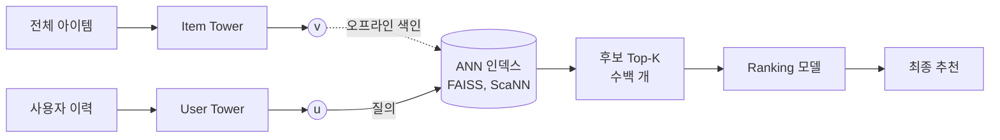
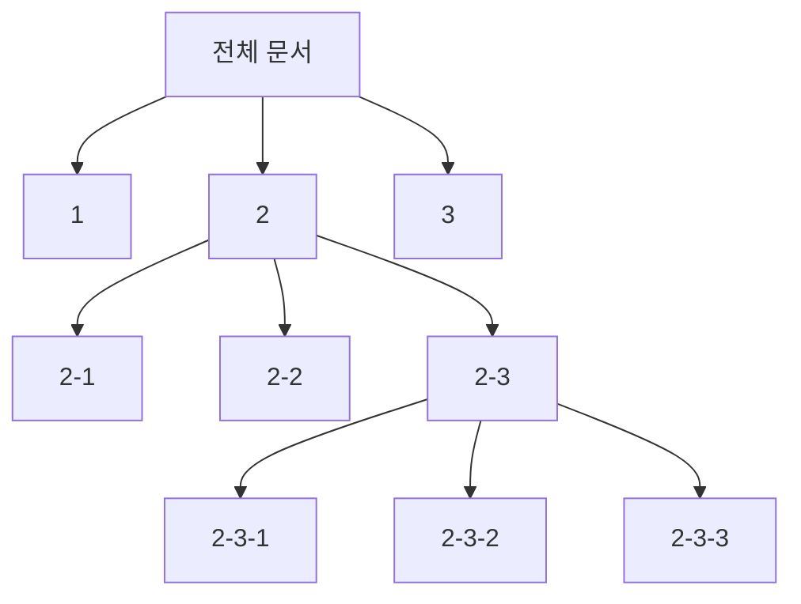
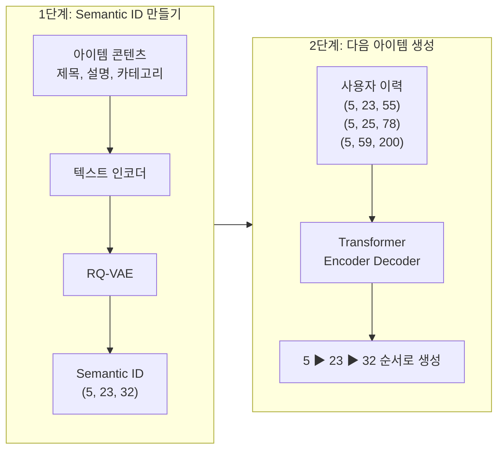
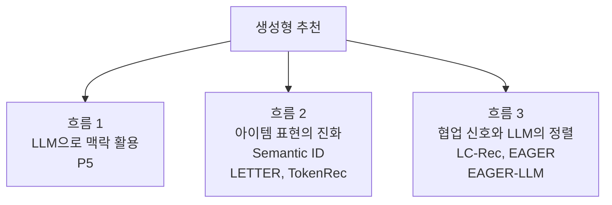

 {: .align-center} 

### _"추천할 아이템을 고르는 대신, 아이템의 이름을 직접 말하게 하면 어떨까?"_

최근 몇 년 사이 추천 시스템 연구에서 가장 큰 흐름 하나를 꼽으라면 **생성형 추천(Generative Recommendation)**입니다. 지금까지의 추천 모델이 "후보 아이템 각각에 점수를 매기고 상위 K개를 고르는" 방식이었다면, 생성형 추천은 언어 모델이 다음 단어를 생성하듯 **다음에 소비할 아이템의 ID를 토큰 단위로 직접 생성**합니다.

이번 글부터 생성형 추천을 주제로 연재를 시작합니다. 아이템을 토큰으로 바꾸는 방법(RQ-VAE, Semantic ID)부터 대표 모델(TIGER, LETTER, TokenRec, LC-Rec, EAGER), 그리고 실제 서빙에서 마주치는 문제까지 순서대로 정리할 예정입니다. 첫 글에서는 "왜 굳이 생성으로 바꾸려 하는가"라는 질문에 답해 보겠습니다.

> 기존 추천 모델의 흐름은 이전 글에서 정리했습니다. 함께 보면 이해가 쉽습니다. 
> [추천 모델](): CF, MF, FM, Wide & Deep 
> [추천 모델 개발 (2) 딥러닝 모델](): Two-Tower, Deep & Cross 
> [그래프 기반 추천 시스템](): NGCF, LightGCN

---

## 1. 지금까지의 추천: 임베딩을 만들고, 가까운 것을 찾는다

현업에서 가장 많이 쓰이는 추천 구조는 크게 두 단계로 나뉩니다.

* **후보 생성(Retrieval):** 수백만, 수억 개 아이템 중에서 수백 개 정도로 후보를 줄입니다.
* **랭킹(Ranking):** 줄어든 후보에 대해 더 무거운 모델로 정밀하게 점수를 매깁니다.

후보 생성 단계의 대표 방식은 Two-Tower 모델입니다. 사용자 타워와 아이템 타워가 각각 벡터를 만들고, 두 벡터의 내적이 큰 아이템을 고릅니다. 아이템이 너무 많아서 모든 아이템과 내적을 계산할 수 없으니, 아이템 벡터를 미리 인덱스에 넣어 두고 **근사 최근접 이웃 탐색(ANN)**으로 내적이 큰 벡터를 빠르게 찾습니다. 이 문제를 MIPS(Maximum Inner Product Search)라고 부릅니다.

이 구조는 빠르고 단순해서 지금도 대부분의 서비스에서 기본값입니다. 그런데 아이템 규모가 커지고, LLM이라는 강력한 도구가 등장하면서 이 구조의 약점이 점점 드러나기 시작했습니다.

---

## 2. 기존 방식이 가진 네 가지 한계

### 2.1 아이템 ID에 의미가 없다

대부분의 추천 모델에서 아이템은 `item_83721` 같은 **임의의 정수 ID**로 표현되고, 모델은 ID마다 임베딩 벡터를 하나씩 학습합니다. 이 ID 자체에는 아무 정보가 없습니다. `item_83721`과 `item_83722`가 비슷한 상품인지, 전혀 다른 상품인지 ID만 보고는 알 수 없습니다.

결국 아이템 사이의 관계는 오직 **상호작용 데이터를 통해서만** 학습됩니다. 같이 클릭된 적이 많으면 가까워지고, 그렇지 않으면 멀어집니다.

 {: .align-center} 

위 그림의 왼쪽처럼 임의 ID는 아이템이 실제로 얼마나 비슷한지와 무관하게 붙습니다. 오른쪽의 Semantic ID는 뒤에서 자세히 다루겠지만, 비슷한 아이템일수록 코드의 앞자리를 공유하도록 만든 ID입니다.

### 2.2 콜드스타트에 취약하다

ID에 의미가 없으니, 상호작용 기록이 없는 새 아이템은 임베딩이 사실상 랜덤 초기값에 머뭅니다. 제목, 카테고리, 설명처럼 아이템이 가진 콘텐츠 정보가 충분해도 ID 임베딩 방식에서는 이를 바로 활용하기 어렵습니다. 콘텐츠 피처를 별도로 넣는 방법도 있지만, 모델 구조가 복잡해지고 ID 임베딩과의 균형을 맞추는 일이 또 하나의 과제가 됩니다.

### 2.3 임베딩 테이블이 아이템 수에 비례해 커진다

아이템이 1억 개면 임베딩 벡터도 1억 개가 필요합니다. 아이템이 매일 추가되고 삭제되는 서비스라면 테이블을 계속 늘리고 관리해야 하고, 한 번도 노출되지 않은 아이템을 위한 자리도 미리 마련해야 합니다(OOV, Out-of-Vocabulary 문제).

### 2.4 인덱스와 모델이 따로 논다

Two-Tower 구조에서 **모델 학습**과 **검색 인덱스 구축**은 별개의 과정입니다. 모델은 내적이 잘 나오도록 학습되지만, 실제 서빙에서는 ANN 인덱스가 근사 탐색을 하면서 일부 정확도를 잃습니다. 인덱스 구조(클러스터 수, 양자화 방식 등)는 모델 학습 목표와 상관없이 따로 튜닝됩니다. 전체 파이프라인이 하나의 목적 함수로 최적화되지 않는다는 뜻입니다.

---

## 3. 검색을 생성으로 바꾸자: Generative Retrieval

### 3.1 DSI: 문서 ID를 직접 생성하는 검색

이 문제를 정보 검색 쪽에서 먼저 다르게 풀어 본 연구가 있습니다. Google의 **DSI(Differentiable Search Index)**입니다(Tay et al., NeurIPS 2022).

기존 검색은 "쿼리와 문서를 각각 벡터로 만들고 가까운 문서를 찾는" 방식이었습니다. DSI는 이 과정을 통째로 Transformer 하나에 맡깁니다. 쿼리를 입력받으면 모델이 **문서 ID 문자열을 직접 생성**합니다. 문서 집합에 대한 지식이 별도 인덱스가 아니라 모델 파라미터 안에 저장되는 셈입니다.

여기서 핵심 아이디어가 하나 더 나옵니다. 문서 ID를 아무 숫자로 붙이면 모델이 외우기 어렵습니다. 그래서 DSI는 문서 임베딩을 계층적으로 클러스터링해서 **비슷한 문서끼리 앞자리가 같은 ID**를 붙였습니다.

`2-3-3`이라는 ID는 "2번 대분류 안의 3번 중분류 안의 3번 문서"라는 의미를 갖습니다. 모델은 ID를 앞에서부터 한 자리씩 생성하면서 점점 범위를 좁혀 가게 됩니다.

### 3.2 TIGER: 같은 아이디어를 추천에

이 아이디어를 추천에 그대로 가져온 것이 **TIGER**입니다(Rajput et al., NeurIPS 2023, *Recommender Systems with Generative Retrieval*). TIGER는 두 단계로 동작합니다.

* **Semantic ID 만들기:** 아이템의 콘텐츠 정보(제목, 설명, 카테고리 등)를 텍스트 인코더로 임베딩하고, 이 임베딩을 **RQ-VAE**로 양자화해서 `(5, 23, 32)` 같은 짧은 코드 튜플로 만듭니다.
* **다음 아이템 생성:** 사용자의 과거 이력을 Semantic ID 시퀀스로 바꿔 Transformer 인코더 디코더에 넣고, **다음 아이템의 Semantic ID를 한 토큰씩 생성**하도록 학습합니다.

Semantic ID에서는 앞자리를 공유할수록 의미가 비슷한 아이템입니다. 그래서 모델이 "이 사용자는 5번 계열의 아이템을 좋아하는구나"를 토큰 수준에서 학습할 수 있고, 처음 보는 아이템이라도 콘텐츠가 비슷하면 비슷한 코드를 받게 되어 콜드스타트에도 유리해집니다.

임베딩 테이블 크기도 크게 줄어듭니다. 코드북 크기 256짜리 3단계 코드를 쓰면 256 x 3 = 768개의 토큰 임베딩만으로 약 1,678만(256³) 개의 조합을 표현할 수 있습니다. 아이템 수에 비례하던 테이블이 코드북 크기에 비례하는 테이블로 바뀌는 것입니다.

 {: .align-center} 

---

## 4. 생성형 추천을 이끄는 세 가지 흐름

TIGER 이후 생성형 추천 연구는 빠르게 늘어났는데, 크게 세 갈래로 정리할 수 있습니다.

### 흐름 1. LLM으로 맥락을 적극 활용하기

추천을 하나의 언어 문제로 보는 시도입니다. P5(Geng et al., RecSys 2022)는 평점 예측, 순차 추천, 설명 생성 같은 여러 추천 과제를 모두 자연어 프롬프트 형태로 바꾸고 하나의 언어 모델로 학습했습니다. 아이템을 점수로 줄 세우는 대신, 모델이 답을 **생성**하도록 바꾼 것입니다.

### 흐름 2. 아이템 표현을 더 정교하게 만들기

아이템을 어떻게 토큰으로 바꿀 것인가의 문제입니다. 랜덤 ID, 제목 텍스트, 클러스터 기반 ID, 그리고 RQ-VAE 기반 Semantic ID까지 다양한 방식이 제안되었고, 최근에는 콘텐츠 정보뿐 아니라 **협업 필터링 신호까지 토큰에 담으려는** 연구(LETTER, TokenRec 등)가 이어지고 있습니다.

### 흐름 3. 협업 신호와 LLM을 정렬하기

LLM은 언어는 잘 알지만 "이 상품을 산 사람이 저 상품도 샀다" 같은 협업 패턴은 모릅니다. 반대로 기존 추천 모델은 협업 패턴은 잘 알지만 언어와 콘텐츠 이해는 약합니다. 이 둘을 **같은 공간에서 맞추려는(Alignment)** 연구가 LC-Rec, EAGER, EAGER-LLM 같은 모델들입니다.

---

## 5. 한눈에 비교하기

| 구분 | 임베딩 기반 검색 (Two-Tower + ANN) | 생성형 추천 (Generative Retrieval) |
|---|---|---|
| 아이템 표현 | 아이템마다 임베딩 벡터 1개 | 공유 코드북의 토큰 조합 (Semantic ID) |
| 추천 방식 | 내적 점수 계산 후 Top-K 탐색 | 다음 아이템 ID를 토큰 단위로 생성 |
| 검색 인덱스 | ANN 인덱스를 따로 구축 | 모델 파라미터 자체가 인덱스 역할 |
| 파라미터 규모 | 아이템 수에 비례 | 코드북 크기에 비례 |
| 콜드스타트 | 상호작용이 없으면 학습 어려움 | 콘텐츠가 비슷하면 비슷한 코드를 받음 |
| LLM 결합 | 별도 구조 설계 필요 | 토큰 단위라 LLM과 자연스럽게 연결 |

---

## 6. 그렇다고 장점만 있는 것은 아니다

생성형 추천이 모든 문제를 해결하는 것은 아닙니다. 오히려 새로운 문제를 가져옵니다.

* **존재하지 않는 아이템을 생성할 수 있습니다.** 토큰을 자유롭게 생성하다 보면 실제로는 없는 코드 조합이 나올 수 있습니다. 추천 시스템에서는 품절, 삭제, 지역 제한 같은 이유로 "있지만 추천하면 안 되는" 아이템도 걸러내야 합니다.
* **추론이 느립니다.** 내적 한 번이면 끝나던 검색이, 토큰을 하나씩 생성하는 자기회귀(Auto-regressive) 디코딩과 빔 서치로 바뀝니다.
* **협업 신호가 약해질 수 있습니다.** Semantic ID를 콘텐츠 임베딩만으로 만들면 "비슷하게 생긴 아이템"은 잘 묶지만 "같이 소비되는 아이템"은 놓칠 수 있습니다.
* **코드북이 제대로 학습되지 않을 수 있습니다.** RQ-VAE를 학습하다 보면 일부 코드만 집중적으로 쓰이고 나머지는 버려지는 코드북 붕괴(Codebook Collapse)가 자주 발생합니다.

첫 번째와 두 번째 문제를 GPU에서 효율적으로 푸는 방법은 이전에 정리한 [STATIC 논문 리뷰]()에서 다뤘고, 나머지 문제들은 연재를 진행하면서 하나씩 살펴보겠습니다.

---

## 7. 결론 및 연재 계획

생성형 추천은 "아이템마다 벡터를 하나씩 두고 가까운 것을 찾는" 구조에서 "아이템을 의미 있는 토큰으로 표현하고 그 토큰을 생성하는" 구조로의 전환입니다. 이 전환의 출발점은 결국 **아이템을 어떻게 토큰으로 바꾸느냐**에 있습니다. 그래서 연재는 토큰화의 기반이 되는 오토인코더와 양자화부터 시작합니다.

| 편 | 주제 |
|---|---|
| 1 | 왜 생성형 추천인가 (이번 글) |
| 2 | 추천 시스템 속 오토인코더: AutoRec, Mult-VAE, 그리고 이산 표현이 필요한 이유 |
| 3 | 벡터 양자화와 VQ-VAE: 코드북 학습, Straight-Through Estimator, 그리고 코드북 붕괴 |
| 4 | RQ-VAE와 Semantic ID: 잔차를 여러 단계로 양자화해 계층적인 아이템 코드 만들기 |
| 5 | 좋은 Semantic ID의 조건: 무엇을 양자화하고, 얼마나 길게 만들고, 어떻게 평가할까 |
| 6 | DSI에서 TIGER까지: 다음 아이템의 ID를 생성하는 모델 |
| 7 | LETTER: 협업 신호를 담는 학습형 토크나이저 |
| 8~9 | TokenRec: MQ-Tokenizer, GNN과 LLM의 결합 |
| 10~11 | LC-Rec: Uniform Semantic Mapping, 언어와 협업 의미의 정렬 |
| 12~13 | EAGER: 행동과 의미의 Two-stream 생성 |
| 14 | EAGER-LLM |
| 15 | 정리: 세대별 생성형 추천 모델 비교 |
| 16 | Constrained Decoding: 없는 아이템을 생성하지 않게 |
| 17 | RQ-VAE를 직접 구현하며 겪은 코드북 붕괴와 해결 |
| 18 | 생성형 추천을 실서비스에서 검증한다는 것 |

다음 글에서는 Semantic ID의 출발점인 오토인코더가 추천 시스템에서 어떻게 쓰여 왔는지부터 정리하겠습니다.

---

## 참고 문헌

* Tay et al., *Transformer Memory as a Differentiable Search Index*, NeurIPS 2022. [arXiv:2202.06991](https://arxiv.org/abs/2202.06991)
* Rajput et al., *Recommender Systems with Generative Retrieval*, NeurIPS 2023. [arXiv:2305.05065](https://arxiv.org/abs/2305.05065)
* Geng et al., *Recommendation as Language Processing (RLP): A Unified Pretrain, Personalized Prompt & Predict Paradigm (P5)*, RecSys 2022. [arXiv:2203.13366](https://arxiv.org/abs/2203.13366)
* Zheng et al., *Adapting Large Language Models by Integrating Collaborative Semantics for Recommendation* (LC-Rec). [arXiv:2311.09049](https://arxiv.org/abs/2311.09049)
* Wang et al., *Learnable Item Tokenization for Generative Recommendation* (LETTER). [arXiv:2405.07314](https://arxiv.org/abs/2405.07314)
