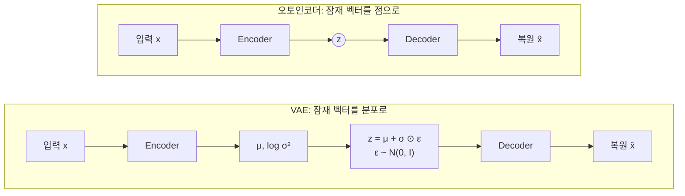
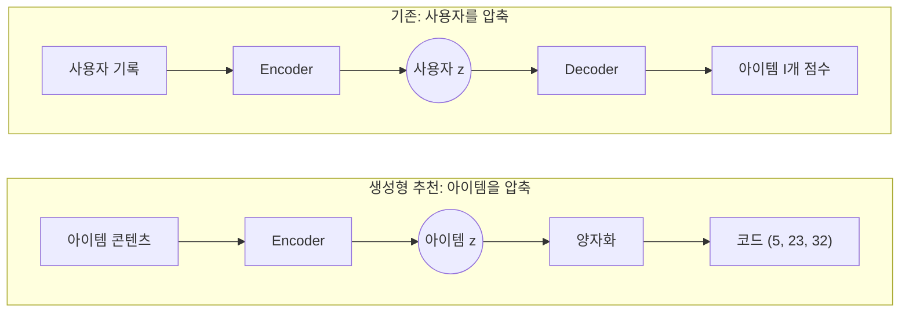

<br>{: .align-center}<br>

### _"오토인코더는 생성형 추천 이전부터 이미 추천 모델이었다"_

[지난 글]()에서 생성형 추천의 출발점은 **아이템을 의미 있는 토큰으로 바꾸는 것**이라고 정리했습니다. 그 토큰, 즉 Semantic ID를 만드는 도구가 RQ-VAE이고, RQ-VAE는 이름 그대로 오토인코더(AE)와 VAE의 연장선에 있습니다.

그런데 오토인코더는 생성형 추천에서 처음 쓰인 것이 아닙니다. 2015년 AutoRec, 2018년 Mult-VAE처럼 **사용자의 상호작용을 압축했다가 복원하는 방식**으로 이미 협업 필터링 모델로 쓰여 왔습니다. 이번 글에서는 추천 시스템에서 오토인코더가 어떻게 쓰였는지 살펴보고, 그 연속적인 잠재 공간이 왜 아이템 토큰으로는 부족한지, 그래서 왜 **이산 표현(Discrete Representation)**이 필요한지까지 이어서 정리합니다.

> 오토인코더와 VAE의 기본 원리(재구성 손실, ELBO, Reparameterization Trick, PyTorch 구현)는 이전 글에서 자세히 다뤘습니다. 이 글은 그 내용을 안다고 가정하고 추천의 관점에서 이야기합니다.<br>
> [VAE : Encoder, Auto Encoder 그리고 Variational Auto Encoder]()

---

## 1. 짧은 복습: AE와 VAE의 차이

두 모델의 차이를 한 줄로 줄이면 **잠재 벡터를 점으로 두느냐, 분포로 두느냐**입니다.



* **AE**는 재구성 손실만 최소화하므로, 잠재 공간이 어떤 모양이 되든 상관하지 않습니다.
* **VAE**는 재구성 손실에 KL 항을 더해 잠재 분포를 표준 정규분포 $\mathcal{N}(0, I)$ 쪽으로 끌어당깁니다.

$$
\mathcal{L}_{VAE} = \underbrace{\mathbb{E}_{q_\phi(z|x)}\left[-\log p_\theta(x|z)\right]}_{\text{재구성}} + \underbrace{D_{KL}\left(q_\phi(z|x)\,\|\,\mathcal{N}(0, I)\right)}_{\text{규제}}
$$

이 차이가 실제로 어떤 모양을 만드는지 직접 확인해 봤습니다. 8x8 손글씨 숫자 1,797장을 같은 MLP 구조(64, 128, 2, 128, 64)로 AE와 VAE에 각각 학습시키고, 2차원 잠재 공간을 그대로 그렸습니다.

<br>{: .align-center}<br>

AE의 잠재 공간은 좌표 범위가 수십 단위로 넓게 퍼지고, 숫자마다 가늘고 긴 가지 모양으로 뻗어 나갑니다. 반면 VAE는 KL 항 때문에 원점 근처 좁은 범위에 모입니다. 이 차이는 "아무 점이나 골라서 디코딩"할 때 확실히 드러납니다.

<br>{: .align-center}<br>

같은 $z \sim \mathcal{N}(0, I)$ 16개를 두 디코더에 넣었습니다. AE는 원점 주변이 학습 데이터가 거의 없는 영역이라 숫자 몇 개가 뭉개진 비슷한 그림만 반복합니다. VAE는 0, 1, 2, 6, 9처럼 다양한 숫자를 만들어 냅니다. 잠재 공간이 **연속적이고 빈틈이 없도록** 규제한 효과입니다.

---

## 2. 추천을 복원 문제로 보기

오토인코더가 추천에 쓰일 수 있는 이유는 단순합니다. 사용자와 아이템의 상호작용 행렬은 대부분이 비어 있는 **희소 행렬**이고, 추천은 결국 **빈칸을 채우는 문제**이기 때문입니다.

<br>{: .align-center}<br>

사용자 한 명의 상호작용 기록(행 하나)을 입력으로 넣고, 좁은 병목을 통과시킨 뒤 다시 전체 아이템에 대한 점수로 복원하게 학습합니다. 병목 때문에 모델은 행을 그대로 외울 수 없고, **비슷한 사용자들이 공유하는 패턴**을 압축해서 배워야 합니다. 학습이 끝나면 원래 빈칸이었던 자리(오른쪽 그림의 굵은 숫자)에도 점수가 채워지고, 이 점수가 높은 아이템을 추천합니다.

행렬 분해(MF)도 같은 빈칸 채우기 문제를 풀지만, 사용자와 아이템을 같은 잠재 공간에 놓고 **내적(선형)**으로 점수를 계산합니다. 오토인코더는 활성화 함수를 거치는 **비선형** 변환으로 복원한다는 점이 다릅니다.

---

## 3. AutoRec: 오토인코더로 평점 복원하기

**AutoRec**(Sedhain et al., WWW 2015)은 오토인코더를 협업 필터링에 적용한 초기 모델입니다. 구조는 은닉층 하나짜리 오토인코더 그대로입니다.

$$
h(\mathbf{r}; \theta) = f\left(W \cdot g(V\mathbf{r} + \mu) + b\right)
$$

여기서 $\mathbf{r}$은 평점 벡터, $g$와 $f$는 활성화 함수, $V$와 $W$는 인코더와 디코더의 가중치입니다.

### 3.1 I-AutoRec과 U-AutoRec

입력 벡터를 무엇으로 잡느냐에 따라 두 가지 변형이 있습니다.

* **I-AutoRec (Item-based):** 아이템 하나에 대한 **모든 사용자의 평점**(열 벡터)을 입력으로 씁니다.
* **U-AutoRec (User-based):** 사용자 한 명이 매긴 **모든 아이템의 평점**(행 벡터)을 입력으로 씁니다.


### 3.2 관측된 값만 손실에 넣는다

AutoRec에서 중요한 디테일은 손실 함수입니다. 비어 있는 칸을 0으로 보고 복원하게 하면 "평가하지 않음"을 "싫어함"으로 학습해 버립니다. 그래서 **관측된 평점만** 손실 계산에 포함합니다.

$$
\min_\theta \sum_{i=1}^{n} \left\| \mathbf{r}^{(i)} - h(\mathbf{r}^{(i)}; \theta) \right\|_{\mathcal{O}}^2 + \frac{\lambda}{2}\left(\|W\|_F^2 + \|V\|_F^2\right)
$$

$\|\cdot\|_{\mathcal{O}}^2$는 관측된 항목만 더한다는 뜻이고, 뒤쪽은 과적합을 막는 L2 규제입니다.

### 3.3 결과: 아이템 기반이 더 잘 맞았다

MovieLens 1M에서 I-AutoRec의 RMSE는 0.831, U-AutoRec은 0.874로 아이템 기반이 더 좋았습니다. 논문은 그 이유를 **아이템당 평점 수가 사용자당 평점 수보다 훨씬 많기 때문**이라고 설명합니다. 사용자는 평가한 아이템 수의 편차가 커서, 사용자 벡터 기반 복원이 불안정해진다는 것입니다. I-AutoRec은 같은 조건에서 행렬 분해(BiasedMF)나 RBM 기반 CF보다도 좋은 결과를 보였습니다.

---

## 4. Mult-VAE: VAE를 Top-N 추천에 맞게 바꾸기

AutoRec이 명시적 평점(1~5점)을 복원했다면, **Mult-VAE**(Liang et al., WWW 2018, *Variational Autoencoders for Collaborative Filtering*)는 클릭, 시청 같은 **암묵적 피드백**에서 Top-N 추천을 하기 위해 VAE를 다듬은 모델입니다. 지금도 협업 필터링의 강한 베이스라인으로 자주 쓰입니다.


### 4.1 다항 분포 가능도(Multinomial Likelihood)

Mult-VAE의 이름이 된 핵심 변경점입니다. 사용자 $u$의 클릭 벡터 $x_u$를 다음과 같이 생성된다고 봅니다.

$$
z_u \sim \mathcal{N}(0, I), \qquad \pi(z_u) = \mathrm{softmax}\left(f_\theta(z_u)\right), \qquad x_u \sim \mathrm{Mult}\left(N_u, \pi(z_u)\right)
$$

따라서 로그 가능도는 다음과 같습니다.

$$
\log p_\theta(x_u | z_u) = \sum_{i} x_{ui} \log \pi_i(z_u)
$$

softmax로 확률을 만들면 전체 아이템이 **확률 질량 1을 나눠 가져야** 합니다. 한 아이템의 확률을 올리면 다른 아이템의 확률은 내려갑니다. 이 경쟁 구조가 "상위 몇 개를 고르는" Top-N 랭킹과 성격이 비슷하기 때문에, 논문은 다항 분포가 가우시안이나 로지스틱 가능도보다 랭킹 지표에 더 잘 맞는다고 설명합니다. 실제로 ML-20M에서 다항 분포가 두 가능도보다 좋았지만, 로지스틱과의 차이는 크지 않았고 **어떤 가능도가 가장 좋은지는 데이터에 따라 다르다**는 점도 함께 밝히고 있습니다.

### 4.2 KL 항을 약하게: β 어닐링

일반 VAE 손실을 그대로 쓰면 KL 항이 잠재 벡터를 지나치게 $\mathcal{N}(0, I)$ 쪽으로 눌러서 추천 성능이 떨어집니다. 그래서 KL 항 앞에 가중치 $\beta$를 붙입니다.

$$
\mathcal{L}_\beta = \mathbb{E}_{q_\phi(z_u|x_u)}\left[\log p_\theta(x_u|z_u)\right] - \beta \cdot D_{KL}\left(q_\phi(z_u|x_u)\,\|\,p(z_u)\right)
$$

$\beta$는 다음과 같이 정합니다.

* **어닐링으로 탐색:** $\beta = 0$에서 시작해 20만 번의 업데이트 동안 선형으로 1까지 올리면서, 검증 성능이 가장 높은 지점을 찾습니다.
* **재학습:** 같은 스케줄로 다시 학습하되, 찾은 $\beta$ 값에서 증가를 멈춥니다.

$\beta < 1$이면 엄밀한 의미의 ELBO는 아니게 되지만, 논문은 이를 **부분 규제(Partial Regularization)**라 부르고 오히려 추천 성능이 좋아진다는 것을 보였습니다. 생성 모델로서의 정확성보다 **랭킹 성능**을 택한 셈입니다.

### 4.3 평가 방식: 처음 보는 사용자

Mult-VAE는 학습에 쓰지 않은 사용자로 평가하는 **강한 일반화(Strong Generalization)** 설정을 씁니다. 평가용 사용자의 기록 중 80%를 입력으로 넣고, 나머지 20%를 얼마나 맞히는지 Recall@20, Recall@50, NDCG@100으로 측정합니다. 사용자마다 임베딩을 따로 학습하는 MF와 달리, 인코더가 **기록만 있으면 바로 사용자 표현을 만들 수 있기** 때문에 가능한 평가입니다.

---

## 5. 그런데 출력층을 보면

AutoRec과 Mult-VAE는 모두 좋은 모델이지만, 구조를 다시 보면 [지난 글]()에서 정리한 한계가 그대로 남아 있습니다.

* **출력층이 아이템 수만큼 큽니다.** Mult-VAE의 디코더 마지막 층은 600 x I 행렬입니다. 아이템이 1억 개라면 이 층 하나가 600억 개의 파라미터를 가집니다. 결국 아이템마다 벡터를 하나씩 두는 ID 임베딩 테이블과 같은 구조입니다.
* **새 아이템을 넣으려면 출력층을 바꿔야 합니다.** 출력 차원이 곧 아이템 목록이기 때문에, 아이템이 추가될 때마다 모델 구조가 바뀝니다.
* **잠재 벡터가 표현하는 대상이 사용자입니다.** 압축되는 것은 사용자의 취향이고, 아이템은 여전히 의미 없는 출력 차원의 번호일 뿐입니다.

생성형 추천은 이 관계를 뒤집습니다. **아이템을 압축해서** 짧은 코드로 만들고, 모델은 아이템 수가 아니라 **코드북 크기만큼의 어휘** 안에서 다음 코드를 생성합니다. 오토인코더를 쓰는 대상이 사용자에서 아이템으로 바뀌는 것입니다.



---

## 6. 왜 연속 벡터가 아니라 이산 코드인가

그렇다면 VAE로 아이템을 압축한 연속 벡터 $z$를 그대로 아이템 ID로 쓰면 안 될까요? 생성형 추천의 관점에서는 세 가지 이유로 어렵습니다.

### 6.1 생성하려면 유한한 어휘가 필요하다

Transformer 디코더는 매 단계 **정해진 어휘 중 하나를 고르는** softmax로 토큰을 생성합니다. 연속 벡터는 가능한 값이 무한하기 때문에 이 방식으로 생성할 수 없습니다. 연속 값을 직접 회귀로 출력할 수는 있지만, 그러면 언어 모델의 생성 방식과 빔 서치를 그대로 쓸 수 없습니다.

### 6.2 "같은 아이템"을 판정할 기준이 없다

모델이 $z = (0.31, -1.24)$를 출력했고 가장 가까운 아이템이 $(0.30, -1.22)$에 있다면, 이것은 그 아이템을 맞힌 걸까요? 결국 가장 가까운 아이템을 찾는 탐색이 다시 필요해지고, 이는 지난 글에서 벗어나려 했던 ANN 검색으로 되돌아가는 것입니다. 이산 코드는 **정확히 일치하느냐**로 판정이 끝납니다.

### 6.3 공유되는 단위가 있어야 일반화된다

이산 코드는 여러 아이템이 같은 코드를 공유합니다. 덕분에 모델은 "코드 5로 시작하는 아이템"이라는 묶음 단위로 패턴을 배울 수 있고, 처음 보는 아이템도 이미 아는 코드 조합으로 표현됩니다. 연속 벡터는 모든 아이템이 서로 다른 값을 가지므로 이런 공유 단위가 없습니다.

### 6.4 연속 공간을 칸으로 나누면

가장 단순한 방법은 학습이 끝난 연속 잠재 공간을 몇 개의 칸으로 나누는 것입니다. 앞에서 학습한 VAE의 잠재 벡터에 k-means를 적용해 16개 칸으로 나눠 봤습니다.

<br>{: .align-center}<br>

각 점은 이제 자신이 속한 칸의 번호, 즉 0부터 15까지의 **코드 하나**로 표현됩니다. 오른쪽은 각 코드에 속한 이미지의 평균인데, 코드 5는 0, 코드 6은 6, 코드 3은 2처럼 대부분의 코드가 하나의 숫자를 대표합니다. 반면 코드 1이나 코드 14처럼 여러 숫자가 섞여 흐릿한 코드도 있습니다.

이 방식에는 분명한 한계가 있습니다.

* **양자화가 학습과 따로 놉니다.** VAE는 칸으로 나뉠 것을 모른 채 학습되었고, k-means는 복원 품질을 모른 채 칸을 나눴습니다. 그래서 코드 1처럼 서로 다른 숫자가 한 칸에 섞입니다.
* **16개 칸은 너무 거칩니다.** 칸을 늘리면 구분은 좋아지지만, 아이템 수만큼 칸을 늘리면 다시 ID 테이블과 같아집니다.

첫 번째 문제는 **양자화를 학습 안으로 넣어서** 해결합니다. 이것이 다음 글의 VQ-VAE입니다. 두 번째 문제는 **칸을 여러 단계로 겹쳐서** 해결하는데, 이것이 그다음 글의 RQ-VAE입니다.

---

## 7. 부록: Mult-VAE 핵심 코드

AE와 VAE의 전체 구현은 [이전 VAE 글]()에 있으니, 여기서는 Mult-VAE가 일반 VAE와 **달라지는 부분**만 PyTorch로 정리합니다.

### Point 1. 입력 정규화와 Dropout

사용자마다 클릭 수가 크게 다르므로 입력을 L2 정규화하고, 일부 클릭을 지운 상태에서 전체를 복원하도록 Dropout을 겁니다.

```python
import torch
import torch.nn as nn
import torch.nn.functional as F

class MultVAE(nn.Module):
    def __init__(self, n_items, hidden=600, latent=200, dropout=0.5):
        super().__init__()
        self.drop = nn.Dropout(dropout)
        self.enc = nn.Linear(n_items, hidden)
        self.mu = nn.Linear(hidden, latent)
        self.logvar = nn.Linear(hidden, latent)
        self.dec = nn.Sequential(nn.Linear(latent, hidden), nn.Tanh(),
                                 nn.Linear(hidden, n_items))  # 출력층이 아이템 수만큼 커진다

    def forward(self, x):
        h = self.drop(F.normalize(x, dim=1))      # 입력 정규화 후 Dropout
        h = torch.tanh(self.enc(h))
        mu, logvar = self.mu(h), self.logvar(h)
        z = mu + torch.randn_like(mu) * torch.exp(0.5 * logvar) if self.training else mu
        return self.dec(z), mu, logvar
```

### Point 2. 다항 분포 로그 가능도

복원 손실을 BCE나 MSE가 아니라 **log softmax와 클릭 벡터의 곱**으로 계산합니다.

```python
def mult_vae_loss(logits, x, mu, logvar, beta):
    # 다항 분포 로그 가능도: sum_i x_ui * log softmax(logits)_i
    nll = -(F.log_softmax(logits, dim=1) * x).sum(dim=1).mean()
    kl = (-0.5 * (1 + logvar - mu.pow(2) - logvar.exp()).sum(dim=1)).mean()
    return nll + beta * kl
```

### Point 3. β 어닐링

$\beta$를 0에서 시작해 업데이트마다 조금씩 올리고, 상한 `beta_cap`에서 멈춥니다. 처음 탐색할 때는 상한을 1로 두고 검증 성능이 가장 좋은 $\beta$를 찾은 뒤, 그 값을 상한으로 다시 학습합니다.

```python
total_anneal_steps, beta_cap = 200_000, 1.0
step = 0
for x in loader:
    beta = min(beta_cap, step / total_anneal_steps)
    logits, mu, logvar = model(x)
    loss = mult_vae_loss(logits, x, mu, logvar, beta)
    optimizer.zero_grad(); loss.backward(); optimizer.step()
    step += 1
```

---

## 8. 결론 및 다음 글

정리하면 다음과 같습니다.

* 추천은 희소한 상호작용 행렬의 **빈칸을 채우는 복원 문제**로 볼 수 있고, 오토인코더는 이 문제에 자연스럽게 맞습니다.
* **AutoRec**은 관측된 평점만으로 복원 손실을 계산했고, 아이템 기반 입력이 더 안정적이었습니다.
* **Mult-VAE**는 다항 분포 가능도와 β 어닐링으로 VAE를 Top-N 랭킹에 맞게 바꿨습니다.
* 하지만 두 모델 모두 **사용자를 압축하고 아이템 수만큼의 출력**을 내기 때문에, 아이템 규모 문제가 그대로 남습니다.
* 생성형 추천은 **아이템을 압축**하고, 그 결과를 생성 가능한 **이산 코드**로 바꿔야 합니다. 연속 공간을 사후에 나누는 방식은 학습과 분리되어 있다는 한계가 있습니다.

다음 글에서는 양자화를 학습 과정 안으로 넣은 **VQ-VAE**를 다룹니다. 코드북을 어떻게 학습하는지, 미분이 불가능한 "가장 가까운 코드 고르기"를 어떻게 역전파하는지, 그리고 생성형 추천에서 골칫거리가 되는 코드북 붕괴가 왜 생기는지를 정리하겠습니다.

---

## 참고 문헌

* Sedhain et al., *AutoRec: Autoencoders Meet Collaborative Filtering*, WWW 2015. [Webis IR Anthology](https://ir.webis.de/anthology/2015.wwwconf_conference-2015c.55)
* Liang et al., *Variational Autoencoders for Collaborative Filtering*, WWW 2018. [arXiv:1802.05814](https://arxiv.org/abs/1802.05814)
* Kingma and Welling, *Auto-Encoding Variational Bayes*, ICLR 2014. [arXiv:1312.6114](https://arxiv.org/abs/1312.6114)
* van den Oord et al., *Neural Discrete Representation Learning* (VQ-VAE), NeurIPS 2017. [arXiv:1711.00937](https://arxiv.org/abs/1711.00937)
