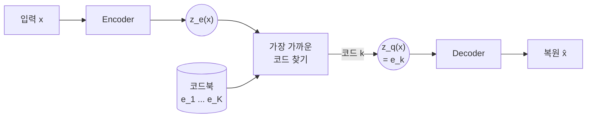
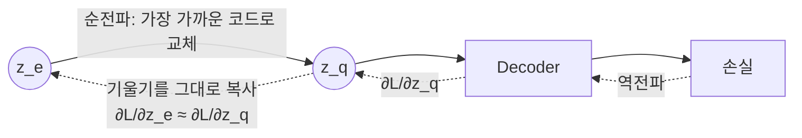
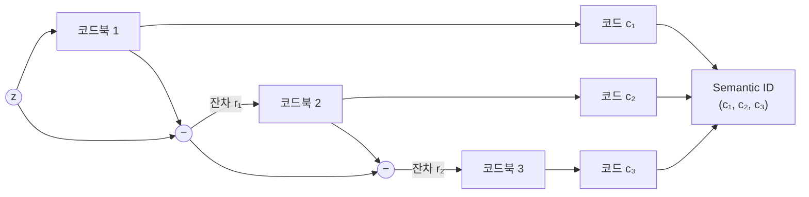

<br>{: .align-center}<br>

### _"가장 가까운 코드를 고르는 순간, 미분이 멈춘다"_

[지난 글]()의 마지막에서 VAE로 학습한 연속 잠재 공간을 k-means로 16개 칸으로 나눠 봤습니다. 각 점이 0부터 15까지의 코드 하나로 표현되면서 연속 벡터가 이산 코드로 바뀌었지만, VAE는 칸으로 나뉠 것을 모른 채 학습되었고 k-means는 복원 품질을 모른 채 칸을 나눴다는 한계가 있었습니다.

이번 글의 주인공 **VQ-VAE**(van den Oord et al., NeurIPS 2017)는 이 양자화 과정을 학습 안으로 넣은 모델입니다. 코드북을 신경망과 함께 학습하고, 미분이 불가능한 "가장 가까운 코드 고르기"를 우회해서 역전파합니다. 생성형 추천의 Semantic ID를 만드는 RQ-VAE는 이 VQ-VAE를 여러 단계로 쌓은 구조이기 때문에, VQ-VAE를 이해하면 RQ-VAE의 절반은 이해한 셈입니다.

이번 글은 이론만 정리하지 않고 2편처럼 직접 학습해서 확인합니다. 결과를 미리 말하면, **양자화를 학습에 넣는다고 저절로 좋아지지는 않았고, 코드북을 어떻게 관리하느냐가 결과를 좌우했습니다.**

---

## 1. 벡터 양자화(Vector Quantization)

벡터 양자화는 연속적인 벡터를 **미리 정해 둔 유한한 대표 벡터 중 하나로 바꾸는** 연산입니다. 대표 벡터들의 모음을 **코드북(Codebook)**이라고 부릅니다.

$$
\mathcal{E} = \{ e_1, e_2, \dots, e_K \}, \qquad e_k \in \mathbb{R}^D
$$

입력 벡터 $z$가 들어오면, 코드북에서 가장 가까운 벡터를 찾아 그 **인덱스**를 코드로 씁니다.

$$
k^* = \arg\min_{j} \| z - e_j \|_2, \qquad q(z) = e_{k^*}
$$

이제 $D$차원 실수 벡터 대신 $0$부터 $K-1$까지의 정수 하나만 저장하면 됩니다. 코드 하나는 $\log_2 K$비트의 정보를 담습니다. $K = 256$이면 8비트, 즉 1바이트입니다.

사실 2편에서 사용한 k-means가 바로 벡터 양자화입니다. k-means의 중심점들이 코드북이고, 각 점을 가장 가까운 중심점에 배정하는 것이 양자화입니다. 차이는 **코드북을 언제, 무엇을 기준으로 정하느냐**에 있습니다.

| 구분 | 사후 k-means | VQ-VAE |
|---|---|---|
| 코드북을 정하는 시점 | 오토인코더 학습이 끝난 뒤 | 오토인코더와 함께 |
| 코드북의 기준 | 잠재 벡터 사이의 거리 | 거리 + 복원 품질 |
| 디코더가 보는 입력 | 연속 벡터로 학습, 코드로 사용 | 처음부터 코드로 학습 |

---

## 2. VQ-VAE의 구조

VQ-VAE는 오토인코더의 병목에 양자화를 끼워 넣은 구조입니다.



* **Encoder:** 입력을 연속 벡터 $z_e(x)$로 바꿉니다.
* **양자화:** $z_e(x)$와 가장 가까운 코드 벡터 $e_k$를 찾아 $z_q(x) = e_k$로 바꿉니다.
* **Decoder:** 연속 벡터가 아니라 **코드 벡터 $z_q(x)$만 보고** 입력을 복원합니다.

VAE와 비교하면 사후 분포가 크게 단순해집니다. VQ-VAE의 사후 분포 $q(z|x)$는 가장 가까운 코드에 확률 1을 주는 **원-핫 분포**입니다.

$$
q(z = k \mid x) =
\begin{cases}
1 & \text{if } k = \arg\min_j \| z_e(x) - e_j \|_2 \\
0 & \text{otherwise}
\end{cases}
$$

사전 분포를 $K$개 코드에 대한 균등 분포로 두면 KL 항은 항상 $\log K$라는 상수가 됩니다. 인코더 파라미터와 상관없는 값이므로 학습에서 무시할 수 있고, 2편의 VAE에서 신경 써야 했던 KL 항과 $\beta$ 조절이 사라집니다.

원 논문은 ImageNet의 128x128x3 이미지를 $K = 512$인 코드북의 32x32 코드 격자로 압축했습니다. 이미지 한 장이 1,024개의 정수로 표현되는 셈입니다.

---

## 3. 미분이 멈추는 문제와 Straight-Through Estimator

여기서 문제가 생깁니다. **$\arg\min$은 미분할 수 없습니다.** $z_e(x)$를 조금 움직여도 가장 가까운 코드가 바뀌기 전까지는 출력이 전혀 변하지 않고, 바뀌는 순간에는 출력이 불연속적으로 점프합니다. 기울기가 거의 모든 곳에서 0이라 디코더에서 내려온 기울기가 인코더까지 전달되지 않습니다.

VQ-VAE는 이를 **Straight-Through Estimator(STE)**로 우회합니다. 아이디어는 단순합니다. 순전파에서는 양자화를 그대로 하고, 역전파에서는 **양자화가 없었던 것처럼** 디코더 입력의 기울기를 인코더 출력으로 그대로 복사합니다.



구현에서는 정지 기울기(stop-gradient) 연산 $\text{sg}[\cdot]$ 하나로 표현합니다.

$$
z_q = z_e + \text{sg}\left[ e_k - z_e \right]
$$

순전파 값은 $z_e + (e_k - z_e) = e_k$로 양자화 결과와 같습니다. 역전파에서는 $\text{sg}[\cdot]$ 안쪽의 기울기가 0이 되므로 $\partial z_q / \partial z_e = I$가 됩니다. PyTorch로는 `z_q = z_e + (z_q - z_e).detach()` 한 줄입니다. STE 자체는 확률적 뉴런의 기울기를 근사하는 방법으로 Bengio et al.(2013)에서 정리된 기법입니다.

이 근사가 통하는 이유는 $z_e$와 $z_q$가 충분히 가깝다면, 디코더 입장에서 "$z_q$를 이쪽으로 옮기면 손실이 줄어든다"는 신호가 $z_e$에도 대체로 맞기 때문입니다. 그래서 **$z_e$와 코드를 가깝게 유지하는 장치**가 필요한데, 그것이 다음에 볼 손실 함수의 나머지 두 항입니다.

---

## 4. 손실 함수: 세 개의 항

STE로 인코더와 디코더는 학습할 수 있게 되었지만, 정작 **코드북**은 어떤 기울기도 받지 못합니다. $z_q$의 기울기가 그대로 $z_e$로 넘어가 버리기 때문입니다. 그래서 VQ-VAE는 손실에 두 항을 더합니다.

$$
\mathcal{L} = \underbrace{-\log p\left(x \mid z_q(x)\right)}_{\text{복원}} + \underbrace{\left\| \text{sg}[z_e(x)] - e \right\|_2^2}_{\text{코드북}} + \underbrace{\beta \left\| z_e(x) - \text{sg}[e] \right\|_2^2}_{\text{커밋먼트}}
$$

| 항 | 학습되는 대상 | 역할 |
|---|---|---|
| 복원 | 인코더(STE를 통해), 디코더 | 입력을 잘 복원하도록 |
| 코드북 | 코드북 | 선택된 코드를 인코더 출력 쪽으로 끌어당김 |
| 커밋먼트 | 인코더 | 인코더 출력이 고른 코드에서 너무 멀어지지 않게 붙잡음 |

정지 기울기 위치가 핵심입니다. 코드북 항은 $z_e$를 고정한 채 **코드만** 움직이고, 커밋먼트 항은 코드를 고정한 채 **인코더만** 움직입니다. 커밋먼트 항이 없으면 코드북이 인코더 출력을 따라잡는 속도보다 인코더 출력이 더 빨리 커져서 둘이 계속 멀어질 수 있습니다. 논문은 모든 실험에서 $\beta = 0.25$를 썼고, 0.1부터 2.0 사이에서는 결과가 크게 달라지지 않았다고 보고했습니다.

### EMA로 코드북 갱신하기

논문 부록에는 코드북 항 대신 **지수 이동 평균(EMA)**으로 코드북을 갱신하는 방법도 소개되어 있습니다. 각 코드에 배정된 인코더 출력의 평균을 천천히 따라가게 만드는 방식으로, k-means의 중심점 갱신을 미니배치 단위로 부드럽게 하는 것과 같습니다.

$$
N_i^{(t)} = \gamma N_i^{(t-1)} + (1 - \gamma)\, n_i^{(t)}, \qquad
m_i^{(t)} = \gamma m_i^{(t-1)} + (1 - \gamma) \sum_j z_{i,j}^{(t)}, \qquad
e_i^{(t)} = \frac{m_i^{(t)}}{N_i^{(t)}}
$$

$n_i$는 이번 배치에서 코드 $i$에 배정된 벡터 수, $z_{i,j}$는 그 벡터들이고, 논문은 $\gamma = 0.99$가 잘 동작했다고 적었습니다. 원 논문 실험 자체는 이 방식을 쓰지 않았지만, 이후 SoundStream 같은 많은 후속 연구가 EMA 갱신을 기본으로 채택했습니다.

---

## 5. 직접 학습해 보기

2편과 같은 8x8 손글씨 숫자 데이터로 VQ-VAE를 직접 학습했습니다. 이번에는 학습 1,500장, 테스트 297장으로 나누고, 모든 수치는 **테스트 이미지의 복원 오차**(이미지당 BCE, 낮을수록 좋음)로 비교했습니다. 결과가 우연이 아닌지 보려고 시드 3개로 반복했습니다. 실험은 numpy와 autograd로 작성했고, 인코더와 디코더는 2편과 같은 은닉층 128의 MLP입니다.

비교한 방법은 다음과 같습니다.

* **사후 k-means:** VAE를 학습한 뒤 잠재 벡터에 k-means를 적용하고, 각 이미지를 소속 중심점으로 복원 (2편의 방식)
* **VQ-VAE (정규분포 초기화):** 코드북을 $\mathcal{N}(0, 1)$로 초기화
* **VQ-VAE (작은 균등분포 초기화):** 코드북을 $U(-1/K, 1/K)$로 초기화. 공개 구현에서 흔히 쓰는 방식
* **VQ-VAE (작은 균등분포 + 죽은 코드 재초기화):** 20스텝 동안 한 번도 선택되지 않은 코드를 현재 배치의 인코더 출력으로 교체

### 5.1 학습된 코드북의 모습

먼저 2편과 똑같이 2차원 잠재 공간, 코드 16개로 학습한 VQ-VAE의 모습입니다.

<br>{: .align-center}<br>

인코더 출력이 16개 코드 주변으로 모였고, 오른쪽처럼 각 코드 벡터를 디코딩하면 코드 7은 0, 코드 14는 6, 코드 11은 2처럼 숫자 하나를 대표하는 이미지가 나옵니다. 2편의 사후 k-means 그림과 겉보기에는 비슷합니다. 실제로 수치를 비교하면 어떨까요?

### 5.2 결과: 학습한다고 저절로 좋아지지는 않았다

<br>{: .align-center}<br>

솔직히 처음 예상과 다른 결과가 나왔습니다.

* **2차원, 코드 16개:** 사후 k-means(21.6)가 모든 VQ-VAE 변형(22.2~22.7)보다 복원 오차가 낮았습니다. 코드가 숫자를 얼마나 깔끔하게 나누는지 보는 순도(각 코드에서 가장 많은 숫자가 차지하는 비율)도 사후 k-means가 0.73~0.77, VQ-VAE가 0.61~0.70으로 더 높았습니다.
* **8차원, 코드 64개:** 죽은 코드를 재초기화한 VQ-VAE(19.5)가 사후 k-means(19.7)를 약간 앞섰습니다. 차이는 크지 않지만 시드 3개 모두에서 같은 방향이었습니다.
* **같은 VQ-VAE라도 초기화에 따라 결과가 크게 달랐습니다.** 8차원 설정에서 작은 균등분포로 초기화한 VQ-VAE는 21.8로, 비교한 방법 중 가장 나빴습니다.

2편에서 "양자화를 학습 안으로 넣어서 해결한다"고 썼지만, 적어도 이 작은 실험에서는 **양자화를 학습에 넣는 것만으로는 사후 k-means를 확실히 이기지 못했습니다.** 코드 16개처럼 표현력이 극단적으로 작은 설정에서는 결국 "16개의 대표 이미지를 잘 고르는 문제"가 되고, 이 문제는 이미 잘 학습된 잠재 공간 위의 k-means가 꽤 잘 풉니다. 반면 코드 수와 잠재 차원이 커지면 VQ-VAE가 앞서기 시작했는데, 그 조건은 **코드북이 제대로 쓰일 때**였습니다.

그렇다면 8차원에서 가장 나빴던 작은 균등분포 초기화에는 무슨 일이 있었을까요?

---

## 6. 코드북 붕괴(Codebook Collapse)

**코드북 붕괴**는 코드북의 일부 코드만 계속 선택되고, 나머지 코드는 한 번도 선택되지 않은 채 버려지는 현상입니다. 버려진 코드를 흔히 **죽은 코드(Dead Code)**라고 부릅니다.

<br>{: .align-center}<br>

왼쪽 그래프에서 작은 균등분포로 초기화한 VQ-VAE(빨간색)는 학습이 끝날 때까지 **64개 코드 중 13개만** 사용했습니다. 시드 3개 모두 12~13개였습니다. 오른쪽 그래프를 보면 소수의 코드에 이미지가 몰려 있고, 코드 하나가 전체의 16% 이상을 차지하기도 합니다. 정규분포로 초기화한 경우도 43~46개 정도만 쓰였습니다. 반면 죽은 코드를 재초기화한 경우(초록색)는 학습 초반 몇 에폭 만에 64개를 거의 다 쓰기 시작했고, 끝까지 64개를 모두 사용했습니다.

<br>{: .align-center}<br>

복원 결과에서도 차이가 보입니다. 테스트 이미지 앞 12장을 그대로 가져왔는데, 붕괴된 VQ-VAE는 표현할 수 있는 코드가 13개뿐이라 세 번째 9와 여섯 번째 3을 비슷한 모양으로 뭉개고, 열한 번째 7은 9처럼 복원했습니다. 재초기화한 쪽도 첫 번째 2를 틀리는 등 완벽하지는 않지만, 대부분의 숫자를 알아볼 수 있게 복원합니다.

### 6.1 왜 생기는가

VQ-VAE의 학습 구조를 다시 보면 붕괴가 생기는 이유가 보입니다.

* **선택된 코드만 학습됩니다.** 코드북 항은 이번에 선택된 코드에만 기울기를 줍니다. 한 번도 선택되지 않은 코드는 아무 신호도 받지 못하고 초기 위치에 그대로 남습니다.
* **부익부 빈익빈이 생깁니다.** 자주 선택된 코드는 인코더 출력 쪽으로 계속 끌려가서 더 많은 출력의 "가장 가까운 코드"가 됩니다. 커밋먼트 항은 인코더 출력을 이미 고른 코드 쪽으로 다시 붙잡습니다.
* **초기화가 데이터와 멀면 시작부터 지고 들어갑니다.** 작은 균등분포 초기화는 모든 코드를 원점 근처의 아주 좁은 영역에 몰아넣습니다. 인코더 출력이 그보다 훨씬 넓게 퍼지면, 출력 쪽에 조금이라도 가까운 몇 개 코드만 선택되고 나머지는 처음부터 경쟁에서 밀려납니다.

### 6.2 어떻게 확인하는가

붕괴는 복원 오차만 봐서는 늦게 알아챕니다. 그래서 코드북 사용 상태를 따로 모니터링합니다.

* **사용 코드 수:** 한 번이라도 선택된 코드의 개수입니다.
* **퍼플렉시티(Perplexity):** 코드 사용 분포 $p_k$의 엔트로피를 지수로 바꾼 값으로, "실질적으로 몇 개의 코드를 고르게 쓰고 있는가"를 나타냅니다. 모든 코드를 똑같이 쓰면 $K$, 하나만 쓰면 1입니다.

$$
\text{Perplexity} = \exp\left( -\sum_{k=1}^{K} p_k \log p_k \right)
$$

이번 실험(코드 64개)에서 퍼플렉시티는 붕괴된 경우 11~12, 정규분포 초기화는 37~40, 재초기화는 54~56이었습니다.

### 6.3 어떻게 막는가

후속 연구들은 여러 대응 방법을 내놓았습니다.

* **EMA 갱신:** 앞에서 본 지수 이동 평균으로 코드북을 갱신합니다. 기울기 크기와 학습률에 덜 민감해서 학습이 안정적입니다.
* **k-means 초기화:** 첫 배치의 인코더 출력에 k-means를 돌려 그 중심점으로 코드북을 시작합니다. 처음부터 코드가 데이터가 있는 곳에 놓이게 하는 방법입니다(SoundStream).
* **죽은 코드 재초기화:** 여러 배치 동안 선택되지 않은 코드를 현재 배치의 인코더 출력 중 하나로 교체합니다(SoundStream). 이번 실험에서 쓴 방법입니다.
* **저차원, 정규화된 코드 조회:** 인코더 출력을 낮은 차원으로 투영한 뒤 L2 정규화해서 코사인 유사도로 코드를 찾습니다. ViT-VQGAN은 이렇게 했을 때 코드북 사용률과 복원 품질이 모두 크게 좋아졌다고 보고했습니다.

실제 아이템 데이터로 RQ-VAE를 학습하면서 겪은 코드북 붕괴와 그 해결 과정은 연재 후반부(19편)에서 따로 정리하겠습니다.

---

## 7. 추천의 관점에서 보면

### 7.1 사후 k-means도 강한 기준선이다

5장의 결과는 작은 장난감 실험이지만, 실제 생성형 추천 연구와도 같은 방향을 가리킵니다.

* **OneRec**(Kuaishou, 2025)은 Semantic ID를 만들 때 RQ-VAE 대신 잔차 k-means(**RQ-Kmeans**)를 사용했습니다. 같은 조건에서 비교했을 때 RQ-Kmeans가 RQ-VAE보다 복원 품질, 코드북 사용률, 코드 분포의 균형이 모두 더 좋았다고 보고했습니다.
* 2026년의 한 재현 연구(Chen et al.)는 여러 Semantic ID 방법을 같은 조건에서 비교한 결과, RQ-VAE와 RQ-Kmeans 중 **일관되게 더 좋은 쪽은 없었고** 데이터셋에 따라 순위가 바뀌었다고 정리했습니다. 또한 코드북 사용률이 높다고 추천 성능이 좋아지는 것은 아니어서, 사용률은 불균형을 진단하는 지표일 뿐 그 자체를 최적화 목표로 삼기에는 부족하다고 결론 내렸습니다.

즉 "학습형 양자화가 항상 낫다"는 전제로 접근하기보다, **사후 k-means를 기준선으로 두고 학습형 양자화가 실제로 이득을 주는지 확인하는 것**이 현실적인 접근입니다.

### 7.2 코드 하나로는 부족하다

추천의 관점에서 더 근본적인 문제는 따로 있습니다. 코드 하나로는 **구분할 수 있는 아이템 수가 코드북 크기 $K$를 넘을 수 없다**는 점입니다.

* 아이템 100만 개를 $K = 256$짜리 코드 하나로 표현하면, 코드 하나에 평균 3,906개의 아이템이 몰립니다. 서로 다른 아이템을 구분할 수 없습니다.
* 그렇다고 $K$를 100만으로 늘리면, 아이템마다 벡터를 하나씩 두는 ID 임베딩 테이블과 다를 바가 없어집니다. 게다가 앞에서 봤듯이 $K$가 커질수록 코드북 붕괴는 더 심해지기 쉽습니다.

음성 코덱 SoundStream도 같은 문제를 만났습니다. 목표 비트레이트를 맞추려면 프레임당 80비트가 필요했는데, 이를 코드북 하나로 처리하려면 $2^{80}$개의 코드가 필요합니다. 그래서 SoundStream은 **작은 코드북 여러 개를 겹쳐서** 쓰는 방법을 택했습니다. 첫 번째 코드북으로 양자화하고 남은 **잔차(Residual)**를 두 번째 코드북으로 다시 양자화하는 식입니다. 1,024개짜리 코드북 8개를 쓰면 $8 \times 10 = 80$비트가 됩니다.



256개짜리 코드북 3개를 겹치면 $256^3$, 약 1,678만 개의 조합을 768개의 코드 벡터로 표현할 수 있습니다. [1편]()에서 본 Semantic ID의 숫자가 바로 이것이고, 앞 코드를 공유할수록 비슷한 아이템이라는 계층 구조도 여기서 나옵니다. 이것이 다음 글의 **RQ-VAE**입니다.

---

## 8. 부록: VQ-VAE 핵심 코드

실험은 numpy로 했지만, 실무에서 바로 쓸 수 있도록 핵심 부분을 PyTorch로 정리합니다.

### Point 1. 양자화와 Straight-Through Estimator

가장 가까운 코드를 찾고, 코드북 손실과 커밋먼트 손실을 계산한 뒤 `detach()` 한 줄로 STE를 적용합니다.

```python
import torch
import torch.nn as nn
import torch.nn.functional as F

class VectorQuantizer(nn.Module):
    def __init__(self, num_codes=512, dim=64, beta=0.25):
        super().__init__()
        self.beta = beta
        self.codebook = nn.Embedding(num_codes, dim)
        self.codebook.weight.data.uniform_(-1 / num_codes, 1 / num_codes)

    def forward(self, z_e):                          # z_e: (B, dim)
        w = self.codebook.weight                     # (K, dim)
        # 모든 코드와의 제곱 거리: |z|^2 - 2 (z, e) + |e|^2
        dist = z_e.pow(2).sum(1, keepdim=True) - 2 * z_e @ w.t() + w.pow(2).sum(1)
        idx = dist.argmin(dim=1)                     # 가장 가까운 코드 (미분 불가)
        z_q = self.codebook(idx)

        codebook_loss = F.mse_loss(z_q, z_e.detach())   # 코드만 움직임
        commit_loss = F.mse_loss(z_e, z_q.detach())     # 인코더만 움직임

        z_q = z_e + (z_q - z_e).detach()             # STE: 순전파는 z_q, 역전파는 z_e로
        return z_q, idx, codebook_loss + self.beta * commit_loss
```

`F.mse_loss`는 차원에 대해 평균을 내므로, 논문 식처럼 합으로 쓰고 싶다면 `reduction="sum"`으로 바꾸고 배치 크기로 나누면 됩니다.

### Point 2. 코드북 사용 상태 모니터링

학습 중에 사용 코드 수와 퍼플렉시티를 함께 기록하면 붕괴를 일찍 발견할 수 있습니다.

```python
def codebook_stats(idx, num_codes):
    counts = torch.bincount(idx, minlength=num_codes).float()
    p = counts / counts.sum()
    used = (counts > 0).sum().item()
    perplexity = torch.exp(-(p[p > 0] * p[p > 0].log()).sum()).item()
    return used, perplexity
```

### Point 3. 죽은 코드 재초기화

일정 스텝 동안 누적한 사용 횟수가 0인 코드를 현재 배치의 인코더 출력으로 교체합니다.

```python
@torch.no_grad()
def reset_dead_codes(vq, z_e, usage):
    dead = (usage == 0).nonzero(as_tuple=True)[0]
    if len(dead) > 0:
        pick = torch.randint(0, z_e.size(0), (len(dead),), device=z_e.device)
        vq.codebook.weight.data[dead] = z_e[pick]
    usage.zero_()

# 학습 루프 안에서
usage = torch.zeros(num_codes, device=device)
for step, x in enumerate(loader):
    z_e = encoder(x)
    z_q, idx, vq_loss = vq(z_e)
    loss = recon_loss(decoder(z_q), x) + vq_loss
    optimizer.zero_grad(); loss.backward(); optimizer.step()

    usage += torch.bincount(idx, minlength=num_codes)
    if (step + 1) % 20 == 0:
        reset_dead_codes(vq, z_e.detach(), usage)
```

Adam처럼 상태를 가진 옵티마이저를 쓴다면, 교체한 코드의 모멘트 값도 함께 초기화해 주는 편이 안전합니다. 이전 위치에서 쌓인 모멘트가 새 위치의 코드를 엉뚱한 방향으로 밀 수 있기 때문입니다.

---

## 9. 결론 및 다음 글

정리하면 다음과 같습니다.

* **벡터 양자화**는 연속 벡터를 코드북의 가장 가까운 코드로 바꾸는 연산이고, k-means도 벡터 양자화의 한 형태입니다.
* **VQ-VAE**는 양자화를 오토인코더 안에 넣고, 미분할 수 없는 코드 선택을 **Straight-Through Estimator**로 우회합니다.
* 손실은 **복원, 코드북, 커밋먼트** 세 항으로 이루어지며, 정지 기울기의 위치에 따라 각 항이 학습시키는 대상이 나뉩니다.
* 직접 실험해 보니 양자화를 학습에 넣는다고 저절로 좋아지지는 않았습니다. 작은 설정에서는 사후 k-means가 더 나았고, 큰 설정에서는 **코드북 붕괴를 막았을 때만** VQ-VAE가 앞섰습니다.
* 코드 하나로는 아이템을 구분하기에 부족하기 때문에, 생성형 추천은 **잔차를 여러 단계로 양자화**하는 방식으로 넘어갑니다.

다음 글에서는 그 방식인 **RQ-VAE**를 다룹니다. 잔차 양자화가 어떻게 계층적인 Semantic ID를 만드는지, 단계가 깊어질수록 무엇이 달라지는지, 그리고 이번 글에서 본 코드북 붕괴가 여러 단계에서는 어떤 모습으로 나타나는지 정리하겠습니다.

---

## 참고 문헌

* van den Oord et al., *Neural Discrete Representation Learning* (VQ-VAE), NeurIPS 2017. [arXiv:1711.00937](https://arxiv.org/abs/1711.00937)
* Bengio et al., *Estimating or Propagating Gradients Through Stochastic Neurons for Conditional Computation*, 2013. [arXiv:1308.3432](https://arxiv.org/abs/1308.3432)
* Zeghidour et al., *SoundStream: An End-to-End Neural Audio Codec*, 2021. [arXiv:2107.03312](https://arxiv.org/abs/2107.03312)
* Yu et al., *Vector-quantized Image Modeling with Improved VQGAN* (ViT-VQGAN), ICLR 2022. [arXiv:2110.04627](https://arxiv.org/abs/2110.04627)
* Kuaishou OneRec Team, *OneRec Technical Report*, 2025. [arXiv:2506.13695](https://arxiv.org/abs/2506.13695)
* Chen et al., *What Makes a Good Semantic ID for Generative Recommendation? A Reproducibility Study*, 2026. [arXiv:2609.24430](https://arxiv.org/abs/2609.24430)
