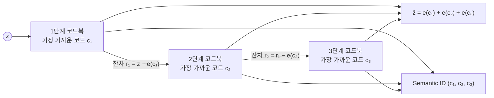
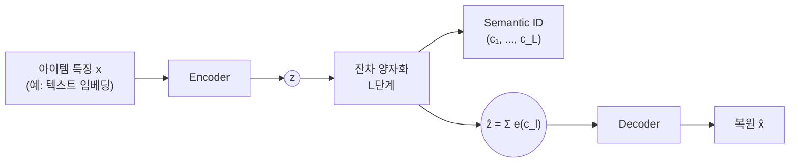

<br>{: .align-center}<br>

### _"코드 하나로 부족하면, 남은 것을 다시 코드로 만든다"_

[지난 글]()의 결론은 코드 하나로는 아이템을 구분하기에 부족하다는 것이었습니다. 코드북 크기가 $K$면 구분할 수 있는 아이템도 $K$개뿐이고, $K$를 아이템 수만큼 늘리면 결국 ID 임베딩 테이블과 다를 바가 없어집니다. 게다가 코드북이 커질수록 코드북 붕괴도 심해지기 쉽습니다.

이번 글에서는 그 해결책인 **잔차 양자화(Residual Quantization)**와, 이를 오토인코더에 넣은 **RQ-VAE**를 다룹니다. RQ-VAE는 TIGER가 아이템의 **Semantic ID**를 만드는 데 쓴 방법이고, [1편]()에서 본 `(5, 23, 32)` 같은 숫자 튜플이 바로 여기서 나옵니다.

이번에도 직접 실험합니다. 손글씨 숫자 1,797장을 각각 하나의 "아이템"으로 보고, 실제로 Semantic ID를 만들어서 그 ID가 어떤 구조를 갖는지 확인해 보겠습니다.

---

## 1. 잔차 양자화(Residual Quantization)

아이디어는 단순합니다. 벡터를 한 번 양자화하면 오차가 남습니다. 그 **남은 오차(잔차)를 다시 양자화**하고, 또 남은 오차를 다시 양자화하는 과정을 $L$번 반복합니다.

$$
r_0 = z, \qquad c_l = \arg\min_{k} \left\| r_{l-1} - e^{(l)}_k \right\|_2, \qquad r_l = r_{l-1} - e^{(l)}_{c_l} \qquad (l = 1, \dots, L)
$$

$e^{(l)}_k$는 $l$번째 단계 코드북의 $k$번째 코드입니다. 각 단계에서 고른 코드 번호를 모으면 아이템의 코드 튜플이 되고, 고른 코드 벡터를 모두 더하면 원래 벡터의 근사가 됩니다.

$$
\text{Semantic ID} = (c_1, c_2, \dots, c_L), \qquad \hat{z} = \sum_{l=1}^{L} e^{(l)}_{c_l}
$$



이 방식의 장점은 **표현력과 파라미터 수가 분리된다**는 점입니다. 코드북 $L$개가 각각 $K$개 코드를 가지면, 저장하는 코드 벡터는 $K \times L$개뿐이지만 표현할 수 있는 조합은 $K^L$개입니다. TIGER처럼 $K = 256$, $L = 3$이면 768개의 벡터로 약 1,678만 개의 ID를 만들 수 있습니다. 같은 수의 ID를 코드 하나로 만들려면 1,678만 개짜리 코드북이 필요합니다.

---

## 2. 거친 것에서 세밀한 것으로

잔차 양자화는 단계가 깊어질수록 **남은 오차가 작아집니다.** 첫 단계는 원래 벡터 전체를 대략적으로 근사하고, 다음 단계는 그 근사가 놓친 부분만 다듬습니다. TIGER 논문은 이를 **거친 것에서 세밀한 것으로(coarse-to-fine)** 근사한다고 표현합니다.

2편에서 학습한 VAE의 2차원 잠재 벡터에 단계마다 코드 8개짜리 잔차 k-means를 적용하면 이 과정이 눈으로 보입니다.

<br>{: .align-center}<br>

세 그림의 축 범위는 같습니다. 1단계에서는 데이터가 넓게 퍼져 있고 코드 8개가 숫자 덩어리를 하나씩 맡습니다. 1단계 코드를 빼고 남은 잔차는 원점 근처로 모이고(평균 크기 1.27에서 0.42), 3단계에서는 더 작아집니다(0.17). 눈여겨볼 점은 2단계부터 잔차가 **특별한 구조 없이 원점 주변에 둥글게 퍼진다**는 것입니다. 1단계 코드가 "어떤 숫자인가"를 담았다면, 뒤쪽 코드는 "그 숫자에서 어느 방향으로 얼마나 벗어났는가"라는 세부를 담습니다.

이 성질은 복원 결과에서도 확인됩니다. 뒤에서 학습할 RQ-VAE로 테스트 이미지를 복원하되, 앞에서부터 코드를 하나씩 늘려 가며 디코딩했습니다.

<br>{: .align-center}<br>

첫 번째와 두 번째 이미지는 원래 2인데, 코드 1개만 쓰면 1처럼 보이다가 코드 2개부터 2의 모양이 나타납니다. 나머지 이미지도 코드가 늘어날수록 획의 굵기나 기울기 같은 세부가 원본에 가까워집니다.

---

## 3. RQ-VAE

### 3.1 구조와 손실

RQ-VAE는 3편의 VQ-VAE에서 양자화 한 번을 잔차 양자화 $L$번으로 바꾼 모델입니다.



디코더에는 코드 벡터의 합 $\hat{z}$가 들어가고, 3편과 같은 Straight-Through Estimator로 기울기를 인코더에 전달합니다($z_q = z + \text{sg}[\hat{z} - z]$). 손실은 복원 손실에 **단계마다** 코드북 항과 커밋먼트 항을 더한 형태입니다. TIGER가 사용한 형태는 다음과 같습니다.

$$
\mathcal{L} = \underbrace{\| x - \hat{x} \|^2}_{\text{복원}} + \sum_{l=1}^{L} \left( \left\| \text{sg}[r_{l-1}] - e^{(l)}_{c_l} \right\|^2 + \beta \left\| r_{l-1} - \text{sg}\left[e^{(l)}_{c_l}\right] \right\|^2 \right)
$$

각 단계의 코드는 원래 벡터 $z$가 아니라 **그 단계의 잔차 $r_{l-1}$**에 가까워지도록 학습됩니다. $\beta$는 3편과 같이 0.25입니다.

### 3.2 원 논문과 TIGER의 차이

잔차 양자화 자체는 오래된 신호 처리 기법이고, 이를 VQ-VAE에 결합한 RQ-VAE는 이미지 생성 모델로 먼저 제안되었습니다(Lee et al., CVPR 2022, 카카오브레인과 POSTECH). TIGER는 이를 아이템 토큰화에 가져오면서 몇 가지를 다르게 설계했습니다.

| 구분 | RQ-VAE 원 논문 (이미지 생성) | TIGER (아이템 Semantic ID) |
|---|---|---|
| 입력 | 이미지의 각 위치 특징 | Sentence-T5로 만든 아이템 텍스트 임베딩 (768차원) |
| 코드북 | **모든 단계가 하나를 공유** | **단계마다 따로** (256개 x 3단계) |
| 잠재 차원 | 이미지 특징 차원 | 32차원 (인코더 512, 256, 128) |
| 코드북 갱신 | EMA | 손실 항으로 학습 |
| 붕괴 대응 | EMA | 첫 배치에서 k-means 초기화 |

원 논문이 코드북을 공유한 이유는 단계별 코드북 크기를 따로 정하는 수고를 줄이고, 모든 코드를 어느 단계에서든 쓸 수 있게 하려는 것이었습니다. TIGER는 반대로 **잔차의 크기가 단계마다 줄어들기 때문에** 단계별로 코드북을 따로 두었다고 설명합니다. 2장의 그림을 떠올리면, 1단계 코드는 넓은 영역에 퍼져 있어야 하고 3단계 코드는 원점 근처 좁은 영역에 모여 있어야 합니다. 하나의 코드북이 두 역할을 모두 하기는 어렵습니다. 이 차이가 실제로 얼마나 중요한지는 다음 실험에서 확인합니다.

TIGER의 RQ-VAE 학습 결과는 Semantic ID 품질에도 바로 드러났습니다. 같은 생성 모델에 RQ-VAE Semantic ID, LSH 기반 Semantic ID, 랜덤 ID를 각각 넣어 비교했을 때, 세 Amazon 데이터셋 모두에서 RQ-VAE가 가장 좋았고 랜덤 ID가 가장 나빴습니다.

---

## 4. 직접 실험: 손글씨 숫자로 Semantic ID 만들기

손글씨 숫자 1,797장을 각각 하나의 아이템으로 보고, 64개 픽셀값을 아이템 특징으로 썼습니다. 실제 추천에서는 아이템 텍스트나 이미지의 임베딩이 들어갈 자리입니다. 설정은 잠재 8차원, 3단계, 단계당 코드 16개입니다. 만들 수 있는 ID는 $16^3 = 4{,}096$개로 아이템 수보다 많습니다. 학습 1,500장, 테스트 297장으로 나눴고, 시드 3개로 반복했습니다.

비교한 방법은 네 가지입니다.

* **RQ-VAE, 단계별 코드북, k-means 초기화:** TIGER 방식
* **사후 잔차 k-means (RQ-Kmeans):** 일반 오토인코더를 학습한 뒤 잠재 벡터에 잔차 k-means를 적용. OneRec 방식에 가까움
* **RQ-VAE, 단계별 코드북, 작은 균등분포 초기화:** 3편에서 코드북 붕괴를 일으킨 초기화
* **RQ-VAE, 모든 단계가 코드북 공유:** 원 논문 방식. 첫 배치의 각 단계 잔차를 모아 k-means로 초기화

### 4.1 결과

<br>{: .align-center}<br>

왼쪽은 앞에서부터 코드를 몇 개 썼는지에 따른 테스트 복원 오차입니다.

* **TIGER 방식이 모든 단계에서 가장 좋았습니다.** 코드 3개를 모두 쓴 복원 오차가 17.9로, 사후 잔차 k-means(18.5)보다 낮았습니다. 코드 1개, 2개만 쓴 경우에도 마찬가지였고 시드 3개 모두 같은 방향이었습니다.
* **모든 방법이 코드가 늘어날수록 좋아졌지만, 줄어드는 폭은 점점 작아졌습니다.** TIGER 방식은 21.6에서 18.9로 2.7 줄었고, 다시 17.9로 1.0 줄었습니다. 뒤쪽 코드일수록 다듬는 양이 작다는 2장의 내용과 같습니다.
* **코드북을 공유하면 가장 나빴습니다.** 코드 3개를 써도 18.9로 네 방법 중 가장 높았습니다.

오른쪽은 단계별로 실제로 쓰인 코드 수입니다.

* **작은 균등분포 초기화는 1단계에서만 붕괴했습니다.** 16개 중 9~11개만 쓰였고, 2단계와 3단계는 16개를 모두 썼습니다. 1단계 코드가 데이터 전체를 덮어야 하는 반면, 뒤쪽 단계의 잔차는 원점 근처에 모여 있어서 원점 근처에서 시작한 코드도 쉽게 선택되기 때문으로 보입니다.
* **공유 코드북은 모든 단계에서 일부 코드만 썼습니다.** 단계마다 평균 11개, 13개, 8개였습니다. 하나의 코드북이 크기가 다른 잔차를 모두 맡으려다 보니, 어느 단계에서도 코드를 고르게 쓰지 못했습니다.

3편에서는 코드 하나짜리 VQ-VAE가 사후 k-means를 확실히 이기지 못했는데, 이번에는 학습형 양자화가 일관되게 앞섰습니다. 잔차 양자화에서는 인코더가 "여러 단계로 나눠 양자화하기 좋은 잠재 공간"을 함께 학습할 수 있다는 점이 차이를 만든 것으로 보입니다. 다만 OneRec은 훨씬 큰 실제 데이터에서 반대로 RQ-Kmeans가 더 좋았다고 보고했습니다. 작은 실험 하나로 어느 쪽이 낫다고 일반화하기보다는, **두 방법을 모두 기준선으로 두고 비교하는 것**이 맞습니다.

---

## 5. Semantic ID로 보기

이제 TIGER 방식으로 만든 코드를 "아이템 ID"로 보고 그 구조를 살펴봅니다.

### 5.1 앞자리를 공유하면 비슷한 아이템이다

<br>{: .align-center}<br>

가장 많은 아이템이 배정된 첫 코드 3개를 골랐더니, 첫 코드 2에는 6이, 첫 코드 1에는 0이, 첫 코드 15에는 9가 모였습니다. 첫 코드만으로 숫자를 얼마나 깔끔하게 나누는지 보는 순도도 0.88~0.92였습니다. 한 단계 더 들어가면 같은 0이라도 `(1, 15, *)`에는 폭이 넓고 둥근 0이, `(1, 5, *)`에는 좁고 길쭉한 0이 모인 것처럼 보입니다. 첫 코드가 큰 범주를, 두 번째 코드가 그 안의 스타일을 나누는 셈입니다.

이 계층 구조를 수치로도 확인했습니다. 아이템 쌍을 무작위로 약 20만 개 뽑고, 앞에서부터 몇 개의 코드를 공유하느냐에 따라 두 이미지의 픽셀 거리를 비교했습니다.

<br>{: .align-center}<br>

공유하는 앞자리가 길수록 거리가 일정하게 줄어듭니다. 이 성질 덕분에 생성 모델은 첫 코드를 고르는 순간 이미 "어떤 종류의 아이템인가"를 정하고, 다음 코드로 범위를 좁혀 갈 수 있습니다. 처음 보는 아이템도 특징만 있으면 인코더를 거쳐 비슷한 아이템과 앞자리를 공유하는 ID를 받습니다. TIGER가 콜드스타트 실험에서 새 아이템을 추천할 수 있었던 것도 이 구조 덕분입니다.

### 5.2 ID 충돌

그런데 문제가 하나 있습니다. ID가 4,096개로 아이템 수보다 많은데도, 서로 다른 아이템이 **같은 ID를 받는 충돌**이 꽤 많이 생겼습니다.

| 방법 | 고유 ID 수 (아이템 1,797개 중) | 충돌한 아이템 비율 | 한 ID에 몰린 최대 아이템 수 |
|---|---|---|---|
| RQ-VAE, 단계별 코드북, k-means 초기화 | 1,105~1,148 | 59~61% | 8~13 |
| 사후 잔차 k-means | 1,070~1,086 | 62~63% | 8~13 |
| RQ-VAE, 작은 균등분포 초기화 | 849~972 | 70~77% | 12~13 |
| RQ-VAE, 코드북 공유 | 384~429 | 94~96% | 23~25 |

아이템은 공간에 고르게 퍼져 있지 않고 비슷한 것끼리 몰려 있기 때문에, 비슷한 아이템이 같은 칸에 들어가는 것은 자연스러운 결과입니다. 오히려 Semantic ID가 의미를 잘 담을수록 생기기 쉬운 현상입니다. 하지만 추천 모델 입장에서는 ID가 같으면 두 아이템을 구분할 수 없습니다.

TIGER는 이 문제를 **네 번째 코드를 덧붙여** 해결했습니다. RQ-VAE 학습이 끝난 뒤 같은 ID를 가진 아이템들에 0, 1, 2 순서로 번호를 붙이는 방식입니다. 예를 들어 `(7, 1, 4)`를 공유하는 아이템이 둘이면 `(7, 1, 4, 0)`과 `(7, 1, 4, 1)`이 되고, 충돌이 없는 아이템도 `(7, 1, 4, 0)`처럼 네 번째 자리에 0을 붙여 길이를 맞춥니다. 이 실험에서는 한 ID에 최대 13개가 몰렸으니 네 번째 자리에 최소 13개의 값이 필요합니다.

공유 코드북은 충돌 측면에서도 가장 나빴습니다. 1,797개 아이템이 400개 남짓한 ID에 몰렸고, 한 ID에 20개 넘게 몰리기도 했습니다. 이렇게 되면 Semantic ID의 대부분을 네 번째 자리가 결정하게 되어, 앞자리에 담긴 의미의 가치가 떨어집니다.

---

## 6. 부록: RQ-VAE 핵심 코드

실험은 numpy로 했지만, 핵심 부분을 PyTorch로 정리합니다. 3편의 `VectorQuantizer`를 단계 수만큼 쌓는 구조입니다.

### Point 1. 단계별 코드북과 첫 배치 k-means 초기화

단계마다 코드북을 따로 두고, 첫 배치가 들어오면 잔차 k-means로 초기화합니다. 이해를 돕기 위해 k-means를 단순하게 구현했고, 첫 배치 크기는 코드북 크기보다 커야 합니다.

```python
import torch
import torch.nn as nn
import torch.nn.functional as F

class ResidualQuantizer(nn.Module):
    def __init__(self, num_levels=3, num_codes=256, dim=32, beta=0.25):
        super().__init__()
        self.beta = beta
        self.codebooks = nn.ParameterList(
            [nn.Parameter(torch.zeros(num_codes, dim)) for _ in range(num_levels)])
        self.register_buffer("initialized", torch.tensor(False))

    @torch.no_grad()
    def kmeans_init(self, z, iters=20):
        r = z.clone()
        for cb in self.codebooks:
            c = r[torch.randperm(len(r))[:cb.size(0)]].clone()
            for _ in range(iters):
                k = torch.cdist(r, c).argmin(1)
                for j in range(c.size(0)):
                    if (k == j).any():
                        c[j] = r[k == j].mean(0)
            cb.data.copy_(c)
            r = r - c[torch.cdist(r, c).argmin(1)]   # 다음 단계는 잔차로 초기화
        self.initialized.fill_(True)
```

### Point 2. 잔차 양자화와 단계별 손실

단계마다 잔차와 가장 가까운 코드를 고르고, 코드북 항과 커밋먼트 항을 더합니다. 잔차를 갱신할 때 코드 쪽만 `detach()`해서, 커밋먼트 항의 기울기가 인코더로만 흐르게 합니다.

```python
    def forward(self, z):                              # z: (B, dim)
        if not self.initialized:
            self.kmeans_init(z.detach())
        r, z_hat, loss, codes = z, torch.zeros_like(z), 0.0, []
        for cb in self.codebooks:
            k = torch.cdist(r.detach(), cb).argmin(1)   # 이 단계의 코드
            e = cb[k]
            loss = loss + F.mse_loss(e, r.detach()) + self.beta * F.mse_loss(r, e.detach())
            z_hat = z_hat + e
            r = r - e.detach()                          # 다음 단계로 넘길 잔차
            codes.append(k)
        z_q = z + (z_hat - z).detach()                  # STE: 순전파는 z_hat
        return z_q, torch.stack(codes, dim=1), loss
```

### Point 3. 충돌 처리: 네 번째 코드 붙이기

학습이 끝난 뒤 전체 아이템의 코드를 한 번 계산하고, 같은 코드를 가진 아이템에 순서대로 번호를 붙입니다.

```python
from collections import defaultdict

def add_collision_suffix(codes):                       # codes: (N, L) 텐서
    seen, ids = defaultdict(int), []
    for t in map(tuple, codes.tolist()):
        ids.append(t + (seen[t],))                     # 첫 아이템은 0, 다음은 1, 2, ...
        seen[t] += 1
    return ids
```

이렇게 만든 ID는 아이템과 일대일로 대응하므로, 추천 모델이 생성한 ID를 아이템으로 되돌리는 조회 테이블로 그대로 쓸 수 있습니다.

---

## 7. 결론 및 다음 글

정리하면 다음과 같습니다.

* **잔차 양자화**는 양자화 오차를 다시 양자화하는 과정을 반복해서, $K \times L$개의 코드 벡터로 $K^L$개의 조합을 표현합니다.
* 단계가 깊어질수록 잔차가 작아지며, 앞쪽 코드는 큰 범주를, 뒤쪽 코드는 세부를 담는 **거친 것에서 세밀한 것으로**의 구조가 생깁니다.
* **RQ-VAE**는 이 잔차 양자화를 오토인코더에 넣은 모델이고, TIGER는 단계별 코드북과 k-means 초기화로 아이템 Semantic ID를 만들었습니다.
* 실험에서는 TIGER 방식이 모든 단계에서 가장 좋았고, 코드북을 공유하면 깊은 단계의 코드가 거의 쓰이지 않았으며 ID가 소수에 몰렸습니다. 다만 대규모 실데이터에서는 사후 잔차 k-means가 더 좋았다는 보고도 있어, 두 방법을 모두 비교해 보는 것이 좋습니다.
* 만들어진 Semantic ID는 **앞자리를 공유할수록 비슷한 아이템**이라는 계층 구조를 가지며, 의미를 잘 담을수록 **ID 충돌**도 생기기 쉬워 네 번째 코드 같은 처리가 필요합니다.

다음 글에서는 한 걸음 물러나 **Semantic ID 자체의 설계**를 다룹니다. 어떤 임베딩을 양자화해야 하는지, 콘텐츠 정보만으로 충분한지 아니면 협업 신호를 담아야 하는지, ID 길이와 코드북 크기는 어떻게 정하는지, 그리고 좋은 Semantic ID를 어떻게 평가하는지 정리하겠습니다.

---

## 참고 문헌

* Lee et al., *Autoregressive Image Generation using Residual Quantization* (RQ-VAE), CVPR 2022. [arXiv:2203.01941](https://arxiv.org/abs/2203.01941)
* Rajput et al., *Recommender Systems with Generative Retrieval* (TIGER), NeurIPS 2023. [arXiv:2305.05065](https://arxiv.org/abs/2305.05065)
* Zeghidour et al., *SoundStream: An End-to-End Neural Audio Codec*, 2021. [arXiv:2107.03312](https://arxiv.org/abs/2107.03312)
* Kuaishou OneRec Team, *OneRec Technical Report*, 2025. [arXiv:2506.13695](https://arxiv.org/abs/2506.13695)
