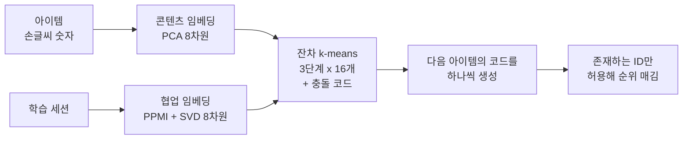

<br>{: .align-center}<br>

### _"아이템을 비슷하게 생긴 것끼리 묶을까, 함께 소비되는 것끼리 묶을까?"_

[2편]()부터 [4편]()까지는 Semantic ID를 **만드는 방법**을 다뤘습니다. 오토인코더로 압축하고, 벡터 양자화로 코드를 만들고, 잔차 양자화로 계층적인 코드 튜플을 얻었습니다.

그런데 만드는 방법만큼 중요한 질문이 남아 있습니다. **무엇을** 양자화해야 할까요? 4편까지는 아이템의 콘텐츠(이미지 픽셀)를 양자화했지만, 추천에서 정말 중요한 것은 "어떻게 생겼는가"보다 "누가 함께 소비하는가"일 수도 있습니다. ID는 얼마나 길어야 하고, 만든 ID가 좋은지는 어떻게 판단할까요?

이번 글에서는 이 설계 질문들을 관련 연구와 함께 정리하고, 합성 시청 기록으로 직접 실험해 답을 확인해 봅니다.

---

## 1. 좋은 Semantic ID의 조건

LETTER(Wang et al., CIKM 2024)는 생성형 추천에서 이상적인 아이템 ID가 갖춰야 할 성질을 세 가지로 정리했습니다.

* **계층적 의미:** 앞쪽 코드는 큰 범주를, 뒤쪽 코드는 세부를 담아야 합니다. 생성 모델이 코드를 앞에서부터 하나씩 만들어 가기 때문입니다. 4편에서 본 거친 것에서 세밀한 것으로의 구조입니다.
* **협업 신호:** 함께 소비되는 아이템은 비슷한 코드를 가져야 합니다. 콘텐츠만으로 만든 ID는 이 신호를 놓칠 수 있습니다.
* **코드 배정의 다양성:** 아이템이 소수의 코드에 몰리면 생성 모델이 그 코드를 자주 만들어 내는 편향이 생깁니다. LETTER는 TIGER에서 이런 현상을 확인했습니다.

여기에 4편에서 본 실무 조건 하나를 더하면 다음과 같습니다.

* **고유성:** 서로 다른 아이템은 서로 다른 ID를 가져야 합니다. 충돌이 생기면 네 번째 코드 같은 별도 처리가 필요합니다.

이 조건들은 서로 부딪히기도 합니다. 예를 들어 의미를 잘 담을수록 비슷한 아이템이 같은 칸에 몰려 충돌과 배정 편향이 커지기 쉽습니다. 그래서 Semantic ID 설계는 하나의 정답을 찾기보다 **균형을 잡는 일**에 가깝습니다.

---

## 2. 기억과 일반화 사이

YouTube 팀의 연구(Singh et al., *Better Generalization with Semantic IDs*)는 이 균형을 **기억(Memorization)과 일반화(Generalization)**라는 관점으로 설명합니다.


* **아이템 ID**는 아이템마다 독립된 임베딩을 학습하므로, 데이터가 충분한 인기 아이템의 패턴을 정확히 **외웁니다.** 하지만 비슷한 아이템끼리 아무것도 공유하지 않아서, 기록이 적은 긴 꼬리 아이템이나 새 아이템에는 약합니다.
* **콘텐츠 임베딩**은 비슷한 아이템끼리 표현을 공유하므로 새 아이템에도 **일반화**되지만, 아이템 하나하나의 세밀한 차이를 외우는 능력은 떨어집니다. 실제로 이 연구에서 아이템 ID를 콘텐츠 임베딩으로 바꾸면 품질이 떨어졌습니다.
* **Semantic ID**는 비슷한 아이템이 앞자리를 공유해 일반화하면서도, 코드 조합 단위로 임베딩을 학습해 어느 정도 기억도 할 수 있습니다.

이 연구는 YouTube 영상의 오디오와 영상 특징으로 만든 2,048차원 콘텐츠 임베딩을 RQ-VAE로 8단계, 단계당 2,048개 코드로 양자화했습니다. 그리고 랭킹 모델에서 랜덤 해시 ID 대신 Semantic ID를 썼을 때, 전체 품질을 해치지 않으면서 새 영상과 긴 꼬리 영상에서 성능이 좋아졌다고 보고했습니다. 다만 세부 결과를 보면 사용자 이력 입력이 없는 설정에서는 Semantic ID가 랜덤 해시보다 나빴던 경우도 있어, 효과가 조건에 따라 달라진다는 점도 함께 기억할 필요가 있습니다.

---

## 3. 무엇을 양자화할까

Semantic ID의 재료가 되는 임베딩은 크게 세 가지입니다.

| 재료 | 예시 | 장점 | 약점 |
|---|---|---|---|
| 콘텐츠 임베딩 | TIGER: 제목, 가격, 브랜드, 카테고리를 Sentence-T5로 인코딩 | 새 아이템도 바로 ID를 받음 | 함께 소비되는 패턴을 모름 |
| 협업 임베딩 | 상호작용 기록으로 학습한 아이템 벡터 | 추천에 직접 필요한 신호 | 기록이 없는 아이템은 벡터가 없음 |
| 둘을 함께 | OneRec: 협업 신호와 멀티모달 특징을 정렬한 뒤 양자화. LETTER: 양자화 결과를 협업 임베딩과 맞추는 정렬 손실 | 두 장점을 모두 노림 | 설계가 복잡하고, 새 아이템 처리가 여전히 숙제 |

TIGER처럼 콘텐츠만 쓰는 방식은 단순하고 새 아이템에 강하지만, OneRec 기술 보고서는 콘텐츠만으로 ID를 만들면 협업 신호를 놓쳐 품질이 떨어진다고 지적했습니다. 반대로 협업 신호만 쓰면 기록이 없는 새 아이템은 ID를 받을 근거가 없습니다. 이 차이를 직접 확인해 봤습니다.

---

## 4. 직접 실험: 어떤 ID가 다음 아이템을 잘 맞힐까

### 4.1 실험 설계

이번에도 손글씨 숫자 1,797장을 아이템으로 썼고, 여기에 **합성 시청 기록**을 붙였습니다.

* **숨겨진 취향 그룹:** 아이템마다 20개 취향 그룹 중 하나가 있습니다. 60%의 아이템은 숫자에 따라 그룹이 정해지고(숫자 하나당 그룹 2개), 나머지 40%는 무작위입니다. 즉 **생김새는 취향을 절반 정도만 설명합니다.**
* **세션:** 사용자는 한 취향 그룹을 골라 아이템 6개를 연속으로 소비합니다. 매번 85% 확률로 같은 그룹에서, 15% 확률로 다른 그룹에서 고르고, 그룹 안에서는 인기도가 긴 꼬리 분포를 따릅니다.
* **새 아이템:** 아이템의 10%(179개)는 학습 세션에 한 번도 등장하지 않습니다.
* **데이터 양:** 학습 세션을 500개부터 3만 개까지 바꿔 가며 비교했습니다. 테스트 세션은 3천 개이고, 시드 3개로 반복했습니다.

비교한 ID는 다섯 가지입니다. 아이템 ID를 제외한 네 가지는 모두 3단계, 단계당 코드 16개이고, 4편처럼 충돌 처리용 네 번째 코드를 붙여 고유하게 만들었습니다.

* **아이템 ID:** 토큰 없이 아이템 간 전이 횟수를 그대로 외우는 방식
* **랜덤 ID:** 아이템마다 무작위 코드 튜플 (TIGER의 비교 실험과 같은 방식)
* **콘텐츠 Semantic ID:** 픽셀을 PCA로 8차원으로 줄인 벡터를 잔차 k-means로 양자화
* **협업 Semantic ID:** 학습 세션의 동시 등장 행렬(PPMI)을 SVD로 8차원으로 줄인 벡터를 양자화. 기록이 없는 아이템은 벡터가 0
* **결합 Semantic ID:** 콘텐츠 벡터와 협업 벡터를 이어 붙여 양자화



추천 모델은 Transformer 대신 **횟수 기반의 자기회귀 모델**을 썼습니다. 이전 아이템의 앞 두 코드를 문맥으로, 다음 아이템의 코드를 앞에서부터 하나씩 생성할 확률을 학습 세션의 횟수로 추정합니다. 문맥이 드물면 더 짧은 문맥으로 물러납니다. 점수는 실제로 존재하는 ID에만 매기므로 [STATIC 글]()에서 다룬 제약 디코딩과 같은 효과를 냅니다. 모델을 단순하게 둔 것은 **ID 설계의 차이만** 보기 위해서입니다.

평가는 두 가지로 나눴습니다.

* **이미 본 아이템:** 정답이 학습 중 한 번이라도 등장한 아이템일 때, 전체 1,797개 중 상위 10개 안에 드는지(Recall@10)
* **새 아이템:** 정답이 새 아이템일 때, 새 아이템 179개끼리의 순위로 상위 10개 안에 드는지. 아무 정보가 없으면 우연 수준인 약 0.056이 나옵니다.

### 4.2 ID가 담고 있는 것

먼저 각 ID의 첫 코드가 무엇을 기준으로 아이템을 묶었는지 봤습니다.

<br>{: .align-center}<br>

가로축은 첫 코드가 같은 숫자를 얼마나 모으는지, 세로축은 연속으로 소비된 두 아이템이 같은 첫 코드를 받는 비율입니다.

* **콘텐츠 ID**는 같은 숫자를 잘 모았지만(순도 0.79~0.84), 함께 소비되는 아이템이 첫 코드를 공유하는 비율은 0.22~0.25에 그쳤습니다.
* **협업 ID**는 반대였습니다. 숫자 순도는 0.37~0.44로 낮지만, 함께 소비되는 아이템의 57~60%가 첫 코드를 공유했습니다.
* **결합 ID**는 그 사이에 있었고, **랜덤 ID**는 둘 다 낮았습니다.

실제로 같은 첫 코드를 받은 아이템을 보면 차이가 분명합니다.

<br>{: .align-center}<br>

콘텐츠 ID의 첫 코드 5에는 6만 모였지만, 아이템의 숨겨진 취향 그룹은 12, 13, 17, 19 등 제각각입니다. 협업 ID의 첫 코드 11에는 1, 4, 7, 0, 5처럼 생김새가 다른 숫자가 섞였지만, 취향 그룹은 16개 중 14개가 2, 9, 14 세 그룹에 몰려 있습니다. **같은 "의미 있는 ID"라도 무엇을 양자화했느냐에 따라 담는 의미가 완전히 다릅니다.**

### 4.3 이미 본 아이템: 데이터가 적을수록 Semantic ID

<br>{: .align-center}<br>

* **데이터가 적을 때는 협업 ID가 가장 좋았습니다.** 세션 500개에서 협업 ID의 Recall@10은 0.39로, 아이템 ID(0.29)보다 약 32% 높았습니다. 비슷하게 소비되는 아이템끼리 앞자리를 공유하므로, 기록이 적은 아이템도 같은 그룹 아이템의 통계를 빌려 쓸 수 있기 때문입니다.
* **데이터가 많아지면 아이템 ID가 따라잡았습니다.** 아이템 ID는 데이터가 늘수록 꾸준히 좋아져 세션 3만 개에서 0.46으로 협업 ID(0.45)를 앞섰고, NDCG@10도 0.278 대 0.267로 앞섰습니다. 반면 협업 ID는 세션 8천 개 이후 거의 늘지 않았습니다. 아이템 ID의 기억력이 충분한 데이터를 만나 힘을 발휘한 것으로, 2장의 기억과 일반화 관점과 같은 결과입니다.
* **콘텐츠 ID는 데이터가 적을 때도 아이템 ID보다 낮았습니다.** 이 실험에서는 생김새가 취향을 절반 정도만 설명하기 때문에, 생김새로 묶은 앞자리가 오히려 엉뚱한 아이템과 통계를 섞었습니다.
* **랜덤 ID는 모든 조건에서 가장 나빴습니다.** 의미 없는 코드끼리 통계를 공유하니 잡음만 늘어난 셈입니다. TIGER의 비교 실험에서 랜덤 ID가 가장 나빴던 것과 같은 방향입니다.

### 4.4 새 아이템: 콘텐츠 정보가 있어야 한다

<br>{: .align-center}<br>

* **아이템 ID와 협업 ID는 새 아이템에서 정확히 우연 수준(0.056)이었습니다.** 기록이 없으니 구분할 근거가 없습니다. 협업 ID에서는 기록이 없는 아이템이 모두 같은 벡터(0)를 받아, 세션 2천 개 기준으로 700개 넘는 아이템이 하나의 코드 조합에 몰렸습니다.
* **콘텐츠 ID만 모든 조건에서 꾸준히 우연보다 나았습니다(0.088~0.103).** 새 아이템도 생김새로 기존 아이템 옆에 놓이기 때문에, 기존 아이템에서 배운 앞자리 통계를 그대로 쓸 수 있습니다. TIGER가 콜드스타트 실험에서 새 아이템을 추천할 수 있었던 것과 같은 원리입니다.
* **결합 ID는 불안정했습니다.** 데이터가 적을 때는 가장 좋았지만(0.12), 데이터가 많을 때는 우연 수준 근처까지 떨어졌고 시드에 따라 0.03에서 0.12까지 흔들렸습니다. 새 아이템은 협업 절반이 비어 있어서 결합 공간 어디에 놓일지가 군집 결과에 크게 좌우되는 것으로 보입니다. 비어 있는 협업 벡터를 콘텐츠로부터 예측해 채우는 방법도 시도했지만 일관된 개선은 없었습니다.

### 4.5 ID 길이

결합 ID로 세션 2천 개 조건에서 단계 수만 1~4로 바꿔 봤습니다.

| 단계 수 | 앞자리 조합 수 | 한 조합에 몰린 최대 아이템 수 | 이미 본 아이템 Recall@10 |
|---|---|---|---|
| 1 | 16 | 197~214 | 0.378 |
| 2 | 215~228 | 37~58 | 0.396 |
| 3 | 914~951 | 13~19 | 0.393 |
| 4 | 1,472~1,483 | 7~9 | 0.387 |

단계가 짧으면 충돌 코드가 대부분의 구분을 떠맡고, 길면 앞자리 조합이 아이템 수에 가까워져 공유되는 통계가 줄어듭니다. 이번 실험에서는 2~3단계가 가장 좋았지만 차이는 크지 않았습니다. 2026년의 재현 연구(Chen et al.)도 방법에 따라 가장 좋은 길이가 달랐다고 보고했습니다. 잔차 k-means는 3단계 근처에서 가장 좋았고, RQ-VAE는 12단계에서 가장 좋았지만 성능 차이는 비슷했습니다. **길이는 데이터와 방법에 맞춰 실험으로 정해야 하는 값**입니다.

---

## 5. Semantic ID를 평가하는 방법

지금까지 쓴 지표를 모으면 Semantic ID를 평가하는 체크리스트가 됩니다.

| 무엇을 보나 | 지표 | 이번 연재에서 쓴 곳 |
|---|---|---|
| 정보를 잘 보존하는가 | 복원 오차 | 3편, 4편 |
| 코드를 고르게 쓰는가 | 사용 코드 수, 퍼플렉시티 | 3편, 4편 |
| 아이템을 구분하는가 | 고유 ID 수, 한 ID에 몰린 최대 아이템 수 | 4편, 이번 글 |
| 앞자리가 의미 있는가 | 앞자리 공유에 따른 유사도, 순도, 함께 소비된 아이템의 앞자리 공유율 | 4편, 이번 글 |
| 추천에 도움이 되는가 | 다음 아이템 Recall, NDCG | 이번 글 |
| 새 아이템을 다루는가 | 새 아이템 구간의 Recall | 이번 글 |

여기서 주의할 점이 있습니다. **앞쪽 지표가 좋다고 추천이 좋아지는 것은 아닙니다.** 앞서 언급한 재현 연구는 첫 단계 코드 분포의 균형과 추천 성능(NDCG@10)의 상관이 거의 없었다고 보고하며, 코드북 사용률은 불균형을 진단하는 데는 유용하지만 그 자체를 목표로 삼기에는 부족하다고 결론 내렸습니다. 이번 실험에서도 숫자를 가장 잘 모은 콘텐츠 ID가 이미 본 아이템 추천에서는 협업 ID보다 낮았습니다. 앞쪽 지표는 문제를 진단하는 데 쓰고, 최종 판단은 **실제 추천 지표와 새 아이템 구간**으로 하는 것이 맞습니다.

---

## 6. 설계 체크리스트

| 질문 | 선택지 | 이번 실험에서 본 것 | 연구 근거 |
|---|---|---|---|
| 무엇을 양자화할까 | 콘텐츠, 협업, 둘 다 | 데이터가 적을 때 협업이 가장 좋았고, 새 아이템은 콘텐츠만 꾸준히 다뤘음 | OneRec, LETTER는 콘텐츠와 협업 신호를 함께 사용 |
| 새 아이템은 어떻게 | 콘텐츠로 ID 부여 | 협업 ID는 우연 수준, 단순 결합은 불안정 | TIGER 콜드스타트 실험 |
| 아이템 ID를 버릴까 | Semantic ID만, 아이템 ID와 함께 | 데이터가 많으면 아이템 ID가 앞섬 | YouTube 연구의 기억과 일반화 균형 |
| ID 길이 | 2~4단계, 또는 더 길게 | 2~3단계가 가장 좋았지만 차이는 작음 | 재현 연구: 방법마다 최적 길이가 다름 |
| 충돌 처리 | 충돌 코드 추가 | 4편: 의미를 잘 담을수록 충돌이 많음 | TIGER의 네 번째 코드 |
| 무엇으로 평가할까 | 복원, 사용률, 추천 지표 | 사용률이 아니라 추천 지표로 판단 | 재현 연구: 사용률과 성능의 상관이 낮음 |

---

## 7. 부록: 실험 핵심 코드

실험은 numpy와 scikit-learn으로 했습니다. Semantic ID를 만드는 부분과 ID 품질을 점검하는 부분만 정리합니다.

### Point 1. 협업 임베딩: 동시 등장 행렬에서 아이템 벡터 만들기

세션 안에서 가까이 등장한 아이템 쌍을 세고, PPMI로 바꾼 뒤 SVD로 차원을 줄입니다. word2vec이 단어 벡터를 만드는 것과 같은 아이디어입니다.

```python
import numpy as np
from sklearn.decomposition import TruncatedSVD

def collab_embedding(sessions, n_items, dim=8, window=2):
    C = np.zeros((n_items, n_items))
    for s in sessions:
        for i, a in enumerate(s):
            for b in s[max(0, i - window):i] + s[i + 1:i + 1 + window]:
                if a != b:
                    C[a, b] += 1
    total, row, col = C.sum(), C.sum(1, keepdims=True), C.sum(0, keepdims=True)
    with np.errstate(divide="ignore", invalid="ignore"):
        pmi = np.log(C * total / (row @ col))
    ppmi = np.nan_to_num(np.maximum(pmi, 0), posinf=0, neginf=0)
    E = TruncatedSVD(dim).fit_transform(ppmi)
    E[row[:, 0] == 0] = 0.0          # 기록이 없는 아이템은 벡터가 없다
    return E
```

### Point 2. 잔차 k-means로 Semantic ID 만들기

4편의 RQ-VAE 대신 학습이 필요 없는 잔차 k-means를 썼습니다. 콘텐츠와 협업 벡터는 각각 길이를 1로 맞춘 뒤 이어 붙여야, 한쪽이 거리 계산을 지배하지 않습니다.

```python
from sklearn.cluster import KMeans

def l2norm(E):
    n = np.linalg.norm(E, axis=1, keepdims=True)
    return np.where(n > 0, E / np.maximum(n, 1e-12), 0.0)

def rq_kmeans(E, levels=3, k=16, seed=0):
    codes, r = [], E.copy()
    for _ in range(levels):
        km = KMeans(n_clusters=k, n_init=4, random_state=seed).fit(r)
        codes.append(km.labels_)
        r = r - km.cluster_centers_[km.labels_]
    return np.stack(codes, axis=1)

hybrid_codes = rq_kmeans(np.hstack([l2norm(content), l2norm(collab)]))
```

### Point 3. ID 품질 점검

추천 모델을 학습하기 전에, 만든 ID가 무엇을 담았는지 빠르게 확인하는 함수입니다.

```python
from collections import Counter

def id_report(codes, sessions, labels=None):
    buckets = Counter(map(tuple, codes))
    pairs = [(a, b) for s in sessions for a, b in zip(s[:-1], s[1:])]
    report = {
        "unique_ids": len(buckets),
        "max_bucket": max(buckets.values()),
        # 연속으로 소비된 두 아이템이 첫 코드를 공유하는 비율
        "co_consumed_share_c1": np.mean([codes[a, 0] == codes[b, 0] for a, b in pairs]),
    }
    if labels is not None:            # 카테고리 같은 콘텐츠 라벨이 있다면 첫 코드 순도
        c1 = codes[:, 0]
        report["purity_c1"] = sum(np.bincount(labels[c1 == c]).max() for c in np.unique(c1)) / len(c1)
    return report
```

`co_consumed_share_c1`이 낮다면 ID가 행동 패턴을 담지 못하고 있다는 신호이고, `max_bucket`이 크다면 충돌 처리가 ID의 상당 부분을 떠맡고 있다는 신호입니다.

---

## 8. 결론 및 다음 글

정리하면 다음과 같습니다.

* 좋은 Semantic ID는 **계층적 의미, 협업 신호, 고른 코드 배정, 고유성**을 갖춰야 하지만, 이 조건들은 서로 부딪히기 때문에 균형이 필요합니다.
* 아이템 ID는 **기억**에, Semantic ID와 콘텐츠 임베딩은 **일반화**에 강합니다. 실험에서도 데이터가 적을 때는 협업 Semantic ID가, 데이터가 많을 때는 아이템 ID가 앞섰습니다.
* **무엇을 양자화했느냐에 따라 ID가 담는 의미가 완전히 달라집니다.** 콘텐츠 ID는 비슷하게 생긴 아이템을, 협업 ID는 함께 소비되는 아이템을 묶었습니다.
* **새 아이템은 콘텐츠 정보가 있어야 다룰 수 있습니다.** 협업 ID는 새 아이템에서 우연 수준이었고, 콘텐츠와 협업을 단순히 이어 붙인 ID는 불안정했습니다. 두 신호를 제대로 정렬하는 방법이 OneRec이나 LETTER 같은 연구가 풀려는 문제입니다.
* ID 품질 지표는 진단용으로 쓰고, 최종 판단은 **실제 추천 지표와 새 아이템 구간**으로 해야 합니다.

이번 실험은 작은 합성 데이터와 단순한 횟수 기반 모델로 한 것이라 수치를 그대로 일반화할 수는 없습니다. 다만 "무엇을 양자화하느냐가 결과를 바꾼다"는 방향만큼은 분명하게 보여 줍니다.

여기까지가 아이템을 토큰으로 바꾸는 이야기였습니다. 다음 글부터는 이렇게 만든 토큰으로 **추천을 생성하는 모델**로 넘어갑니다. 1편에서 짧게 소개한 DSI와 TIGER를 본격적으로 다루면서, 사용자 이력을 어떻게 토큰 시퀀스로 바꾸고, 인코더 디코더가 다음 아이템의 Semantic ID를 어떻게 학습하고 생성하는지 정리하겠습니다.

---

## 참고 문헌

* Wang et al., *Learnable Item Tokenization for Generative Recommendation* (LETTER), CIKM 2024. [arXiv:2405.07314](https://arxiv.org/abs/2405.07314)
* Singh et al., *Better Generalization with Semantic IDs: A Case Study in Ranking for Recommendations*, 2024. [arXiv:2306.08121](https://arxiv.org/abs/2306.08121)
* Rajput et al., *Recommender Systems with Generative Retrieval* (TIGER), NeurIPS 2023. [arXiv:2305.05065](https://arxiv.org/abs/2305.05065)
* Kuaishou OneRec Team, *OneRec Technical Report*, 2025. [arXiv:2506.13695](https://arxiv.org/abs/2506.13695)
* Chen et al., *What Makes a Good Semantic ID for Generative Recommendation? A Reproducibility Study*, 2026. [arXiv:2609.24430](https://arxiv.org/abs/2609.24430)
* Levy and Goldberg, *Neural Word Embedding as Implicit Matrix Factorization*, NeurIPS 2014.
