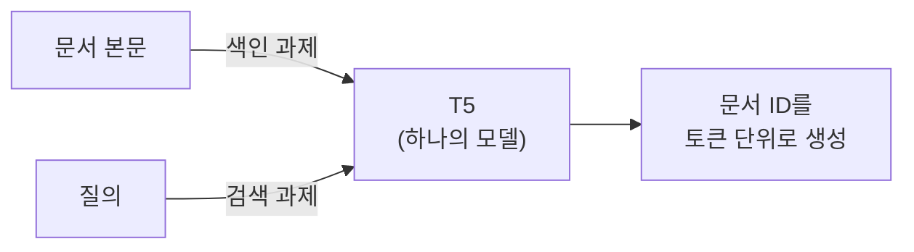
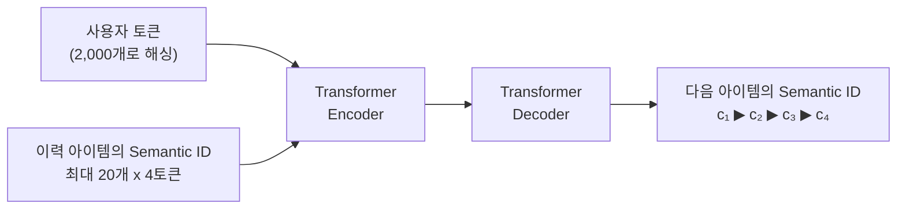
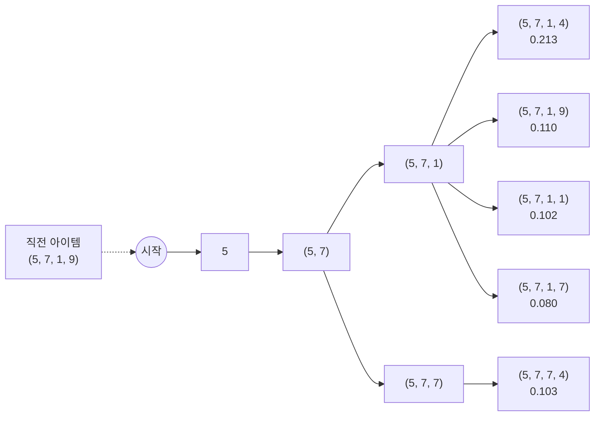
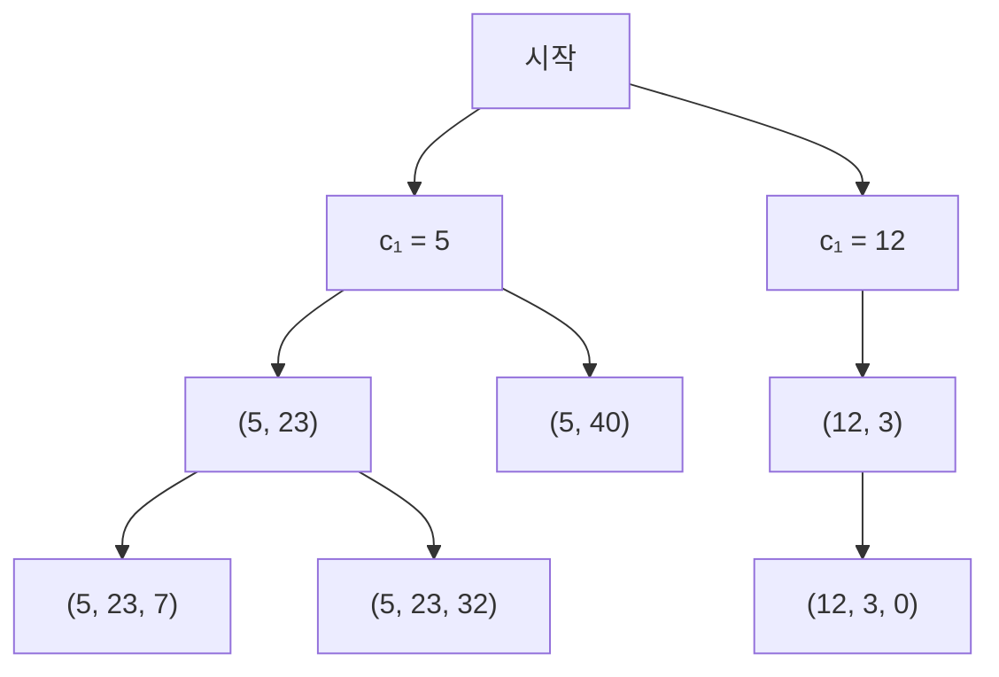

<br>{: .align-center}<br>

### _"검색 인덱스를 모델 파라미터 안에 넣을 수 있을까?"_

[지난 글]()까지 다섯 편에 걸쳐 아이템을 토큰으로 바꾸는 방법을 정리했습니다. 이제 그 토큰으로 **추천을 생성하는 모델**을 볼 차례입니다.

[1편]()에서 Generative Retrieval의 흐름을 DSI와 TIGER로 짧게 소개했는데, 이번 글에서는 두 모델을 제대로 들여다봅니다. 검색에서 출발한 DSI가 무엇을 바꿨는지, TIGER는 그것을 추천에 어떻게 옮겼는지, 그리고 모델이 실제로 다음 아이템의 ID를 어떻게 학습하고 생성하는지 정리합니다. 마지막으로 작은 TIGER를 직접 학습시켜 같은 크기의 아이템 ID 모델과 비교해 봅니다.

---

## 1. DSI: 검색 인덱스를 Transformer 안에 넣다

### 1.1 색인과 검색을 하나의 모델로

전통적인 검색 시스템은 **색인(Indexing)**과 **검색(Retrieval)**이 분리되어 있습니다. 문서를 미리 벡터나 역색인으로 저장해 두고, 질의가 들어오면 그 인덱스에서 가까운 문서를 찾습니다.

Google의 **DSI(Differentiable Search Index)**(Tay et al., NeurIPS 2022)는 이 둘을 Transformer 하나로 합쳤습니다. T5 모델에 두 가지 과제를 함께 학습시킵니다.

* **색인 과제:** 문서 본문(앞부분 32토큰)을 입력하면 그 문서의 ID를 출력
* **검색 과제:** 질의를 입력하면 정답 문서의 ID를 출력



색인 과제를 통해 모델은 "어떤 문서가 어떤 ID를 갖는지"를 파라미터에 외우고, 검색 과제를 통해 "질의가 오면 어떤 ID를 떠올려야 하는지"를 배웁니다. 별도의 벡터 인덱스 없이 **모델 자체가 인덱스**가 되는 셈입니다. 검색할 때는 빔 서치로 여러 ID를 생성해 순위를 매깁니다. 논문은 두 과제를 따로 순서대로 학습하는 것보다 함께 학습하는 쪽이 더 좋았다고 보고했습니다.

### 1.2 문서 ID를 어떻게 붙일까

DSI는 문서 ID를 붙이는 세 가지 방식을 비교했습니다.

| 방식 | 설명 |
|---|---|
| 구조 없는 원자 ID | 문서마다 고유한 토큰 하나. 출력층이 문서 수만큼 커짐 |
| 단순 문자열 ID | 임의로 붙인 정수 ID를 숫자 문자열로 보고 한 글자씩 생성 |
| 의미 구조 ID | BERT 임베딩을 계층적 k-means로 나눠 붙인 ID. 단계마다 10개 군집, 100개 이하가 될 때까지 재귀 |

세 번째 방식이 바로 Semantic ID의 원형입니다. 비슷한 문서가 앞자리를 공유하기 때문에, 모델이 ID를 앞에서부터 생성하면서 점점 범위를 좁혀 갈 수 있습니다.

### 1.3 결과

Natural Questions(NQ320K)에서 DSI는 BM25(Hits@1 11.6)와 T5-XXL 듀얼 인코더(24.3)보다 높은 Hits@1(35.6, 의미 구조 ID, T5-Large)을 기록했습니다. 다만 Hits@10에서는 듀얼 인코더(67.3)가 DSI(62.6)보다 높았습니다. 정답 하나를 정확히 맞히는 데는 강하지만, 후보를 넓게 뽑는 데는 기존 방식이 여전히 강했던 셈입니다. 모델이 클수록 성능이 꾸준히 올라간다는 점도 함께 보였습니다.

---

## 2. TIGER: 같은 아이디어를 추천에

### 2.1 무엇이 바뀌었나

TIGER(Rajput et al., NeurIPS 2023)는 DSI의 아이디어를 순차 추천으로 옮겼습니다. 대응 관계는 다음과 같습니다.

| DSI (검색) | TIGER (추천) |
|---|---|
| 질의 | 사용자의 최근 이력 |
| 문서 | 아이템 |
| 의미 구조 ID (계층적 k-means) | Semantic ID (RQ-VAE, 3단계 x 256개 + 충돌 코드) |
| 색인 과제로 문서와 ID를 연결 | 아이템 콘텐츠로 Semantic ID를 미리 만들어 둠 |
| 검색 과제 | 다음 아이템의 Semantic ID 생성 |

중요한 차이는 **색인 과제가 없다**는 점입니다. DSI는 문서와 ID의 연결을 모델이 외워야 했지만, TIGER의 Semantic ID는 [4편]()에서 본 RQ-VAE가 아이템 콘텐츠로부터 미리 만들어 둡니다. 모델은 "이 이력 다음에는 어떤 코드 조합이 올까"만 배우면 됩니다.

### 2.2 입력과 출력



* **입력:** 사용자 ID를 2,000개 토큰 중 하나로 해싱한 사용자 토큰 하나, 그 뒤에 최근 이력(최대 20개) 아이템의 Semantic ID 4토큰씩
* **출력:** 다음 아이템의 Semantic ID 4토큰
* **모델:** T5X 인코더 디코더, 인코더와 디코더 각 4층, 헤드 6개, 약 1,300만 파라미터
* **어휘:** Semantic ID 토큰 1,024개(4단계 x 256개)와 사용자 토큰 2,000개

### 2.3 결과

Amazon Beauty 데이터에서 TIGER는 Recall@5 0.0454, NDCG@5 0.0321로, SASRec(0.0387, 0.0249)과 가장 강한 기준선이었던 S3-Rec(0.0387, 0.0244)보다 높았습니다. Sports, Toys 데이터에서도 같은 방향이었습니다.

임베딩 테이블 크기의 차이도 큽니다. 아이템 ID 모델은 아이템마다 벡터가 필요해 $N \times d$ 크기의 테이블을 쓰지만, TIGER는 코드 토큰 1,024개의 임베딩만 있으면 됩니다. 이 논문의 데이터셋은 아이템이 1만~2만 개 수준이었으니 10배 이상 작은 셈이고, 아이템이 수억 개인 서비스라면 차이는 훨씬 커집니다.

---

## 3. 생성 과정 자세히 보기

### 3.1 학습: 다음 아이템 ID의 토큰을 하나씩 맞히기

TIGER의 학습은 언어 모델과 같습니다. 다음 아이템의 Semantic ID를 $(c_1, c_2, c_3, c_4)$라 하면, 이력 $H$가 주어졌을 때 그 아이템의 확률을 토큰별 조건부 확률의 곱으로 나눕니다.

$$
p(\text{item} \mid H) = \prod_{l=1}^{4} p\left(c_l \mid c_1, \dots, c_{l-1}, H\right)
$$

학습할 때는 디코더에 정답 토큰을 한 칸씩 밀어 넣고(teacher forcing) 각 위치에서 다음 토큰을 맞히도록 교차 엔트로피를 최소화합니다. 출력층은 아이템 수가 아니라 **코드 토큰 수**만큼만 있으면 됩니다.

### 3.2 추론: 빔 서치

추론할 때는 확률이 높은 ID를 여러 개 뽑아야 하므로 **빔 서치**를 씁니다. 첫 토큰 후보 중 상위 $B$개를 남기고, 각각에 둘째 토큰을 붙여 다시 상위 $B$개를 남기는 과정을 마지막 토큰까지 반복합니다.

아래는 뒤의 실험에서 학습한 미니 TIGER가 실제로 빔 크기 5로 생성한 결과입니다. 직전에 본 아이템의 Semantic ID가 `(5, 7, 1, 9)`일 때, 남은 다섯 개의 후보와 각 확률입니다.



다섯 후보가 모두 직전 아이템과 같은 `(5, 7)`로 시작합니다. 모델이 첫 두 토큰에서 "직전 아이템과 같은 동네"를 고르고, 뒤쪽 토큰으로 그 안의 아이템을 고른 셈입니다. 마지막 토큰은 4편에서 본 충돌 처리용 코드라서, `(5, 7, 1, 4)`와 `(5, 7, 1, 9)`는 앞 세 코드가 같은 서로 다른 아이템입니다. 참고로 이 예시의 실제 다음 아이템은 `(3, 4, 9, 3)`으로 전혀 다른 영역이어서, 이 경우는 맞히지 못했습니다.

### 3.3 존재하지 않는 ID와 제약 디코딩

생성 모델이므로 **실제로는 없는 코드 조합**을 만들 수 있습니다. TIGER 논문은 상위 10개 중 이런 ID가 0.1~1.6%였다고 보고했고, 빔을 넓혀 걸러내는 방법을 썼습니다. 다른 방법은 생성 단계에서 **존재하는 ID의 앞자리로만 이어지도록 막는 것**입니다. 모든 아이템의 Semantic ID로 접두사 트리를 만들어 두고, 각 단계에서 그 트리에 있는 다음 코드만 허용합니다. 이를 GPU에서 빠르게 하는 방법이 [STATIC 글]()에서 다룬 희소 행렬 기반 제약 디코딩입니다.



예를 들어 첫 코드로 5를 골랐다면, 둘째 코드는 트리에서 5 아래에 있는 23이나 40만 고를 수 있습니다. 이렇게 하면 생성 결과가 항상 실제 아이템으로 이어집니다.

---

## 4. 직접 실험: 미니 TIGER 학습시키기

### 4.1 실험 설계

[5편]()과 같은 합성 세계를 썼습니다. 손글씨 숫자 1,797장이 아이템이고, 아이템마다 숨겨진 취향 그룹이 있으며, 사용자는 한 취향 그룹 안에서 아이템 6개를 연속으로 소비합니다. 아이템의 10%(179개)는 학습에 한 번도 등장하지 않는 새 아이템입니다. 학습 세션 8천 개 중 10%는 검증용으로 떼어 두었고, 나머지에서 직전 최대 5개 아이템으로 다음 아이템을 맞히는 예시 3만 6천 개를 만들었습니다.

비교한 모델은 네 가지이고, 모두 같은 크기의 Transformer(차원 64, 헤드 4, 인코더 2층)를 씁니다.

* **아이템 ID 모델 (SASRec식):** 이력 아이템의 ID 임베딩을 인코더에 넣고, 마지막 위치의 출력과 전체 아이템 임베딩의 내적으로 다음 아이템을 분류
* **미니 TIGER (랜덤 ID):** 인코더 디코더(디코더 2층 추가)가 무작위 코드 튜플을 생성
* **미니 TIGER (콘텐츠 Semantic ID):** 픽셀로 만든 Semantic ID를 생성
* **미니 TIGER (협업 Semantic ID):** 시청 기록으로 만든 Semantic ID를 생성

세 Semantic ID는 모두 3단계, 단계당 16개 코드에 충돌 코드를 붙인 4토큰입니다. 실험은 JAX로 작성했고, 최대 6천 스텝을 학습하면서 500스텝마다 검증 손실을 재 가장 좋았던 시점의 모델을 썼습니다. 처음에는 모든 모델을 같은 스텝 수만큼 학습했는데, 아이템 ID 모델이 금방 과적합되어 성능이 크게 떨어졌기 때문입니다. 실제로 아이템 ID 모델은 세 시드 모두 500스텝에서, 미니 TIGER는 1,000~1,500스텝에서 가장 좋았습니다.

평가는 5편과 같이 두 가지로 나눴습니다.

* **이미 본 아이템:** 테스트 예시 5천 개에서 전체 1,797개 중 상위 10개 안에 드는지. 미니 TIGER는 빔 20의 제약 디코딩으로 뽑은 상위 10개를 썼습니다.
* **새 아이템:** 새 아이템 179개끼리의 순위로 상위 10개 안에 드는지. 미니 TIGER는 후보 179개의 생성 확률을 모두 계산했습니다.

새 아이템 평가에는 한 가지 함정이 있었습니다. 아이템 ID 모델은 새 아이템을 학습에서 본 적이 없으므로, 새 아이템들의 점수가 학습되지 않은 무작위 임베딩으로 정해집니다. 이 순서는 질의와 상관없이 거의 고정되기 때문에, 인기 많은 새 아이템이 우연히 위에 놓이면 점수가 크게 오르고 아니면 크게 떨어집니다. 실제로 처음 계산한 값은 시드에 따라 0.03에서 0.17까지 출렁였습니다. 그래서 새 아이템 점수는 **정답 아이템별로 Recall을 구해 평균**냈습니다. 이렇게 하면 질의를 보지 않고 순서가 고정된 모델은 정확히 우연 수준(10/179, 약 0.056)이 나오고, 이력을 보고 판단하는 모델만 그보다 높아집니다.

### 4.2 결과

<br>{: .align-center}<br>

**이미 본 아이템**에서는 다음과 같았습니다.

* **아이템 ID 모델이 가장 높았고(0.611), 협업 Semantic ID 미니 TIGER가 바로 뒤를 이었습니다(0.589).** 차이는 약 0.02로, NDCG@10도 0.352 대 0.338로 같은 순서였습니다. TIGER 논문에서는 TIGER가 SASRec을 앞섰지만, 이 실험에서는 그러지 못했습니다. 5편에서 확인했듯이 데이터가 넉넉하면 아이템마다 따로 외우는 아이템 ID가 강한데, 이 실험은 학습에 등장한 아이템 하나당 다음 아이템 예시가 평균 20개 이상인 비교적 조밀한 데이터였습니다. TIGER 논문의 Amazon 데이터는 이보다 훨씬 희소합니다.
* **미니 TIGER끼리는 ID가 무엇을 담았느냐에 따라 순서가 갈렸습니다.** 협업 ID(0.589) > 콘텐츠 ID(0.529) > 랜덤 ID(0.498) 순으로, 5편의 결과와 같고 TIGER 논문의 비교 실험처럼 랜덤 ID가 가장 나빴습니다. 같은 모델이라도 생성할 토큰이 의미를 담고 있어야 잘 배웁니다.

**새 아이템**에서는 콘텐츠 Semantic ID 미니 TIGER만 우연 수준의 약 2배(0.107, 시드별 0.093~0.122)를 기록했습니다. 아이템 ID 모델(0.065)과 협업 ID(0.054)는 우연 수준 근처였고, 랜덤 ID(0.037)는 오히려 그보다 낮았습니다. 새 아이템도 생김새로 기존 아이템과 앞자리를 공유하는 콘텐츠 ID만, 기존 아이템에서 배운 생성 패턴을 새 아이템으로 옮길 수 있었습니다.

**임베딩 테이블 크기**는 아이템 ID 모델이 1,797행(아이템 수)인 반면, 미니 TIGER는 50~326행이었습니다. 협업 ID가 큰 것은 기록이 없는 아이템이 한 코드 조합에 몰려 충돌 코드의 종류가 많아졌기 때문입니다. 아이템이 1,797개뿐이라 이 실험에서는 차이가 크지 않지만, TIGER 논문처럼 아이템 수가 늘어나도 코드 토큰 수는 거의 그대로라는 점이 핵심입니다.

### 4.3 빔 크기와 존재하지 않는 ID

협업 ID 미니 TIGER로 빔 크기를 바꿔 가며, 제약 디코딩을 쓴 경우와 쓰지 않은 경우를 비교했습니다.

<br>{: .align-center}<br>

* **빔 크기 10부터 Recall@10이 거의 늘지 않았습니다(0.615).** 빔 크기가 10보다 작으면 상위 10개를 다 채우지 못하므로 낮게 나오는 것이 당연하고, 그 이상은 계산만 늘어납니다.
* **제약 없이 생성해도 존재하지 않는 ID가 거의 나오지 않았습니다.** 상위 10개 중 최대 0.007%로, 두 방식의 Recall이 사실상 같았습니다. TIGER 논문(0.1~1.6%)보다도 훨씬 적은데, 이 실험은 아이템이 1,797개뿐이고 코드 조합이 촘촘해서 모델이 존재하는 조합을 쉽게 익혔기 때문으로 보입니다. 아이템이 수백만 개로 늘어나고 품절, 지역 제한 같은 조건이 붙는 실서비스에서는 제약 디코딩의 필요성이 훨씬 커집니다.

---

## 5. 아이템 ID 모델과 무엇이 다른가

| 구분 | 아이템 ID 모델 (SASRec 등) | 생성형 추천 (TIGER) |
|---|---|---|
| 출력 | 전체 아이템에 대한 점수 (분류) | 다음 아이템 ID의 토큰 (생성) |
| 임베딩 테이블 | 아이템 수 $N \times d$ | 코드 토큰 수 $(K \times L) \times d$ |
| 새 아이템 | 학습 전까지 표현이 없음 | 콘텐츠로 ID를 받으면 바로 생성 후보 |
| 추론 | 내적 한 번 + ANN 검색 | 토큰마다 디코더를 돌리는 빔 서치 |
| 잘못된 출력 | 없음 | 존재하지 않는 ID (제약 디코딩으로 차단) |
| 다양성 조절 | 후처리 | 생성 온도로 조절 가능 |

TIGER 논문도 한계로 **추론 비용**을 꼽았습니다. 내적 한 번으로 끝나는 검색과 달리, 토큰마다 디코더를 돌리고 빔을 유지해야 하므로 ANN 기반 검색보다 비쌀 수 있습니다. 반대로 장점도 있습니다. 생성 온도를 높이면 첫 토큰이 바뀌어 다른 범주의 아이템이 나오기 쉬워지는데, TIGER는 Beauty 데이터에서 온도를 1.0에서 2.0으로 올렸을 때 추천 상위 10개의 카테고리 분포 엔트로피(Entropy@10)가 0.76에서 1.38로 늘었다고 보고했습니다.

---

## 6. 부록: 미니 TIGER 핵심 코드

실험은 JAX로 했지만, 핵심 부분을 PyTorch로 정리합니다.

### Point 1. 입력 시퀀스 만들기

사용자 토큰 하나와 이력 아이템의 Semantic ID를 이어 붙입니다. 단계마다 다른 토큰 공간을 쓰도록 오프셋을 더해, 1단계의 5와 2단계의 5가 다른 토큰이 되게 합니다. 사용자 해싱에는 실행할 때마다 값이 바뀌는 파이썬 `hash` 대신 고정된 해시를 씁니다.

```python
import zlib

def build_input(user_id, history, sid, offsets, n_user_tokens=2000, max_items=20):
    """sid[item] = (c1, c2, c3, c4), offsets[l] = l단계 토큰의 시작 번호 (사용자 토큰 다음부터)"""
    tokens = [zlib.crc32(str(user_id).encode()) % n_user_tokens]
    for item in history[-max_items:]:
        tokens += [c + offsets[l] for l, c in enumerate(sid[item])]
    return tokens
```

### Point 2. 인코더 디코더와 teacher forcing

디코더 입력은 시작 벡터 뒤에 정답 토큰을 한 칸씩 밀어 넣은 것이고, 출력의 각 위치는 다음 토큰을 예측합니다.

```python
import torch
import torch.nn as nn
import torch.nn.functional as F

class MiniTiger(nn.Module):
    def __init__(self, vocab, pad, d=64, heads=4, layers=2, max_len=128, sid_len=4):
        super().__init__()
        self.pad = pad
        self.emb = nn.Embedding(vocab, d)
        self.pos = nn.Embedding(max_len, d)
        self.dpos = nn.Embedding(sid_len + 1, d)
        self.bos = nn.Parameter(torch.zeros(1, 1, d))
        self.tf = nn.Transformer(d, heads, layers, layers, dim_feedforward=2 * d, batch_first=True)
        self.out = nn.Linear(d, vocab)

    def forward(self, src, tgt_in):                    # tgt_in: 지금까지 생성한 토큰 (B, t), t는 0일 수도 있음
        B, S = src.shape
        x = self.emb(src) + self.pos(torch.arange(S, device=src.device))
        y = torch.cat([self.bos.expand(B, -1, -1), self.emb(tgt_in)], dim=1)
        y = y + self.dpos(torch.arange(y.size(1), device=src.device))
        mask = nn.Transformer.generate_square_subsequent_mask(y.size(1), device=src.device)
        h = self.tf(x, y, tgt_mask=mask, src_key_padding_mask=(src == self.pad))
        return self.out(h)                             # (B, t+1, vocab)

def loss_fn(model, src, tgt):                          # tgt: 다음 아이템의 4토큰 (B, 4)
    logits = model(src, tgt[:, :-1])                   # teacher forcing
    return F.cross_entropy(logits.reshape(-1, logits.size(-1)), tgt.reshape(-1))
```

### Point 3. 접두사 트리를 이용한 제약 빔 서치

모든 아이템의 Semantic ID로 "이 앞자리 다음에 올 수 있는 코드" 표를 만들고, 빔을 넓힐 때 표에 있는 코드만 붙입니다.

```python
from collections import defaultdict

def build_trie(sids):
    nxt = defaultdict(set)
    for s in sids:
        for l in range(len(s)):
            nxt[tuple(s[:l])].add(s[l])
    return nxt

@torch.no_grad()
def constrained_beam_search(model, src, trie, offsets, sid_len=4, beam=20):
    beams = [((), 0.0)]                                # (지금까지의 코드, 로그 확률)
    for l in range(sid_len):
        prefix = torch.tensor([[c + offsets[i] for i, c in enumerate(p)] for p, _ in beams],
                              dtype=torch.long).reshape(len(beams), l)
        logp = model(src.expand(len(beams), -1), prefix)[:, -1].log_softmax(-1)
        cand = [(p + (c,), s + logp[b, c + offsets[l]].item())
                for b, (p, s) in enumerate(beams) for c in trie[p]]   # 존재하는 다음 코드만
        beams = sorted(cand, key=lambda t: -t[1])[:beam]
    return beams                                       # 상위 ID와 점수
```

`trie[p]` 대신 해당 단계의 모든 코드를 허용하면 제약 없는 빔 서치가 되고, 그때 나온 ID가 표에 없는지 세면 존재하지 않는 ID 비율을 측정할 수 있습니다.

---

## 7. 결론 및 다음 글

정리하면 다음과 같습니다.

* **DSI**는 문서와 ID의 연결을 Transformer 파라미터에 외우게 해서, 별도 인덱스 없이 질의에서 문서 ID를 바로 생성했습니다. 계층적 k-means로 만든 의미 구조 ID는 Semantic ID의 원형입니다.
* **TIGER**는 이를 추천으로 옮겨, 사용자 이력의 Semantic ID를 입력으로 다음 아이템의 Semantic ID 4토큰을 생성합니다. RQ-VAE가 ID를 미리 만들어 두므로 색인 과제가 필요 없고, 임베딩 테이블은 아이템 수가 아니라 코드 토큰 수에 비례합니다.
* 생성은 **토큰별 조건부 확률의 곱**으로 학습하고, 추론은 **빔 서치**로 하며, 존재하는 ID로만 이어지게 막는 **제약 디코딩**을 함께 쓸 수 있습니다.
* 직접 학습한 미니 TIGER는 데이터가 넉넉한 조건에서 같은 크기의 아이템 ID 모델을 넘지 못했지만(0.589 대 0.611), **훨씬 작은 임베딩 테이블**로 근접한 성능을 냈고, 콘텐츠 Semantic ID를 쓰면 **새 아이템도 우연보다 2배 가까이** 잘 맞혔습니다. 랜덤 ID가 가장 나빴다는 점에서, 생성형 추천의 성능은 결국 **어떤 ID를 생성하느냐**에 달려 있습니다.

이번 실험도 작은 합성 데이터와 작은 모델로 한 것이라 수치를 그대로 일반화할 수는 없습니다. 다만 생성형 추천이 "아이템 ID 모델을 무조건 이긴다"기보다, **작은 어휘로 비슷한 성능을 내면서 새 아이템까지 다룰 수 있는 구조**라는 점은 분명하게 보여 줍니다.

다음 글에서는 Semantic ID를 만드는 토크나이저 자체를 추천 목적에 맞게 학습하는 **LETTER**를 다룹니다. 5편에서 콘텐츠만으로 만든 ID가 협업 신호를 놓친다는 것을 확인했는데, LETTER는 RQ-VAE 학습에 협업 신호와 코드 배정의 다양성을 직접 넣어 이 문제를 풉니다. 연재 계획은 1편의 표에서 실제 진행에 맞게 다듬어 두었습니다.

---

## 참고 문헌

* Tay et al., *Transformer Memory as a Differentiable Search Index* (DSI), NeurIPS 2022. [arXiv:2202.06991](https://arxiv.org/abs/2202.06991)
* Rajput et al., *Recommender Systems with Generative Retrieval* (TIGER), NeurIPS 2023. [arXiv:2305.05065](https://arxiv.org/abs/2305.05065)
* Kang and McAuley, *Self-Attentive Sequential Recommendation* (SASRec), ICDM 2018. [arXiv:1808.09781](https://arxiv.org/abs/1808.09781)
* Su et al., *Vectorizing the Trie: Efficient Constrained Decoding for LLM-based Generative Retrieval on Accelerators* (STATIC), 2026. [arXiv:2602.22647](https://arxiv.org/abs/2602.22647)
