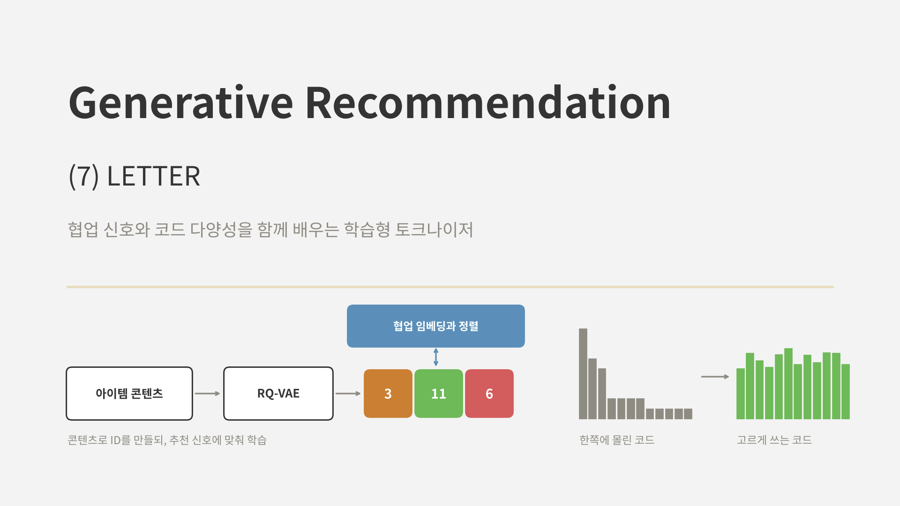
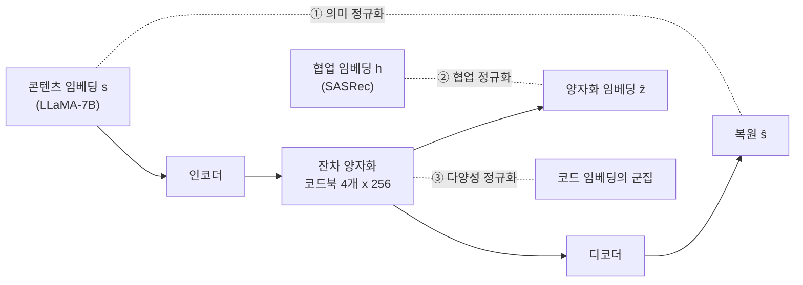
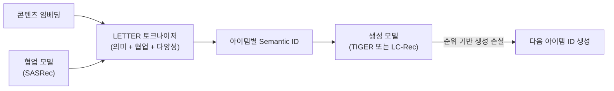
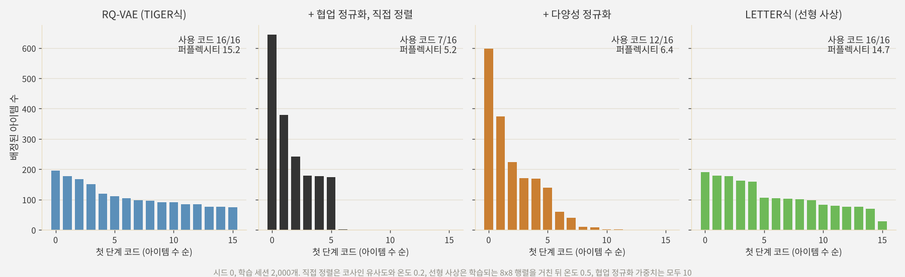
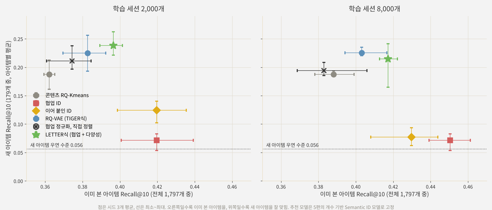
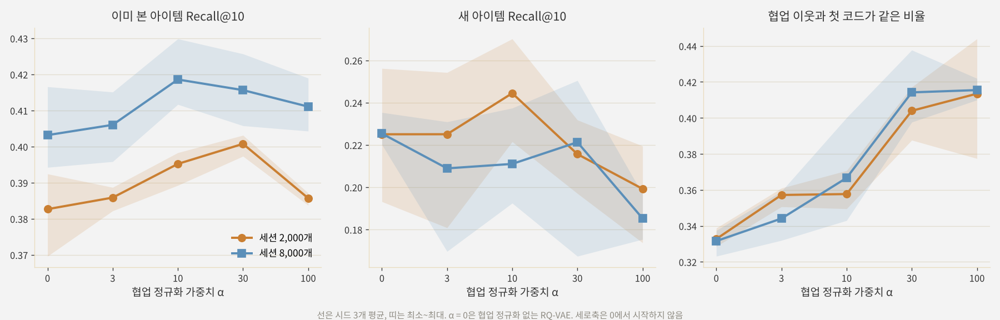

<br>{: .align-center}<br>

### _"Semantic ID를 만드는 토크나이저도 추천 목적에 맞게 학습할 수 있을까?"_

[지난 글]()에서 본 TIGER는 두 단계로 나뉩니다. 먼저 RQ-VAE가 아이템 콘텐츠로 Semantic ID를 만들고, 그다음 Transformer가 그 ID를 생성하도록 학습합니다. 첫 단계의 토크나이저는 **콘텐츠를 잘 복원하는 것**만 목표로 학습되고, 추천 모델을 학습할 때는 고정됩니다.

[5편]()의 실험에서 이 구조의 한계를 확인했습니다. 콘텐츠로 만든 ID는 새 아이템을 다룰 수 있지만 함께 소비되는 패턴을 놓쳤고, 협업 신호로 만든 ID는 그 반대였습니다. 둘을 단순히 이어 붙인 ID는 새 아이템에서 불안정했습니다.

이번 글에서 다룰 **LETTER**(Wang et al., CIKM 2024)는 토크나이저 학습 자체에 추천에 필요한 신호를 넣습니다. RQ-VAE의 복원 손실에 **협업 신호와의 정렬**, **코드 배정의 다양성**이라는 두 가지 정규화를 더하고, 생성 모델 쪽에도 순위를 의식한 손실을 씁니다. 논문의 구조와 결과를 정리한 뒤, 작은 실험으로 이 정규화들이 실제로 어떻게 작동하는지 확인해 봅니다.

---

## 1. LETTER가 지적한 문제

### 1.1 좋은 식별자의 세 조건

5편에서 짧게 소개했듯이, LETTER는 생성형 추천의 이상적인 아이템 식별자가 세 가지를 갖춰야 한다고 봅니다.

* **계층적 의미:** 앞쪽 코드는 큰 범주를, 뒤쪽 코드는 세부를 담아야 합니다.
* **협업 신호:** 함께 소비되는 아이템은 비슷한 코드를 가져야 합니다.
* **코드 배정의 다양성:** 아이템이 소수의 코드에 몰리지 않아야 합니다.

이 관점으로 기존 식별자들을 정리하면 다음과 같습니다.

| 식별자 | 예시 | 계층적 의미 | 협업 신호 | 다양성 |
|---|---|---|---|---|
| 아이템 ID | 원자 ID, 정수 문자열 | 없음 | 학습으로 일부 | 해당 없음 |
| 텍스트 | 아이템 제목 | 약함 | 없음 | 해당 없음 |
| 코드북 (콘텐츠) | TIGER, LC-Rec | 있음 | 없음 | 편향 있음 |
| LETTER | 학습형 코드북 | 있음 | 있음 | 정규화로 보완 |

### 1.2 콘텐츠만으로 만든 코드의 두 가지 빈틈

**협업 신호의 부재.** TIGER의 RQ-VAE는 콘텐츠 임베딩을 잘 복원하도록만 학습됩니다. 그래서 콘텐츠는 비슷하지만 소비 패턴이 다른 아이템이 같은 코드를 받고, 반대로 생김새는 달라도 함께 소비되는 아이템이 먼 코드를 받을 수 있습니다. 생성 모델이 아무리 좋아도 "어떤 코드 다음에 어떤 코드가 오는가"를 배우는 재료가 추천 신호와 어긋나 있는 셈입니다.

**코드 배정 편향.** 코드북 기반 토크나이저는 아이템을 코드에 고르게 나누지 않습니다. 비슷한 아이템이 많은 영역의 코드에 아이템이 몰리고, 이런 코드는 학습 데이터에도 자주 등장합니다. LETTER는 TIGER로 실험한 Instruments 데이터에서, 생성 모델이 **많은 아이템이 배정된 코드를 더 자주 생성하는** 편향을 확인했습니다. 생성 단계의 인기 편향이 토크나이저에서부터 시작되는 셈입니다.

---

## 2. LETTER의 구조: 세 가지 정규화

LETTER는 RQ-VAE 구조는 그대로 두고, 학습 손실에 정규화 세 가지를 둡니다.



### 2.1 의미 정규화

첫째는 [4편]()에서 본 RQ-VAE 손실 그대로입니다. 콘텐츠 임베딩 $s$를 복원하는 손실과, 단계별 잔차 $r_{l-1}$와 고른 코드 $e_{c_l}$ 사이의 코드북 손실, 커밋먼트 손실을 더합니다.

$$
\mathcal{L}_{\text{Sem}} = \lVert s - \hat{s} \rVert^2 + \sum_{l=1}^{L} \left( \lVert \text{sg}[r_{l-1}] - e_{c_l} \rVert^2 + \mu \lVert r_{l-1} - \text{sg}[e_{c_l}] \rVert^2 \right)
$$

$\text{sg}$는 기울기를 멈추는 연산이고, $\mu$는 TIGER와 같이 0.25를 씁니다. 이 손실이 앞쪽 코드는 큰 범주, 뒤쪽 코드는 세부를 담는 **계층적 의미**를 만듭니다.

### 2.2 협업 정규화

둘째가 LETTER의 핵심입니다. 미리 학습해 둔 협업 모델(논문에서는 32차원 SASRec)의 아이템 임베딩 $h$와, 토크나이저의 양자화 임베딩 $\hat{z}$(단계별 코드 임베딩의 합)를 대조 학습으로 맞춥니다.

$$
\mathcal{L}_{\text{CF}} = -\frac{1}{B} \sum_{i=1}^{B} \log \frac{\exp(\langle \hat{z}_i, h_i \rangle)}{\sum_{j=1}^{B} \exp(\langle \hat{z}_i, h_j \rangle)}
$$

배치 안에서 자기 자신의 협업 임베딩과는 가깝게, 다른 아이템의 협업 임베딩과는 멀게 만드는 InfoNCE 형태입니다. (논문 본문의 수식에는 $\log$가 빠져 있지만, 일반적인 InfoNCE 형태로 적었습니다.)

이 손실을 복원 손실과 함께 줄이면, 함께 소비되는 아이템의 양자화 임베딩이 서로 가까워지고 결국 **같은 코드를 공유하게** 됩니다. 중요한 점은 입력이 여전히 콘텐츠라는 것입니다. 학습이 끝나면 협업 임베딩 없이 콘텐츠만으로 ID를 만들 수 있으므로, 새 아이템도 ID를 받을 수 있습니다. 5편의 단순 이어 붙이기와 달리, 협업 신호가 **입력이 아니라 학습 신호**로만 쓰이는 것입니다.

### 2.3 다양성 정규화

셋째는 코드 배정 편향을 줄이는 손실입니다. 단계마다 코드북의 코드 임베딩을 **크기가 같은 $K$개 군집으로 나누는 제약 k-means**로 묶어 두고(논문은 $K=10$), 아이템이 고른 코드 $e_{c_l}$를 같은 군집의 다른 코드 $e_{+}$와는 가깝게, 나머지 코드와는 멀게 만듭니다.

$$
\mathcal{L}_{\text{Div}} = -\frac{1}{B} \sum_{i=1}^{B} \log \frac{\exp(\langle e^{i}_{c_l}, e_{+} \rangle)}{\sum_{j=1}^{N-1} \exp(\langle e^{i}_{c_l}, e_{j} \rangle)}
$$

여기서 $e_{+}$는 같은 군집에서 무작위로 고른 코드이고, 분모는 고른 코드를 뺀 나머지 $N-1$개 코드에 대한 합입니다. 군집끼리는 서로 밀어내므로 코드 임베딩이 공간에 고르게 퍼지고, 쓰이지 않던 코드도 같은 군집의 쓰이는 코드 쪽으로 끌려와 다시 배정될 기회를 얻는다고 볼 수 있습니다. [3편]()에서 본 죽은 코드 문제를 손실로 다루는 셈입니다.

### 2.4 전체 손실

토크나이저의 전체 손실은 세 정규화의 가중합입니다.

$$
\mathcal{L}_{\text{LETTER}} = \mathcal{L}_{\text{Sem}} + \alpha \, \mathcal{L}_{\text{CF}} + \beta \, \mathcal{L}_{\text{Div}}
$$

논문은 $\alpha$를 {0.1, 0.02, 0.01, 0.001}, $\beta$를 {0.01, 0.001, 0.0001, 0.00001}에서 골랐습니다. 두 정규화 모두 너무 세면 의미 정규화와 부딪힌다는 것이 논문의 분석입니다.

---

## 3. 생성 모델 쪽: 순위를 의식한 손실

LETTER는 토크나이저 외에 생성 모델의 학습 손실도 하나 바꿉니다. 6편에서 본 대로 TIGER는 다음 아이템 ID의 토큰을 하나씩 맞히는 교차 엔트로피로 학습합니다. LETTER는 여기에 **온도 $\tau$**를 넣은 **순위 기반 생성 손실(Ranking-guided Generation Loss)**을 씁니다.

$$
\mathcal{L}_{\text{rank}} = -\sum_{t=1}^{\lvert y \rvert} \log \frac{\exp\left(p(y_t)/\tau\right)}{\sum_{v \in \mathcal{V}} \exp\left(p(v)/\tau\right)}
$$

$p(v)$는 토큰 $v$의 로짓입니다. $\tau$를 낮추면 소프트맥스가 날카로워져서, 정답과 점수가 비슷한 **어려운 음성 토큰**에 더 큰 벌점이 갑니다. 논문은 이 손실이 Recall, NDCG와 관련 있는 one-way partial AUC를 최적화하는 것과 연결된다는 분석도 함께 제시했습니다.

다만 온도를 너무 낮추는 것이 항상 좋지는 않습니다. 논문은 $\tau$를 0.6~1.2 범위에서 바꿔 보며, 지나치게 낮으면 다른 사용자에게는 정답일 수 있는 아이템까지 강하게 밀어내 성능이 떨어질 수 있다고 분석했습니다.

정리하면 LETTER의 전체 흐름은 다음과 같습니다.



토크나이저는 특정 생성 모델에 묶여 있지 않아서, 논문은 TIGER와 LLM 기반의 LC-Rec 두 모델에 모두 붙여 실험했습니다.

---

## 4. 논문의 실험 결과

### 4.1 설정

* **데이터:** Amazon Instruments, Beauty와 Yelp. 상호작용이 5개 미만인 사용자와 아이템은 제거하고, 이력은 최근 20개까지 사용
* **토크나이저:** 코드북 4단계 x 256개, 코드 임베딩 32차원. 콘텐츠 임베딩은 LLaMA-7B, 협업 임베딩은 32차원 SASRec
* **생성 모델:** TIGER(논문을 바탕으로 재구현)와 LC-Rec(LLaMA-7B를 LoRA로 미세 조정)
* **평가:** Recall@K, NDCG@K (K = 5, 10)

### 4.2 주요 결과

| 모델 | Instruments R@10 | Instruments N@10 | Beauty R@10 | Beauty N@10 | Yelp R@10 | Yelp N@10 |
|---|---|---|---|---|---|---|
| TIGER | 0.1058 | 0.0797 | 0.0610 | 0.0331 | 0.0407 | 0.0213 |
| LETTER-TIGER | **0.1122** | **0.0831** | **0.0672** | **0.0364** | **0.0426** | **0.0231** |
| LC-Rec | 0.1006 | 0.0772 | 0.0642 | 0.0374 | 0.0359 | 0.0199 |
| LETTER-LC-Rec | **0.1115** | **0.0854** | **0.0703** | **0.0418** | **0.0393** | **0.0211** |

두 생성 모델 모두에서 LETTER 토크나이저로 바꾸기만 해도 Recall@10이 4.7~10.8% 올랐습니다. 생성 모델 구조는 그대로 두고 **ID만 바꿔서 얻은 개선**이라는 점이 의미 있습니다.

### 4.3 각 구성 요소의 기여

TIGER에 구성 요소를 하나씩 더한 결과입니다.

| 변형 | Instruments R@10 | Instruments N@10 | Beauty R@10 | Beauty N@10 |
|---|---|---|---|---|
| TIGER | 0.1058 | 0.0797 | 0.0610 | 0.0331 |
| + 협업 정규화 | 0.1078 | 0.0810 | 0.0660 | 0.0351 |
| + 다양성 정규화 | 0.1075 | 0.0809 | 0.0618 | 0.0335 |
| + 협업 + 다양성 | 0.1092 | 0.0819 | 0.0672 | 0.0357 |
| + 협업 + 다양성 + 순위 기반 손실 (LETTER) | **0.1122** | **0.0831** | 0.0672 | **0.0364** |

두 정규화가 각각 도움이 되고, 함께 쓸 때 더 좋았습니다. Beauty에서는 협업 정규화의 기여가 특히 컸습니다.

### 4.4 분석에서 눈여겨볼 점

* **협업 정규화만 쓰면 코드가 몰립니다.** 논문 분석에서 협업 정규화를 더하자 첫 단계 코드 중 실제로 쓰이는 코드가 148개에서 76개로 줄었고, 다양성 정규화를 더하면 다시 늘어났습니다. 협업 신호에 맞추다 보면 비슷하게 소비되는 아이템이 같은 코드로 모이기 때문입니다. 두 정규화가 **짝으로** 설계된 이유입니다.
* **협업 이웃이 코드를 공유합니다.** 협업 임베딩이 가까운 아이템끼리 코드가 겹치는 정도가 Instruments에서 0.0849(TIGER)에서 0.2760으로, Beauty에서 0.1135에서 0.3312로 늘었습니다.
* **ID 길이는 4가 가장 좋았습니다.** 2에서 4까지는 세밀한 정보가 늘어 좋아지고, 4에서 8로 늘리면 자기회귀 생성의 오류가 쌓여 나빠졌습니다.
* **코드북 크기**는 64에서 512까지 대체로 클수록 좋았지만, 너무 크면 콘텐츠의 잡음까지 외워 오히려 나빠질 수 있다고 분석했습니다.

---

## 5. 직접 실험: 토크나이저에 협업 신호 넣어 보기

### 5.1 실험 설계

5편과 6편의 합성 세계를 거의 그대로 썼습니다. 손글씨 숫자 1,797장이 아이템이고, 아이템마다 숨겨진 취향 그룹이 20개 있으며, 사용자는 한 취향 그룹 안에서 아이템 6개를 연속으로 소비합니다. 아이템의 10%(179개)는 학습에 한 번도 등장하지 않는 새 아이템입니다.

**한 가지를 바꿨습니다.** 5편에서는 숫자마다 취향 그룹이 2개씩 있고, 둘 중 어느 쪽인지는 무작위였습니다. 이번에는 **획의 굵기**로 정했습니다. 같은 숫자라도 획이 굵은 절반과 가는 절반이 서로 다른 그룹에 속하고, 20%의 아이템은 여전히 무작위 그룹입니다. LETTER가 가정하는 상황, 즉 **콘텐츠 안에 추천에 중요한 정보가 있지만 콘텐츠만으로 만든 토크나이저는 그것을 중요하게 다루지 않는** 상황을 만들기 위해서입니다. 실제로 픽셀 전체로는 선형 분류기가 이 그룹을 84% 맞히지만, 콘텐츠 Semantic ID의 재료인 8차원 PCA로는 59%만 맞혔습니다. 픽셀의 주된 변화는 숫자 모양이고, 굵기는 작은 변화이기 때문입니다.

비교한 토크나이저는 다음과 같습니다. 모두 3단계, 단계당 16개 코드에 충돌 코드를 붙인 4토큰입니다.

* **콘텐츠 RQ-Kmeans, 협업 ID, 이어 붙인 ID:** 5편의 세 가지. 협업 임베딩은 동시 출현 행렬의 PPMI를 SVD로 줄인 8차원 벡터
* **RQ-VAE (TIGER식):** 4편의 RQ-VAE(인코더 64 → 128 → 8)를 픽셀로 학습. 오토인코더로 1,000스텝 예열한 뒤 k-means로 코드북을 초기화하고 3,000스텝 학습
* **+ 협업 정규화:** 위 RQ-VAE에 2.2절의 대조 손실을 더함. 정렬 대상은 위의 8차원 협업 임베딩(논문의 SASRec 대신)이고, 기록이 있는 아이템만 사용
* **LETTER식:** 협업 정규화에 다양성 정규화까지 더함. 단계마다 코드 16개를 4개씩 4군집으로 나누고, 250스텝마다 다시 군집화

추천 모델은 **5편의 개수 기반 Semantic ID 모델로 고정**했습니다. 6편의 미니 TIGER는 설정 하나를 학습하는 데 오래 걸려 여러 토크나이저와 가중치, 시드를 비교하기 어려웠고, 이번에 보고 싶은 것은 생성 모델이 아니라 **ID 자체의 차이**이기 때문입니다. 평가는 6편과 같이 이미 본 아이템의 Recall@10(전체 1,797개 중)과, 새 아이템의 Recall@10(새 아이템 179개 중 순위를 정답 아이템별로 평균)으로 나눴습니다. 학습 세션은 2,000개와 8,000개 두 가지, 시드는 3개입니다.

### 5.2 첫 시도: 그대로 맞추면 코드가 몰린다

처음에는 양자화 임베딩과 협업 임베딩을 코사인 유사도로 직접 맞췄습니다(온도 0.2). 결과는 논문의 분석과 같은 방향이었습니다. **코드가 소수에 몰렸습니다.**

<br>{: .align-center}<br>

* **RQ-VAE**는 첫 단계 코드 16개를 모두 쓰고, 아이템이 비교적 고르게 퍼져 있습니다(퍼플렉시티 15.2).
* **협업 정규화를 직접 더하자** 쓰이는 코드가 7개로 줄고, 가장 큰 코드 하나에 아이템 650개 가까이가 몰렸습니다. 협업 임베딩 공간에서 가까운 아이템들을 같은 코드로 모으는 압력이 코드북 전체를 몇 개의 큰 덩어리로 만든 것입니다. 세 시드 평균으로 쓰이는 코드는 9개였고, 이미 본 아이템 성능도 RQ-VAE보다 오히려 낮았습니다(세션 2,000개 기준 0.374 대 0.383).
* **다양성 정규화를 더하면** 쓰이는 코드가 12개로 늘었습니다(세 시드 평균도 9개에서 12개). 논문에서 본 것처럼 몰림을 어느 정도 되돌리지만, 추천 성능까지 회복하지는 못했습니다.

원인은 정렬 방식에 있었습니다. 양자화 임베딩 공간을 협업 임베딩 공간과 **그대로 겹치게** 만들려다 보니, 콘텐츠를 복원하는 데 필요한 공간 구조와 부딪힌 것입니다. 그래서 정렬하기 전에 **학습되는 선형 사상(8 x 8 행렬)**을 하나 두고 온도를 0.5로 올렸습니다. 이렇게 하면 양자화 임베딩은 콘텐츠의 구조를 유지하면서, 그 안에 협업 신호를 선형으로 읽어 낼 수 있는 방향만 담으면 됩니다. 오른쪽 끝 그림처럼 이 경우에는 코드가 몰리지 않았습니다. 아래 결과의 협업 정규화와 LETTER식은 모두 이 방식입니다.

### 5.3 결과: 이미 본 아이템과 새 아이템 사이

가로축을 이미 본 아이템 성능, 세로축을 새 아이템 성능으로 두고 각 토크나이저의 위치를 그렸습니다. 아래 표는 세 시드 평균이고, 괄호는 학습 세션 수입니다. 새 아이템의 우연 수준은 0.056입니다.

<br>{: .align-center}<br>

| 토크나이저 | 이미 본 아이템 (2,000) | 새 아이템 (2,000) | 이미 본 아이템 (8,000) | 새 아이템 (8,000) |
|---|---|---|---|---|
| 콘텐츠 RQ-Kmeans | 0.362 | 0.188 | 0.388 | 0.187 |
| 협업 ID | **0.420** | 0.072 | **0.450** | 0.072 |
| 이어 붙인 ID | **0.420** | 0.124 | 0.430 | 0.077 |
| RQ-VAE (TIGER식) | 0.383 | 0.225 | 0.403 | **0.225** |
| 협업 정규화, 직접 정렬 | 0.374 | 0.211 | 0.383 | 0.194 |
| LETTER식 (협업 + 다양성) | 0.397 | **0.238** | 0.417 | 0.215 |

* **협업 ID는 이미 본 아이템에서 가장 강하지만 새 아이템은 거의 우연 수준입니다.** 5편과 같은 결과입니다.
* **이어 붙인 ID는 이번에도 불안정했습니다.** 세션 2,000개에서는 새 아이템 0.124였지만, 8,000개에서는 0.077로 떨어졌습니다. 협업 신호가 많아질수록 협업 쪽 절반이 군집을 좌우하고, 협업 벡터가 없는 새 아이템은 엉뚱한 칸에 들어가기 때문입니다.
* **LETTER식 토크나이저는 RQ-VAE를 오른쪽으로 옮겼습니다.** 이미 본 아이템 성능이 0.383에서 0.397로(세션 8,000개에서는 0.403에서 0.417로) 올랐고, 시드 3개와 데이터 크기 2가지, 모두 6번의 비교에서 빠짐없이 올랐습니다. 협업 ID와의 격차를 30~40% 정도 줄인 셈입니다.
* **새 아이템 성능은 콘텐츠 수준을 유지했습니다.** 0.238과 0.215로 RQ-VAE(0.225)와 비슷했고, 시드에 따라 오르기도 내리기도 했습니다. 중요한 것은 이어 붙인 ID처럼 무너지지 않았다는 점입니다. 협업 신호를 입력이 아니라 학습 신호로만 썼기 때문에, 새 아이템도 학습된 인코더를 거쳐 기존 아이템과 같은 방식으로 ID를 받습니다.

다양성 정규화는 선형 사상을 쓴 경우에는 거의 차이를 만들지 못했습니다. 협업 정규화만 쓴 경우(0.395, 0.244)와 비슷했는데, 애초에 코드가 몰리지 않아 다양성 정규화가 할 일이 없었기 때문입니다. 이 실험에서 다양성 정규화는 **협업 정규화가 코드를 몰리게 할 때의 안전장치**로 작동했다고 보는 편이 정확합니다.

### 5.4 협업 정규화의 세기

마지막으로 협업 정규화 가중치 $\alpha$를 바꿔 봤습니다. 실험의 손실 크기가 논문과 다르므로 값 자체는 비교할 수 없고, 경향만 보면 됩니다.

<br>{: .align-center}<br>

* **$\alpha$를 키울수록 협업 이웃이 첫 코드를 공유하는 비율이 꾸준히 늘었습니다**(0.33에서 0.41). 협업 정규화가 의도대로 코드를 협업 신호 쪽으로 끌어당긴다는 뜻입니다. 논문의 분석(코드 겹침 0.08에서 0.28)과 같은 방향입니다.
* **하지만 추천 성능은 중간에서 가장 좋았습니다.** 이미 본 아이템은 $\alpha$ = 10~30에서 가장 높았고, 100에서는 다시 떨어졌습니다. 새 아이템은 $\alpha$ = 100에서 확실히 나빠졌습니다. 협업 신호를 너무 세게 넣으면 복원 손실이 커지고(17.5에서 21.8), 콘텐츠가 담던 일반화 능력이 깎입니다. 논문이 "너무 큰 $\alpha$는 의미 정규화와 부딪힌다"고 한 것과 같은 현상입니다.

이번 실험도 작은 합성 데이터에서 한 것이고, 개선 폭(이미 본 아이템 기준 약 0.014)도 논문처럼 크지 않습니다. 다만 **협업 신호를 토크나이저 학습에 넣으면 코드가 추천 신호 쪽으로 움직이고, 그 대가로 코드가 몰릴 수 있으며, 세기를 조절해야 한다**는 LETTER의 핵심 주장은 작은 규모에서도 그대로 확인할 수 있었습니다.

---

## 6. 부록: LETTER 토크나이저 핵심 코드

실험은 JAX로 했지만, 핵심 부분을 PyTorch로 정리합니다. RQ-VAE 본체는 [4편]() 부록과 같고, 여기서는 LETTER가 더하는 두 손실만 보입니다.

### Point 1. 협업 정규화

양자화 임베딩과 협업 임베딩의 배치 내 대조 손실입니다. 기록이 없는 아이템은 협업 임베딩이 없으므로 마스크로 뺍니다. 여기서는 실험과 같이 코사인 유사도와 온도, 작은 선형 사상을 썼습니다.

```python
import torch
import torch.nn as nn
import torch.nn.functional as F

class CollabReg(nn.Module):
    def __init__(self, z_dim, cf_dim, tau=0.5):
        super().__init__()
        self.proj = nn.Linear(z_dim, cf_dim, bias=False)
        self.tau = tau

    def forward(self, z, zq, h, has_cf):
        """z: 인코더 출력, zq: 단계별 코드의 합, h: 협업 임베딩, has_cf: 기록이 있는 아이템"""
        zcf = zq + (z - z.detach())          # 값은 양자화 결과, 기울기는 코드북과 인코더 양쪽으로
        zcf, h = zcf[has_cf], h[has_cf]
        logits = F.normalize(self.proj(zcf), dim=-1) @ F.normalize(h, dim=-1).T / self.tau
        target = torch.arange(len(zcf), device=z.device)
        return F.cross_entropy(logits, target)
```

### Point 2. 크기가 같은 군집으로 나누기

다양성 정규화에 쓸 군집을 만듭니다. 일반 k-means는 군집 크기가 제각각이므로, 각 중심을 군집 크기만큼 복제한 뒤 헝가리안 알고리즘으로 코드를 하나씩 배정해 크기를 맞춥니다.

```python
import numpy as np
from scipy.optimize import linear_sum_assignment
from sklearn.cluster import KMeans

def constrained_kmeans(codebook, n_clusters, seed=0):
    """codebook: (N, d) numpy 배열, N은 n_clusters로 나누어떨어진다고 가정"""
    km = KMeans(n_clusters, n_init=4, random_state=seed).fit(codebook)
    size = len(codebook) // n_clusters
    cost = ((codebook[:, None] - km.cluster_centers_[None]) ** 2).sum(-1)
    rows, cols = linear_sum_assignment(np.repeat(cost, size, axis=1))
    labels = np.empty(len(codebook), dtype=int)
    labels[rows] = cols // size
    return labels
```

### Point 3. 다양성 정규화

아이템이 고른 코드를 같은 군집의 다른 코드 하나와 가깝게, 나머지 코드와는 멀게 만듭니다. 군집은 학습 중 일정 스텝마다 다시 계산합니다.

```python
def diversity_reg(codebook, codes, labels, tau=0.2):
    """codebook: (N, d) 한 단계의 코드 임베딩, codes: (B,) 아이템이 고른 코드, labels: (N,) 군집 번호"""
    E = F.normalize(codebook, dim=-1)
    logits = E[codes] @ E.T / tau                                   # (B, N)
    logits = logits.masked_fill(F.one_hot(codes, len(E)).bool(), float("-inf"))   # 자기 자신은 제외
    same = (labels[codes][:, None] == labels[None, :]) & ~F.one_hot(codes, len(E)).bool()
    pos = torch.multinomial(same.float(), 1).squeeze(1)              # 같은 군집에서 하나를 무작위로
    return F.cross_entropy(logits, pos)
```

전체 손실은 4편의 RQ-VAE 손실에 `alpha * collab_reg(...) + beta * sum(diversity_reg(...) for each level) / L`을 더하면 됩니다.

---

## 7. 결론 및 다음 글

정리하면 다음과 같습니다.

* **LETTER**는 Semantic ID를 만드는 RQ-VAE에 정규화 두 가지를 더해, 토크나이저를 **추천 목적에 맞게** 학습합니다. 콘텐츠를 복원하는 의미 정규화는 그대로 두고, 양자화 임베딩을 협업 임베딩과 맞추는 **협업 정규화**와 코드 임베딩을 고르게 퍼뜨리는 **다양성 정규화**를 함께 씁니다.
* 협업 신호는 **입력이 아니라 학습 신호**로만 쓰이므로, 학습이 끝난 토크나이저는 콘텐츠만으로 ID를 만듭니다. 새 아이템도 ID를 받을 수 있다는 콘텐츠 기반 ID의 장점이 유지됩니다.
* 생성 모델 쪽에는 온도를 넣은 **순위 기반 생성 손실**로 어려운 음성 토큰을 더 강하게 밀어냅니다.
* 논문에서는 TIGER와 LC-Rec 모두 토크나이저만 바꿔 Recall@10이 4.7~10.8% 올랐고, 협업 정규화만 쓰면 코드가 몰리고 다양성 정규화가 이를 되돌린다는 분석을 보였습니다.
* 직접 해 본 작은 실험에서도 같은 그림이 나왔습니다. 협업 신호를 직접 맞추면 **코드가 몰렸고**, 선형 사상을 거쳐 맞추자 **이미 본 아이템 성능이 협업 ID 쪽으로 다가가면서도 새 아이템 성능은 콘텐츠 수준을 유지**했습니다. 5편에서 불안정했던 "이어 붙이기"보다 훨씬 안정적인 방법이었습니다.

실무 관점에서 보면 LETTER는 비용이 적은 개선입니다. 생성 모델은 그대로 두고 토크나이저 학습 손실만 바꾸면 되기 때문입니다. 대신 협업 모델을 먼저 학습해 두어야 하고, 협업 신호가 바뀔 때마다 토크나이저를 다시 학습하면 **아이템의 ID가 바뀐다**는 점은 따로 고민해야 합니다. 이미 학습한 생성 모델은 이전 ID 체계에 맞춰져 있기 때문입니다. 이 문제는 실서비스 검증을 다룰 때 다시 이야기하겠습니다.

지금까지는 아이템을 RQ-VAE 계열의 코드로 바꾸는 방법을 주로 봤습니다. 다음 글에서는 GNN으로 학습한 협업 표현을 MQ-Tokenizer로 양자화해, 사용자와 아이템을 함께 LLM의 토큰으로 만드는 **TokenRec**을 다룹니다. 협업 신호를 담는 토큰을 만든다는 점에서는 LETTER와 같은 문제의식이지만, 접근 방식은 꽤 다릅니다.

---

## 참고 문헌

* Wang et al., *Learnable Item Tokenization for Generative Recommendation* (LETTER), CIKM 2024. [arXiv:2405.07314](https://arxiv.org/abs/2405.07314)
* Rajput et al., *Recommender Systems with Generative Retrieval* (TIGER), NeurIPS 2023. [arXiv:2305.05065](https://arxiv.org/abs/2305.05065)
* Zheng et al., *Adapting Large Language Models by Integrating Collaborative Semantics for Recommendation* (LC-Rec), ICDE 2024. [arXiv:2311.09049](https://arxiv.org/abs/2311.09049)
* Kang and McAuley, *Self-Attentive Sequential Recommendation* (SASRec), ICDM 2018. [arXiv:1808.09781](https://arxiv.org/abs/1808.09781)
* Lee et al., *Autoregressive Image Generation using Residual Quantization* (RQ-VAE), CVPR 2022. [arXiv:2203.01941](https://arxiv.org/abs/2203.01941)
