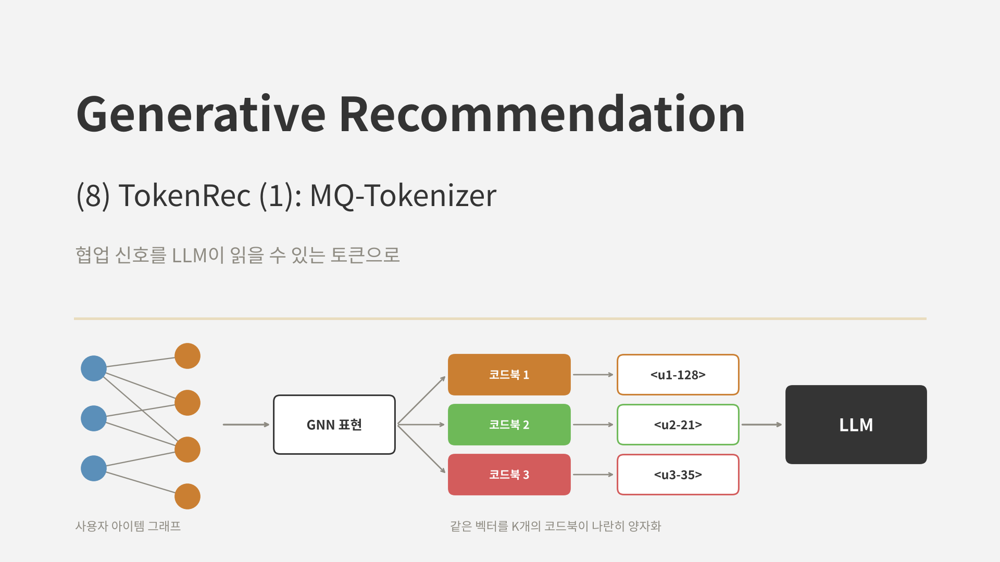
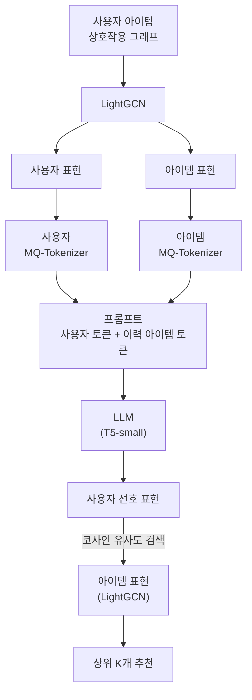
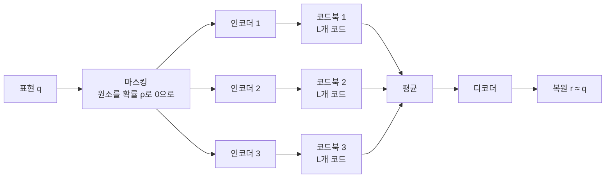
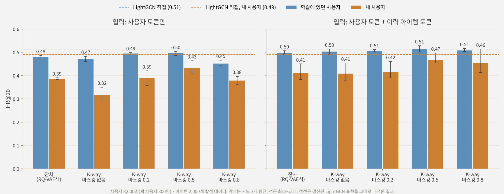
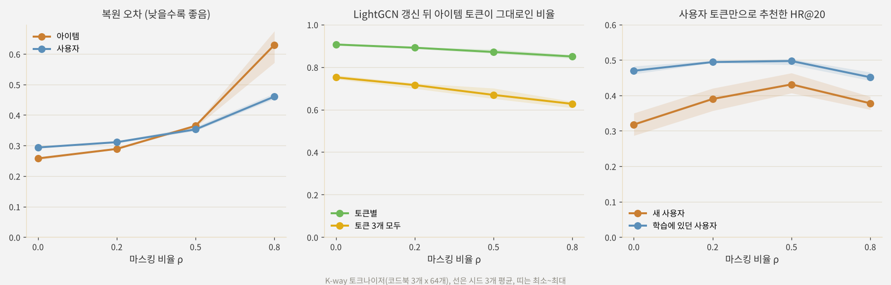
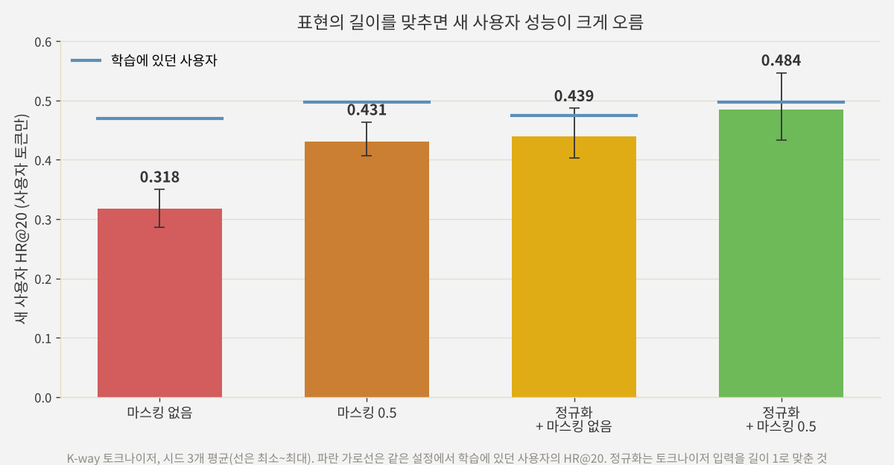

<br>{: .align-center}<br>

### _"LLM이 사용자와 아이템을 알아들으려면 어떤 토큰이 필요할까?"_

[지난 글]()의 LETTER는 콘텐츠로 Semantic ID를 만들되, 학습 과정에서 협업 신호를 맞추는 방법이었습니다. 이번에 다룰 **TokenRec**(Qu et al., IEEE TKDE 2025)은 출발점이 반대입니다. 콘텐츠가 아니라 **협업 필터링이 학습한 표현 자체를 토큰으로** 바꾸고, 그 토큰을 LLM에 넣어 추천합니다.

TokenRec에는 큰 아이디어가 두 가지 있습니다. 하나는 사용자와 아이템의 ID를 토큰으로 바꾸는 **MQ-Tokenizer**이고, 다른 하나는 LLM이 아이템 토큰을 하나씩 생성하는 대신 **표현을 출력해 검색하는** 방식입니다. 이번 글은 첫 번째, 토크나이저를 다룹니다. 두 번째 아이디어와 새 사용자 처리, 추론 속도는 다음 글에서 이어서 정리합니다.

---

## 1. LLM 추천에서 ID를 어떻게 표현할까

### 1.1 문제: LLM은 ID를 모른다

P5(Geng et al., RecSys 2022) 이후 LLM으로 추천을 하려는 시도가 많아졌습니다. 이때 가장 먼저 부딪히는 문제가 **사용자와 아이템을 어떻게 프롬프트에 넣느냐**입니다. 언어 모델의 어휘에는 "사용자 1234"나 "아이템 5678"에 해당하는 단어가 없기 때문입니다.

지금까지 나온 방법은 대략 다음과 같습니다.

| 방법 | 예시 | 문제 |
|---|---|---|
| ID를 숫자 문자열로 | `user_1234`를 하위 단어로 쪼개서 입력 (P5) | 1234와 1235가 비슷한 토큰을 공유하지만 실제로는 아무 관계가 없음 |
| ID 하나에 새 토큰 하나 | 아이템마다 전용 토큰 추가 | 어휘가 아이템 수만큼 커지고, 새 아이템은 토큰이 없음 |
| 제목, 설명 같은 텍스트 | 아이템 제목을 그대로 입력 | 함께 소비되는 패턴은 담지 못함 |
| 콘텐츠 기반 Semantic ID | TIGER, LC-Rec | 협업 신호가 약함 (5편, 7편) |
| 협업 기반 인덱싱 | 상호작용 그래프를 군집화해 ID 부여 (CID) | 군집화가 고정되어 표현력이 제한됨 |
| 협업 임베딩을 직접 주입 | CF 임베딩을 MLP로 LLM 입력 공간에 사상 (CoLLM) | 이산 토큰이 아닌 연속 벡터를 입력에 섞어야 함 |

TokenRec이 노리는 지점은 분명합니다. **협업 신호를 충분히 담으면서**, **이산 토큰이라 LLM 어휘에 자연스럽게 들어가고**, **새 사용자나 아이템이 와도 LLM을 다시 학습하지 않고 토큰을 붙일 수 있는** ID 표현입니다.

### 1.2 왜 GNN 표현인가

TokenRec은 협업 신호의 원천으로 **LightGCN**(He et al., SIGIR 2020)의 사용자, 아이템 표현을 씁니다. LightGCN은 사용자 아이템 그래프에서 이웃의 임베딩을 여러 번 평균 내어, 직접 상호작용한 아이템뿐 아니라 **"내가 본 아이템을 본 다른 사용자가 본 아이템"** 같은 고차 연결까지 표현에 담습니다. 논문은 이를 고차 협업 지식(High-Order Collaborative Knowledge)이라고 부르고, 뒤의 결과에서 보듯 이것을 단순한 MF로 바꾸면 성능이 크게 떨어집니다.

---

## 2. TokenRec의 전체 구조



1. LightGCN으로 모든 사용자와 아이템의 표현을 학습해 둡니다.
2. 사용자용, 아이템용 **MQ-Tokenizer**가 각 표현을 $K$개의 토큰으로 바꿉니다.
3. 이 토큰들을 프롬프트에 넣어 LLM에 입력합니다.
4. LLM의 출력을 아이템 표현 공간으로 사상하고, 가장 가까운 아이템을 찾아 추천합니다.

이번 글은 2번을 자세히 봅니다. 3번과 4번은 다음 글의 주제입니다.

---

## 3. MQ-Tokenizer

MQ-Tokenizer(Masked Vector-Quantized Tokenizer)는 [3편]()의 VQ-VAE를 바탕으로, 두 가지를 바꿨습니다. 입력을 일부러 가리는 **마스킹**과, 코드북을 여러 개 나란히 쓰는 **K-way 구조**입니다.



### 3.1 마스킹

학습할 때 입력 표현의 각 원소를 확률 $\rho$로 0으로 바꿉니다.

$$
\mathbf{q}'_j = \text{Mask}(\mathbf{q}_j, \mathcal{E}), \quad \mathcal{E} \sim \text{Bernoulli}(\rho)
$$

마스크는 에폭마다 새로 뽑고, 복원 목표는 가리기 전의 원래 표현 $\mathbf{q}_j$입니다. 일부가 지워진 입력으로도 같은 토큰을 고르도록 학습되므로, 토크나이저가 **표현의 작은 변화에 덜 민감**해집니다. 새 사용자처럼 학습 때와 조금 다른 분포의 표현이 들어와도 그럴듯한 토큰을 붙일 수 있게 하려는 장치입니다. 논문은 $\rho$를 0에서 1까지 바꿔 보며 0.5 미만에서 개선이 있었고 0.2가 가장 좋았으며, 0.5 이상에서는 오히려 나빠졌다고 보고했습니다.

### 3.2 K-way 인코더와 코드북

인코더가 $K$개 있고, 각각 **마스킹된 표현 전체**를 받아 자기 코드북에서 가장 가까운 코드를 고릅니다.

$$
\mathbf{a}_j^k = \text{MLP}^k(\mathbf{q}'_j), \qquad w_j^k = \arg\min_{l} \lVert \mathbf{a}_j^k - \mathbf{c}_l^k \rVert^2
$$

4편의 RQ-VAE와 비교하면 차이가 분명합니다.

| 구분 | RQ-VAE (TIGER) | MQ-Tokenizer (TokenRec) |
|---|---|---|
| 코드북 연결 | 직렬: 앞 단계의 잔차를 다음 단계가 양자화 | 병렬: 각 코드북이 전체 표현을 따로 양자화 |
| 인코더 | 1개 | 코드북마다 1개 ($K$개) |
| 디코더 입력 | 코드 임베딩의 합 | 코드 임베딩의 평균 |
| 토큰 순서 | 앞 코드가 큰 범주, 뒤 코드가 세부 | 순서에 따른 계층 없음 |
| 입력 | 콘텐츠 임베딩 | GNN 협업 표현 (+ 마스킹) |

RQ-VAE의 계층 구조는 아이템 ID를 **앞에서부터 하나씩 생성**할 때 유용합니다. 첫 토큰으로 큰 범주를 고르고 점점 좁혀 가기 때문입니다. TokenRec은 다음 글에서 볼 것처럼 아이템 토큰을 생성하지 않고 **입력으로만** 쓰므로, 토큰 사이에 순서가 없어도 됩니다. 대신 각 코드북이 표현의 서로 다른 측면을 잡아내도록 나란히 둔 것으로 볼 수 있습니다.

### 3.3 디코더와 학습 손실

고른 코드 임베딩 $K$개를 평균 내고 MLP로 원래 표현을 복원합니다.

$$
\mathbf{r}_j = \text{MLP}\left( \frac{1}{K} \sum_{k=1}^{K} \mathbf{c}^k_{w_j^k} \right)
$$

손실은 VQ-VAE와 같은 세 항입니다. 복원 손실, 코드를 인코더 출력 쪽으로 당기는 코드북 손실, 인코더 출력을 코드 쪽으로 당기는 커밋먼트 손실입니다.

$$
\mathcal{L}_{\text{MQ}} = \lVert \mathbf{q}_j - \mathbf{r}_j \rVert^2 + \sum_{k=1}^{K} \lVert \text{sg}[\mathbf{a}_j^k] - \mathbf{c}^k_{w_j^k} \rVert^2 + \beta \sum_{k=1}^{K} \lVert \mathbf{a}_j^k - \text{sg}[\mathbf{c}^k_{w_j^k}] \rVert^2
$$

$\arg\min$은 미분할 수 없으므로 3편에서 본 Straight-Through Estimator로 기울기를 흘립니다. 사용자와 아이템은 구조가 같은 토크나이저를 **따로** 학습합니다.

### 3.4 프롬프트 속 토큰

학습이 끝나면 아이템 하나는 $K$개의 새 토큰이 됩니다. 논문은 $K=3$을 쓰고, 코드북 크기 $L$은 데이터에 따라 256이나 512로 두었습니다. 논문의 프롬프트를 우리말로 옮기면 대략 다음과 같습니다.

```text
사용자 <u1-128><u2-21><u3-35>는 <v1-42><v2-12><v3-98>, <v1-7><v2-201><v3-14>, ... 를 이용했습니다.
이 사용자의 선호를 설명해 주세요.
```

`<u2-21>`은 "사용자 토크나이저의 두 번째 코드북에서 21번 코드"라는 뜻입니다. LLM 어휘에는 사용자용 $K \times L$개, 아이템용 $K \times L$개 토큰만 추가하면 됩니다. 아이템이 몇 개든 어휘 크기는 그대로라는 점은 TIGER의 Semantic ID와 같습니다. 논문은 학습용 프롬프트 템플릿 10개와 평가에만 쓰는 템플릿 1개를 두어, 처음 보는 문장 형식에서도 성능이 유지되는지 확인했습니다.

---

## 4. 논문의 실험 결과

### 4.1 설정

* **데이터:** LastFM(사용자 1,090명, 아이템 3,646개), ML-1M(3,416명, 6,040개), Amazon Beauty(22,363명, 12,101개), Clothing(23,033명, 39,387개)
* **평가:** 사용자마다 마지막 상호작용 하나를 정답으로 두는 leave-one-out, HR@K와 NDCG@K
* **LLM:** T5-small. 공정한 비교를 위해 LLM 기반 기준선도 모두 T5-small을 사용
* **기준선:** MF, LightGCN 같은 협업 필터링, P5 계열, CoLLM, POD 등 LLM 기반 추천

### 4.2 주요 결과

| 데이터 | TokenRec HR@20 | TokenRec NDCG@20 | 가장 강한 기준선 HR@20 | 가장 강한 기준선 NDCG@20 |
|---|---|---|---|---|
| LastFM | **0.0936** | **0.0348** | 0.0786 (CoLLM) | 0.0319 (CoLLM) |
| ML-1M | **0.1677** | **0.0697** | 0.1499 (CoLLM) | 0.0620 (CoLLM) |
| Beauty | **0.0615** | **0.0276** | 0.0606 (CoLLM) | 0.0259 (CoLLM) |
| Clothing | **0.0240** | **0.0112** | 0.0226 (LightGCN 등) | 0.0110 (LTGNN) |

네 데이터 모두에서 가장 높았고, LastFM에서는 가장 강한 기준선보다 HR@20이 19.08% 높았습니다. 다만 Beauty와 Clothing에서는 차이가 작습니다. 눈여겨볼 점은 가장 강한 기준선이 대부분 **CoLLM**, 즉 협업 임베딩을 LLM에 넣는 방법이었다는 것입니다. LLM 추천에서 협업 신호가 얼마나 중요한지 보여 주는 대목입니다.

### 4.3 구성 요소의 기여

| 변형 | LastFM HR@20 | LastFM NDCG@20 | Beauty HR@20 | Beauty NDCG@20 |
|---|---|---|---|---|
| LightGCN 대신 MF 표현 | 0.0549 | 0.0172 | 0.0407 | 0.0149 |
| 코드북 1개 (K-way 없음) | 0.0820 | 0.0309 | 0.0592 | 0.0250 |
| 마스킹 없음 | 0.0848 | 0.0332 | 0.0573 | 0.0253 |
| TokenRec 전체 | **0.0936** | **0.0348** | **0.0615** | **0.0276** |

* **GNN 표현이 가장 중요했습니다.** MF로 바꾸면 LastFM HR@20이 0.0936에서 0.0549로 40% 넘게 떨어졌습니다.
* **K-way와 마스킹도 각각 도움이 됐습니다.** 둘 중 하나만 빼도 성능이 내려갔습니다.
* 코드북 수 $K$는 3을 넘기면 개선이 미미했습니다.

---

## 5. 직접 실험: 협업 표현을 토큰으로 바꿔 보기

### 5.1 실험 설계

이번에는 콘텐츠 없이 **상호작용만 있는** 합성 데이터를 만들었습니다. TokenRec이 ID와 협업 신호만 쓰기 때문입니다.

* **데이터:** 사용자 3,000명, 아이템 2,000개, 숨겨진 취향 그룹 40개. 사용자는 주 그룹 하나와 (절반은) 보조 그룹 하나를 갖고, 상호작용의 60%는 주 그룹, 25%는 보조 그룹, 15%는 무작위 아이템에서 나옵니다. 인기는 긴 꼬리 분포입니다. 사용자마다 상호작용 하나를 정답으로 떼어 두는 leave-one-out 평가입니다.
* **새 사용자:** 사용자의 10%(300명)는 LightGCN, 토크나이저, 추천 모델 학습에서 모두 뺐습니다. 이후 논문처럼 **LightGCN만 갱신**합니다. 기존 가중치에서 출발해 새 사용자까지 포함한 데이터로 조금 더 학습하고, 토크나이저와 추천 모델은 그대로 둡니다.
* **LightGCN:** 2층, 32차원, BPR 손실
* **토크나이저:** 사용자용과 아이템용을 따로, 코드북 3개 x 코드 64개
  * **잔차:** 4편의 RQ-VAE처럼 인코더 하나에 잔차를 3단계로 양자화
  * **K-way:** MQ-Tokenizer처럼 인코더 3개가 각각 전체 표현을 양자화
  * **K-way + 마스킹:** 여기에 학습 중 마스킹을 비율 0.2, 0.5, 0.8로 적용
* **추천 모델:** LLM 대신 작은 MLP를 썼습니다. 사용자 토큰과 이력 아이템 토큰의 임베딩을 평균 내어 MLP에 넣고, 출력과 아이템의 LightGCN 표현 사이의 코사인 유사도로 상위 20개를 고릅니다. 손실은 TokenRec과 같은 쌍 단위 손실입니다. 다음 글에서 볼 TokenRec의 검색 방식을 LLM 없이 흉내 낸 것이라, 토크나이저의 차이만 비교하기 좋습니다.
* **평가:** HR@20, 시드 3개. 비교 기준으로 갱신된 LightGCN 표현을 그대로 내적한 결과도 함께 봤습니다.

### 5.2 학습에 있던 사용자: 토큰으로 바꿔도 거의 잃지 않는다

<br>{: .align-center}<br>

먼저 파란 막대, 학습에 있던 사용자입니다. 사용자 토큰과 이력 아이템 토큰을 함께 넣으면 모든 토크나이저가 HR@20 0.50~0.52로, LightGCN 표현을 그대로 쓴 0.51과 거의 같았습니다. 32차원 실수 벡터를 토큰 3개로 줄였는데도 추천에 필요한 정보는 대부분 남은 셈입니다.

### 5.3 새 사용자: K-way만으로는 약하고, 마스킹이 도움이 된다

차이는 주황 막대, **새 사용자**에서 났습니다. 특히 사용자 토큰만 넣었을 때 차이가 컸습니다. 논문에도 사용자 ID만으로 추천하는 설정이 있는데, 이 설정에서는 사용자 토큰의 품질이 결과를 그대로 좌우합니다.

* **마스킹 없는 K-way가 가장 나빴습니다(0.318).** 학습에 있던 사용자(0.470)보다 크게 낮았고, 잔차 방식(0.386)보다도 낮았습니다.
* **마스킹을 넣으면 올라갔습니다.** 0.2에서 0.390, 0.5에서 0.431로, 마스킹 없을 때보다 35% 높았습니다.
* **너무 세게 가리면 다시 떨어졌습니다.** 0.8에서는 0.378로 내려갔고, 학습에 있던 사용자 성능도 함께 떨어졌습니다.

논문은 마스킹 비율 0.2가 가장 좋고 0.5 이상에서 나빠진다고 했는데, 이 실험에서는 0.5가 가장 좋았습니다. 최적값은 데이터와 표현에 따라 달라지지만, **적당한 마스킹이 새 사용자에 대한 일반화를 돕고, 지나치면 해친다**는 방향은 같았습니다.

마스킹의 대가도 보였습니다.

<br>{: .align-center}<br>

* **복원 오차가 커졌습니다.** 마스킹 비율이 높을수록 토크나이저는 표현을 정확히 복원하는 대신, 일부가 지워져도 같은 토큰을 고르는 쪽으로 학습됩니다. 0.8에서는 오차가 두 배 넘게 커졌습니다.
* **서로 다른 아이템이 같은 토큰을 받는 경우가 늘었습니다.** 아이템 2,000개 중 서로 다른 토큰 조합이 잔차 방식은 1,920개였고, K-way는 1,539개, 마스킹 0.5에서는 1,271개였습니다. TokenRec은 아이템 토큰을 생성해 아이템을 찾는 구조가 아니라서 이 겹침이 치명적이지는 않지만, TIGER처럼 ID를 생성하는 구조였다면 큰 문제가 됩니다.
* **LightGCN을 갱신한 뒤 아이템 토큰이 그대로인 비율**은 K-way가 토큰별 91%로 잔차 방식(81%)보다 높았습니다. 잔차 방식은 뒤쪽 단계가 작은 잔차를 양자화하므로 표현이 조금만 바뀌어도 토큰이 쉽게 바뀝니다. 마스킹은 이 비율을 오히려 조금 낮췄습니다(87%). 마스킹의 효과가 "토큰이 덜 바뀐다"는 데서 오는 것은 아니라는 뜻입니다.

### 5.4 왜 새 사용자에서 약했나: 표현의 길이

원인을 찾으려고 새 사용자의 LightGCN 표현을 들여다봤습니다. 방향은 기존 사용자와 비슷했지만(가장 가까운 기존 사용자와의 코사인 유사도 0.85), **벡터 길이가 평균 1.74로, 기존 사용자(3.21)의 절반 정도**였습니다. 무작위 초기값에서 짧게 갱신된 표현이라 아직 충분히 자라지 않은 것입니다.

마스킹 없이 학습한 토크나이저는 이런 짧은 벡터를 본 적이 없어서 엉뚱한 코드를 고릅니다. 마스킹은 학습 중 입력의 일부를 0으로 만들어 **길이가 줄어든 입력**을 자주 보여 주므로, 이 차이에 덜 민감해진 것으로 보입니다. 이 해석을 확인하려고 토크나이저 입력을 길이 1로 정규화해 다시 학습해 봤습니다.

<br>{: .align-center}<br>

정규화만으로 새 사용자 성능이 0.318에서 0.439로 올랐고, 정규화와 마스킹을 함께 쓰면 0.484로 학습에 있던 사용자(0.497)와 거의 같아졌습니다. 이 실험에서 새 사용자 문제의 상당 부분은 **표현의 크기가 달라지는 분포 변화**였고, 마스킹은 그중 일부를 우회적으로 막아 주고 있었던 셈입니다.

### 5.5 사용자 토큰이 오히려 방해가 될 때

하나 더 눈에 띈 점이 있습니다. 사용자 토큰 없이 **이력 아이템 토큰만** 넣은 모델은 새 사용자에서 0.501로, 사용자 토큰을 함께 넣은 모델(마스킹 없는 K-way 0.409)보다 높았습니다. 새 사용자의 토큰이 부정확하면, 모델이 그 토큰을 믿는 만큼 결과가 나빠집니다. 반면 이력 아이템은 이미 학습된 아이템이라 토큰이 안정적입니다.

TokenRec의 프롬프트가 사용자 토큰과 이력 아이템 토큰을 **함께** 넣는 것은 이런 면에서도 의미가 있습니다. 실서비스라면 사용자 표현이 충분히 학습되지 않은 신규 사용자에게는 이력 쪽 비중을 높이거나, 위처럼 표현을 정규화하는 장치가 필요해 보입니다.

이번 실험도 작은 합성 데이터와 LLM 없는 작은 모델로 한 것이라, 수치보다는 경향을 봐 주시면 좋겠습니다.

---

## 6. 부록: MQ-Tokenizer 핵심 코드

실험은 JAX로 했지만, 핵심 부분을 PyTorch로 정리합니다.

### Point 1. K-way 인코더, 코드북, 디코더

코드북마다 인코더를 따로 두고, 각 인코더는 마스킹된 표현 전체를 받습니다. 디코더는 고른 코드의 평균에서 원래 표현을 복원합니다.

```python
import torch
import torch.nn as nn
import torch.nn.functional as F

def mlp(sizes):
    layers = []
    for a, b in zip(sizes[:-1], sizes[1:]):
        layers += [nn.Linear(a, b), nn.ReLU()]
    return nn.Sequential(*layers[:-1])

class MQTokenizer(nn.Module):
    def __init__(self, dim=32, code_dim=16, K=3, L=64, hidden=64, rho=0.2, beta=0.25):
        super().__init__()
        self.K, self.rho, self.beta = K, rho, beta
        self.encoders = nn.ModuleList([mlp([dim, hidden, hidden, hidden, code_dim]) for _ in range(K)])
        self.codebooks = nn.Parameter(torch.randn(K, L, code_dim) * 0.1)
        self.decoder = mlp([code_dim, hidden, hidden, hidden, dim])

    def quantize(self, a, k):
        idx = torch.cdist(a, self.codebooks[k]).argmin(-1)
        return idx, self.codebooks[k][idx]

    def forward(self, q):
        x = q
        if self.training and self.rho > 0:                    # 원소 단위 마스킹
            x = q * (torch.rand_like(q) >= self.rho).float()
        codes, outs, vq = [], [], 0.0
        for k, enc in enumerate(self.encoders):
            a = enc(x)
            idx, e = self.quantize(a, k)
            vq = vq + F.mse_loss(e, a.detach()) + self.beta * F.mse_loss(a, e.detach())
            outs.append(a + (e - a).detach())                   # straight-through
            codes.append(idx)
        r = self.decoder(torch.stack(outs).mean(0))
        loss = F.mse_loss(r, q) + vq                            # 복원 목표는 가리기 전의 q
        return torch.stack(codes, -1), loss
```

### Point 2. 표현을 토큰 문자열로

학습이 끝난 토크나이저로 모든 사용자와 아이템의 코드를 구하고, 프롬프트에 넣을 토큰 문자열로 바꿉니다. 이 토큰들은 LLM 토크나이저에 새 어휘로 추가합니다.

```python
@torch.no_grad()
def to_tokens(tokenizer, reps, prefix):
    tokenizer.eval()
    codes, _ = tokenizer(reps)
    return ["".join(f"<{prefix}{k + 1}-{c}>" for k, c in enumerate(row.tolist())) for row in codes]

def new_vocab(K, L, prefix):
    return [f"<{prefix}{k + 1}-{c}>" for k in range(K) for c in range(L)]

# 예: item_tokens[42] == "<v1-17><v2-3><v3-51>"
# llm_tokenizer.add_tokens(new_vocab(3, 64, "u") + new_vocab(3, 64, "v"))
# llm.resize_token_embeddings(len(llm_tokenizer))
```

### Point 3. 표현이 바뀌었을 때 토큰 안정성 재기

LightGCN을 새 데이터로 갱신한 뒤, 같은 토크나이저로 다시 토큰을 붙여 얼마나 그대로인지 셉니다. 뒤의 실험에서 쓴 지표입니다.

```python
@torch.no_grad()
def token_stability(tokenizer, reps_before, reps_after):
    tokenizer.eval()
    a, _ = tokenizer(reps_before)
    b, _ = tokenizer(reps_after)
    same = (a == b)
    return same.float().mean().item(), same.all(-1).float().mean().item()   # 토큰별, 아이템 전체
```

---

## 7. 결론 및 다음 글

정리하면 다음과 같습니다.

* **TokenRec**은 LLM 추천에서 사용자와 아이템을 표현하기 위해, 콘텐츠가 아니라 **LightGCN이 학습한 협업 표현을 토큰으로** 바꿉니다. 이산 토큰이라 LLM 어휘에 자연스럽게 들어가고, 아이템 수와 상관없이 어휘 크기가 고정됩니다.
* **MQ-Tokenizer**는 VQ-VAE에 두 가지를 더했습니다. 코드북 $K$개가 같은 표현을 **나란히** 양자화하는 K-way 구조와, 학습 중 입력 원소를 확률 $
ho$로 지우는 **마스킹**입니다.
* 논문에서는 GNN 표현이 가장 중요했고(MF로 바꾸면 40% 넘게 하락), K-way와 마스킹도 각각 성능을 올렸습니다.
* 직접 해 본 실험에서는 토큰 3개로도 LightGCN 수준의 추천이 가능했고, **새 사용자**에서 토크나이저 설계의 차이가 크게 드러났습니다. 마스킹은 새 사용자 성능을 35% 올렸지만 복원 오차와 토큰 겹침이라는 대가가 있었습니다. 원인을 따라가 보니 새 사용자 표현의 **길이가 달라지는 분포 변화**가 컸고, 입력 정규화만으로도 상당 부분 해결됐습니다.

TokenRec의 토크나이저는 결국 "협업 표현이 바뀌거나 새로 생겨도 LLM을 다시 학습하지 않고 토큰을 붙일 수 있는가"를 노린 설계입니다. 그 목표를 이루려면 토크나이저가 **학습 때와 조금 다른 표현에도 안정적이어야** 하고, 마스킹은 그것을 위한 한 가지 방법입니다. 다만 실험에서 보듯 원인이 분명하다면 더 직접적인 처리가 나을 수도 있습니다.

다음 글에서는 TokenRec의 두 번째 아이디어를 다룹니다. LLM이 아이템 토큰을 하나씩 생성하는 대신 **사용자 선호를 표현으로 출력하고 가장 가까운 아이템을 검색하는** 생성형 검색 방식입니다. 이 방식이 왜 빠른지(논문 기준 P5보다 약 12~16배), 존재하지 않는 ID 문제를 어떻게 피하는지, 그리고 TIGER 같은 토큰 생성 방식과 무엇을 맞바꾸는지 정리하겠습니다.

---

## 참고 문헌

* Qu et al., *TokenRec: Learning to Tokenize ID for LLM-based Generative Recommendations*, IEEE TKDE 2025. [arXiv:2406.10450](https://arxiv.org/abs/2406.10450)
* He et al., *LightGCN: Simplifying and Powering Graph Convolution Network for Recommendation*, SIGIR 2020. [arXiv:2002.02126](https://arxiv.org/abs/2002.02126)
* Geng et al., *Recommendation as Language Processing (RLP): A Unified Pretrain, Personalized Prompt & Predict Paradigm (P5)*, RecSys 2022. [arXiv:2203.13366](https://arxiv.org/abs/2203.13366)
* Hua et al., *How to Index Item IDs for Recommendation Foundation Models*, SIGIR-AP 2023. [arXiv:2305.06569](https://arxiv.org/abs/2305.06569)
* Zhang et al., *CoLLM: Integrating Collaborative Embeddings into Large Language Models for Recommendation*. [arXiv:2310.19488](https://arxiv.org/abs/2310.19488)
* van den Oord et al., *Neural Discrete Representation Learning* (VQ-VAE), NeurIPS 2017. [arXiv:1711.00937](https://arxiv.org/abs/1711.00937)
