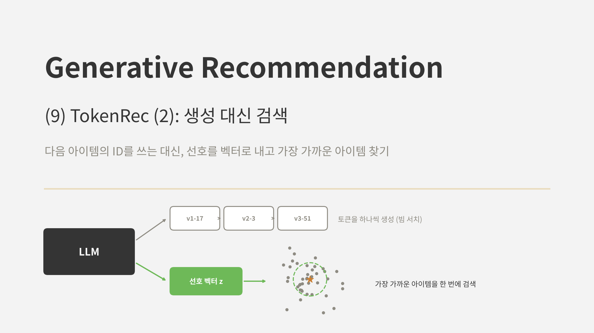
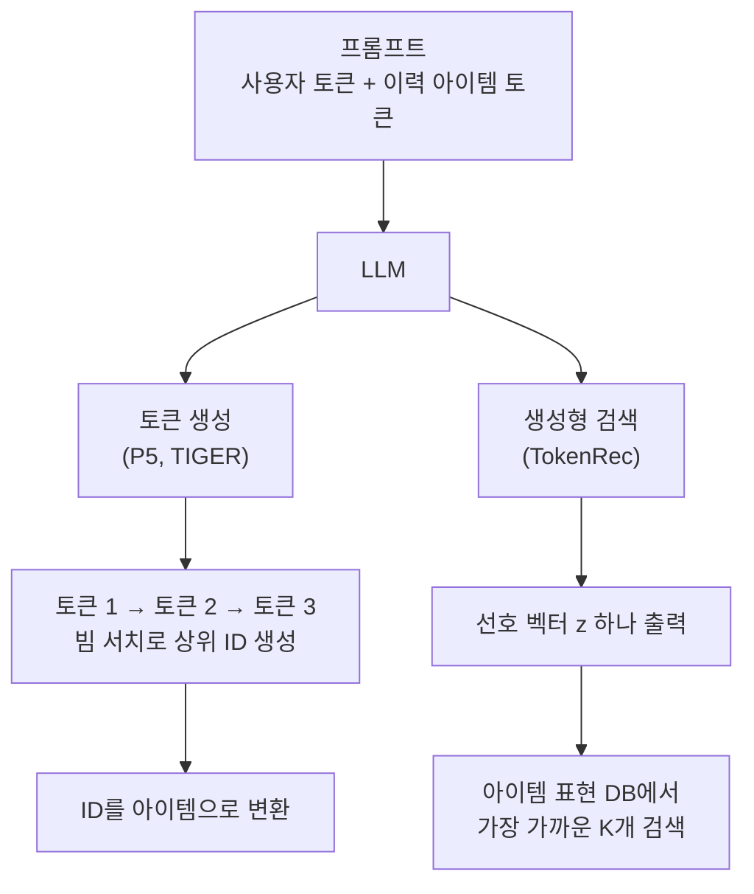
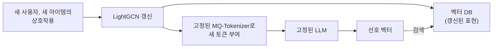
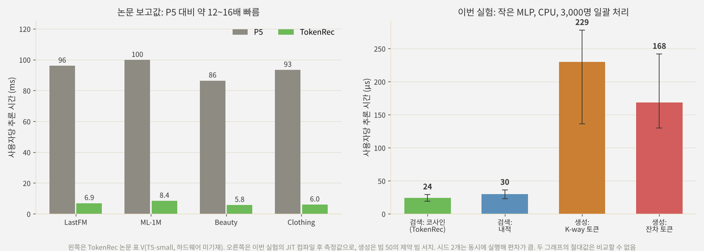
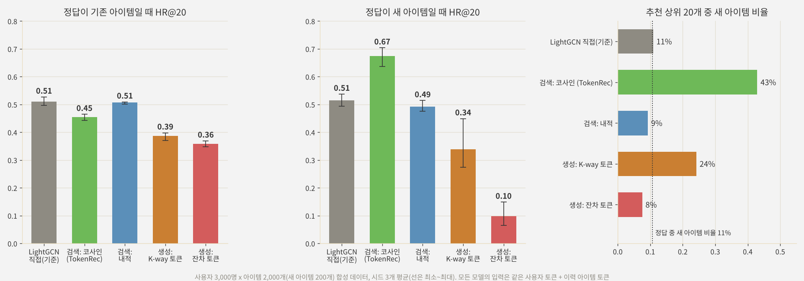

<br>{: .align-center}<br>

### _"다음 아이템의 ID를 꼭 한 글자씩 써 내려가야 할까?"_

[지난 글]()에서는 TokenRec이 LightGCN의 협업 표현을 MQ-Tokenizer로 토큰화해 LLM에 넣는 방법을 봤습니다. 이번에는 TokenRec의 두 번째 아이디어, **출력 쪽**을 다룹니다.

[6편]()의 TIGER나 P5 같은 모델은 다음 아이템의 ID 토큰을 빔 서치로 하나씩 생성합니다. TokenRec은 이 과정을 없앴습니다. LLM은 사용자의 선호를 **벡터 하나로** 내고, 그 벡터와 가장 가까운 아이템을 검색합니다. 이 선택이 추론 속도, 존재하지 않는 ID, 새 아이템 처리에 어떤 차이를 만드는지 정리하고, 같은 입력에 두 방식을 붙여 직접 비교해 봅니다.

---

## 1. 출력을 만드는 두 가지 방법

### 1.1 토큰 생성과 생성형 검색



* **토큰 생성:** 언어 모델이 문장을 쓰듯, 아이템 ID를 이루는 토큰을 앞에서부터 하나씩 생성합니다. 상위 20개를 얻으려면 빔을 20개 이상 유지하면서 토큰 수만큼 디코더를 반복해서 돌려야 합니다.
* **생성형 검색:** LLM의 마지막 은닉 상태를 작은 MLP로 아이템 표현 공간에 사상해 벡터 $\mathbf{z}$를 만들고, 모든 아이템 표현과의 유사도로 순위를 매깁니다. 디코딩 반복이 없습니다.

이름이 조금 헷갈릴 수 있습니다. 6편의 DSI와 TIGER도 "Generative Retrieval"이라고 불렸지만, 그때는 **ID를 생성하는 것**이 검색이었습니다. TokenRec이 말하는 생성형 검색은 LLM이 무언가를 생성하기는 하되 그것이 토큰열이 아니라 **검색용 벡터**라는 뜻입니다.

### 1.2 무엇이 달라지나

| 구분 | 토큰 생성 (TIGER, P5) | 생성형 검색 (TokenRec) |
|---|---|---|
| 출력 | 아이템 ID 토큰열 | 선호 벡터 하나 |
| 추론 | 토큰 수 x 빔 크기만큼 디코딩 | 순전파 한 번 + 최근접 이웃 검색 |
| 존재하지 않는 ID | 생길 수 있음 (제약 디코딩으로 차단) | 생기지 않음 (실제 아이템 중에서만 고름) |
| ID 충돌 | 같은 ID를 가진 아이템을 따로 구분해야 함 | 상관없음 (아이템마다 고유한 표현) |
| 새 아이템 | 그 ID 패턴을 모델이 생성할 수 있어야 함 | 표현만 DB에 넣으면 바로 후보 |
| 필요한 것 | 코드 토큰 어휘만 | 모든 아이템의 표현과 검색 인덱스 |

---

## 2. TokenRec의 생성형 검색

### 2.1 사상과 점수

프롬프트를 LLM(T5-small)에 넣어 얻은 은닉 상태 $\mathbf{h}_i$를 3층 MLP로 사상하고, 아이템 $j$의 LightGCN 표현 $\mathbf{q}_j$와의 코사인 유사도를 점수로 씁니다.

$$
\mathbf{z}_i = \text{Proj}(\mathbf{h}_i), \qquad y_{ij} = \frac{\mathbf{z}_i^\top \mathbf{q}_j}{\lVert \mathbf{z}_i \rVert \, \lVert \mathbf{q}_j \rVert}
$$

### 2.2 학습 손실

정답 아이템과는 유사도를 1에 가깝게, 상호작용하지 않은 아이템과는 여유값 $\gamma$ 아래로 떨어뜨리는 쌍 단위 손실입니다. 음성 아이템은 양성 하나당 하나씩 무작위로 뽑습니다.

$$
\mathcal{L} =
\begin{cases}
1 - y_{ij} & \text{정답 아이템} \\
\max(0, \; y_{ij} - \gamma) & \text{음성 아이템}
\end{cases}
$$

논문은 $\gamma$를 0~0.2 범위에서 정했습니다. 학습할 때 MQ-Tokenizer는 고정하고, LLM과 새로 추가한 토큰 임베딩, 사상 MLP를 학습합니다.

### 2.3 추론

추론할 때는 LLM을 한 번 돌려 $\mathbf{z}$를 얻고, 벡터 DB에 저장된 모든 아이템 표현과 비교해 상위 $K$개를 고릅니다. 아이템이 많으면 [STATIC 글]() 같은 제약 디코딩 대신 일반적인 근사 최근접 이웃(ANN) 검색 인프라를 그대로 쓸 수 있다는 점도 실무에서는 장점입니다.

---

## 3. 새 사용자와 새 아이템

### 3.1 LLM은 그대로, 표현만 갱신

TokenRec은 새 사용자와 새 아이템이 생겼을 때 **LLM과 토크나이저를 다시 학습하지 않습니다.** LightGCN만 새 상호작용으로 갱신하고, 벡터 DB의 표현을 바꿉니다. 새 사용자는 갱신된 표현을 고정된 토크나이저에 넣어 토큰을 받고, 새 아이템은 표현이 DB에 들어가는 순간 검색 후보가 됩니다.



### 3.2 논문의 결과

논문은 상호작용이 가장 적은 5% 사용자를 학습에서 빼고, 학습 후에 새 사용자로 평가했습니다.

| 데이터 | 모델 | 기존 사용자 HR@20 | 새 사용자 HR@20 | 하락 |
|---|---|---|---|---|
| LastFM | P5 | 0.0704 | 0.0399 | 43% |
| LastFM | CoLLM | 0.0812 | 0.0574 | 29% |
| LastFM | TokenRec | **0.0973** | **0.0773** | 21% |
| Beauty | P5 | 0.0511 | 0.0274 | 46% |
| Beauty | CoLLM | 0.0612 | 0.0477 | 22% |
| Beauty | TokenRec | **0.0629** | **0.0591** | 6% |

ID를 그대로 쓰는 P5는 새 사용자에서 성능이 거의 절반으로 떨어졌지만, TokenRec은 하락 폭이 가장 작았습니다. 새 사용자의 ID가 협업 표현에서 나오기 때문에, 처음 보는 사용자라도 비슷한 기존 사용자와 겹치는 토큰을 받을 수 있어서입니다.

다만 **새 아이템**에 대해서는 논문이 방법만 설명하고 정량 결과는 보고하지 않았습니다. 이 부분은 뒤의 실험에서 직접 확인해 봤습니다.

---

## 4. 추론 속도

생성형 검색의 가장 직접적인 이점은 속도입니다. 논문의 표 V를 옮기면 다음과 같습니다(사용자당 ms).

<br>{: .align-center}<br>

왼쪽 그래프처럼 TokenRec은 같은 T5-small을 쓰는 P5보다 네 데이터에서 약 12~16배 빨랐습니다. 차이는 거의 전부 디코딩에서 옵니다. P5는 아이템 ID를 빔 서치로 생성하느라 디코더를 여러 번 돌리지만, TokenRec은 인코딩 한 번과 유사도 계산으로 끝납니다. 아이템 수가 늘어도 유사도 계산은 ANN으로 처리할 수 있으므로, 이 차이는 규모가 커질수록 더 중요해집니다.

---

## 5. 직접 실험: 같은 입력, 두 가지 출력

### 5.1 실험 설계

8편과 같은 합성 데이터(사용자 3,000명, 아이템 2,000개, 취향 그룹 40개)와 LightGCN, 토크나이저를 썼습니다. 이번에는 사용자 대신 **아이템**의 10%(200개)를 처음 학습에서 빼 두었다가, LightGCN만 갱신해 새 아이템으로 넣었습니다. 토크나이저와 추천 모델은 고정이고, 새 아이템은 고정된 아이템 토크나이저로 토큰을 받습니다.

입력은 모든 모델이 같습니다. 8편에서 가장 좋았던 설정(입력을 길이 1로 정규화하고 마스킹 0.5를 쓴 K-way 토크나이저)으로 만든 사용자 토큰과 이력 아이템 토큰을 평균 내어 MLP에 넣습니다. 출력 쪽만 다르게 붙였습니다.

* **검색, 코사인:** TokenRec 방식. MLP 출력과 갱신된 아이템 LightGCN 표현의 코사인 유사도, 2.2절의 손실
* **검색, 내적:** 같은 구조에서 유사도만 내적으로 바꾸고 BPR 손실로 학습
* **생성, K-way 토큰:** 정답 아이템의 K-way 토큰 3개를 순서대로 생성. 빔 50의 제약 빔 서치
* **생성, 잔차 토큰:** 같은 방식으로, 4편의 잔차 양자화로 만든 토큰을 생성. 앞 코드가 큰 범주를 담는 TIGER식 ID

같은 토큰 조합을 가진 아이템이 여럿이면 인기 순으로 모두 후보에 넣었습니다. 기준으로는 갱신된 LightGCN 표현을 그대로 내적한 결과를 함께 봤습니다. 평가는 정답이 기존 아이템인 경우와 새 아이템인 경우로 나눈 HR@20이고, 시드는 3개입니다.

### 5.2 결과

<br>{: .align-center}<br>

| 출력 방식 | 기존 아이템 HR@20 | 새 아이템 HR@20 | 상위 20개 중 새 아이템 |
|---|---|---|---|
| LightGCN 직접 (기준) | 0.510 | 0.514 | 11% |
| 검색, 코사인 (TokenRec) | 0.455 | **0.674** | 43% |
| 검색, 내적 | **0.507** | 0.493 | 9% |
| 생성, K-way 토큰 | 0.387 | 0.338 | 24% |
| 생성, 잔차 토큰 | 0.358 | 0.098 | 8% |

**검색이 생성보다 정확했습니다.** 기존 아이템 기준으로 내적 검색은 0.507로 LightGCN과 거의 같았지만, 토큰 생성은 0.36~0.39에 그쳤습니다. 생성 모델은 아이템 2,000개를 토큰 조합으로 구분해 맞혀야 하고, 토큰 조합이 같은 아이템은 서로 구분할 수 없습니다. 검색은 아이템마다 고유한 표현이 있어 이런 손실이 없습니다.

**생성 방식은 새 아이템에 약했고, 특히 잔차 토큰은 거의 맞히지 못했습니다(0.098).** 잔차 토큰은 아이템마다 거의 고유해서(2,000개 중 약 1,930개 조합), 새 아이템의 93% 이상이 학습 때 한 번도 정답으로 나온 적 없는 조합을 받았습니다. 모델이 본 적 없는 조합을 생성하기는 어렵습니다. K-way 토큰은 조합이 겹치는 경우가 많아, 새 아이템의 약 60%가 기존 아이템과 같은 조합을 받았습니다. 그 덕에 새 아이템이 기존 아이템에 섞여 후보에 오르지만, 이는 생성 모델이 새 아이템을 이해해서라기보다 **충돌 덕분**입니다.

**코사인 검색은 새 아이템을 지나치게 많이 추천했습니다.** 새 아이템 HR@20이 0.674로 LightGCN(0.514)보다도 높았는데, 상위 20개의 43%가 새 아이템이었습니다. 실제 정답 중 새 아이템은 11%뿐이니 네 배 가까이 과하게 노출한 셈입니다. 그만큼 기존 아이템이 밀려나 기존 아이템 HR@20은 0.455로 떨어졌습니다.

원인은 8편에서 본 것과 같은 **벡터 길이**였습니다. 갱신된 LightGCN에서 새 아이템 표현은 짧게만 학습되어 길이가 기존 아이템의 3분의 2 정도였습니다. 내적은 이 짧은 길이를 그대로 반영해 새 아이템을 덜 추천하지만, 코사인은 길이를 지우고 방향만 봅니다. 새 아이템은 아직 여러 사용자의 평균 쪽을 향해 있어서, 방향만 보면 많은 사용자와 가까워 보입니다. 같은 구조에서 유사도만 내적으로 바꾸자 새 아이템 비율이 9%로 내려가고 기존 아이템과 새 아이템 성능이 모두 LightGCN과 비슷해졌습니다.

새 아이템을 일부러 더 노출하고 싶은 서비스라면 코사인의 이런 성질이 오히려 도움이 될 수도 있습니다. 다만 그것은 **설계해서 조절할 일**이지, 유사도 선택의 부작용으로 생겨서는 안 됩니다. 논문은 코사인을 썼고 새 아이템 실험은 하지 않았으므로, 실서비스에 옮긴다면 이 부분을 꼭 확인해 봐야 합니다.

### 5.3 속도와 존재하지 않는 ID

4절의 그래프 오른쪽이 이번 실험의 추론 시간입니다. 같은 입력 표현에서 출력만 바꿨는데, 검색은 사용자당 약 24~30μs, 생성은 170~230μs로 **약 6~10배** 차이가 났습니다. 모델이 아주 작아 절대값에는 의미가 없지만, 생성이 토큰 수만큼 헤드를 반복해서 돌리고 빔마다 정렬해야 한다는 구조적 차이는 그대로 드러납니다.

제약 없이 빔 서치를 하면 상위 20개 중 **존재하지 않는 토큰 조합**이 K-way 토큰에서 10%, 잔차 토큰에서 31% 나왔습니다. 6편의 미니 TIGER(0.007% 이하)보다 훨씬 많은데, 이번에는 각 단계의 다음 코드를 MLP 헤드 하나로만 예측하는 단순한 생성기라 조합의 제약을 잘 익히지 못했기 때문으로 보입니다. 생성 방식에서는 제약 디코딩이 사실상 필수이고, 검색 방식에는 이런 문제가 아예 없습니다.

이번 실험도 작은 합성 데이터와 LLM 없는 작은 모델로 한 것이라 수치보다는 경향을 봐 주시면 좋겠습니다. 특히 생성 헤드는 Transformer 디코더가 아니라 단순한 MLP라서, 생성 방식의 정확도는 실제보다 낮게 나왔을 수 있습니다.

---

## 6. 무엇을 맞바꾸는가

생성형 검색이 빠르고 존재하지 않는 ID도 없다면, 왜 모두 이 방식을 쓰지 않을까요? 맞바꾸는 것도 분명히 있습니다.

* **결국 협업 표현 공간 안에서만 고른다.** 출력은 LightGCN 표현 공간의 한 점이고, LLM은 그 공간에서 사용자의 위치를 다시 표현할 뿐입니다. 협업 표현이 담지 못한 관계는 LLM이 알아도 결과에 반영되기 어렵습니다.
* **아이템 표현을 계속 관리해야 한다.** 검색하려면 모든 아이템의 표현과 인덱스가 있어야 하고, 협업 모델을 갱신할 때마다 LLM이 학습한 사상과 어긋나지 않는지 신경 써야 합니다. 토큰 생성 방식은 코드 토큰 어휘만 있으면 됩니다.
* **유사도 정의가 결과를 좌우한다.** 뒤의 실험에서 본 것처럼, 코사인이냐 내적이냐에 따라 새 아이템이 노출되는 정도가 크게 달라질 수 있습니다.
* **LLM의 다른 능력과 섞기 어렵다.** 토큰 생성 방식은 추천 결과와 설명 문장을 같은 디코더로 이어서 생성할 수 있지만, 벡터 출력은 별도의 경로가 필요합니다.

정리하면, 생성형 검색은 **LLM을 강력한 사용자 인코더로 쓰는** 방식에 가깝습니다. 이름에 생성이 들어가지만 출력 구조는 [1편]()에서 본 Two-Tower와 ANN 기반 검색에 더 가깝고, 그만큼 기존 검색 인프라와 잘 맞습니다.

---

## 7. 부록: 두 출력 방식의 핵심 코드

실험은 JAX로 했지만, 핵심 부분을 PyTorch로 정리합니다.

### Point 1. 검색 헤드와 TokenRec의 손실

```python
import torch
import torch.nn as nn
import torch.nn.functional as F

class RetrievalHead(nn.Module):
    def __init__(self, hidden, item_dim):
        super().__init__()
        self.proj = nn.Sequential(nn.Linear(hidden, hidden), nn.ReLU(),
                                  nn.Linear(hidden, hidden), nn.ReLU(),
                                  nn.Linear(hidden, item_dim))      # 3층 MLP

    def forward(self, h):
        return F.normalize(self.proj(h), dim=-1)

def tokenrec_loss(z, item_reps, pos, neg, gamma=0.1):
    """z: (B, d) 정규화된 선호 벡터, item_reps: (N, d) LightGCN 아이템 표현"""
    q = F.normalize(item_reps, dim=-1)
    sim_pos = (z * q[pos]).sum(-1)
    sim_neg = (z * q[neg]).sum(-1)
    return (1 - sim_pos).mean() + F.relu(sim_neg - gamma).mean()

@torch.no_grad()
def retrieve(z, item_reps, seen_mask, k=20):
    scores = z @ F.normalize(item_reps, dim=-1).T
    scores = scores.masked_fill(seen_mask, float("-inf"))           # 이미 본 아이템 제외
    return scores.topk(k, dim=-1).indices
```

### Point 2. 토큰 생성 헤드

비교용 토큰 생성 헤드입니다. 같은 입력 표현 $\mathbf{h}$에서 아이템의 토큰 3개를 순서대로 예측합니다.

```python
class GenerationHead(nn.Module):
    def __init__(self, hidden, K=3, L=64, code_dim=32):
        super().__init__()
        self.K, self.L = K, L
        self.code_emb = nn.ModuleList([nn.Embedding(L, code_dim) for _ in range(K)])
        self.heads = nn.ModuleList([nn.Sequential(nn.Linear(hidden + code_dim * l, hidden), nn.ReLU(),
                                                  nn.Linear(hidden, L)) for l in range(K)])

    def logits(self, h, prev):                     # prev: (..., l) 지금까지 생성한 코드
        parts = [h] + [self.code_emb[j](prev[..., j]) for j in range(prev.size(-1))]
        return self.heads[prev.size(-1)](torch.cat(parts, -1))

    def loss(self, h, target):                     # target: (B, K) 정답 아이템의 토큰
        return sum(F.cross_entropy(self.logits(h, target[:, :l]), target[:, l]) for l in range(self.K))
```

### Point 3. 제약 빔 서치

존재하는 토큰 조합만 이어지도록 마스크를 씌우고, 단계마다 상위 `beam`개를 남깁니다. 마지막에 같은 토큰 조합을 가진 아이템이 여러 개면 모두 후보로 펼칩니다.

```python
@torch.no_grad()
def constrained_beam(head, h, allowed, beam=50):
    """allowed[l]: l단계에서 허용되는 다음 코드 마스크. allowed[0]: (L,), allowed[1]: (L, L), allowed[2]: (L, L, L)"""
    B = h.size(0)
    lp = head.logits(h, h.new_zeros(B, 0, dtype=torch.long)).log_softmax(-1)
    lp = lp.masked_fill(~allowed[0], float("-inf"))
    score, c = lp.topk(beam, dim=-1)
    seqs = c.unsqueeze(-1)                                           # (B, beam, 1)
    for l in range(1, head.K):
        hb = h.unsqueeze(1).expand(-1, beam, -1)
        lp = head.logits(hb, seqs).log_softmax(-1)                  # (B, beam, L)
        mask = allowed[l][tuple(seqs[..., j] for j in range(l))]
        lp = lp.masked_fill(~mask, float("-inf"))
        score, idx = (score.unsqueeze(-1) + lp).flatten(1).topk(beam, dim=-1)
        prev = torch.gather(seqs, 1, (idx // head.L).unsqueeze(-1).expand(-1, -1, l))
        seqs = torch.cat([prev, (idx % head.L).unsqueeze(-1)], -1)
    return seqs, score
```

검색은 행렬 곱 한 번이지만, 생성은 토큰 수만큼 헤드를 다시 돌리고 빔마다 후보를 정렬해야 합니다. 두 함수의 구조 차이가 곧 추론 비용의 차이입니다.

---

## 8. 결론 및 다음 글

정리하면 다음과 같습니다.

* TokenRec의 **생성형 검색**은 LLM이 아이템 토큰을 하나씩 생성하는 대신, 사용자 선호를 **벡터 하나**로 내고 아이템 표현 DB에서 가장 가까운 아이템을 찾습니다. 3층 MLP 사상, 코사인 유사도, 여유값이 있는 쌍 단위 손실로 학습합니다.
* 디코딩 반복이 없어 논문 기준 P5보다 **12~16배 빨랐고**, 실제 아이템 중에서만 고르므로 **존재하지 않는 ID가 생기지 않습니다.**
* 새 사용자와 새 아이템은 **LightGCN과 벡터 DB만 갱신**하면 되고, LLM과 토크나이저는 그대로 둡니다. 논문에서 새 사용자 성능 하락은 P5의 절반 이하였습니다.
* 직접 비교해 보니 같은 입력에서 **검색이 생성보다 정확했고**, 특히 새 아이템에서 차이가 컸습니다. 잔차 토큰을 생성하는 방식은 처음 보는 토큰 조합을 거의 만들지 못했습니다.
* 다만 **코사인 유사도는 새 아이템을 네 배 가까이 과하게 추천**했습니다. 갱신 직후 새 아이템 표현이 짧기 때문이고, 내적으로 바꾸면 사라졌습니다.

[1편]()에서 생성형 추천의 장점으로 "모델 자체가 인덱스 역할을 하므로 ANN 인덱스를 따로 만들 필요가 없다"는 점을 꼽았습니다. TokenRec은 이 성질을 내려놓고 벡터 검색을 다시 가져온 대신, 속도와 새 아이템 처리를 얻었습니다. 생성형 추천이라는 이름 아래에서도 출력 설계에 따라 전혀 다른 시스템이 될 수 있다는 점이 이번 두 편의 핵심입니다.

다음 글부터는 **LC-Rec**을 두 편에 걸쳐 다룹니다. LC-Rec은 TokenRec과 반대로 LLM이 아이템의 Semantic ID를 **직접 생성**하게 하면서, 언어 모델이 그 ID의 의미를 이해하도록 여러 정렬 과제를 함께 학습시킵니다. 같은 LLM 기반 추천이라도 토큰을 생성하는 쪽을 택하면 무엇을 더 해 줘야 하는지 살펴보겠습니다.

---

## 참고 문헌

* Qu et al., *TokenRec: Learning to Tokenize ID for LLM-based Generative Recommendations*, IEEE TKDE 2025. [arXiv:2406.10450](https://arxiv.org/abs/2406.10450)
* Geng et al., *Recommendation as Language Processing (RLP): A Unified Pretrain, Personalized Prompt & Predict Paradigm (P5)*, RecSys 2022. [arXiv:2203.13366](https://arxiv.org/abs/2203.13366)
* Rajput et al., *Recommender Systems with Generative Retrieval* (TIGER), NeurIPS 2023. [arXiv:2305.05065](https://arxiv.org/abs/2305.05065)
* Tay et al., *Transformer Memory as a Differentiable Search Index* (DSI), NeurIPS 2022. [arXiv:2202.06991](https://arxiv.org/abs/2202.06991)
* He et al., *LightGCN: Simplifying and Powering Graph Convolution Network for Recommendation*, SIGIR 2020. [arXiv:2002.02126](https://arxiv.org/abs/2002.02126)
