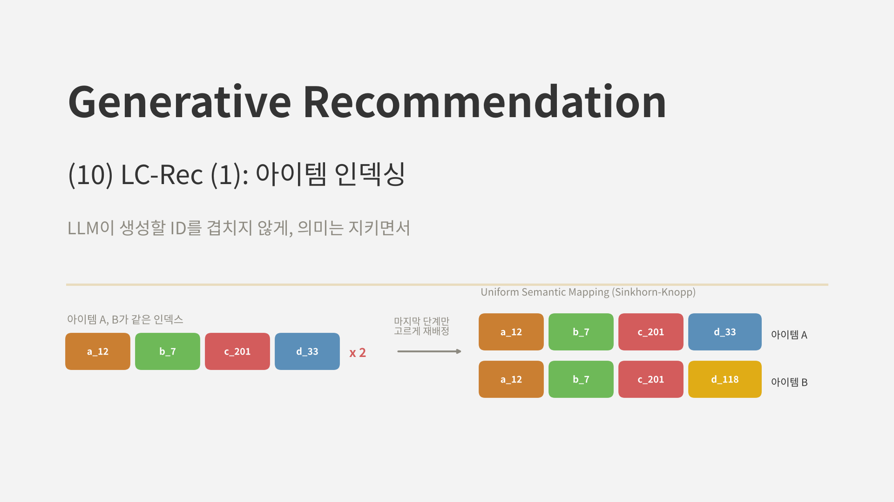
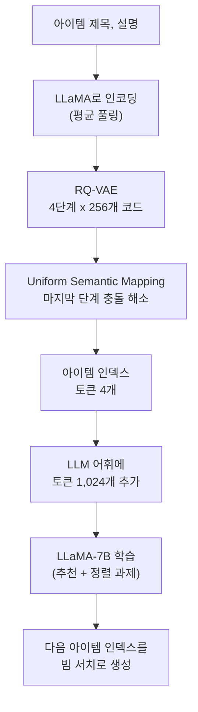
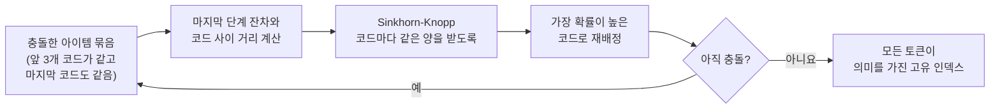
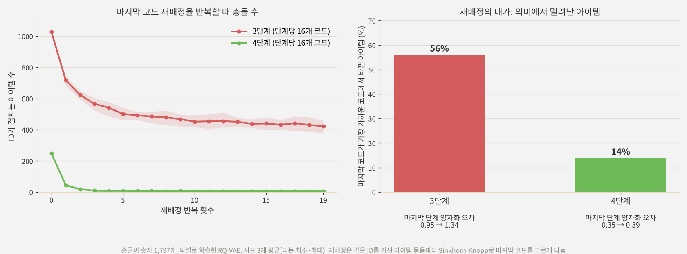
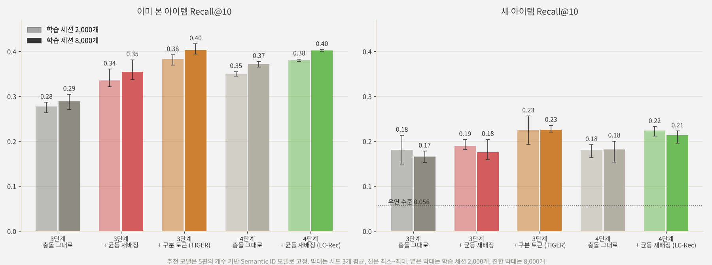

<br>{: .align-center}<br>

### _"LLM이 아이템 ID를 직접 생성하게 하려면, ID부터 어떻게 만들어야 할까?"_

[지난 두 편]()의 TokenRec은 LLM이 아이템 토큰을 생성하지 않고, 선호 벡터를 내서 검색하는 길을 택했습니다. 이번에 다룰 **LC-Rec**(Zheng et al., ICDE 2024)은 정반대입니다. LLaMA-7B가 다음 아이템의 인덱스를 **토큰으로 직접 생성**합니다.

생성 쪽을 택하면 해결해야 할 문제가 두 가지 생깁니다. 첫째, LLM이 생성할 **아이템 인덱스를 어떻게 만들 것인가**. 둘째, 언어만 배운 LLM이 그 인덱스의 **의미를 어떻게 이해하게 할 것인가**. LC-Rec은 첫째를 Uniform Semantic Mapping이라는 인덱싱 방법으로, 둘째를 여러 정렬 과제로 풉니다. 이번 글은 첫째, 다음 글은 둘째를 다룹니다.

---

## 1. LC-Rec의 전체 구조



1. 아이템의 제목과 설명을 LLaMA로 인코딩하고 토큰 표현을 평균 내어 텍스트 임베딩을 만듭니다.
2. [4편]()의 RQ-VAE로 임베딩을 4단계, 단계당 256개 코드로 양자화합니다.
3. 여러 아이템이 같은 인덱스를 받으면 **Uniform Semantic Mapping(USM)**으로 마지막 단계 코드를 다시 배정해 충돌을 없앱니다.
4. 단계마다 다른 토큰을 써서, 인덱스 토큰 4 x 256 = 1,024개를 LLM 어휘에 추가합니다.
5. LLaMA-7B를 추천 과제와 정렬 과제로 학습하고(다음 글), 추론할 때는 빔 크기 20의 빔 서치로 인덱스를 생성합니다.

---

## 2. LLM을 위한 아이템 인덱스의 조건

LC-Rec은 LLM이 쓸 아이템 인덱스가 갖춰야 할 성질을 다음처럼 정리합니다.

* **의미를 담을 것:** 비슷한 아이템이 비슷한 토큰을 공유해야, LLM이 아이템 사이의 관계를 토큰 수준에서 배울 수 있습니다.
* **어휘가 작을 것:** 아이템마다 새 토큰을 하나씩 추가하면 어휘가 아이템 수만큼 커지고, 대부분의 토큰은 학습 데이터에 몇 번 등장하지도 않습니다. 코드를 조합하면 토큰 1,024개로 수많은 아이템을 표현할 수 있습니다.
* **겹치지 않을 것:** LLM은 인덱스를 생성해 아이템을 고르므로, 두 아이템이 같은 인덱스를 가지면 서로 구분할 수 없습니다.

앞의 두 조건은 TIGER의 Semantic ID가 이미 만족합니다. 문제는 셋째입니다. [5편]()에서 봤듯이 의미를 잘 담을수록 비슷한 아이템이 같은 칸에 몰리고, 그만큼 충돌이 늘어납니다.

---

## 3. 충돌을 푸는 세 가지 방법

### 3.1 그대로 두기, 구분 토큰 붙이기

가장 단순한 방법은 충돌을 그대로 두는 것이지만, 그러면 같은 인덱스를 가진 아이템들을 추천 결과에서 구분할 수 없습니다.

[6편]()의 TIGER는 인덱스 끝에 **구분 토큰**을 하나 더 붙였습니다. 같은 인덱스를 가진 아이템들에 0, 1, 2 순서로 번호를 매기는 방식입니다. 확실하게 충돌을 없애지만, 이 마지막 토큰에는 **아무 의미가 없습니다.** 같은 묶음 안에서 누가 0번이고 누가 1번인지는 임의로 정해집니다. LLM 입장에서는 의미 없는 토큰을 외워야 하는 셈이고, LC-Rec은 이것이 LLM과 인덱스의 의미를 정렬하는 데 방해가 된다고 봤습니다.

### 3.2 Uniform Semantic Mapping

LC-Rec의 해법은 마지막 단계의 코드 배정에 **균등 분포 제약**을 거는 것입니다. 앞 단계들은 그대로 두고, 마지막 단계에서 아이템을 코드에 고르게 나누도록 최적 수송(Optimal Transport) 문제로 바꿉니다.

배치 $\mathcal{B}$의 아이템마다 마지막 단계의 잔차 $\mathbf{r}_H$가 있고, 코드 $k$의 임베딩을 $\mathbf{v}_k^H$라고 하면 다음 문제를 풉니다.

$$
\min_{q} \sum_{\mathbf{r} \in \mathcal{B}} \sum_{k=1}^{K} q(c_H = k \mid \mathbf{r}_H) \, \lVert \mathbf{r}_H - \mathbf{v}_k^H \rVert^2
$$

$$
\text{s.t.} \quad \sum_{k=1}^{K} q(c_H = k \mid \mathbf{r}_H) = 1, \qquad \sum_{\mathbf{r} \in \mathcal{B}} q(c_H = k \mid \mathbf{r}_H) = \frac{\lvert \mathcal{B} \rvert}{K}
$$

첫째 제약은 아이템마다 배정 확률의 합이 1이라는 뜻이고, 둘째 제약이 핵심입니다. **모든 코드가 같은 양의 아이템을 받아야** 한다는 균등 제약입니다. 가장 가까운 코드만 고르면 비슷한 아이템이 한 코드로 몰리지만, 이 제약이 있으면 몰린 아이템 일부가 다음으로 가까운 코드로 밀려납니다.

이 문제는 **Sinkhorn-Knopp** 알고리즘으로 빠르게 풀 수 있습니다. 거리로 만든 행렬 $\exp(-D/\varepsilon)$의 열 합과 행 합을 번갈아 정규화하는 과정을 반복하면, 두 제약을 모두 만족하는 배정 확률에 가까워집니다. 각 아이템은 그중 확률이 가장 높은 코드를 받습니다.



### 3.3 왜 마지막 단계만 바꾸나

USM은 **마지막 단계에만** 적용됩니다. RQ-VAE의 잔차 구조에서 앞쪽 코드는 큰 범주를, 뒤쪽 코드는 작은 세부를 담습니다. 앞쪽 코드를 바꾸면 아이템이 엉뚱한 범주로 가 버리지만, 마지막 코드는 원래 작은 잔차를 표현하던 것이라 다음으로 가까운 코드로 옮겨도 의미 손실이 작습니다.

논문의 분석도 이를 뒷받침합니다. 인덱스에서 아이템 제목을 생성해 보면, 첫 번째 코드만으로도 핵심 키워드 일부가 나오고, 두 번째 코드까지 주면 아이템 이름의 상당 부분이 복원되며, 네 번째 코드가 더하는 정보가 가장 적었습니다.

정리하면 세 방법은 다음과 같습니다.

| 방법 | 인덱스 길이 | 충돌 | 마지막 토큰의 의미 |
|---|---|---|---|
| 그대로 두기 | 그대로 | 남음 | 있음 |
| 구분 토큰 (TIGER) | 1 늘어남 | 없음 | 없음 (임의의 번호) |
| USM (LC-Rec) | 그대로 | 대부분 사라짐 | 있음 (가까운 코드 중에서 배정) |

---

## 4. 논문의 결과

### 4.1 설정

* **데이터:** Amazon Musical Instruments, Arts Crafts and Sewing, Video Games. leave-one-out, 전체 아이템 순위
* **인덱스:** RQ-VAE 4단계 x 256개, 코드 차원 32
* **LLM:** LLaMA-7B, AdamW(학습률 5e-5), 4에폭. 추론은 빔 크기 20

### 4.2 주요 결과

| 데이터 | TIGER HR@10 | LC-Rec HR@10 | TIGER NDCG@10 | LC-Rec NDCG@10 |
|---|---|---|---|---|
| Instruments | 0.1064 | **0.1220** | 0.0803 | **0.0926** |
| Arts | 0.1012 | **0.1266** | 0.0703 | **0.0906** |
| Games | 0.0939 | **0.1174** | 0.0501 | **0.0681** |

세 데이터 모두에서 TIGER보다 HR@10이 15~25% 높았습니다. 다만 이 차이는 인덱싱만의 효과가 아닙니다. LLaMA-7B라는 훨씬 큰 모델과, 다음 글에서 볼 정렬 과제가 함께 들어간 결과입니다.

### 4.3 인덱싱 방법 비교

논문은 Games 데이터에서 인덱싱 방법만 바꾼 비교도 보였습니다. USM을 쓴 LC-Rec의 인덱스가 **구분 토큰을 붙인 인덱스**, **충돌을 그대로 둔 인덱스**, **무작위 인덱스**보다 모두 좋았습니다. 그리고 어떤 인덱싱 방법을 쓰든 정렬 과제를 더하면 성능이 올랐습니다. 아쉽게도 이 비교는 그래프로만 제시되어 정확한 수치는 알 수 없습니다.

---

## 5. 직접 실험: 충돌을 어떻게 푸느냐에 따라

### 5.1 실험 설계

[7편]()과 같은 합성 세계를 썼습니다. 손글씨 숫자 1,797개가 아이템이고, 10%(179개)는 학습에 등장하지 않는 새 아이템입니다. 픽셀로 학습한 RQ-VAE로 인덱스를 만들고, 충돌 처리 방식만 바꿔 비교했습니다.

* **3단계, 충돌 그대로:** 코드 16개 x 3단계
* **3단계 + 균등 재배정:** 위에 USM을 적용
* **3단계 + 구분 토큰:** TIGER처럼 네 번째 토큰으로 번호를 붙임
* **4단계, 충돌 그대로:** 코드 16개 x 4단계
* **4단계 + 균등 재배정:** LC-Rec과 같은 구성

USM은 3.2절의 방식대로, 같은 인덱스를 가진 아이템 묶음마다 Sinkhorn-Knopp로 마지막 코드를 다시 배정하고 최대 20번 반복했습니다. 추천 모델은 LLM 대신 5편의 개수 기반 Semantic ID 모델로 고정했습니다. 이번에 보고 싶은 것은 인덱스 자체의 차이이기 때문입니다. 평가는 이전 편들과 같이 이미 본 아이템의 Recall@10과 새 아이템의 Recall@10(아이템별 평균)이고, 학습 세션 2,000개와 8,000개, 시드 3개입니다.

### 5.2 USM은 여유가 있을 때만 충돌을 없앤다

<br>{: .align-center}<br>

* **4단계에서는 거의 모든 충돌이 사라졌습니다.** 처음에 247개 아이템이 다른 아이템과 인덱스가 겹쳤는데, 재배정 한 번에 40여 개로 줄고 20번 뒤에는 평균 5개만 남았습니다. 이때 마지막 코드가 바뀐 아이템은 14%였고, 마지막 단계의 양자화 오차는 0.35에서 0.39로 조금만 늘었습니다.
* **3단계에서는 40% 넘게 남았습니다.** 1,027개에서 427개로 줄었지만 더는 줄지 않았고, 그 과정에서 아이템의 56%가 마지막 코드를 옮겨야 했습니다. 양자화 오차는 0.95에서 1.34로 크게 늘었습니다.

차이는 **빈자리**에서 옵니다. 앞 두 코드가 같은 아이템이 16개를 넘으면, 마지막 코드 16개를 아무리 고르게 나눠도 겹칠 수밖에 없습니다. 3단계에서는 이런 묶음이 많았고, 4단계에서는 앞 세 코드로 이미 잘게 나뉘어 마지막 코드 16개에 여유가 있었습니다. LC-Rec이 4단계 x 256개라는 넉넉한 공간에서 USM을 쓴 것도 같은 이유로 볼 수 있습니다. USM은 **빈자리가 있을 때 의미를 덜 해치면서 충돌을 피하는 방법**이지, 공간이 모자랄 때 쓰는 해법이 아닙니다.

### 5.3 추천 성능

<br>{: .align-center}<br>

| 인덱스 | 길이 | 겹치는 아이템 | 이미 본 아이템 (2,000) | 새 아이템 (2,000) | 이미 본 아이템 (8,000) | 새 아이템 (8,000) |
|---|---|---|---|---|---|---|
| 3단계, 충돌 그대로 | 3 | 1,027 | 0.277 | 0.181 | 0.288 | 0.166 |
| 3단계 + 균등 재배정 | 3 | 427 | 0.335 | 0.190 | 0.355 | 0.175 |
| 3단계 + 구분 토큰 (TIGER) | 4 | 0 | **0.383** | **0.225** | **0.403** | **0.225** |
| 4단계, 충돌 그대로 | 4 | 247 | 0.350 | 0.180 | 0.372 | 0.182 |
| 4단계 + 균등 재배정 (LC-Rec) | 4 | 5 | 0.380 | 0.223 | 0.402 | 0.213 |

* **충돌은 그대로 두면 안 됩니다.** 3단계에서 충돌을 그대로 두면 이미 본 아이템 성능이 0.277로, 충돌을 없앤 방식(0.38)보다 크게 낮았습니다. 같은 인덱스를 가진 아이템은 추천 모델이 구분할 방법이 없기 때문입니다.
* **같은 길이 4에서, 구분 토큰과 USM은 거의 같았습니다.** TIGER식(0.383, 0.225)과 LC-Rec식(0.380, 0.223)의 차이는 시드 사이의 편차보다 작았습니다. 4단계에서 충돌을 그대로 둔 경우(0.350)보다는 둘 다 확실히 좋았습니다.
* **3단계에서 USM을 억지로 쓰면 손해입니다.** 충돌이 40% 넘게 남고 마지막 코드의 의미도 많이 흐려져, 구분 토큰보다 이미 본 아이템에서 0.05 가까이 낮았습니다.

이 실험의 추천 모델은 토큰의 등장 횟수만 세는 단순한 모델이라, 마지막 토큰이 의미를 갖는지 아닌지를 활용할 방법이 별로 없습니다. 그래서 두 방식이 비슷하게 나온 것으로 보입니다. LC-Rec이 USM을 고집한 이유는 다른 곳에 있습니다. LLM은 인덱스 토큰을 제목이나 설명 같은 **언어와 연결해서** 배워야 하는데, 의미 없는 번호 토큰은 연결할 언어가 없습니다. 이 차이는 다음 글의 정렬 과제에서 본격적으로 드러납니다.

---

## 6. 부록: Uniform Semantic Mapping 핵심 코드

실험은 NumPy로 했지만, 핵심 부분을 PyTorch로 정리합니다.

### Point 1. Sinkhorn-Knopp

거리 행렬에서 출발해 열(코드)과 행(아이템)을 번갈아 정규화합니다. 열은 아이템 수를 코드 수로 나눈 양을, 행은 1을 갖도록 맞춥니다.

```python
import torch

@torch.no_grad()
def sinkhorn_assign(r, codebook, eps=0.05, iters=100):
    """r: (n, d) 마지막 단계 잔차, codebook: (K, d). 코드마다 n/K만큼 받도록 배정"""
    D = torch.cdist(r, codebook) ** 2
    D = D / D.max().clamp_min(1e-12)                 # 스케일을 맞춰 eps의 의미를 고정
    Q = torch.exp(-D / eps)
    n, K = Q.shape
    for _ in range(iters):
        Q = Q / Q.sum(0, keepdim=True) * (n / K)     # 열 합 = n / K (코드 균등)
        Q = Q / Q.sum(1, keepdim=True)               # 행 합 = 1 (아이템마다 확률 분포)
    return Q.argmax(1)
```

### Point 2. 충돌한 묶음마다 반복해서 재배정

같은 인덱스를 가진 아이템들을 묶고, 묶음마다 마지막 코드만 다시 배정합니다. 재배정한 코드가 다른 아이템과 새로 겹칠 수 있으므로 충돌이 없어질 때까지(또는 정해 둔 횟수까지) 반복합니다.

```python
from collections import defaultdict

def uniform_semantic_mapping(codes, r_last, last_codebook, rounds=20):
    """codes: (N, H) RQ-VAE 인덱스, r_last: (N, d) 마지막 단계 잔차"""
    codes = codes.clone()
    for _ in range(rounds):
        groups = defaultdict(list)
        for i, idx in enumerate(map(tuple, codes.tolist())):
            groups[idx].append(i)
        collided = [g for g in groups.values() if len(g) > 1]
        if not collided:
            break
        for g in collided:
            codes[g, -1] = sinkhorn_assign(r_last[g], last_codebook)
    return codes
```

### Point 3. 인덱스를 LLM 토큰으로

단계마다 다른 접두어를 붙여 토큰을 만들고, LLM 토크나이저에 새 어휘로 추가합니다. 1단계의 12번과 2단계의 12번은 서로 다른 토큰입니다.

```python
PREFIX = ["a", "b", "c", "d"]

def index_to_tokens(index):
    return "".join(f"<{PREFIX[h]}_{c}>" for h, c in enumerate(index))

def index_vocab(H=4, K=256):
    return [f"<{PREFIX[h]}_{c}>" for h in range(H) for c in range(K)]

# index_to_tokens((12, 7, 201, 33)) == "<a_12><b_7><c_201><d_33>"
# tokenizer.add_tokens(index_vocab()); model.resize_token_embeddings(len(tokenizer))
```

---

## 7. 결론 및 다음 글

정리하면 다음과 같습니다.

* **LC-Rec**은 LLaMA-7B가 아이템 인덱스를 직접 생성하는 추천 모델입니다. 아이템의 제목과 설명을 LLaMA로 인코딩하고, RQ-VAE로 4단계 x 256개 코드의 인덱스를 만들어 LLM 어휘에 토큰 1,024개만 추가합니다.
* 인덱스 충돌은 **Uniform Semantic Mapping**으로 풉니다. 마지막 단계의 코드 배정을 균등 분포 제약이 있는 최적 수송 문제로 바꾸고 Sinkhorn-Knopp로 풀어, 겹친 아이템을 가까운 다른 코드로 나눕니다. 구분 토큰과 달리 **모든 토큰이 의미를 유지**하고 인덱스 길이도 늘지 않습니다.
* 직접 실험해 보니 USM은 **빈자리가 충분할 때** 잘 작동했습니다. 4단계에서는 충돌이 247개에서 5개로 줄었고 마지막 코드를 옮긴 아이템은 14%였지만, 3단계에서는 충돌이 40% 넘게 남고 아이템의 56%가 의미에서 밀려났습니다.
* 단순한 추천 모델에서는 같은 길이의 구분 토큰과 USM이 거의 같은 성능을 냈습니다. USM의 진짜 장점은 LLM이 인덱스를 **언어와 연결해 배워야 할 때** 나타난다는 것이 LC-Rec의 주장입니다.

실무 관점에서는 인덱스 공간의 크기를 먼저 따져 보는 것이 좋겠습니다. 아이템 수에 비해 단계 수나 코드 수가 부족하면 어떤 충돌 처리도 의미를 해치게 됩니다. 반대로 공간이 넉넉하면, 의미 없는 번호를 붙이는 대신 USM처럼 가까운 빈자리로 옮기는 편이 인덱스 전체를 의미 있게 유지하는 방법입니다.

다음 글에서는 LC-Rec의 두 번째 축인 **정렬 과제**를 다룹니다. 인덱스와 제목을 서로 바꿔 쓰게 하는 과제, 이력 표현을 섞는 과제, 사용자 의도와 선호를 말로 풀게 하는 과제가 각각 무엇을 가르치는지, 그리고 LLM의 언어 지식과 추천의 협업 신호가 실제로 만나는지 살펴보겠습니다.

---

## 참고 문헌

* Zheng et al., *Adapting Large Language Models by Integrating Collaborative Semantics for Recommendation* (LC-Rec), ICDE 2024. [arXiv:2311.09049](https://arxiv.org/abs/2311.09049)
* Rajput et al., *Recommender Systems with Generative Retrieval* (TIGER), NeurIPS 2023. [arXiv:2305.05065](https://arxiv.org/abs/2305.05065)
* Cuturi, *Sinkhorn Distances: Lightspeed Computation of Optimal Transport*, NeurIPS 2013. [arXiv:1306.0895](https://arxiv.org/abs/1306.0895)
* Lee et al., *Autoregressive Image Generation using Residual Quantization* (RQ-VAE), CVPR 2022. [arXiv:2203.01941](https://arxiv.org/abs/2203.01941)
