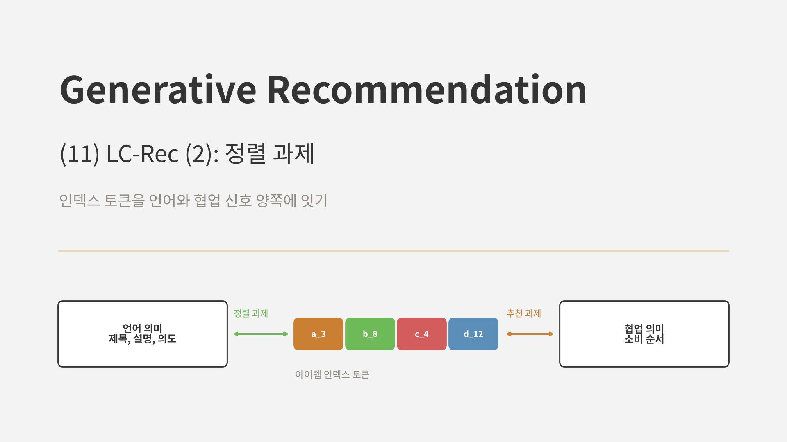
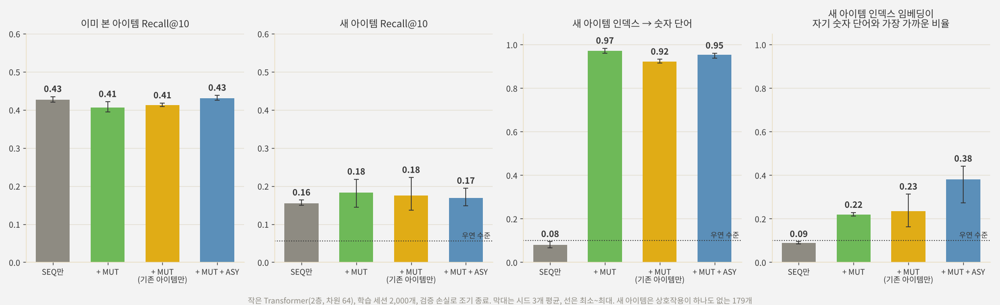

<br>{: .align-center}<br>

### _"처음 보는 인덱스 토큰의 뜻을 LLM은 어떻게 알게 될까?"_

[지난 글]()에서 LC-Rec이 아이템마다 의미를 담은 4토큰 인덱스를 만들고, 그 토큰 1,024개를 LLM 어휘에 추가하는 과정을 봤습니다. 하지만 추가된 토큰은 LLM에게 처음 보는 기호일 뿐입니다. `<a_12>`가 "기타 줄"과 관련 있다는 것을 LLM은 모릅니다.

LC-Rec의 두 번째 축은 바로 이 간극을 메우는 **정렬 과제(Alignment Tuning)**입니다. 추천 데이터만으로 학습하면 LLM은 인덱스끼리의 이어짐만 배우고, 사전 학습으로 쌓은 언어 지식은 쓰지 못합니다. 그래서 인덱스와 언어를 서로 오가게 하는 과제들을 함께 학습시킵니다. 이번 글에서는 이 과제들이 각각 무엇을 가르치는지 정리하고, 작은 언어 모델로 직접 효과를 확인해 봅니다.

---

## 1. 왜 정렬이 필요한가

### 1.1 두 종류의 의미

LC-Rec이 다루는 의미는 두 가지입니다.

* **언어 의미:** "어쿠스틱 기타 줄", "초보자용" 같은 아이템 설명에 담긴 의미. LLM은 사전 학습으로 이미 잘 압니다.
* **협업 의미:** "이 아이템을 산 사람은 다음에 저 아이템을 산다" 같은 소비 패턴. 상호작용 데이터에만 있고, LLM은 모릅니다.

인덱스 토큰은 두 의미가 만나는 자리입니다. 인덱스는 텍스트 임베딩으로 만들었으니 언어 의미에서 출발했고, 추천 과제로 학습하면 협업 의미가 실립니다. 문제는 LLM 안에서 이 토큰들의 임베딩이 **언어 토큰과 같은 공간에 놓이지 않는다**는 점입니다. 논문은 정렬 과제 없이 학습한 인덱스 토큰 임베딩을 PCA로 그려 보면 텍스트 토큰 임베딩과 따로 떨어져 있고, 정렬 과제를 더하면 두 분포가 섞인다는 것을 보였습니다.

### 1.2 정렬의 목표


인덱스 토큰을 가운데 두고, 한쪽은 추천 과제로 협업 의미와, 다른 쪽은 정렬 과제로 언어 의미와 연결합니다. 그러면 LLM이 "기타 줄을 산 사람에게 무엇을 추천할까"를 생각할 때, 언어로 아는 지식과 데이터로 배운 패턴을 함께 쓸 수 있습니다.

---

## 2. 다섯 가지 과제

LC-Rec은 모든 과제를 지시문(instruction)과 응답의 쌍으로 만들어 섞어서 학습합니다. 아래 예시는 논문의 과제 형식을 바탕으로 우리말로 만든 것입니다.

### 2.1 순차 아이템 예측 (SEQ)

추천의 기본 과제입니다. 사용자가 본 아이템들의 인덱스를 주고, 다음 아이템의 인덱스를 생성하게 합니다.

```text
지시: 사용자가 순서대로 이용한 아이템은 <a_3><b_8><c_1><d_5>, <a_3><b_2><c_9><d_0> 입니다. 다음에 이용할 아이템을 예측하세요.
응답: <a_3><b_8><c_4><d_12>
```

### 2.2 명시적 인덱스-언어 정렬 (MUT)

인덱스와 아이템 설명을 **양방향으로** 바꿔 쓰게 합니다.

```text
지시: 제목이 "Ernie Ball 일렉 기타 줄"인 아이템의 인덱스는?
응답: <a_3><b_8><c_4><d_12>

지시: 인덱스가 <a_3><b_8><c_4><d_12>인 아이템의 제목은?
응답: Ernie Ball 일렉 기타 줄
```

인덱스 토큰과 언어 토큰을 직접 짝지어 주는, 가장 직관적인 정렬입니다.

### 2.3 비대칭 아이템 예측 (ASY)

추천 과제의 입력과 출력을 **서로 다른 표현**으로 섞습니다.

* 인덱스 이력 → 다음 아이템의 제목
* 인덱스 이력 → 다음 아이템의 설명
* 제목 이력 → 다음 아이템의 인덱스

같은 추천 문제를 인덱스로도, 언어로도 풀게 해서, 두 표현이 같은 의미를 가리키도록 만듭니다. MUT가 아이템 하나 단위의 정렬이라면, ASY는 추천이라는 맥락 안에서의 정렬입니다.

### 2.4 사용자 의도 기반 예측 (ITE)

아이템 리뷰에서 GPT-3.5로 사용자의 **의도**를 뽑아 둔 뒤, 의도를 질의로 주고 아이템을 생성하게 합니다.

```text
지시: 연습용으로 손가락이 덜 아픈 기타 줄을 찾고 있어요.
응답: <a_3><b_8><c_7><d_1>
```

이력과 의도를 함께 주는 형태도 있습니다. 검색 질의 같은 자연어 요청을 인덱스로 연결하는 능력을 가르칩니다.

### 2.5 개인화 선호 추론 (PER)

사용자의 이력 인덱스를 주고, GPT-3.5가 추론해 둔 사용자 선호를 **말로 설명**하게 합니다.

```text
지시: 다음 이력을 보고 사용자의 선호를 설명하세요. <a_3><b_8><c_1><d_5>, <a_3><b_2><c_9><d_0>, ...
응답: 일렉 기타 입문자로, 가성비 좋은 소모품을 선호합니다.
```

인덱스의 나열에서 사람의 취향이라는 추상적인 언어 의미를 끌어내도록 합니다.

정리하면 다음과 같습니다.

| 과제 | 입력 | 출력 | 연결하는 것 |
|---|---|---|---|
| SEQ | 인덱스 이력 | 인덱스 | 협업 의미 |
| MUT | 제목, 설명 ↔ 인덱스 | 인덱스 ↔ 제목, 설명 | 아이템 단위의 언어 의미 |
| ASY | 인덱스 또는 제목 이력 | 제목, 설명 또는 인덱스 | 추천 맥락의 언어 의미 |
| ITE | 의도 (+ 이력) | 인덱스 | 자연어 요청 |
| PER | 인덱스 이력 | 선호 설명 | 사용자 수준의 언어 의미 |

---

## 3. 논문의 결과

### 3.1 과제를 하나씩 더할 때

| 학습 과제 | Arts HR@10 | Arts NDCG@10 | Games HR@10 | Games NDCG@10 |
|---|---|---|---|---|
| SEQ | 0.1133 | 0.0812 | 0.0930 | 0.0535 |
| + MUT | 0.1141 | 0.0832 | 0.1038 | 0.0598 |
| + ASY | 0.1172 | 0.0848 | 0.1073 | 0.0615 |
| + ITE | 0.1232 | 0.0889 | 0.1125 | 0.0648 |
| + PER (LC-Rec) | **0.1266** | **0.0906** | **0.1174** | **0.0681** |

과제를 더할 때마다 성능이 꾸준히 올랐고, Games에서는 SEQ만 쓸 때보다 HR@10이 26% 높아졌습니다. 테스트할 때는 SEQ 형식의 질문만 하는데도 다른 과제들이 도움이 됐다는 점이 중요합니다. 정렬 과제는 추천 데이터를 늘린 것이 아니라, **같은 인덱스를 언어로 이해하는 방법**을 가르친 것입니다.

### 3.2 인덱스가 의미를 담았는지

* **인덱스에서 제목 생성:** 인덱스의 앞 코드만 주고 제목을 생성하게 하면, 첫 코드만으로도 핵심 키워드가 나오고 코드를 더할수록 제목이 구체화됐습니다. 정렬된 LLM이 인덱스 토큰을 단계별 의미로 읽고 있다는 뜻입니다.
* **비슷한 아이템 생성:** 인덱스로 비슷한 아이템을 찾게 하면 같은 장르, 같은 플랫폼의 게임이 나왔습니다. 텍스트 임베딩 유사도로 찾으면 오히려 다른 플랫폼의 같은 게임이 나왔는데, 인덱스에 협업 의미가 실려 있기 때문으로 해석됩니다.
* **정답과 오답 구별:** 정답 아이템과 오답 아이템을 고르게 했을 때 정확도는 무작위 오답에서 90.19%, 언어적으로 비슷한 오답에서 75.73%, 협업적으로 비슷한 오답에서 60.01%였습니다. 함께 소비되는 아이템끼리 구별하는 것이 가장 어렵다는, 직관과 맞는 결과입니다.

---

## 4. 직접 실험: 작은 언어 모델에 정렬 과제 가르치기

### 4.1 실험 설계

LLaMA-7B를 학습시킬 수는 없으니, 같은 구조를 아주 작게 만들었습니다.

* **아이템과 인덱스:** [10편]()과 같은 손글씨 숫자 1,797개와, 픽셀로 학습한 RQ-VAE에 USM을 적용한 4토큰 인덱스(단계당 코드 16개). 10%(179개)는 상호작용이 없는 새 아이템입니다.
* **언어:** 아이템마다 두 단어짜리 설명을 붙였습니다. 숫자 단어(0~9)와 굵기 단어(굵은, 가는)입니다. 이 세계에서 취향 그룹은 숫자와 획 굵기로 정해지므로, 설명이 취향을 정하는 요인을 그대로 담은 **낙관적인 설정**입니다.
* **모델:** 과제 토큰, 설명 단어, 인덱스 토큰을 하나의 어휘로 쓰는 작은 디코더 전용 Transformer(2층, 차원 64). 응답 토큰에만 손실을 주고, 검증 손실로 조기 종료했습니다.
* **과제:** SEQ(직전 두 아이템의 인덱스 → 다음 인덱스), MUT(설명 ↔ 인덱스), ASY(직전 두 아이템의 설명 → 다음 인덱스). 매 스텝 SEQ 배치는 같은 양을 넣고, 다른 과제는 추가로 섞어 SEQ 학습량을 맞췄습니다.
* **비교:** SEQ만, + MUT, + MUT(새 아이템은 빼고 기존 아이템만), + MUT + ASY
* **평가:** 이미 본 아이템 Recall@10(제약 빔 서치), 새 아이템 Recall@10(새 아이템 179개 중 순위, 아이템별 평균), 그리고 **새 아이템의 인덱스를 주고 숫자 단어를 맞히는 정확도**. 학습 세션 2,000개, 시드 3개입니다.

### 4.2 결과

<br>{: .align-center}<br>

| 학습 과제 | 이미 본 아이템 | 새 아이템 | 새 아이템 인덱스 → 숫자 단어 | 공유 공간 지표 |
|---|---|---|---|---|
| SEQ만 | 0.427 | 0.155 | 0.08 | 0.09 |
| + MUT | 0.406 | 0.183 | 0.97 | 0.22 |
| + MUT (기존 아이템만) | 0.412 | 0.175 | 0.92 | 0.23 |
| + MUT + ASY | **0.430** | 0.169 | 0.95 | **0.38** |

마지막 열은 새 아이템의 인덱스 토큰 임베딩 평균이 숫자 단어 10개 중 자기 숫자 단어와 가장 가까운 비율로, 우연 수준은 0.1입니다.

**가장 뚜렷한 효과는 인덱스를 "읽는" 능력이었습니다.** SEQ만 학습한 모델은 새 아이템의 인덱스를 보고 숫자를 맞히지 못했지만(0.08, 우연 수준), MUT를 더하자 0.97이 됐습니다. 더 눈여겨볼 것은 **새 아이템을 MUT에서 뺀 경우에도 0.92**였다는 점입니다. 모델은 새 아이템의 인덱스와 설명을 한 번도 짝지어 본 적이 없는데도 맞혔습니다. 기존 아이템에서 "1단계 3번 코드는 숫자 7 쪽"처럼 **코드 단위의 의미를 배워서, 처음 보는 조합도 읽어 낸** 것입니다. 인덱스가 의미를 담은 코드의 조합이기 때문에 가능한 일이고, 10편에서 USM으로 모든 토큰의 의미를 지키려 한 이유이기도 합니다.

**임베딩 공간도 가까워졌습니다.** 인덱스 토큰 임베딩이 자기 숫자 단어와 가장 가까운 비율이 0.09에서 MUT로 0.22, ASY까지 더하면 0.38로 올랐습니다. 아이템 단위로 짝짓는 MUT보다, 추천 맥락 안에서 두 표현을 섞는 ASY가 공간을 더 많이 겹치게 했습니다. 논문이 PCA로 보인 "정렬하면 인덱스 토큰이 언어 토큰 사이로 들어온다"는 현상과 같은 방향입니다. 다만 그 정도는 크지 않았습니다.

**추천 성능은 거의 그대로였습니다.** 이미 본 아이템은 MUT만 더하면 오히려 조금 내려갔다가(0.406), ASY까지 더하면 원래 수준(0.430)으로 돌아왔습니다. 새 아이템은 평균적으로 0.155에서 0.17~0.18로 올랐지만 시드에 따라 0.14~0.22로 크게 흔들려, 분명한 개선이라고 말하기는 어렵습니다.

### 4.3 왜 추천은 크게 좋아지지 않았나

논문에서는 정렬 과제로 HR@10이 26%까지 올랐는데, 이 실험에서는 그러지 않았습니다. 가장 큰 차이는 **언어 쪽에 가져올 지식이 있느냐**라고 생각합니다.

LC-Rec의 LLaMA는 "기타 줄"과 "피크"가 함께 쓰인다는 것, "입문자용"이 어떤 뜻인지를 사전 학습으로 이미 압니다. 정렬 과제는 인덱스 토큰을 이 지식에 연결해 주고, 그래서 추천이 좋아집니다. 반면 이 실험의 작은 모델은 처음부터 학습했고, 설명도 숫자와 굵기 두 단어뿐이라 언어 쪽에서 새로 가져올 지식이 없습니다. 설명이 담은 정보는 이미 인덱스(픽셀)와 상호작용 데이터에 들어 있습니다.

정리하면, 정렬 과제가 직접 가르치는 것은 **인덱스와 언어 사이의 번역 능력**이고, 이 실험에서도 그 능력은 확실히 생겼습니다. 그 번역이 추천 성능으로 이어지려면 반대편 언어 모델이 추천에 쓸 만한 지식을 이미 갖고 있어야 합니다. 작은 모델을 처음부터 학습하는 환경이라면 정렬 과제의 효과를 기대만큼 보기 어렵고, 사전 학습된 LLM을 쓸 때 진가가 드러나는 방법이라고 볼 수 있습니다.

이번 실험도 작은 합성 데이터와 아주 작은 모델로 한 것이라 수치보다는 경향을 봐 주시면 좋겠습니다.

---

## 5. 실무 관점에서

LC-Rec의 정렬 과제는 강력하지만 비용도 분명합니다.

* **데이터 준비:** ITE와 PER은 GPT-3.5로 리뷰와 이력에서 의도와 선호를 추출해 만든 데이터입니다. 아이템과 사용자가 많으면 이 생성 비용이 상당합니다. 반면 MUT와 ASY는 **카탈로그의 제목과 설명만 있으면** 만들 수 있습니다.
* **학습 비용:** 과제가 늘수록 학습 데이터가 몇 배로 늘어납니다. LLaMA-7B를 이 데이터로 4에폭 학습하는 것은 작은 일이 아닙니다.
* **새 아이템:** 새 아이템도 제목과 설명은 있습니다. MUT 데이터에 새 아이템을 넣어 두면, 상호작용이 하나도 없어도 LLM이 그 인덱스의 의미를 배울 수 있습니다. 뒤의 실험에서 이 효과를 직접 확인했습니다.

처음 적용한다면 SEQ에 MUT부터 더해 보는 것이 비용 대비 효과가 좋아 보입니다. 카탈로그 데이터만으로 만들 수 있고, Games 데이터에서는 과제 하나를 더했을 때의 개선 중 MUT가 가장 컸습니다(Arts에서는 작았습니다).

---

## 6. 부록: 정렬 과제 데이터와 학습 코드

실험은 JAX로 했지만, 핵심 부분을 PyTorch와 Hugging Face 스타일로 정리합니다.

### Point 1. 과제별 지시문 만들기

같은 아이템 정보에서 여러 과제의 지시문과 응답 쌍을 만듭니다. 실제로는 과제마다 템플릿을 여러 개 두고 무작위로 고릅니다.

```python
import random

def idx_str(index):                     # (3, 8, 4, 12) -> "<a_3><b_8><c_4><d_12>"
    return "".join(f"<{'abcd'[h]}_{c}>" for h, c in enumerate(index))

def build_examples(history, target, index, title):
    hist = ", ".join(idx_str(index[i]) for i in history)
    ex = [
        ("seq", f"사용자가 순서대로 이용한 아이템은 {hist} 입니다. 다음 아이템은?", idx_str(index[target])),
        ("mut", f'제목이 "{title[target]}"인 아이템의 인덱스는?', idx_str(index[target])),
        ("mut", f"인덱스가 {idx_str(index[target])}인 아이템의 제목은?", title[target]),
        ("asy", f"사용자가 순서대로 이용한 아이템은 {hist} 입니다. 다음 아이템의 제목은?", title[target]),
        ("asy", "사용자가 이용한 아이템의 제목은 " + ", ".join(title[i] for i in history) + " 입니다. 다음 아이템은?",
         idx_str(index[target])),
    ]
    return ex
```

### Point 2. 응답 토큰에만 손실 주기

지시문 부분은 정답으로 쓰지 않도록 라벨을 -100으로 가립니다. 인덱스 토큰이 응답에 있든 지시문에 있든, LLM은 같은 임베딩을 쓰므로 두 방향의 과제가 같은 토큰을 학습시킵니다.

```python
def encode(tokenizer, prompt, response, max_len=512):
    p = tokenizer(prompt, add_special_tokens=False)["input_ids"]
    r = tokenizer(response + tokenizer.eos_token, add_special_tokens=False)["input_ids"]
    ids = (p + r)[:max_len]
    labels = ([-100] * len(p) + r)[:max_len]            # 지시문은 손실에서 제외
    return {"input_ids": ids, "labels": labels}
```

### Point 3. 존재하는 인덱스만 생성하기

추론할 때는 [6편]()에서 본 제약 디코딩을 씁니다. Hugging Face의 `generate`에 다음 토큰 후보를 제한하는 함수를 넘기면 됩니다.

```python
from collections import defaultdict

def build_prefix_fn(tokenizer, all_indices, prompt_len):
    tok = lambda h, c: tokenizer.convert_tokens_to_ids(f"<{'abcd'[h]}_{c}>")
    nxt = defaultdict(set)
    for index in all_indices:
        for h in range(len(index)):
            nxt[tuple(index[:h])].add(tok(h, index[h]))
    rev = {tok(h, c): c for h in range(4) for c in range(256)}

    def prefix_allowed_tokens_fn(batch_id, input_ids):
        gen = input_ids[prompt_len:].tolist()               # 지금까지 생성한 인덱스 토큰
        allowed = nxt.get(tuple(rev[t] for t in gen), None)
        return list(allowed) if allowed else [tokenizer.eos_token_id]
    return prefix_allowed_tokens_fn

# model.generate(**inputs, num_beams=20, num_return_sequences=20, max_new_tokens=4,
#                prefix_allowed_tokens_fn=build_prefix_fn(tokenizer, all_indices, inputs["input_ids"].shape[1]))
```

---

## 7. 결론 및 다음 글

정리하면 다음과 같습니다.

* LC-Rec은 LLM 어휘에 추가한 인덱스 토큰이 **언어 의미와 협업 의미 양쪽에 연결되도록** 다섯 가지 과제를 함께 학습합니다. SEQ는 협업 의미를, MUT와 ASY는 아이템과 추천 맥락의 언어 의미를, ITE와 PER은 사용자의 의도와 선호라는 언어 의미를 인덱스에 잇습니다.
* 논문에서는 과제를 더할 때마다 성능이 올라, Games에서 SEQ만 쓸 때보다 HR@10이 26% 높았습니다. 정렬된 LLM은 인덱스에서 제목을 단계별로 복원했고, 인덱스 토큰 임베딩이 언어 토큰 사이로 들어왔습니다.
* 작은 모델로 직접 해 보니 정렬 과제는 인덱스를 **읽는 능력**을 확실히 가르쳤습니다. 새 아이템을 MUT에서 뺐는데도 인덱스만 보고 숫자를 92% 맞혔습니다. 코드 단위의 의미를 배워 처음 보는 조합에도 적용한 것입니다.
* 하지만 추천 성능은 거의 그대로였습니다. 정렬은 번역 능력을 주지만, 그 번역이 추천을 좋게 만들려면 언어 모델 쪽에 **가져올 지식**이 있어야 합니다. 사전 학습된 LLM을 쓰는 LC-Rec에서 효과가 컸던 이유입니다.

10편과 11편을 이어 보면, LC-Rec은 결국 "LLM이 이미 아는 것을 추천에 어떻게 끌어올 것인가"에 대한 답입니다. 인덱스는 의미를 지닌 코드의 조합으로 만들고(USM), 그 코드를 언어와 오가는 과제로 LLM의 지식에 연결합니다(정렬 과제). TokenRec이 LLM을 사용자 인코더로 쓰고 출력을 검색으로 돌린 것과 달리, LC-Rec은 LLM이 추천을 **말하듯이 생성**하게 만든 셈입니다.

다음 글부터는 **EAGER**를 두 편에 걸쳐 다룹니다. 지금까지는 아이템 인덱스 하나에 콘텐츠와 협업 신호를 함께 담으려 했다면, EAGER는 **행동(협업) 신호와 의미(콘텐츠) 신호를 각각의 흐름으로 따로 생성**하고 둘을 함께 학습시키는 two-stream 구조를 택합니다. 두 신호를 하나로 섞을지, 나란히 둘지라는 질문에 대한 또 다른 답을 살펴보겠습니다.

---

## 참고 문헌

* Zheng et al., *Adapting Large Language Models by Integrating Collaborative Semantics for Recommendation* (LC-Rec), ICDE 2024. [arXiv:2311.09049](https://arxiv.org/abs/2311.09049)
* Rajput et al., *Recommender Systems with Generative Retrieval* (TIGER), NeurIPS 2023. [arXiv:2305.05065](https://arxiv.org/abs/2305.05065)
* Geng et al., *Recommendation as Language Processing (RLP): A Unified Pretrain, Personalized Prompt & Predict Paradigm (P5)*, RecSys 2022. [arXiv:2203.13366](https://arxiv.org/abs/2203.13366)
* Wei et al., *Finetuned Language Models Are Zero-Shot Learners* (FLAN), ICLR 2022. [arXiv:2109.01652](https://arxiv.org/abs/2109.01652)
