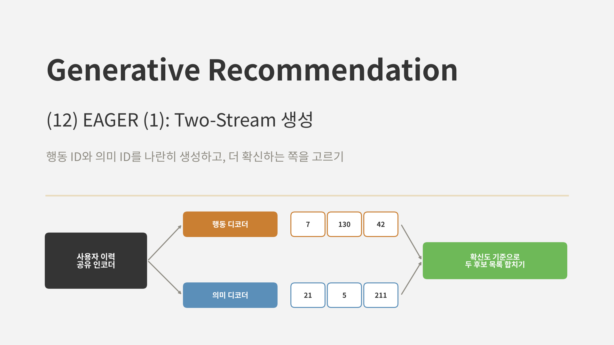
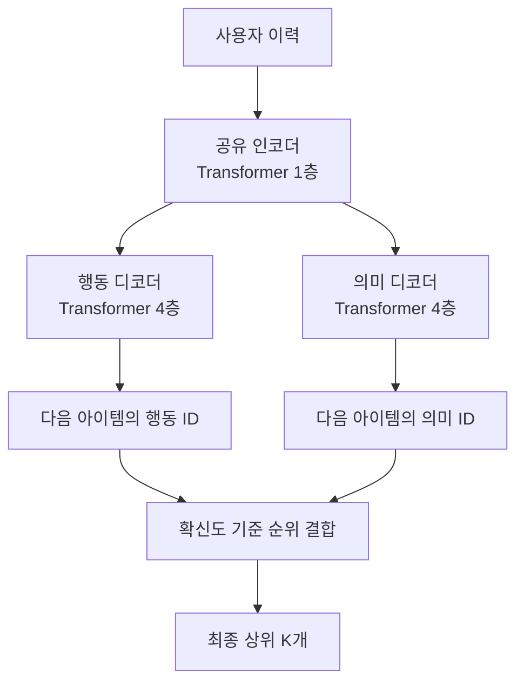
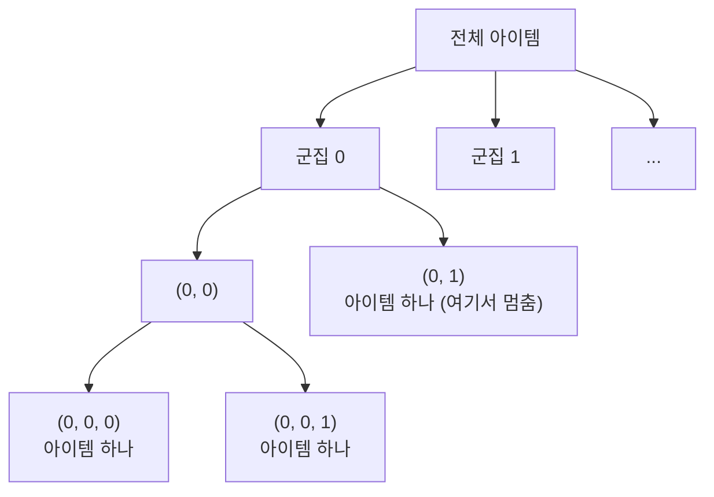
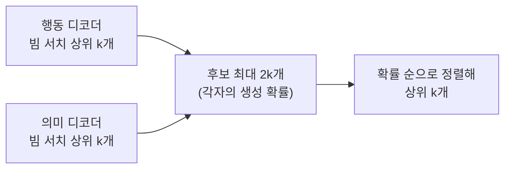
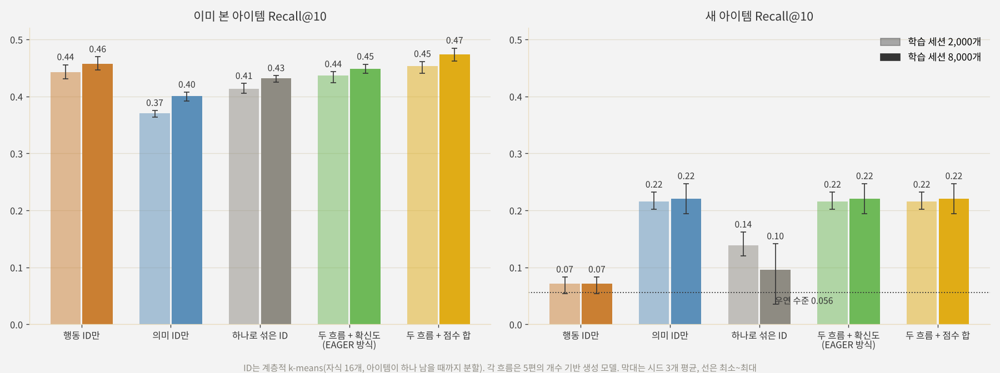

<br>{: .align-center}<br>

### _"행동 신호와 의미 신호를 꼭 하나의 ID에 섞어야 할까?"_

지금까지 본 모델들은 모두 아이템마다 **ID 하나**를 만들고, 거기에 필요한 신호를 담으려 했습니다. [LETTER]()는 콘텐츠로 만든 ID에 협업 신호를 정규화로 넣었고, TokenRec은 협업 표현을 토큰으로 바꿨으며, [LC-Rec]()은 콘텐츠로 만든 ID를 정렬 과제로 언어와 협업 의미에 이었습니다. [5편]()에서는 콘텐츠와 협업 임베딩을 단순히 이어 붙여 ID를 만들어 봤는데, 새 아이템에서 불안정했습니다.

이번에 다룰 **EAGER**(Wang et al., KDD 2024)는 다른 답을 냅니다. 두 신호를 섞지 않고, 아이템마다 **행동 ID와 의미 ID를 따로** 만든 뒤 각각을 생성하는 디코더 두 개를 나란히 둡니다. 이번 글에서는 이 two-stream 구조와 두 흐름의 결과를 합치는 방법을, 다음 글에서는 두 흐름이 서로 배우게 하는 보조 과제를 다룹니다.

---

## 1. 왜 두 흐름인가

추천에 쓰이는 아이템 신호는 크게 두 가지입니다.

* **행동 신호:** 누가 무엇을 함께, 어떤 순서로 소비했는지. 상호작용 데이터로 학습한 아이템 임베딩에 담깁니다.
* **의미 신호:** 아이템이 무엇인지. 제목, 설명, 이미지 같은 콘텐츠로 만든 임베딩에 담깁니다.

두 신호는 서로 다른 것을 알려 줍니다. 행동 신호는 이미 충분히 소비된 아이템의 관계를 잘 알지만 새 아이템에 대해서는 아무것도 모릅니다. 의미 신호는 새 아이템도 다룰 수 있지만, 생김새는 비슷해도 소비 패턴은 다른 아이템을 구분하지 못합니다.

하나의 ID에 두 신호를 섞으면 어느 한쪽이 다른 쪽을 덮어쓰기 쉽습니다. 5편의 실험에서 콘텐츠와 협업 임베딩을 이어 붙인 ID는, 협업 신호가 많아질수록 협업 쪽이 군집을 좌우해 새 아이템 성능이 무너졌습니다. EAGER의 발상은 단순합니다. **섞지 말고 둘 다 생성하자.**

---

## 2. EAGER의 구조



### 2.1 아이템 ID 두 벌

* **행동 ID:** DIN으로 학습한 아이템 임베딩(상호작용 ID 열만 사용)을 양자화한 코드
* **의미 ID:** Sentence-T5로 인코딩한 아이템 텍스트 임베딩을 양자화한 코드

### 2.2 공유 인코더와 두 디코더

사용자 이력은 Transformer 인코더 1층이 한 번 인코딩하고, 그 결과를 두 디코더가 함께 씁니다. 행동 디코더는 다음 아이템의 행동 ID를, 의미 디코더는 의미 ID를 각각 한 토큰씩 생성합니다. 두 디코더는 각각 4층입니다. 생성 손실은 두 흐름의 교차 엔트로피를 더한 것입니다.

$$
\mathcal{L}_{\text{gen}} = - \sum_{l} \log p\left(c^{b}_{l} \mid c^{b}_{<l}, H\right) - \sum_{l} \log p\left(c^{s}_{l} \mid c^{s}_{<l}, H\right)
$$

$c^b$는 행동 코드, $c^s$는 의미 코드, $H$는 인코딩한 이력입니다. 전체 손실에는 여기에 다음 글에서 볼 두 보조 과제의 손실이 더해집니다.

### 2.3 인코더를 공유하는 이유

두 디코더가 같은 인코더 출력을 보므로, 인코더는 **두 종류의 ID를 모두 잘 예측할 수 있는** 사용자 표현을 배워야 합니다. 행동 ID를 맞히는 데 필요한 정보와 의미 ID를 맞히는 데 필요한 정보가 인코더 안에서 만나는 셈입니다. 그러면서도 출력 쪽은 분리되어 있어서, 한쪽 신호가 다른 쪽 ID를 망가뜨리지 않습니다.

---

## 3. 계층적 k-means로 만든 ID

EAGER는 RQ-VAE 대신 **계층적 k-means**로 ID를 만듭니다. [6편]()에서 본 DSI의 의미 구조 ID와 같은 방식입니다.

1. 전체 아이템 임베딩을 k-means로 $K$개 군집으로 나눕니다. 군집 번호가 첫 코드입니다.
2. 각 군집을 다시 $K$개로 나누고, 그 번호가 둘째 코드가 됩니다.
3. 군집에 아이템이 하나만 남을 때까지 반복합니다.



| 구분 | RQ-VAE (TIGER, LC-Rec) | 계층적 k-means (EAGER, DSI) |
|---|---|---|
| 학습 | 인코더, 디코더, 코드북을 함께 학습 | k-means만 반복 |
| 코드 사이 관계 | 잔차를 단계별로 양자화 | 군집을 단계별로 쪼갬 |
| 충돌 | 생길 수 있음 (구분 토큰, USM 필요) | 없음 (아이템 하나가 남을 때까지 분할) |
| ID 길이 | 고정 | 아이템마다 다를 수 있음 |
| 코드 의미 | 같은 단계의 같은 코드는 어느 군집 아래서든 같은 코드 벡터 | 같은 번호라도 부모 군집에 따라 뜻이 다름 |

논문은 $K=256$을 썼습니다. 마지막 차이가 중요합니다. RQ-VAE에서 2단계의 7번 코드는 어떤 1단계 코드 아래에 있든 같은 코드 벡터를 뜻하지만, 계층적 k-means에서 2단계의 7번은 부모 군집마다 전혀 다른 하위 군집입니다. 그래서 디코더는 앞 토큰들을 보고 다음 토큰의 뜻을 해석해야 합니다. EAGER는 충돌 처리가 필요 없고 학습이 간단하다는 쪽을 택한 셈입니다.

---

## 4. 두 흐름의 결과 합치기: 확신도 기반 순위

추론할 때는 두 디코더가 각자 빔 서치로 상위 $k$개 ID를 생성합니다. 행동 ID는 행동 ID 표로, 의미 ID는 의미 ID 표로 아이템에 대응시키면 후보가 최대 $2k$개 생깁니다. EAGER는 각 후보를 **그 후보를 만든 디코더의 생성 확률**로 줄 세워 상위 $k$개를 고릅니다.



아이디어는 **더 확신하는 쪽을 믿는다**는 것입니다. 행동 기록이 많은 사용자와 아이템이라면 행동 디코더가 높은 확률로 답할 것이고, 행동 신호가 약한 경우라면 의미 디코더의 답이 위로 올라옵니다. 두 흐름의 점수를 하나의 식으로 섞지 않고, 각자의 확률을 그대로 비교하는 단순한 방식입니다.

---

## 5. 논문의 결과

### 5.1 설정

* **데이터:** Amazon Beauty, Sports and Outdoors, Toys and Games, Yelp. 5-core, leave-one-out
* **ID:** 행동은 DIN 임베딩, 의미는 Sentence-T5 임베딩, 계층적 k-means($K=256$)
* **모델:** 인코더 1층, 디코더 각 4층

### 5.2 주요 결과

| 데이터 | TIGER Recall@10 | EAGER Recall@10 | TIGER NDCG@10 | EAGER NDCG@10 |
|---|---|---|---|---|
| Beauty | 0.0648 | **0.0836** | 0.0384 | **0.0525** |
| Sports | 0.0400 | **0.0441** | 0.0225 | **0.0236** |
| Toys | 0.0712 | **0.0714** | 0.0432 | **0.0505** |
| Yelp | 0.0367 | **0.0453** | 0.0194 | **0.0242** |

Beauty에서 TIGER보다 Recall@10이 29% 높았습니다. Toys에서는 Recall@10은 거의 같았지만 NDCG@10이 17% 높아, 정답을 더 위에 놓았습니다.

### 5.3 two-stream만의 효과

논문은 구성 요소를 하나씩 더한 결과도 보였습니다.

| 구성 | Beauty Recall@10 | Beauty NDCG@10 | Toys Recall@10 | Toys NDCG@10 |
|---|---|---|---|---|
| 기본 모델 | 0.0699 | 0.0430 | 0.0545 | 0.0379 |
| + two-stream 생성 | 0.0795 | 0.0496 | 0.0646 | 0.0469 |
| + 전역 대조 과제 | 0.0815 | 0.0514 | 0.0699 | 0.0497 |
| + 의미 전이 과제 (EAGER) | **0.0836** | **0.0525** | **0.0714** | **0.0505** |

두 흐름으로 나누는 것만으로 Beauty Recall@10이 14%, Toys가 19% 올랐습니다. 전체 개선의 대부분이 이 단계에서 나왔습니다. 나머지 두 과제는 다음 글에서 다룹니다.

Yelp에서는 텍스트에 이미지 임베딩까지 더하면 Recall@10이 0.0453에서 0.0484로 더 올랐다고 보고했습니다. 흐름을 늘리는 방식으로 다른 모달리티도 자연스럽게 붙일 수 있다는 뜻입니다.

### 5.4 추론 비용

디코더가 두 개라 느리지 않을까 싶지만, Beauty에서 빔 크기 100으로 상위 5개를 뽑을 때 샘플당 시간은 EAGER 0.0325초, TIGER 0.0281초로 큰 차이가 없었습니다. 두 디코더는 서로 기다릴 필요 없이 병렬로 돌릴 수 있습니다. 다만 파라미터 수는 TIGER의 약 6배로 컸습니다.

---

## 6. 직접 실험: 하나로 섞을까, 나란히 둘까

### 6.1 실험 설계

[7편]()부터 써 온 손글씨 숫자 세계를 그대로 썼습니다. 아이템 1,797개 중 10%(179개)는 학습에 등장하지 않는 새 아이템입니다. 아이템마다 EAGER처럼 계층적 k-means(자식 16개, 아이템이 하나 남을 때까지 분할)로 세 가지 ID를 만들었습니다.

* **행동 ID:** 학습 세션의 동시 출현으로 만든 협업 임베딩. 새 아이템은 기록이 없어 벡터가 비어 있습니다.
* **의미 ID:** 픽셀로 만든 콘텐츠 임베딩
* **하나로 섞은 ID:** 두 임베딩을 이어 붙인 것 (5편의 방식)

각 ID로는 5편의 개수 기반 생성 모델을 하나씩 학습해, 모든 아이템의 생성 확률을 구했습니다. 그리고 두 흐름의 확률을 세 가지로 합쳐 봤습니다.

* **확신도 (EAGER 방식):** 아이템마다 두 흐름 중 더 높은 로그 확률을 점수로 씀
* **길이 정규화 확신도:** 위와 같지만 로그 확률을 ID 길이로 나눔 (토큰당 확률)
* **점수 합:** 두 흐름의 로그 확률을 더함

평가는 이전 편들과 같은 이미 본 아이템 Recall@10과 새 아이템 Recall@10(새 아이템끼리의 순위, 아이템별 평균)입니다. 학습 세션 2,000개와 8,000개, 시드 3개입니다.

### 6.2 결과

<br>{: .align-center}<br>

| 방식 | 이미 본 아이템 (2,000) | 새 아이템 (2,000) | 이미 본 아이템 (8,000) | 새 아이템 (8,000) |
|---|---|---|---|---|
| 행동 ID만 | 0.442 | 0.072 | 0.457 | 0.072 |
| 의미 ID만 | 0.370 | **0.216** | 0.400 | **0.221** |
| 하나로 섞은 ID | 0.413 | 0.139 | 0.432 | 0.096 |
| 두 흐름 + 확신도 (EAGER 방식) | 0.436 | **0.216** | 0.449 | **0.221** |
| 두 흐름 + 길이 정규화 확신도 | 0.417 | 0.125 | 0.435 | 0.132 |
| 두 흐름 + 점수 합 | **0.454** | **0.216** | **0.474** | **0.221** |

* **각 흐름은 한쪽만 잘합니다.** 행동 ID는 이미 본 아이템에서 가장 강했지만(0.442) 새 아이템은 거의 우연 수준(0.072)이었습니다. 의미 ID는 반대로 새 아이템에서만 강했습니다.
* **하나로 섞은 ID는 양쪽 다 어중간했습니다.** 이미 본 아이템은 행동 ID보다 낮았고, 새 아이템은 의미 ID보다 낮았습니다. 데이터가 늘면 새 아이템 성능이 0.139에서 0.096으로 오히려 떨어지는, 5편에서 본 불안정함도 그대로 나왔습니다.
* **두 흐름을 확신도로 합치면 양쪽의 장점을 거의 다 가져갔습니다.** 이미 본 아이템은 행동 ID와 거의 같았고(0.436 대 0.442), 새 아이템은 의미 ID와 같았습니다. 새 아이템은 행동 흐름에서 모두 비슷하게 낮은 확률을 받으므로, 새 아이템끼리의 순위는 의미 흐름이 정합니다.

두 흐름이 정말 다른 것을 보는지도 확인했습니다. 같은 이력에 대해 두 흐름이 뽑은 상위 10개는 평균 26~32%만 겹쳤습니다. 확신도로 합친 상위 10개 중 약 61%는 행동 흐름이, 나머지는 의미 흐름이 더 높은 확률을 준 아이템이었습니다. 두 흐름이 서로 다른 후보를 가져오고, 합친 목록이 양쪽을 고루 쓴다는 뜻입니다.

### 6.3 합치는 방법이 중요하다

같은 두 흐름이라도 합치는 방식에 따라 결과가 꽤 달랐습니다.

* **점수 합이 가장 좋았습니다.** 이미 본 아이템에서 0.454와 0.474로, 어느 한 흐름보다도 높았습니다. 두 흐름이 모두 그럴듯하다고 보는 아이템이 위로 올라오는, 일종의 전문가 곱 효과입니다. EAGER의 확신도 방식은 각 아이템을 한 흐름의 점수로만 보므로 이런 상호 보강이 없습니다.
* **길이 정규화는 오히려 해로웠습니다.** 계층적 k-means의 ID는 아이템마다 길이가 달라서(평균 3~3.4토큰), 토큰당 확률로 바꾸면 길이가 다른 아이템끼리 비교가 왜곡됩니다. 논문은 이 점수를 "perplexity와 비슷하다"고만 설명했는데, ID 길이가 다를 때는 전체 로그 확률을 쓰는 편이 안전해 보입니다.

다만 점수 합은 모든 아이템을 양쪽 흐름에서 모두 채점해야 계산할 수 있습니다. 실제 EAGER처럼 각 흐름이 빔 서치로 상위 후보만 뽑는다면, 한쪽에만 나온 후보는 다른 쪽 점수를 모릅니다. 그런 경우 상대 흐름에서 그 후보의 확률을 한 번 더 계산해야 하므로 비용이 늘어납니다. EAGER가 단순한 확신도 방식을 택한 데에는 이런 실용적인 이유도 있을 것입니다.

이번 실험의 각 흐름은 공유 인코더 없이 따로 학습한 단순한 개수 기반 모델이라, 두 흐름이 인코더를 공유할 때의 효과는 담지 못했습니다. 그래도 **두 신호를 하나의 ID에 섞는 것보다 나란히 생성하고 결과를 합치는 쪽이 안정적**이라는 EAGER의 핵심 주장은 작은 규모에서도 분명하게 확인할 수 있었습니다.

---

## 7. 부록: two-stream 핵심 코드

실험은 NumPy로 했지만, 핵심 부분을 PyTorch로 정리합니다.

### Point 1. 계층적 k-means로 ID 만들기

군집에 아이템이 $K$개 이하로 남으면 각자 다른 번호를 주고 멈춥니다. 모든 아이템이 서로 다른 ID를 받고, 길이는 아이템마다 다를 수 있으므로 패딩 토큰으로 맞춥니다.

```python
import numpy as np
from sklearn.cluster import KMeans

def hierarchical_kmeans_ids(emb, K=256, seed=0):
    codes = [[] for _ in range(len(emb))]

    def split(idx, depth):
        if len(idx) == 1:
            return
        if len(idx) <= K:                                     # 남은 아이템마다 다른 번호
            labels = np.arange(len(idx))
        else:
            labels = KMeans(K, n_init=1, random_state=seed + depth).fit_predict(emb[idx])
        for c in np.unique(labels):
            child = idx[labels == c]
            for i in child:
                codes[i].append(int(c))
            split(child, depth + 1)

    split(np.arange(len(emb)), 0)
    L = max(map(len, codes))
    pad = K                                                   # 패딩 토큰
    return np.array([c + [pad] * (L - len(c)) for c in codes])
```

### Point 2. 공유 인코더와 두 디코더

```python
import torch
import torch.nn as nn
import torch.nn.functional as F

class TwoStreamRecommender(nn.Module):
    def __init__(self, vocab_b, vocab_s, d=128, heads=4):
        super().__init__()
        self.emb_b = nn.Embedding(vocab_b, d)                 # 이력 입력 방식은 단순화 (행동 코드 열)
        enc_layer = nn.TransformerEncoderLayer(d, heads, 4 * d, batch_first=True)
        self.encoder = nn.TransformerEncoder(enc_layer, num_layers=1)
        dec_layer = lambda: nn.TransformerDecoderLayer(d, heads, 4 * d, batch_first=True)
        self.dec_b = nn.TransformerDecoder(dec_layer(), num_layers=4)
        self.dec_s = nn.TransformerDecoder(dec_layer(), num_layers=4)
        self.tgt_b, self.tgt_s = nn.Embedding(vocab_b, d), nn.Embedding(vocab_s, d)
        self.out_b, self.out_s = nn.Linear(d, vocab_b), nn.Linear(d, vocab_s)
        self.bos = nn.Parameter(torch.zeros(1, 1, d))

    def decode(self, dec, tgt_emb, out, memory, tgt_in):
        y = torch.cat([self.bos.expand(len(memory), -1, -1), tgt_emb(tgt_in)], 1)
        mask = nn.Transformer.generate_square_subsequent_mask(y.size(1), device=y.device)
        return out(dec(y, memory, tgt_mask=mask))

    def forward(self, hist, tgt_b, tgt_s):
        memory = self.encoder(self.emb_b(hist))               # 공유 인코더
        lb = self.decode(self.dec_b, self.tgt_b, self.out_b, memory, tgt_b[:, :-1])
        ls = self.decode(self.dec_s, self.tgt_s, self.out_s, memory, tgt_s[:, :-1])
        loss = F.cross_entropy(lb.flatten(0, 1), tgt_b.flatten()) + F.cross_entropy(ls.flatten(0, 1), tgt_s.flatten())
        return loss                                           # L_gen = 두 흐름의 교차 엔트로피 합
```

### Point 3. 확신도 기반 순위 결합

각 흐름의 빔 서치 결과를 아이템으로 바꾸고, 같은 아이템이 양쪽에 있으면 더 높은 확률을 남긴 뒤 확률 순으로 자릅니다.

```python
def confidence_merge(beams_b, beams_s, id2item_b, id2item_s, k=10):
    """beams_*: [(코드 튜플, 로그 확률), ...] 각 흐름의 빔 서치 결과"""
    score = {}
    for beams, id2item in [(beams_b, id2item_b), (beams_s, id2item_s)]:
        for code, logp in beams:
            item = id2item.get(code)
            if item is not None:
                score[item] = max(score.get(item, float("-inf")), logp)
    return sorted(score, key=score.get, reverse=True)[:k]
```

---

## 8. 결론 및 다음 글

정리하면 다음과 같습니다.

* **EAGER**는 행동 신호와 의미 신호를 하나의 ID에 섞지 않고, 아이템마다 **행동 ID와 의미 ID를 따로** 만들어 각각을 생성하는 two-stream 구조를 택했습니다. 이력은 공유 인코더가 한 번 인코딩하고, 디코더 두 개가 두 ID를 나란히 생성합니다.
* ID는 **계층적 k-means**로 만들어, 아이템이 하나 남을 때까지 군집을 나누므로 충돌이 없습니다. 대신 ID 길이가 아이템마다 다르고, 같은 코드 번호라도 부모 군집에 따라 뜻이 다릅니다.
* 추론할 때는 두 디코더의 후보를 **각자의 생성 확률**로 줄 세워 합칩니다. 더 확신하는 흐름의 답을 믿는 방식입니다.
* 논문에서는 두 흐름으로 나누는 것만으로 Beauty Recall@10이 14% 올랐고, 전체 개선의 대부분이 여기서 나왔습니다.
* 직접 실험해 보니 두 흐름을 확신도로 합치면 **이미 본 아이템은 행동 ID 수준, 새 아이템은 의미 ID 수준**을 함께 얻었고, 하나로 섞은 ID보다 안정적이었습니다. 두 흐름의 점수를 더하면 이미 본 아이템 성능이 어느 한 흐름보다도 높아졌고, 로그 확률을 길이로 나누는 방식은 오히려 해로웠습니다.

지금까지의 모델들이 "ID 하나에 무엇을 담을까"를 고민했다면, EAGER는 "ID를 꼭 하나로 해야 하나"라고 물은 셈입니다. 실무에서도 협업 신호가 풍부한 기존 아이템과 신호가 없는 새 아이템이 섞여 있는 경우가 대부분이므로, 두 신호를 따로 두고 결과 단계에서 합치는 설계는 충분히 고려해 볼 만합니다.

다만 이렇게 나란히 두기만 하면 두 흐름은 서로에게서 배우지 못합니다. 다음 글에서는 EAGER의 나머지 두 장치, 요약 토큰으로 아이템 전체의 의미를 담게 하는 **전역 대조 과제**와 의미 흐름의 지식을 행동 흐름에 옮기는 **의미 유도 전이 과제**를 다룹니다.

---

## 참고 문헌

* Wang et al., *EAGER: Two-Stream Generative Recommender with Behavior-Semantic Collaboration*, KDD 2024. [arXiv:2406.14017](https://arxiv.org/abs/2406.14017)
* Rajput et al., *Recommender Systems with Generative Retrieval* (TIGER), NeurIPS 2023. [arXiv:2305.05065](https://arxiv.org/abs/2305.05065)
* Zhou et al., *Deep Interest Network for Click-Through Rate Prediction* (DIN), KDD 2018. [arXiv:1706.06978](https://arxiv.org/abs/1706.06978)
* Ni et al., *Sentence-T5: Scalable Sentence Encoders from Pre-trained Text-to-Text Models*, Findings of ACL 2022. [arXiv:2108.08877](https://arxiv.org/abs/2108.08877)
* Tay et al., *Transformer Memory as a Differentiable Search Index* (DSI), NeurIPS 2022. [arXiv:2202.06991](https://arxiv.org/abs/2202.06991)
