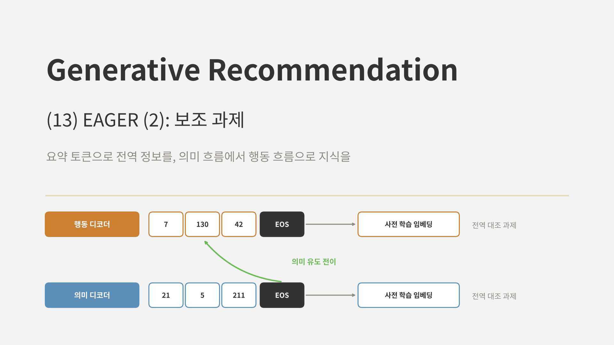
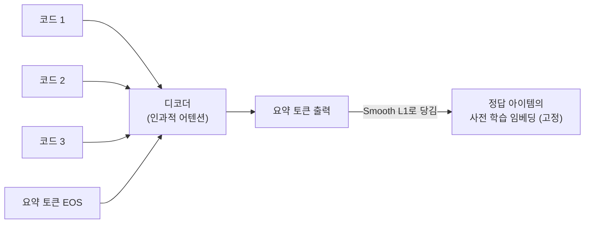
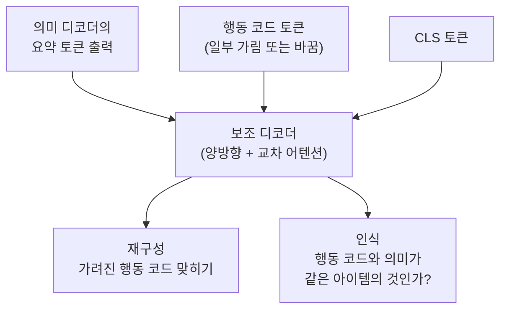
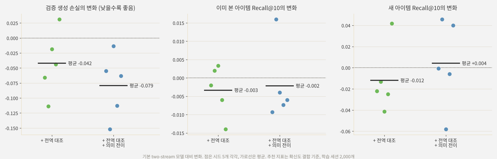

<br>{: .align-center}<br>

### _"나란히 놓인 두 흐름은 서로에게서 무엇을 배울 수 있을까?"_

[지난 글]()에서 EAGER가 행동 ID와 의미 ID를 따로 만들고, 디코더 두 개가 각각을 생성하는 two-stream 구조를 봤습니다. 두 흐름을 나누는 것만으로 성능이 크게 올랐지만, 이 구조에는 아직 빈틈이 두 가지 있습니다.

* 디코더는 다음 토큰 하나를 맞히도록 학습됩니다. 토큰 단위의 손실만으로는 **아이템 전체가 어떤 아이템인지**라는 전역 정보를 담기 어렵습니다.
* 두 흐름은 인코더를 공유할 뿐, 디코더끼리는 학습 중에 정보를 주고받지 않습니다. 의미 흐름이 아는 것을 행동 흐름이 **배울 기회가 없습니다.**

EAGER는 이 두 빈틈을 각각 **전역 대조 과제(Global Contrastive Task, GCT)**와 **의미 유도 전이 과제(Semantic-guided Transfer Task, STT)**로 메웁니다. 둘 다 학습할 때만 쓰는 보조 과제라 추론 비용은 늘지 않습니다. 이번 글에서는 두 과제의 구조를 정리하고, 작은 모델로 효과를 확인해 봅니다.

---

## 1. 전역 대조 과제: 요약 토큰으로 아이템 전체를 담기

### 1.1 토큰 단위 손실의 한계

생성 디코더의 손실은 "앞 토큰들을 보고 다음 토큰을 맞혀라"입니다. 각 단계는 다음 코드 하나에만 집중하므로, 코드 토큰들의 표현이 모여서 **어떤 아이템을 가리키는지**를 직접 가르치는 신호는 없습니다. 특히 계층적 k-means ID처럼 같은 번호라도 부모 군집에 따라 뜻이 달라지는 코드에서는, 토큰 하나만 보고는 아이템을 알기 어렵습니다.

### 1.2 요약 토큰

EAGER는 각 디코더의 입력 끝에 학습 가능한 **요약 토큰([EOS])**을 하나 붙입니다. 디코더는 인과적 어텐션을 쓰므로, 이 토큰은 앞의 모든 코드 토큰을 볼 수 있습니다. 그리고 요약 토큰의 출력을 그 흐름이 ID를 만들 때 쓴 **사전 학습 아이템 임베딩**에 가깝게 당깁니다. 행동 디코더의 요약 토큰은 DIN 임베딩에, 의미 디코더의 요약 토큰은 Sentence-T5 임베딩에 맞춥니다.

$$
\mathcal{L}_{\text{con}} = \sum_{t \in \{b, s\}} F\left(\mathbf{y}^{t}_{\text{EOS}}, \, \mathbf{E}^{t}\right)
$$

$\mathbf{y}^t_{\text{EOS}}$는 흐름 $t$의 요약 토큰 출력, $\mathbf{E}^t$는 정답 아이템의 고정된 임베딩입니다. 거리 함수 $F$로는 Smooth L1을 썼습니다.



이 손실의 기울기는 요약 토큰을 거쳐 **앞의 코드 토큰 표현들로** 흘러갑니다. 그 결과 코드 토큰들이 아이템 전체의 정보를 담도록 학습됩니다. 사전 학습 임베딩에 담긴 지식을 디코더에 증류하는 셈입니다.

### 1.3 양성만 쓰는 대조 학습

이름은 대조 과제이지만, 실제로는 음성 샘플 없이 **정답 임베딩에 다가가기만** 합니다. 논문은 InfoNCE처럼 음성 샘플을 밀어내는 방식보다 이쪽이 더 좋았다고 보고했습니다. 생성 손실이 이미 정답 코드와 다른 코드를 구분하는 역할을 하고 있으므로, 요약 토큰은 전역 정보를 담는 데만 집중하면 된다고 볼 수 있습니다.

---

## 2. 의미 유도 전이 과제: 의미 흐름의 지식을 행동 흐름으로

### 2.1 왜 의미에서 행동으로인가

행동 ID는 상호작용 데이터로만 만들어서, 기록이 적은 아이템일수록 코드가 불안정합니다. 의미 ID는 콘텐츠에서 나오므로 모든 아이템에 대해 안정적입니다. 그래서 EAGER는 **의미 흐름이 아는 것을 행동 흐름에 옮기는** 방향을 택했습니다. 논문은 반대 방향(행동에서 의미로)보다 이 방향이 더 좋았다고 보고했습니다.

### 2.2 구조

학습할 때만 쓰는 보조 Transformer 디코더를 하나 둡니다. 이 디코더는 행동 코드 토큰들과 [CLS] 토큰을 양방향 어텐션으로 읽고, 교차 어텐션으로 **의미 흐름의 요약 토큰 출력**(1장의 $\mathbf{y}^s_{\text{EOS}}$)을 참고합니다. 그 위에서 두 과제를 풉니다.



* **재구성(reconstruction):** 행동 코드 토큰의 50%를 가리고, 의미 흐름의 전역 특징을 참고해 가려진 토큰을 맞힙니다. 음성 샘플과 비교하는 대조 손실을 씁니다.
* **인식(recognition):** [CLS] 출력으로 "이 행동 코드가 이 의미 특징과 같은 아이템의 것인가"를 이진 분류합니다. 음성 샘플은 행동 코드 토큰의 50%를 무작위 코드로 바꿔 만듭니다.

두 과제 모두 행동 코드 토큰이 **의미 특징과 맞물리도록** 표현을 다듬습니다. 논문은 둘 중 인식 과제가 더 중요했다고 보고했습니다.

### 2.3 전체 손실

$$
\mathcal{L} = \mathcal{L}_{\text{gen}} + \lambda_1 \mathcal{L}_{\text{con}} + \lambda_2 \left( \mathcal{L}_{\text{recon}} + \mathcal{L}_{\text{recog}} \right)
$$

논문은 $\lambda_1 = \lambda_2 = 1$을 썼습니다. 보조 디코더는 추론할 때 쓰지 않으므로, 12편에서 본 추론 비용은 그대로입니다.

---

## 3. 논문의 결과

12편에서 본 표를 다시 가져오면, 두 보조 과제의 몫은 다음과 같습니다.

| 구성 | Beauty Recall@10 | Beauty NDCG@10 | Toys Recall@10 | Toys NDCG@10 |
|---|---|---|---|---|
| 기본 모델 | 0.0699 | 0.0430 | 0.0545 | 0.0379 |
| + two-stream 생성 | 0.0795 | 0.0496 | 0.0646 | 0.0469 |
| + 전역 대조 과제 | 0.0815 | 0.0514 | 0.0699 | 0.0497 |
| + 의미 유도 전이 과제 (EAGER) | **0.0836** | **0.0525** | **0.0714** | **0.0505** |

* **전역 대조 과제**는 Beauty Recall@10을 2.5%, Toys를 8.2% 올렸습니다.
* **의미 유도 전이 과제**는 여기서 Beauty를 2.6%, Toys를 2.1% 더 올렸습니다.

두 과제를 합친 개선은 Beauty 5%, Toys 11% 정도로, two-stream 생성 자체의 효과(14%, 19%)보다는 작습니다. EAGER의 성능은 주로 구조에서 오고, 보조 과제는 그 위에 얹는 마무리에 가깝다고 볼 수 있습니다.

---

## 4. 직접 실험: 보조 과제는 작은 모델에서도 도움이 될까

### 4.1 실험 설계

[12편]()의 손글씨 숫자 세계와 계층적 k-means ID(행동, 의미)를 그대로 쓰고, 이번에는 두 흐름을 **하나의 신경망 안에서** 학습했습니다. EAGER의 Transformer 대신 작은 MLP로 같은 역할을 하도록 만들었습니다.

* **공유 몸통:** 직전 두 아이템의 행동 코드와 의미 코드 임베딩을 평균 내어 MLP에 넣고, 사용자 표현 $\mathbf{h}$를 만듭니다.
* **두 디코더:** 흐름마다 $\mathbf{h}$와 앞 코드들의 임베딩을 받아 다음 코드를 예측하는 자기회귀 헤드
* **전역 대조 과제:** 흐름마다 요약 헤드가 $\mathbf{h}$와 정답 코드 임베딩을 읽고, 그 흐름의 사전 학습 임베딩(행동은 협업 임베딩, 의미는 콘텐츠 임베딩)에 Smooth L1로 다가갑니다.
* **의미 유도 전이 과제:** 의미 흐름의 요약 출력을 보고 (1) 행동 코드가 진짜인지, 토큰 50%를 바꾼 가짜인지 가리고(인식), (2) 가려진 행동 코드 토큰 하나를 맞힙니다(재구성).

기본 two-stream, + 전역 대조, + 전역 대조 + 의미 전이의 세 가지를 같은 조건(학습 세션 2,000개, 검증 생성 손실로 조기 종료)에서 학습했습니다. 효과가 작을 것으로 예상해 시드를 5개로 늘렸고, 같은 시드끼리 짝지어 기본 모델 대비 변화를 봤습니다. 추천 지표는 12편의 확신도 결합 기준입니다.

### 4.2 결과

<br>{: .align-center}<br>

| 구성 | 검증 생성 손실 | 이미 본 아이템 Recall@10 | 새 아이템 Recall@10 |
|---|---|---|---|
| 기본 two-stream | 9.273 | 0.511 | 0.187 |
| + 전역 대조 | 9.230 | 0.508 | 0.175 |
| + 전역 대조 + 의미 전이 | **9.193** | 0.509 | **0.191** |

**생성 손실은 꾸준히 낮아졌습니다.** 전역 대조 과제를 더하면 5개 시드 중 4개에서, 의미 전이 과제까지 더하면 5개 모두에서 검증 생성 손실이 내려갔습니다. 보조 과제가 정답 코드를 더 잘 맞히는 쪽으로 모델을 다듬은 것은 분명합니다.

**하지만 추천 지표는 움직이지 않았습니다.** 이미 본 아이템 Recall@10의 변화는 평균 -0.003, -0.002로 사실상 0이었고, 시드마다 위아래로 흔들렸습니다. 새 아이템은 전역 대조만 더하면 조금 내려가고, 의미 전이까지 더하면 조금 올랐지만, 시드 사이의 편차(±0.04)가 변화보다 훨씬 컸습니다.

논문의 개선 폭이 2~8%였다는 점을 떠올리면 놀라운 결과는 아닙니다. 이번 실험에서 기본 모델의 Recall@10은 시드에 따라 표준편차가 0.02 정도라, 그보다 작은 개선은 시드 5개로는 구분할 수 없습니다. 생성 손실처럼 더 촘촘한 지표에서는 효과가 보이지만, 그것이 상위 10개 안에 정답이 드는지까지 바꾸지는 못한 것입니다.

### 4.3 작은 모델에서 효과가 약했던 이유

* **증류할 지식이 이미 들어 있다.** 이 실험의 사전 학습 임베딩은 ID를 만든 바로 그 임베딩이고, 생성 모델은 그 ID를 학습합니다. EAGER처럼 DIN과 Sentence-T5라는 별도의 강한 모델이 만든 임베딩이 아니라서, 요약 토큰이 새로 배울 것이 많지 않습니다.
* **요약 토큰의 경로가 다르다.** EAGER의 요약 토큰은 어텐션으로 앞의 코드 토큰들과 연결되어, 기울기가 각 토큰 표현을 직접 다듬습니다. 이번 실험의 MLP 요약 헤드는 코드 임베딩의 평균만 보므로, 그 효과가 약할 수밖에 없습니다.
* **행동 코드가 이미 안정적이다.** 이 세계에서는 학습 데이터에 등장한 아이템의 협업 임베딩이 비교적 깨끗해서, 의미 흐름이 행동 흐름을 보정해 줄 여지가 크지 않았습니다.

곁가지로 하나 더 관찰했습니다. 12편의 개수 기반 모델에서는 두 흐름의 점수를 더하는 방식이 가장 좋았지만, 이번 신경망 모델에서는 새 아이템에서 오히려 크게 나빴습니다(확신도 0.187 대 점수 합 0.094). 학습된 행동 흐름은 기록이 없는 새 아이템에도 제각각의 점수를 주는데, 이 점수가 의미 흐름의 순위를 흔들기 때문입니다. 각 흐름의 점수를 섞지 않고 더 확신하는 쪽만 쓰는 EAGER의 방식이, 모델이 바뀌어도 더 안전했습니다.

이번 실험도 작은 합성 데이터와 단순한 모델로 한 것이라, 보조 과제의 효과가 없다고 결론 내릴 근거는 아닙니다. 다만 **보조 과제의 효과는 구조 변화보다 훨씬 작고, 그만큼 측정하기도 어렵다**는 점은 분명히 확인할 수 있었습니다.

---

## 5. 실무 관점에서

* **추론 비용이 없다.** 두 과제 모두 학습할 때만 쓰므로, 서빙 비용을 늘리지 않고 시도해 볼 수 있습니다.
* **사전 학습 임베딩이 필요하다.** 전역 대조 과제는 ID를 만들 때 쓴 임베딩을 정답으로 씁니다. ID를 만들 때 이미 임베딩이 있으니 추가 비용은 거의 없지만, 임베딩의 품질이 곧 증류할 지식의 품질입니다.
* **효과는 작고 흔들릴 수 있다.** 논문에서도 개선 폭이 2~8%였고, 앞의 실험에서는 시드 사이의 편차에 묻혔습니다. 실서비스에 적용한다면 여러 번 학습해 평균을 보거나, 오프라인 지표의 신뢰 구간을 함께 확인하는 것이 좋겠습니다.

우선순위를 정한다면 two-stream 구조와 확신도 결합을 먼저 갖추고, 그다음에 전역 대조 과제, 마지막으로 의미 유도 전이 과제를 붙여 보는 순서가 합리적으로 보입니다. 논문의 결과도, 이번 실험도 그 순서로 효과가 작아졌습니다.

---

## 6. 부록: 두 보조 과제의 핵심 코드

실험은 JAX로 했지만, 핵심 부분을 PyTorch로 정리합니다.

### Point 1. 요약 토큰과 전역 대조 손실

디코더 입력 끝에 요약 토큰을 붙이고, 그 출력을 사전 학습 임베딩에 맞춥니다.

```python
import torch
import torch.nn as nn
import torch.nn.functional as F

class StreamDecoderWithSummary(nn.Module):
    def __init__(self, vocab, d, item_dim, layers=4, heads=4):
        super().__init__()
        self.tok = nn.Embedding(vocab, d)
        self.eos = nn.Parameter(torch.zeros(1, 1, d))           # 요약 토큰
        layer = nn.TransformerDecoderLayer(d, heads, 4 * d, batch_first=True)
        self.dec = nn.TransformerDecoder(layer, layers)
        self.out = nn.Linear(d, vocab)
        self.to_item = nn.Linear(d, item_dim)                    # 요약 출력 -> 아이템 임베딩 공간

    def forward(self, memory, codes, item_emb):
        """codes: (B, L) 정답 코드, item_emb: (B, item_dim) 고정된 사전 학습 임베딩"""
        x = torch.cat([self.tok(codes), self.eos.expand(len(codes), -1, -1)], 1)
        mask = nn.Transformer.generate_square_subsequent_mask(x.size(1), device=x.device)
        h = self.dec(x, memory, tgt_mask=mask)
        logits = self.out(h[:, :-2])                             # 다음 코드 예측 (첫 코드 예측용 BOS는 생략)
        l_gen = F.cross_entropy(logits.flatten(0, 1), codes[:, 1:].flatten())
        summary = self.to_item(h[:, -1])                         # 요약 토큰 출력
        l_con = F.smooth_l1_loss(summary, item_emb.detach())     # 양성만 쓰는 전역 대조 손실
        return l_gen, l_con, h[:, -1]
```

### Point 2. 의미 유도 전이: 인식과 재구성

의미 흐름의 요약 출력을 교차 어텐션의 메모리로 주고, 행동 코드를 읽는 보조 디코더에서 두 과제를 풉니다.

```python
class SemanticGuidedTransfer(nn.Module):
    def __init__(self, vocab_b, d, layers=2, heads=4, mask_id=None):
        super().__init__()
        self.tok = nn.Embedding(vocab_b + 1, d)                  # 마지막 번호는 [MASK]
        self.mask_id = vocab_b if mask_id is None else mask_id
        self.cls = nn.Parameter(torch.zeros(1, 1, d))
        layer = nn.TransformerDecoderLayer(d, heads, 4 * d, batch_first=True)
        self.dec = nn.TransformerDecoder(layer, layers)          # 마스크 없이 쓰면 양방향
        self.recog = nn.Linear(d, 1)
        self.recon = nn.Linear(d, vocab_b)
        self.vocab_b = vocab_b

    def run(self, codes, sem_summary):
        x = torch.cat([self.cls.expand(len(codes), -1, -1), self.tok(codes)], 1)
        return self.dec(x, sem_summary.unsqueeze(1))              # 의미 요약 토큰에 교차 어텐션

    def forward(self, codes_b, sem_summary):
        # 인식: 진짜 코드 vs 토큰 50%를 무작위로 바꾼 코드
        fake = torch.where(torch.rand_like(codes_b, dtype=torch.float) < 0.5,
                           torch.randint_like(codes_b, self.vocab_b), codes_b)
        h_pos, h_neg = self.run(codes_b, sem_summary), self.run(fake, sem_summary)
        logit = torch.cat([self.recog(h_pos[:, 0]), self.recog(h_neg[:, 0])]).squeeze(-1)
        label = torch.cat([torch.ones(len(codes_b)), torch.zeros(len(codes_b))]).to(logit.device)
        l_recog = F.binary_cross_entropy_with_logits(logit, label)
        # 재구성: 토큰 50%를 가리고 의미 특징을 참고해 맞히기
        m = torch.rand_like(codes_b, dtype=torch.float) < 0.5
        h = self.run(codes_b.masked_fill(m, self.mask_id), sem_summary)[:, 1:]
        l_recon = F.cross_entropy(self.recon(h)[m], codes_b[m])  # 논문은 음성 샘플과의 대조 손실
        return l_recog, l_recon
```

학습 루프에서는 `l_gen_b + l_gen_s + l_con_b + l_con_s + l_recog + l_recon`을 함께 줄이면 됩니다. 추론할 때는 `SemanticGuidedTransfer`를 쓰지 않습니다.

---

## 7. 결론 및 다음 글

정리하면 다음과 같습니다.

* **전역 대조 과제**는 각 디코더의 입력 끝에 요약 토큰을 붙이고, 그 출력을 ID를 만들 때 쓴 사전 학습 임베딩에 Smooth L1로 맞춥니다. 기울기가 요약 토큰을 거쳐 코드 토큰들로 흘러, 토큰 단위 손실로는 담기 어려운 아이템 전체의 정보를 디코더에 증류합니다.
* **의미 유도 전이 과제**는 보조 디코더가 의미 흐름의 요약 출력을 보고 행동 코드를 재구성하거나, 행동 코드가 그 의미와 짝이 맞는지 인식하게 합니다. 안정적인 의미 흐름의 지식을 기록에 따라 흔들리는 행동 흐름으로 옮기는 장치입니다.
* 두 과제 모두 학습할 때만 쓰므로 추론 비용은 늘지 않습니다. 논문에서는 각각 2~8%의 개선을 보였고, two-stream 구조 자체의 효과보다는 작았습니다.
* 작은 모델로 직접 해 보니 보조 과제는 **검증 생성 손실을 꾸준히 낮췄지만**, Recall@10의 변화는 시드 사이의 편차에 묻혔습니다. 효과가 작은 개선일수록 여러 시드와 촘촘한 지표로 확인해야 한다는 점을 다시 느꼈습니다.

12편과 13편을 묶으면, EAGER는 "행동과 의미를 섞지 말고 나란히 두되(two-stream), 학습 중에는 서로 배우게 하자(보조 과제)"는 설계입니다. 실무에 옮긴다면 구조와 결합 방식을 먼저 갖추고, 보조 과제는 그 위에서 충분한 반복 실험과 함께 시도해 보는 것이 좋겠습니다.

다음 글에서는 EAGER의 후속 연구인 **EAGER-LLM**을 다룹니다. 지금까지 EAGER가 행동과 의미라는 두 흐름을 작은 Transformer로 다뤘다면, EAGER-LLM은 이 두 신호를 **LLM 안으로** 가져옵니다. LC-Rec이 풀려 했던 "LLM이 추천의 협업 신호를 이해하게 하기"라는 문제를, 행동과 의미를 함께 넣는 방식으로 어떻게 다시 푸는지 살펴보겠습니다.

---

## 참고 문헌

* Wang et al., *EAGER: Two-Stream Generative Recommender with Behavior-Semantic Collaboration*, KDD 2024. [arXiv:2406.14017](https://arxiv.org/abs/2406.14017)
* Devlin et al., *BERT: Pre-training of Deep Bidirectional Transformers for Language Understanding*, NAACL 2019. [arXiv:1810.04805](https://arxiv.org/abs/1810.04805)
* Hinton et al., *Distilling the Knowledge in a Neural Network*, 2015. [arXiv:1503.02531](https://arxiv.org/abs/1503.02531)
* Rajput et al., *Recommender Systems with Generative Retrieval* (TIGER), NeurIPS 2023. [arXiv:2305.05065](https://arxiv.org/abs/2305.05065)
