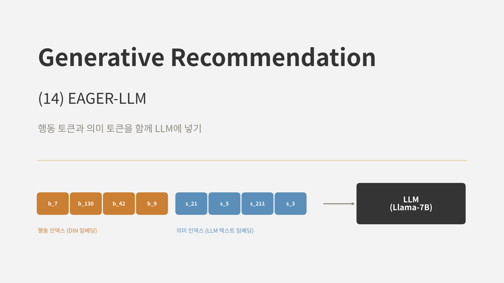
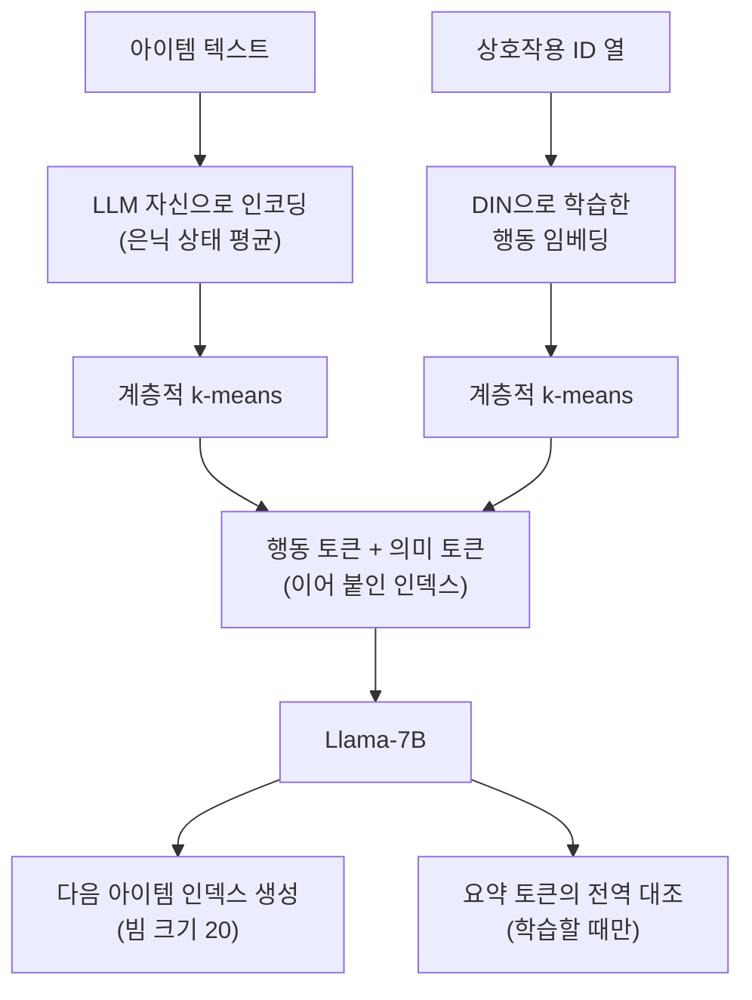
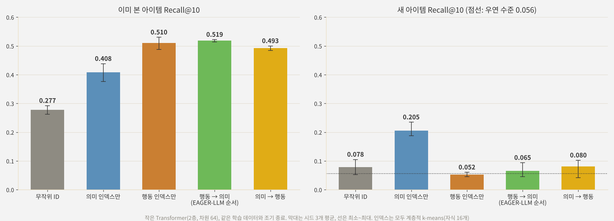

<br>{: .align-center}<br>

### _"EAGER의 두 흐름을 LLM 하나에 담을 수 있을까?"_

[지난 두 편]()의 EAGER는 행동 ID와 의미 ID를 따로 만들고, 작은 Transformer 디코더 두 개로 각각을 생성했습니다. 그보다 앞서 본 [LC-Rec]()은 LLaMA-7B가 콘텐츠 기반 인덱스를 생성하게 하고, 정렬 과제로 언어와 협업 의미를 이었습니다.

이번에 다룰 **EAGER-LLM**(Hong et al., WWW 2025)은 두 갈래를 합칩니다. EAGER를 만든 그룹의 후속 연구로, **행동 인덱스와 의미 인덱스를 함께 LLM에 넣고**, EAGER의 전역 대조 과제와 LC-Rec식 과제들을 LLM 학습에 맞게 다시 설계했습니다. 이번 글에서는 그 구조를 정리하고, 같은 생성 모델에 어떤 인덱스를 주느냐에 따라 결과가 어떻게 달라지는지 직접 비교해 봅니다.

---

## 1. 세 모델의 위치

| 구분 | LC-Rec | EAGER | EAGER-LLM |
|---|---|---|---|
| 생성 모델 | LLaMA-7B | 작은 Transformer (인코더 1층, 디코더 4층 x 2) | Llama-7B |
| 아이템 인덱스 | 의미 (RQ-VAE + USM) | 행동, 의미 (계층적 k-means) 따로 | 행동 + 의미를 이어 붙인 하나의 인덱스 |
| 두 신호의 결합 | 정렬 과제로 언어와 연결 | 디코더 두 개, 결과 단계에서 합침 | LLM 안에서 함께 처리 |
| 보조 과제 | 인덱스와 언어를 오가는 과제들 | 전역 대조, 의미 유도 전이 | 전역 대조(InfoNCE), 상호작용 모델링 과제 |
| 학습 단계 | 한 단계 | 한 단계 | 두 단계 (기본 학습 + 어닐링 어댑터) |

EAGER-LLM의 문제의식은 LLM 기반 추천이 대부분 **의미 신호만** 쓴다는 데 있습니다. LC-Rec의 인덱스도 텍스트 임베딩으로 만들었고, 협업 신호는 학습 과제로만 간접적으로 들어갑니다. EAGER에서 확인했듯이 행동 신호와 의미 신호는 서로 다른 것을 알려 주므로, LLM에도 두 신호를 **처음부터 함께** 넣자는 것입니다.

---

## 2. EAGER-LLM의 구조



### 2.1 두 출처의 인덱스

* **의미 신호:** 아이템 텍스트를 **백본 LLM 자신**에 넣고 은닉 상태를 평균 내어 임베딩을 만듭니다. 별도의 문장 인코더 대신 LLM의 표현 공간을 그대로 씁니다.
* **행동 신호:** EAGER처럼, 상호작용 ID 열만으로 학습한 DIN식 모델의 아이템 임베딩을 씁니다.
* **이산화:** 두 임베딩을 각각 계층적 k-means로 나눕니다. 논문은 벡터 양자화 방식(RQ-VAE)이 불안정해서 피했다고 밝혔습니다. 단계마다 256개, 4단계로 인덱스를 만듭니다.

두 인덱스는 토큰 종류를 구분해(행동용, 의미용) **이어 붙여** 하나의 아이템 표현으로 씁니다. 두 신호를 합치는 별도의 모듈은 없습니다. 논문은 Q-Former 같은 모듈로 미리 섞으면 정보가 손실된다고 보고, 섞는 일은 LLM 안에서 일어나게 두었습니다.

### 2.2 전역 대조 과제 (LLM판)

13편의 전역 대조 과제를 LLM에 맞게 바꿨습니다. 입력 끝에 요약 토큰 [CON]을 붙이고, 그 은닉 상태를 학습용 사상기 두 개로 각각 의미 공간과 행동 공간에 옮긴 뒤, 정답 아이템의 의미 임베딩, 행동 임베딩과 맞춥니다.

$$
\mathcal{L}_{\text{con}}^{t} = - \log \frac{\exp\left(\text{sim}(f^{t}(\mathbf{y}_{\text{CON}}), \mathbf{z}^{t}_{+}) / \tau\right)}{\sum_{j} \exp\left(\text{sim}(f^{t}(\mathbf{y}_{\text{CON}}), \mathbf{z}^{t}_{j}) / \tau\right)}, \quad t \in \{s, b\}
$$

EAGER와 달리 이번에는 음성 샘플을 쓰는 **InfoNCE**입니다. EAGER는 작은 디코더에서 Smooth L1이 더 좋았다고 했는데, 큰 LLM에서는 대조 손실을 택했습니다. 이 손실은 순차 추천 과제의 데이터에만 적용하고, 사상기는 학습할 때만 씁니다.

$$
\mathcal{L} = \mathcal{L}_{\text{gen}} + \mathbb{1}_{\text{SRT}} \left( \lambda_1 \mathcal{L}_{\text{con}}^{s} + \lambda_2 \mathcal{L}_{\text{con}}^{b} \right)
$$

### 2.3 상호작용 모델링 과제

LC-Rec의 정렬 과제와 비슷하게, 다음 토큰 예측 형식의 과제 세 가지를 함께 학습합니다.

* **순차 추천:** 이력 인덱스를 보고 다음 아이템의 인덱스 생성
* **의미 재구성:** 인덱스를 보고 아이템의 텍스트 정보를 복원
* **선호 이해:** 이력을 보고 사용자의 선호를 언어로 설명

### 2.4 어닐링 어댑터

기본 학습을 마친 뒤, 추가 파라미터를 가진 어댑터를 **소량의 고품질 순차 추천 데이터**로 한 번 더 학습합니다. 추천 정확도를 끌어올리면서도, LLM 본체를 크게 건드리지 않아 원래의 언어 능력이 덜 망가지게 하려는 단계입니다. 논문은 어댑터의 구체적인 구조(LoRA 여부 등)는 밝히지 않았습니다.

---

## 3. 논문의 결과

### 3.1 주요 결과

| 데이터 | TIGER R@10 | LC-Rec R@10 | EAGER-LLM R@10 | TIGER N@10 | LC-Rec N@10 | EAGER-LLM N@10 |
|---|---|---|---|---|---|---|
| Beauty | 0.0648 | 0.0681 | **0.0830** | 0.0384 | 0.0409 | **0.0459** |
| Sports | 0.0400 | 0.0451 | **0.0569** | 0.0225 | 0.0246 | **0.0315** |
| Instruments | 0.1064 | 0.1177 | **0.1224** | 0.0803 | 0.0890 | **0.0926** |

같은 LLaMA 계열 7B 모델을 쓰는 LC-Rec보다 Beauty에서 Recall@10이 22%, Sports에서 26% 높았습니다. Instruments에서는 차이가 4%로 작았습니다. Llama2-7B로 맞춰 비교한 Instruments에서도 LETTER를 붙인 LC-Rec(Recall@10 0.1115)보다 높았습니다(0.1206).

다만 [12편]()의 EAGER가 Beauty에서 보고한 Recall@10(0.0836)과 비교하면 거의 같습니다. 두 논문의 실험 설정이 완전히 같다는 보장은 없지만, 7B LLM을 쓴 것이 작은 Transformer보다 추천 정확도를 크게 올리지는 않았다는 뜻이기도 합니다. EAGER-LLM의 의미는 정확도 자체보다, **LLM 기반 추천에 행동 신호를 넣는 방법**을 보였다는 데 있다고 봅니다.

### 3.2 구성 요소의 기여

| 구성 | Beauty R@10 | Beauty N@10 | Instruments R@10 | Instruments N@10 |
|---|---|---|---|---|
| 무작위 인덱스 | 0.0650 | 0.0358 | 0.1071 | 0.0817 |
| + 두 출처 인덱스 | 0.0760 | 0.0413 | 0.1199 | 0.0886 |
| + 전역 대조 과제 | 0.0781 | 0.0432 | 0.1215 | 0.0914 |
| + 어닐링 어댑터 (전체) | **0.0817** | **0.0451** | **0.1225** | **0.0927** |

가장 큰 개선은 **인덱스를 바꾸는 단계**에서 나왔습니다. 무작위 인덱스를 두 출처 인덱스로 바꾸는 것만으로 Beauty Recall@10이 17%, Instruments가 12% 올랐습니다. EAGER에서 two-stream 구조가 개선의 대부분을 차지했던 것과 같은 그림입니다.

### 3.3 인덱스 종류에 따른 차이

논문은 무작위, 의미만, 행동만, 둘 다(이어 붙인 인덱스)를 비교했습니다. 둘 다 쓴 인덱스가 가장 좋았고, 논문은 그 효과가 각각의 효과를 **더한 것보다 크다**고 설명했습니다. 눈에 띄는 것은 Beauty에서 **의미만 쓴 인덱스가 무작위 인덱스보다도 나빴다**는 결과입니다. 논문은 텍스트 임베딩을 4토큰으로 줄이는 압축률이 너무 높아서라고 해석했습니다. 행동 신호가 의미 신호를 해석하는 실마리 역할을 한다는 것이 저자들의 주장입니다.

---

## 4. 직접 실험: 같은 생성 모델, 다른 인덱스

### 4.1 실험 설계

EAGER-LLM의 핵심이 인덱스에 있으니, 생성 모델은 그대로 두고 **인덱스만 바꿔** 비교했습니다. [11편]()에서 쓴 작은 디코더 전용 Transformer(2층, 차원 64)를 LLM 대신 썼고, 손글씨 숫자 세계와 새 아이템 179개도 그대로입니다.

* **무작위 ID:** 아이템마다 겹치지 않는 무작위 3토큰
* **의미 인덱스만:** 픽셀 콘텐츠 임베딩의 계층적 k-means (자식 16개)
* **행동 인덱스만:** 협업 임베딩의 계층적 k-means. 새 아이템은 기록이 없어 벡터가 비어 있습니다.
* **행동 → 의미:** 두 인덱스를 이어 붙인 8토큰 (EAGER-LLM의 순서)
* **의미 → 행동:** 순서를 바꿔 이어 붙인 8토큰

과제는 직전 두 아이템의 인덱스를 보고 다음 아이템의 인덱스를 생성하는 순차 추천 하나입니다. 전역 대조 과제와 어닐링 어댑터는 넣지 않았습니다. 평가는 이미 본 아이템 Recall@10(제약 빔 서치)과 새 아이템 Recall@10(새 아이템끼리의 순위, 아이템별 평균)이고, 시드는 3개입니다.

### 4.2 결과

<br>{: .align-center}<br>

| 인덱스 | 길이 | 이미 본 아이템 | 새 아이템 |
|---|---|---|---|
| 무작위 ID | 3 | 0.277 | 0.078 |
| 의미 인덱스만 | 4 | 0.408 | **0.205** |
| 행동 인덱스만 | 4 | 0.510 | 0.052 |
| 행동 → 의미 (EAGER-LLM 순서) | 8 | **0.519** | 0.065 |
| 의미 → 행동 | 8 | 0.493 | 0.080 |

새 아이템의 우연 수준은 0.056입니다.

**이미 본 아이템에서는 두 출처 인덱스가 가장 좋았습니다.** 행동 → 의미 순서의 인덱스가 0.519로, 행동 인덱스만 쓴 경우(0.510)보다 조금 높았고 시드 사이 편차도 가장 작았습니다. 논문처럼 의미가 행동 위에 더해져 도움이 되는 방향입니다. 다만 그 차이는 크지 않았고, 논문이 말한 "각각의 효과를 더한 것보다 큰" 시너지는 이 작은 실험에서는 보이지 않았습니다.

**의미 인덱스는 무작위보다 확실히 좋았습니다.** 논문의 Beauty 결과와 달리, 이 세계에서는 의미 인덱스(0.408)가 무작위 ID(0.277)보다 훨씬 좋았습니다. 픽셀 임베딩이 취향 그룹을 정하는 숫자 모양을 잘 담고 있기 때문입니다. 의미 인덱스가 무작위보다 나쁠 수 있다는 논문의 관찰은, 텍스트 임베딩이 추천에 필요한 정보를 얼마나 담느냐에 따라 달라지는 결과로 보입니다.

### 4.3 이어 붙인 인덱스는 새 아이템을 다루지 못했다

가장 눈에 띈 것은 새 아이템입니다. 의미 인덱스만 쓰면 새 아이템에서 0.205였지만, **행동 토큰을 붙이는 순간 거의 우연 수준(0.065, 0.080)으로 떨어졌습니다.** 의미 토큰을 앞에 두어도 마찬가지였습니다.

원인은 생성 방식에 있습니다. 아이템을 생성하려면 인덱스 8토큰을 **모두** 생성해야 하고, 아이템의 점수는 8토큰 확률의 곱입니다. 새 아이템의 행동 토큰은 기록이 없는 아이템들 사이에서 임의로 정해진 코드라, 모델이 높은 확률을 줄 근거가 없습니다. 의미 토큰이 아무리 잘 맞아도, 뒤따르는(또는 앞서는) 행동 토큰의 낮고 제각각인 확률이 순위를 흔들어 버립니다.

[12편]()의 EAGER에서는 이 문제가 없었습니다. 두 흐름을 **따로 생성**하고 더 확신하는 쪽을 골랐기 때문에, 새 아이템은 의미 흐름만으로 순위가 정해졌습니다. 두 인덱스를 하나로 이어 붙이면 LLM이 두 신호를 함께 볼 수 있다는 장점이 생기지만, 대신 **한쪽 신호가 없는 아이템은 다른 쪽 신호의 덕을 보지 못합니다.** EAGER-LLM의 논문은 새 아이템을 따로 평가하지 않았는데, 새 아이템이 많은 서비스라면 꼭 확인해야 할 부분입니다.

이번 실험도 작은 합성 데이터와 작은 모델로 한 것이고, EAGER-LLM의 전역 대조 과제와 어닐링 어댑터는 빠져 있습니다. 그래도 **두 출처 인덱스가 기존 아이템에는 도움이 되지만, 이어 붙이는 설계는 새 아이템이라는 비용을 치른다**는 점은 분명하게 드러났습니다.

---

## 5. 부록: 두 출처 인덱스와 LLM용 전역 대조 손실

실험은 JAX로 했지만, 핵심 부분을 PyTorch로 정리합니다.

### Point 1. 행동 토큰과 의미 토큰을 이어 붙인 인덱스

12편의 계층적 k-means로 두 인덱스를 만든 뒤, 토큰 종류를 구분해 이어 붙입니다. 아이템 하나가 토큰 8개로 표현됩니다.

```python
def dual_index_tokens(beh_codes, sem_codes, pad=256):
    """beh_codes, sem_codes: (N, 4) 계층적 k-means 인덱스 (짧은 경로는 pad로 채움)"""
    def part(prefix, codes):
        return "".join(f"<{prefix}{l}_{c}>" for l, c in enumerate(codes) if c != pad)
    return [part("b", b) + part("s", s) for b, s in zip(beh_codes, sem_codes)]

def dual_vocab(levels=4, K=256):
    return [f"<{p}{l}_{c}>" for p in ("b", "s") for l in range(levels) for c in range(K)]

# dual_index_tokens(...)[42] == "<b0_7><b1_130><b2_42><b3_9><s0_21><s1_5><s2_211><s3_3>"
```

### Point 2. 요약 토큰과 사상기, InfoNCE

LLM의 마지막 은닉 상태 중 요약 토큰 위치를 꺼내, 공간마다 사상기를 거쳐 배치 안의 아이템 임베딩과 대조합니다. 사상기는 학습할 때만 씁니다.

```python
import torch
import torch.nn as nn
import torch.nn.functional as F

class GlobalContrast(nn.Module):
    def __init__(self, hidden, sem_dim, beh_dim, tau=0.07):
        super().__init__()
        self.proj = nn.ModuleDict({"s": nn.Sequential(nn.Linear(hidden, hidden), nn.GELU(), nn.Linear(hidden, sem_dim)),
                                   "b": nn.Sequential(nn.Linear(hidden, hidden), nn.GELU(), nn.Linear(hidden, beh_dim))})
        self.tau = tau

    def forward(self, last_hidden, con_pos, z_sem, z_beh):
        """last_hidden: (B, T, H) LLM 출력, con_pos: (B,) 요약 토큰 위치, z_*: (B, d) 정답 아이템 임베딩 (고정)"""
        y = last_hidden[torch.arange(len(con_pos)), con_pos]
        loss = 0.0
        for t, z in (("s", z_sem), ("b", z_beh)):
            q = F.normalize(self.proj[t](y), dim=-1)
            k = F.normalize(z.detach(), dim=-1)
            logits = q @ k.T / self.tau                          # 배치 안의 다른 아이템이 음성
            loss = loss + F.cross_entropy(logits, torch.arange(len(q), device=q.device))
        return loss

# loss = out.loss + is_seqrec * global_contrast(out.hidden_states[-1], con_pos, z_sem, z_beh)
```

### Point 3. 8토큰 인덱스의 제약 디코딩

인덱스가 8토큰이 되어도 제약 디코딩은 같습니다. 존재하는 인덱스의 접두사 트라이를 만들고, 매 단계 허용되는 다음 토큰만 남깁니다.

```python
from collections import defaultdict

def build_trie(index_token_ids):
    """index_token_ids: 아이템마다 인덱스 토큰 id 리스트 (길이 8)"""
    nxt = defaultdict(set)
    for ids in index_token_ids:
        for l in range(len(ids)):
            nxt[tuple(ids[:l])].add(ids[l])
    return nxt

def allowed_next(nxt, generated, eos_id):
    return list(nxt.get(tuple(generated), [])) or [eos_id]
```

---

## 6. 결론 및 다음 글

정리하면 다음과 같습니다.

* **EAGER-LLM**은 EAGER의 두 신호를 LLM 안으로 가져왔습니다. 아이템마다 행동 인덱스(DIN 임베딩)와 의미 인덱스(LLM 자신의 텍스트 임베딩)를 계층적 k-means로 만들어 **이어 붙이고**, 두 신호를 섞는 일은 LLM에게 맡겼습니다.
* 학습에는 요약 토큰의 **전역 대조 과제**(이번에는 InfoNCE), LC-Rec식 **상호작용 모델링 과제**, 소량의 고품질 데이터로 한 번 더 다듬는 **어닐링 어댑터**를 썼습니다.
* 논문에서는 LC-Rec보다 Recall@10이 4~26% 높았고, 개선의 가장 큰 몫은 인덱스를 바꾸는 단계에서 나왔습니다.
* 직접 비교해 보니 두 출처 인덱스는 이미 본 아이템에서 가장 좋았지만, **새 아이템에서는 거의 우연 수준**으로 떨어졌습니다. 이어 붙인 인덱스는 모든 토큰을 생성해야 하므로, 행동 신호가 없는 아이템은 의미 신호만으로 살아남을 수 없었습니다.

7편부터 14편까지 본 모델들은 모두 같은 질문에 서로 다른 답을 냈습니다. **아이템 ID에 콘텐츠와 협업 신호를 어떻게 담을 것인가.** LETTER는 하나의 ID를 학습할 때 협업 신호를 넣었고, TokenRec은 협업 표현 자체를 토큰으로 만들었으며, LC-Rec은 콘텐츠 ID를 정렬 과제로 언어와 협업 의미에 이었습니다. EAGER는 두 ID를 나란히 생성했고, EAGER-LLM은 두 ID를 이어 붙여 LLM에 넣었습니다. 이번 실험들에서 반복해서 본 것처럼, 이 선택은 **이미 본 아이템의 정확도와 새 아이템에 대한 일반화 사이의 균형**을 어디에 둘지의 문제이기도 합니다.

다음 글에서는 이 연재의 중간 정리로, 지금까지 다룬 모델들을 이 균형을 기준으로 한자리에 놓고 비교합니다. 각 편의 실험에서 얻은 결과도 함께 모아, 실무에서 생성형 추천을 설계할 때 무엇부터 정해야 하는지 정리해 보겠습니다.

---

## 참고 문헌

* Hong et al., *EAGER-LLM: Enhancing Large Language Models as Recommenders through Exogenous Behavior-Semantic Integration*, WWW 2025. [arXiv:2502.14735](https://arxiv.org/abs/2502.14735)
* Wang et al., *EAGER: Two-Stream Generative Recommender with Behavior-Semantic Collaboration*, KDD 2024. [arXiv:2406.14017](https://arxiv.org/abs/2406.14017)
* Zheng et al., *Adapting Large Language Models by Integrating Collaborative Semantics for Recommendation* (LC-Rec), ICDE 2024. [arXiv:2311.09049](https://arxiv.org/abs/2311.09049)
* Li et al., *BLIP-2: Bootstrapping Language-Image Pre-training with Frozen Image Encoders and Large Language Models* (Q-Former), ICML 2023. [arXiv:2301.12597](https://arxiv.org/abs/2301.12597)
