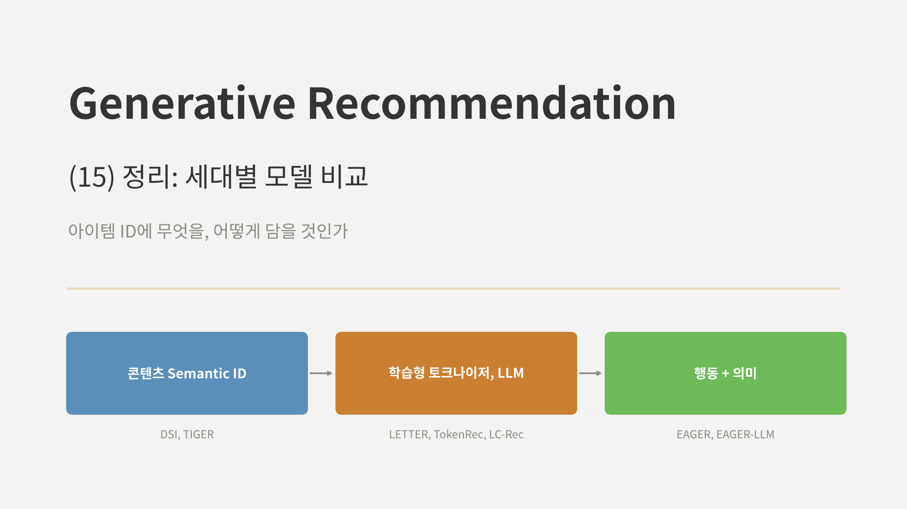
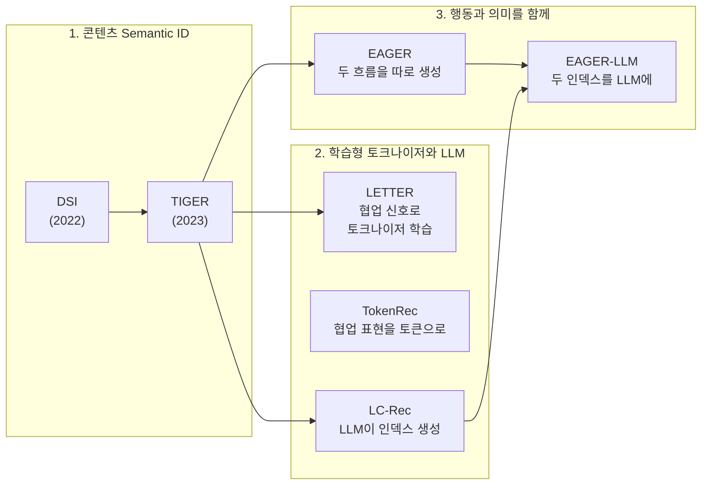
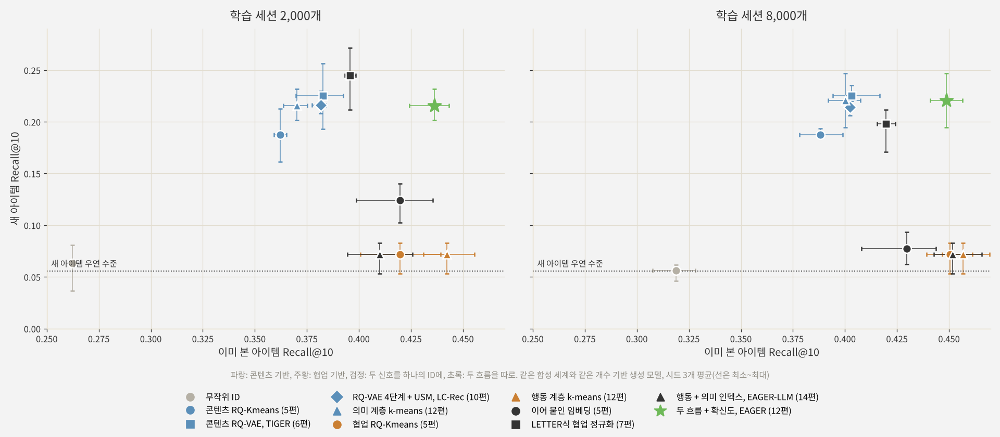
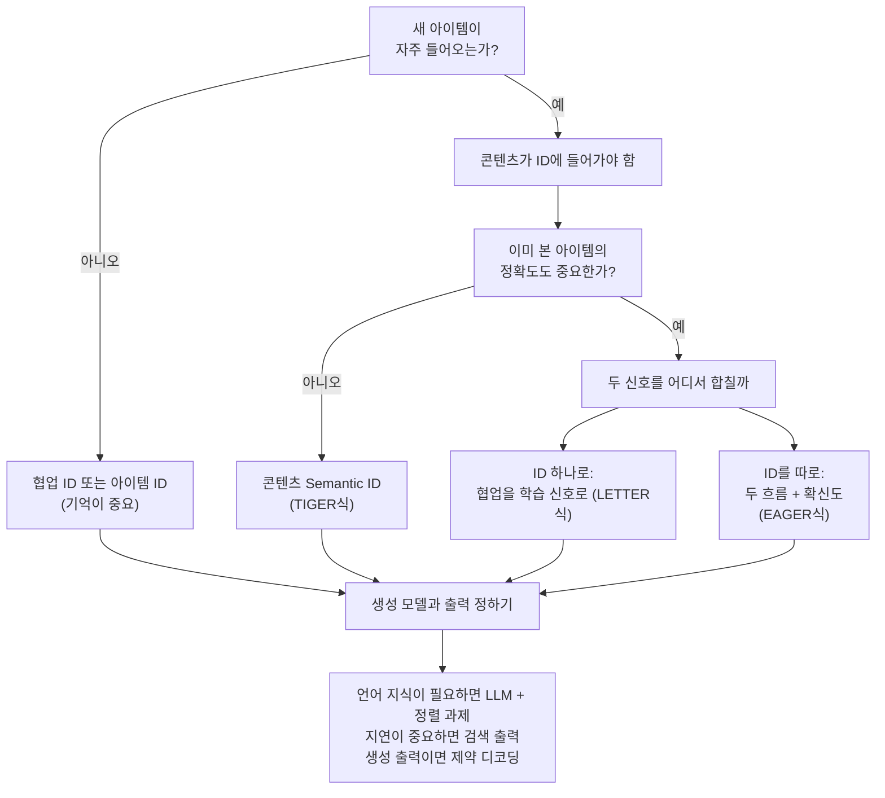

<br>{: .align-center}<br>

### _"지금까지 본 생성형 추천 모델들은 결국 무엇이 다른가?"_

[6편]()의 TIGER부터 [지난 글]()의 EAGER-LLM까지, 생성형 추천 모델을 일곱 개 살펴봤습니다. 한 편씩 따라오다 보면 각 모델의 장치는 기억에 남지만, 모델끼리 무엇이 같고 무엇이 다른지는 오히려 흐려지기 쉽습니다.

이번 글은 연재의 중간 정리입니다. 모델들을 한 표에 놓고, 설계 선택을 몇 개의 축으로 나눠 봅니다. 그리고 각 편에서 따로 실험했던 ID 설계들을 **같은 합성 세계, 같은 생성 모델** 위에 한꺼번에 올려 다시 비교합니다. 마지막으로 각 편의 실험에서 얻은 교훈을 모아, 생성형 추천을 설계할 때 무엇부터 정해야 하는지 정리하겠습니다.

---

## 1. 연재 지도

1~4편은 재료를 준비하는 과정이었습니다. [2편]()에서 오토인코더로 아이템 표현을 압축하는 법을, [3편]()에서 VQ-VAE로 표현을 이산 코드로 바꾸는 법을, [4편]()에서 RQ-VAE로 코드를 여러 단계로 쌓아 **Semantic ID**를 만드는 법을 봤습니다. [5편]()에서는 좋은 Semantic ID의 조건을 정리했습니다.

6편부터 본 모델들은 이 연재에서 세 무리로 나눠 볼 수 있습니다. 엄밀한 시대 구분은 아니고(LC-Rec, LETTER, TokenRec, EAGER는 모두 2024년 전후에 나왔습니다), **아이템 ID에 무엇을 담으려 했는지**를 기준으로 묶은 것입니다.



* **콘텐츠 Semantic ID (6편):** DSI가 "ID를 생성한다"는 틀을 만들었고, TIGER가 이를 추천으로 옮겼습니다. 아이템 텍스트 임베딩을 RQ-VAE로 양자화한 ID를 Transformer가 생성합니다. ID에는 **콘텐츠만** 들어갑니다.
* **학습형 토크나이저와 LLM (7~11편):** 콘텐츠만 담은 ID에는 협업 신호가 빠져 있다는 문제를 서로 다른 방향에서 풉니다. LETTER는 토크나이저를 학습할 때 협업 신호를 맞추고, TokenRec은 처음부터 협업 표현을 토큰으로 만들며, LC-Rec은 콘텐츠 인덱스를 LLM에 넣고 정렬 과제로 협업 의미를 가르칩니다.
* **행동과 의미를 함께 (12~14편):** 두 신호를 하나의 ID에 섞지 않고 **각자의 ID로** 둡니다. EAGER는 두 ID를 디코더 두 개로 나란히 생성하고, EAGER-LLM은 두 ID를 이어 붙여 LLM 하나에 넣습니다.

---

## 2. 한 표로 보는 모델 비교

| 모델 | ID의 재료 | 토크나이저 | 충돌 처리 | 생성 모델 | 출력 방식 |
|---|---|---|---|---|---|
| DSI | 문서 본문 (BERT 임베딩) | 계층적 k-means | 마지막 군집 안의 번호로 구분 | T5 | ID 생성 |
| TIGER | 아이템 텍스트 (Sentence-T5) | RQ-VAE 3단계 x 256 | 구분 토큰 1개 추가 | 인코더 디코더 Transformer | 빔 서치 생성 |
| LETTER | 아이템 텍스트 + 협업 임베딩(학습 신호로만) | RQ-VAE + 협업, 다양성 정규화 | 다양성 정규화로 코드 쏠림 완화 | TIGER 또는 LC-Rec | 빔 서치 생성 |
| TokenRec | LightGCN 협업 표현 (사용자, 아이템) | MQ-Tokenizer (K-way, 마스킹) | 검색이라 문제 되지 않음 | T5-small | **검색** (벡터 → 최근접 아이템) |
| LC-Rec | 아이템 텍스트 (LLaMA 임베딩) | RQ-VAE 4단계 x 256 | Uniform Semantic Mapping | LLaMA-7B + 정렬 과제 | 빔 서치 생성 |
| EAGER | 행동(DIN) + 의미(Sentence-T5), **따로** | 계층적 k-means | 끝까지 분할 | 공유 인코더 + 디코더 2개 | 두 흐름 생성, 확신도로 합침 |
| EAGER-LLM | 행동(DIN) + 의미(LLM 자신), **이어 붙임** | 계층적 k-means | 끝까지 분할 | Llama-7B | 빔 서치 생성 |

표를 세로로 읽으면 각 열이 하나의 설계 결정이고, 모델마다 다른 칸을 골랐다는 것이 보입니다. 논문에서 보고한 개선도 대부분 이 칸들 중 하나를 바꾼 데서 나왔습니다.

* LETTER는 **토크나이저만** 바꿔 TIGER와 LC-Rec의 Recall@10을 4.7~10.8% 올렸습니다.
* TokenRec은 출력을 **검색으로** 바꿔 같은 T5-small을 쓰는 P5보다 12~16배 빨랐습니다.
* LC-Rec은 **정렬 과제**를 더할 때마다 성능이 올라, Games에서 순차 추천 과제만 쓸 때보다 HR@10이 26% 높았습니다.
* EAGER는 **두 흐름으로 나누는 것**만으로 Beauty Recall@10이 14% 올랐고, 보조 과제는 그 위에 2~8%를 더했습니다.
* EAGER-LLM은 LC-Rec보다 Recall@10이 4~26% 높았고, 개선의 가장 큰 몫은 **인덱스를 바꾸는 단계**에서 나왔습니다.

논문마다 데이터와 기준선, 재현 방식이 달라 이 숫자들을 서로 직접 비교할 수는 없습니다. 그래도 공통점은 분명합니다. **가장 큰 개선은 생성 모델의 크기보다 ID를 어떻게 만드느냐에서 나왔습니다.**

---

## 3. 여섯 가지 설계 축

표의 열을 조금 더 일반화하면, 생성형 추천을 설계할 때 정해야 하는 것은 다음 여섯 가지입니다.

### 3.1 무엇을 양자화할까

ID의 재료입니다. 콘텐츠 임베딩(TIGER, LC-Rec), 협업 임베딩(TokenRec), 둘 다(EAGER, EAGER-LLM) 중에서 고릅니다. [5편]()에서 봤듯이 콘텐츠 ID는 비슷하게 생긴 아이템을, 협업 ID는 함께 소비되는 아이템을 묶습니다. 이 선택이 **새 아이템을 다룰 수 있는지**를 거의 결정합니다. 기록이 없는 아이템은 협업 임베딩이 비어 있기 때문입니다.

### 3.2 어떻게 양자화할까

RQ-VAE(TIGER, LETTER, LC-Rec), 잔차 k-means, 계층적 k-means(DSI, EAGER), K-way 양자화(TokenRec)가 있습니다. [12편]()에서 정리했듯이 RQ-VAE는 코드 길이가 고정되고 같은 단계의 같은 코드가 어디서나 같은 뜻이지만 충돌이 생길 수 있고, 계층적 k-means는 충돌이 없지만 같은 번호라도 부모 군집에 따라 뜻이 달라집니다. LETTER처럼 양자화기 자체를 **추천 목적으로 학습**할 수도 있습니다.

### 3.3 충돌을 어떻게 풀까

서로 다른 아이템이 같은 코드를 받으면 생성 모델은 둘을 구분할 수 없습니다. TIGER는 의미 없는 구분 토큰을 하나 붙였고, LC-Rec은 마지막 단계의 코드 배정을 최적 수송 문제로 바꿔 **모든 토큰의 의미를 지키며** 나눴습니다([10편]()). EAGER의 계층적 k-means는 아이템이 하나 남을 때까지 나누므로 충돌 자체가 없고, TokenRec은 검색을 하므로 충돌이 문제가 되지 않습니다.

### 3.4 생성 모델은 얼마나 클까

TIGER와 EAGER는 수천만 파라미터 이하의 작은 Transformer를, LC-Rec과 EAGER-LLM은 70억 파라미터 LLM을 씁니다. LLM을 쓰면 아이템 설명, 사용자 의도 같은 **언어 지식**을 추천에 끌어올 수 있지만, 그 대가로 인덱스 토큰을 언어와 이어 주는 정렬 과제가 필요하고 학습과 추론 비용이 크게 늘어납니다.

### 3.5 생성할까, 검색할까

ID 토큰을 빔 서치로 하나씩 생성하면 모델 자체가 인덱스가 되지만, 디코딩이 느리고 **존재하지 않는 ID**가 나올 수 있습니다. TokenRec처럼 선호 벡터를 내고 최근접 아이템을 검색하면 빠르고 없는 아이템이 나오지 않는 대신, 벡터 인덱스를 다시 들여야 합니다([9편]()).

### 3.6 두 신호를 어디서 합칠까

콘텐츠와 협업 신호를 모두 쓰고 싶다면, 합치는 위치를 정해야 합니다.

* **입력에서:** 두 임베딩을 이어 붙여 하나의 ID로 양자화 (5편의 이어 붙인 ID)
* **토크나이저 학습에서:** 콘텐츠로 ID를 만들되 협업 신호를 학습 신호로만 사용 (LETTER)
* **인덱스에서:** 두 ID를 이어 붙인 하나의 인덱스 (EAGER-LLM)
* **생성 모델 학습에서:** 콘텐츠 인덱스에 협업 의미를 정렬 과제로 연결 (LC-Rec)
* **출력에서:** 두 ID를 따로 생성하고 결과를 합침 (EAGER)

이 연재의 실험들이 가장 여러 번 다룬 축이 이것입니다. 그래서 다음 절에서는 이 축을 중심으로, 지금까지의 ID 설계를 한자리에서 비교해 보겠습니다.

---

## 4. 직접 실험: 한 무대에 올린 ID 설계들

### 4.1 실험 설계

5편부터 각 편의 실험은 대부분 같은 합성 세계를 썼지만, 비교 대상은 편마다 몇 개씩이었습니다. 이번에는 **같은 세계, 같은 시드, 같은 추천 모델**에 ID만 바꿔 열한 가지를 한 번에 비교했습니다.

* **세계:** [7편]()의 손글씨 숫자 세계 그대로입니다. 아이템 1,797개, 취향 그룹 20개(80%의 아이템은 숫자와 획 굵기로, 20%는 무작위로 그룹이 정해짐), 사용자는 한 그룹 안에서 아이템 6개를 연속으로 소비합니다. 아이템의 10%(179개)는 학습에 한 번도 나오지 않는 새 아이템입니다.
* **추천 모델:** [5편]()의 **개수 기반 자기회귀 Semantic ID 모델**로 고정했습니다. 이전 아이템의 앞 두 코드를 문맥으로, 다음 아이템의 코드를 하나씩 생성할 확률을 횟수로 추정하고, 존재하는 ID에만 점수를 매깁니다. 학습이 필요 없어 열한 가지 ID를 같은 조건에서 비교할 수 있고, 무엇보다 **차이가 ID에서만** 나옵니다.
* **평가:** 이미 본 아이템의 Recall@10(전체 1,797개 중)과 새 아이템의 Recall@10(새 아이템 179개끼리의 순위, 정답 아이템별 평균. 우연 수준 약 0.056). 학습 세션 2,000개와 8,000개, 시드 3개입니다.

비교한 ID는 다음과 같습니다. 고정 길이 ID는 3단계 x 16개 코드에 충돌 코드를 붙인 4토큰입니다.

| 묶음 | ID 설계 | 해당 편 |
|---|---|---|
| 기준 | 무작위 ID | 6편 |
| 콘텐츠 | 콘텐츠 RQ-Kmeans (픽셀 PCA 8차원) | 5편 |
| | 콘텐츠 RQ-VAE (TIGER식, 픽셀에서 학습) | 6, 7편 |
| | RQ-VAE 4단계 + USM (LC-Rec식) | 10편 |
| | 의미 계층적 k-means (EAGER의 의미 ID) | 12편 |
| 협업 | 협업 RQ-Kmeans (PPMI + SVD 8차원) | 5편 |
| | 행동 계층적 k-means (EAGER의 행동 ID) | 12편 |
| 하나의 ID에 섞기 | 이어 붙인 임베딩을 양자화 | 5편 |
| | LETTER식 (협업 정규화 + 다양성 정규화) | 7편 |
| | 행동 + 의미 인덱스를 이어 붙인 8토큰 (EAGER-LLM식) | 14편 |
| 따로 두기 | 두 흐름 + 확신도 (EAGER식) | 12편 |

TokenRec의 검색과 LC-Rec의 정렬 과제는 ID가 아니라 생성 모델 쪽의 설계라서 이번 비교에서는 뺐습니다. 두 모델은 각각 9편과 11편에서 따로 실험했습니다.

### 4.2 결과

<br>{: .align-center}<br>

가로축이 이미 본 아이템, 세로축이 새 아이템의 성능입니다. 오른쪽 위로 갈수록 좋습니다.

| ID 설계 | 이미 본 아이템 (2,000) | 새 아이템 (2,000) | 이미 본 아이템 (8,000) | 새 아이템 (8,000) |
|---|---|---|---|---|
| 무작위 ID | 0.262 | 0.063 | 0.319 | 0.056 |
| 콘텐츠 RQ-Kmeans | 0.362 | 0.188 | 0.388 | 0.187 |
| 콘텐츠 RQ-VAE (TIGER식) | 0.383 | 0.225 | 0.403 | **0.225** |
| RQ-VAE 4단계 + USM | 0.382 | 0.216 | 0.402 | 0.214 |
| 의미 계층적 k-means | 0.370 | 0.216 | 0.400 | 0.221 |
| 협업 RQ-Kmeans | 0.420 | 0.072 | 0.450 | 0.072 |
| 행동 계층적 k-means | **0.442** | 0.072 | **0.457** | 0.072 |
| 이어 붙인 임베딩 | 0.420 | 0.124 | 0.430 | 0.077 |
| LETTER식 | 0.396 | **0.245** | 0.420 | 0.198 |
| 행동 + 의미 인덱스 (8토큰) | 0.410 | 0.072 | 0.452 | 0.072 |
| 두 흐름 + 확신도 | 0.436 | 0.216 | 0.449 | 0.221 |

(LETTER식은 정규화 세기 설정이 7편 표의 설정과 달라서, 특히 세션 8,000개의 새 아이템에서 수치가 조금 다릅니다. USM도 이번에 토크나이저를 다시 학습해서 10편 표와 소수점 둘째, 셋째 자리에서 조금 다릅니다.)

### 4.3 무엇이 보이나

**첫째, 한 가지 신호만 담은 ID는 두 줄로 나뉩니다.** 파란색 콘텐츠 ID들은 새 아이템 0.19~0.23, 이미 본 아이템 0.36~0.40에 모여 있고, 주황색 협업 ID들은 이미 본 아이템 0.42~0.46으로 더 높지만 새 아이템은 0.072로 거의 우연 수준입니다. 협업 ID에서 새 아이템은 모두 같은 빈 벡터를 받으므로 서로 구분되지 않습니다. 콘텐츠 ID끼리의 차이(RQ-Kmeans, RQ-VAE, USM, 계층적 k-means)는 이미 본 아이템에서 0.02 안팎으로, **무엇을 양자화했느냐에 따른 차이**(콘텐츠 대 협업, 0.04~0.08)보다 작았습니다.

**둘째, 하나의 ID에 섞을 때는 섞는 위치가 결과를 가릅니다.** 검은색 세 가지가 모두 두 신호를 하나의 ID에 담았지만 결과는 전혀 다릅니다.

* 임베딩을 **입력에서** 이어 붙이면, 세션 2,000개에서는 새 아이템 0.124로 중간쯤이었지만 8,000개에서는 0.077로 떨어졌습니다. 협업 신호가 많아질수록 협업 쪽 절반이 군집을 좌우하고, 협업 벡터가 없는 새 아이템은 엉뚱한 칸에 들어갑니다.
* 두 인덱스를 **이어 붙인** 8토큰은 이미 본 아이템에서 협업 ID 수준이었지만 새 아이템은 우연 수준이었습니다. 앞쪽 행동 토큰부터 맞혀야 하는데, 새 아이템의 행동 토큰은 의미가 없기 때문입니다. 14편에서 Transformer로 본 결과와 같습니다.
* LETTER식처럼 협업 신호를 **학습 신호로만** 쓰면 새 아이템 성능이 콘텐츠 수준으로 유지됐고(세션 2,000개에서는 열한 가지 중 가장 높은 0.245), 이미 본 아이템은 콘텐츠 RQ-VAE보다 0.013~0.017 높았습니다. 다만 세션 8,000개에서는 새 아이템이 0.198로 내려왔습니다(시드별 0.171~0.212). 협업 신호가 강해질수록 하나의 ID 안에서 콘텐츠의 몫이 조금씩 줄어드는 대가는 LETTER식에도 있었습니다.

**셋째, 오른쪽 위에는 두 흐름만 있습니다.** 초록색 별은 이미 본 아이템에서 행동 ID의 약 98%(0.436 대 0.442, 0.449 대 0.457)를 얻으면서, 새 아이템에서는 의미 ID와 같은 값을 냈습니다. 행동 흐름은 새 아이템끼리 구분하지 못하므로 새 아이템의 순위는 의미 흐름이 정하고, 이미 본 아이템에서는 더 확신하는 행동 흐름의 답이 대부분 채택됩니다. [12편]()에서 본 것처럼 두 흐름의 점수를 더하면 이미 본 아이템에서 행동 ID보다도 높아지기도 했습니다.

**넷째, 데이터가 늘어도 새 아이템 성능은 늘지 않습니다.** 세션을 네 배로 늘리자 이미 본 아이템은 모든 설계에서 0.01~0.06 올랐지만, 새 아이템은 거의 그대로이거나 오히려 내려갔습니다. 새 아이템을 맞히는 능력은 데이터 양이 아니라 **ID에 콘텐츠가 들어 있는지**로 정해집니다. 무작위 ID(0.26~0.32)가 모든 Semantic ID보다 낮다는 것도 6편의 결론을 다시 확인해 줍니다.

### 4.4 이 실험이 말해 주지 않는 것

이 비교는 일부러 단순하게 만든 무대라서, 결과를 읽을 때 몇 가지를 기억해야 합니다.

* **생성 모델이 개수 기반 모델입니다.** 일반화 능력이 있는 Transformer나 LLM이었다면 콘텐츠 ID와 협업 ID의 격차, 특히 하나로 섞은 ID의 결과가 달라질 수 있습니다. 14편에서 Transformer로 이어 붙인 인덱스를 비교했을 때 경향은 같았지만, 모든 설계를 그렇게 확인하지는 않았습니다.
* **언어 지식이 없습니다.** LC-Rec과 EAGER-LLM의 장점 중 상당 부분은 사전 학습된 LLM에서 옵니다. 11편에서 확인했듯이 작은 모델에서는 정렬 과제가 인덱스를 읽는 법은 가르쳐도 추천 성능은 거의 올리지 못했습니다.
* **세계가 합성입니다.** 이 세계에서는 콘텐츠(숫자 모양과 획 굵기)가 취향 그룹의 80%를 설명합니다. 콘텐츠가 취향을 거의 설명하지 못하는 서비스라면 콘텐츠 ID의 새 아이템 성능도 그만큼 낮아질 것입니다.

그래서 숫자보다는 **배치**를 봐 주시면 좋겠습니다. 한 가지 신호만 담은 ID가 두 줄로 갈리고, 섞는 방식에 따라 새 아이템이 살아남거나 무너지며, 두 흐름이 두 줄의 장점을 함께 얻는다는 배치는 5편부터 14편까지 여러 실험에서 반복해서 나타났습니다.

---

## 5. 각 편의 실험에서 배운 것

| 편 | 실험 질문 | 결과 |
|---|---|---|
| 5 | 콘텐츠 ID와 협업 ID, 무엇이 나을까 | 데이터가 적으면 협업 Semantic ID, 많으면 아이템 ID. 새 아이템은 콘텐츠 ID만 다룸 |
| 6 | 미니 TIGER는 아이템 ID 모델을 이길까 | 0.589 대 0.611로 근접, 임베딩 테이블은 훨씬 작음. 콘텐츠 ID는 새 아이템에서 우연의 약 2배 |
| 7 | 토크나이저에 협업 신호를 넣으면 | 그대로 맞추면 코드가 몰림. 선형 사상을 거치면 이미 본 아이템이 오르고 새 아이템은 유지 |
| 8 | MQ-Tokenizer의 마스킹은 왜 효과가 있나 | 새 사용자 성능 35% 상승. 원인은 표현 길이의 분포 변화, 입력 정규화로 상당 부분 해결 |
| 9 | 아이템 토큰을 생성할까, 검색할까 | 검색이 더 정확하고 6~10배 빠름. 코사인 검색은 새 아이템을 네 배 가까이 과하게 추천, 내적이면 해결 |
| 10 | USM은 언제 충돌을 잘 푸나 | 빈자리가 충분할 때만 (4단계: 충돌 247 → 5개, 3단계: 실패). 단순 모델에서는 구분 토큰과 비슷 |
| 11 | 정렬 과제는 무엇을 가르치나 | 인덱스 읽기는 확실히 배움 (처음 보는 새 아이템도 92%). 추천 성능은 거의 그대로 |
| 12 | 두 흐름을 어떻게 합칠까 | 확신도로 합치면 두 장점을 함께 얻음. 점수 합은 이미 본 아이템에서 최고, 길이 정규화는 해로움 |
| 13 | 보조 과제는 얼마나 도움이 되나 | 검증 생성 손실은 꾸준히 낮아짐. Recall 변화는 시드 편차 안 |
| 14 | 이어 붙인 인덱스는 새 아이템을 다룰까 | 이미 본 아이템은 최고 수준, 새 아이템은 우연 수준 |

표를 가로질러 보면 네 가지 교훈이 반복됩니다.

1. **ID의 재료가 새 아이템 성능의 상한을 정합니다.** 콘텐츠가 들어가지 않은 ID로는 어떤 생성 모델도 새 아이템을 맞히지 못했고(5, 6, 14편, 이번 글), 콘텐츠를 넣더라도 새 아이템이 앞자리 토큰을 맞힐 수 있는 구조여야 했습니다.
2. **점수의 척도가 결과를 크게 흔듭니다.** 코사인과 내적(9편), 확신도와 길이 정규화 확신도(12편)처럼, 모델은 같아도 점수를 어떻게 비교하느냐에 따라 새 아이템 노출이나 흐름 사이의 균형이 완전히 달라졌습니다. 서비스에 붙일 때 가장 먼저 점검할 부분입니다.
3. **LLM 고유의 효과는 작은 모델에서 재현되지 않습니다.** 정렬 과제(11편)와 보조 과제(13편)는 학습 신호로는 분명히 작동했지만, 추천 지표로 이어지려면 언어 모델 쪽에 가져올 지식이 있어야 했습니다. 논문의 개선을 작은 모델로 확인하려 할 때 주의할 점입니다.
4. **작은 개선은 여러 시드와 촘촘한 지표로 확인해야 합니다.** 13편처럼 효과가 몇 % 수준이면 시드 사이의 편차에 쉽게 묻힙니다. 이번 글의 그림에 최소~최대 막대를 함께 그린 이유이기도 합니다.

---

## 6. 설계할 때 무엇부터 정할까

지금까지의 내용을 실무 순서로 옮기면 다음과 같습니다. 정답이 정해진 순서도는 아니고, 이 연재의 실험과 논문 결과에서 얻은 기본값에 가깝습니다.



조금 더 풀어 쓰면 이렇습니다.

* **먼저 새 아이템의 비중을 봅니다.** 뉴스, 숏폼, 신상품처럼 새 아이템이 계속 들어오는 서비스라면 ID에 콘텐츠가 반드시 들어가야 합니다. 카탈로그가 거의 고정이고 기록이 충분하다면 협업 ID나 아이템 ID가 더 강합니다(5편).
* **두 신호가 모두 필요하면, 입력에서 섞지 않습니다.** 이어 붙인 임베딩은 데이터가 많아질수록 새 아이템에서 무너졌고, 이어 붙인 인덱스는 처음부터 우연 수준이었습니다. ID를 하나로 유지해야 한다면 LETTER처럼 협업 신호를 학습 신호로 쓰고, 생성 비용을 두 배로 감당할 수 있다면 EAGER처럼 두 흐름으로 나눕니다.
* **충돌 처리는 생성 모델에 맞춥니다.** 작은 생성 모델이면 구분 토큰으로 충분했고, LLM이 인덱스를 언어와 연결해 배워야 한다면 USM처럼 모든 토큰의 의미를 지키는 방법이 낫습니다(10편).
* **출력 방식은 지연과 정확도의 요구로 정합니다.** 생성 출력이라면 존재하지 않는 ID를 막는 제약 디코딩이 사실상 필수이고, 지연이 중요하다면 검색 출력이 대안입니다(9편).
* **평가는 반드시 새 아이템 구간을 따로 봅니다.** 전체 Recall 하나로는 이번 글의 그림에서 주황색과 초록색을 구분할 수 없습니다.

---

## 7. 부록: 통합 비교 핵심 코드

전체 코드는 5편 이후의 실험 코드를 재사용했습니다. 여기서는 열한 가지 ID를 한 인터페이스로 비교하는 데 필요한 부분만 옮깁니다.

### Point 1. ID 설계를 하나의 인터페이스로

모든 ID 설계는 결국 `(아이템 수, 토큰 수)` 정수 배열을 돌려주게 만들었습니다. 길이가 다른 ID(이어 붙인 8토큰)도 같은 배열 모양이면 추천 모델은 차이를 알 필요가 없습니다.

```python
import numpy as np

def make_ids(content, collab, train_codes):
    """content: (N, 8) 콘텐츠 임베딩, collab: (N, 8) 협업 임베딩(새 아이템은 0 벡터)"""
    sem = hkmeans(content)                      # EAGER의 의미 ID
    beh = hkmeans(collab)                       # EAGER의 행동 ID
    return {
        "content_rqkmeans": add_suffix(rq_kmeans(content)),
        "collab_rqkmeans":  add_suffix(rq_kmeans(collab)),
        "hybrid_rqkmeans":  add_suffix(rq_kmeans(np.hstack([content, collab]))),  # 입력에서 섞기
        "rqvae_tiger":      add_suffix(train_codes["rqvae3"]),
        "letter":           add_suffix(train_codes["letter"]),                     # 학습 신호로 섞기
        "rqvae4_usm":       train_codes["rqvae4_usm"],
        "hk_semantic": sem,
        "hk_behavior": beh,
        "unit_concat": np.hstack([beh, sem]),   # 인덱스에서 섞기 (EAGER-LLM식 8토큰)
    }
```

### Point 2. 같은 추천 모델에 ID만 바꿔 넣기

5편의 개수 기반 모델은 다음 아이템의 코드를 앞에서부터 하나씩 생성할 확률을 학습 세션의 횟수로 추정합니다. 점수는 존재하는 ID마다 토큰별 로그 확률을 더한 값이라, 제약 빔 서치를 끝까지 펼친 것과 같습니다.

```python
from collections import defaultdict

class SIDMarkov:
    def __init__(self, codes, train, ctx_len=2, alpha=0.5):
        self.codes, self.ctx_len, self.alpha = codes, ctx_len, alpha
        self.V = [codes[:, l].max() + 1 for l in range(codes.shape[1])]
        self.cnt = defaultdict(lambda: None)
        for s in train:
            for a, b in zip(s[:-1], s[1:]):
                ctx, nxt = tuple(codes[a][:ctx_len]), codes[b]
                for l in range(len(nxt)):                    # (문맥, 앞 토큰들) → 다음 토큰 횟수
                    key = (ctx, tuple(nxt[:l]))
                    if self.cnt[key] is None:
                        self.cnt[key] = np.zeros(self.V[l])
                    self.cnt[key][nxt[l]] += 1

    def scores(self, prev):
        ctx = tuple(self.codes[prev][:self.ctx_len])
        s = np.zeros(len(self.codes))
        for i, c in enumerate(self.codes):                   # 존재하는 ID에만 점수
            for l in range(len(c)):
                cnt = self.cnt[(ctx, tuple(c[:l]))]
                tot = 0 if cnt is None else cnt.sum()
                p = ((0 if cnt is None else cnt[c[l]]) + self.alpha) / (tot + self.alpha * self.V[l])
                s[i] += np.log(p)
        return s
```

실제 실험 코드는 문맥이 드물 때 더 짧은 문맥으로 물러나는 보간과, 같은 접두사를 묶어 한 번에 계산하는 벡터화가 더 들어가 있습니다.

### Point 3. 두 흐름을 확신도로 합치기

두 흐름은 각자의 ID로 따로 점수를 매기고, 아이템마다 **더 확신하는 쪽의 로그 확률**을 씁니다. 행동 흐름은 새 아이템끼리 같은 점수를 주므로, 새 아이템 사이의 순위는 자연히 의미 흐름이 정합니다.

```python
def two_stream_scores(m_beh, m_sem, prev, mode="conf"):
    sb, ss = m_beh.scores(prev), m_sem.scores(prev)
    if mode == "conf":                  # EAGER: 각자의 생성 확률로 줄 세워 합치기
        return np.maximum(sb, ss)
    if mode == "sum":                   # 12편: 이미 본 아이템에서 가장 높았던 방식
        return sb + ss
    raise ValueError(mode)

def recall_at_10(score_fn, pairs, candidates):
    hits = [t in candidates[np.argsort(-score_fn(a)[candidates])[:10]] for a, t in pairs]
    return float(np.mean(hits))
```

---

## 8. 결론 및 다음 글

정리하면 다음과 같습니다.

* 6편부터 본 일곱 모델은 **아이템 ID에 무엇을 담는가**를 기준으로 세 무리로 묶을 수 있습니다. 콘텐츠만 담은 Semantic ID(DSI, TIGER), 협업 신호를 토크나이저나 LLM 학습으로 보완한 모델(LETTER, TokenRec, LC-Rec), 행동과 의미를 각자의 ID로 함께 쓰는 모델(EAGER, EAGER-LLM)입니다.
* 모델들의 차이는 **양자화 재료, 양자화 방식, 충돌 처리, 생성 모델 크기, 출력 방식, 두 신호를 합치는 위치**라는 여섯 축으로 정리됩니다. 논문들의 가장 큰 개선은 대부분 생성 모델이 아니라 ID 쪽에서 나왔습니다.
* 열한 가지 ID 설계를 같은 무대에 올려 보니, 한 가지 신호만 담은 ID는 **이미 본 아이템에 강한 협업 ID와 새 아이템에 강한 콘텐츠 ID**로 갈렸습니다. 두 신호를 입력이나 인덱스에서 섞으면 새 아이템에서 무너졌고, 학습 신호로 섞은 LETTER식은 콘텐츠 수준을 지켰으며, **두 흐름으로 나눈 EAGER식만 양쪽의 장점을 함께** 얻었습니다.
* 각 편의 실험을 가로지르면, ID의 재료가 새 아이템 성능의 상한을 정하고, 점수의 척도가 결과를 크게 흔들며, LLM 고유의 효과는 작은 모델에서 재현되지 않는다는 교훈이 반복됐습니다.

이번 정리에서 아직 다루지 않은 축이 하나 있습니다. 생성 출력을 쓰는 모든 모델에 붙어 다니던 **제약 디코딩**입니다. 9편의 실험에서 단순한 생성기는 제약 없이 빔 서치를 하면 상위 20개 중 최대 31%가 존재하지 않는 토큰 조합이었습니다. 이번 글의 비교에서도 개수 기반 모델은 존재하는 ID에만 점수를 매기는 방식으로 이 문제를 피해 갔습니다.

다음 글에서는 이 제약 디코딩을 정면으로 다룹니다. 존재하는 ID만 생성하도록 접두사 트리로 빔 서치를 막는 기본 방식부터, 아이템이 수백만 개일 때 이를 가속기에서 빠르게 처리하는 방법까지, 없는 아이템을 생성하지 않게 하는 방법을 정리하겠습니다.

---

## 참고 문헌

* Tay et al., *Transformer Memory as a Differentiable Search Index* (DSI), NeurIPS 2022. [arXiv:2202.06991](https://arxiv.org/abs/2202.06991)
* Rajput et al., *Recommender Systems with Generative Retrieval* (TIGER), NeurIPS 2023. [arXiv:2305.05065](https://arxiv.org/abs/2305.05065)
* Wang et al., *Learnable Item Tokenization for Generative Recommendation* (LETTER), CIKM 2024. [arXiv:2405.07314](https://arxiv.org/abs/2405.07314)
* Qu et al., *TokenRec: Learning to Tokenize ID for LLM-based Generative Recommendations*, IEEE TKDE 2025. [arXiv:2406.10450](https://arxiv.org/abs/2406.10450)
* Zheng et al., *Adapting Large Language Models by Integrating Collaborative Semantics for Recommendation* (LC-Rec), ICDE 2024. [arXiv:2311.09049](https://arxiv.org/abs/2311.09049)
* Wang et al., *EAGER: Two-Stream Generative Recommender with Behavior-Semantic Collaboration*, KDD 2024. [arXiv:2406.14017](https://arxiv.org/abs/2406.14017)
* Hong et al., *EAGER-LLM: Enhancing Large Language Models as Recommenders through Exogenous Behavior-Semantic Integration*, WWW 2025. [arXiv:2502.14735](https://arxiv.org/abs/2502.14735)
* Lee et al., *Autoregressive Image Generation using Residual Quantization* (RQ-VAE), CVPR 2022. [arXiv:2203.01941](https://arxiv.org/abs/2203.01941)
