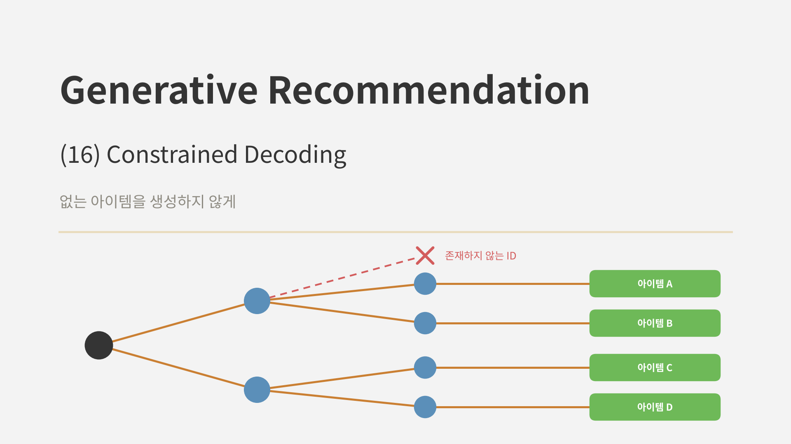
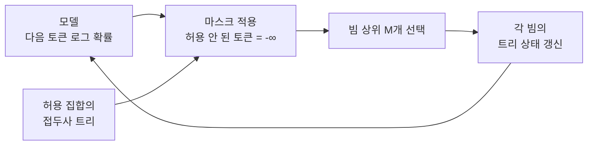
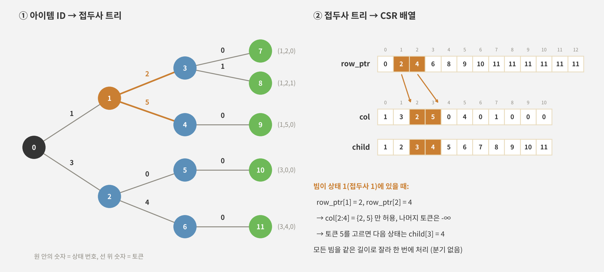
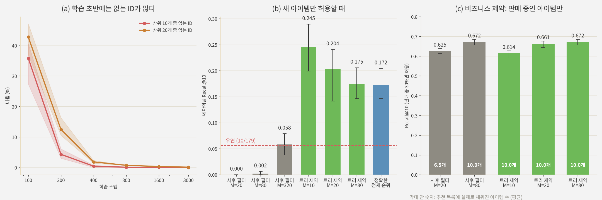
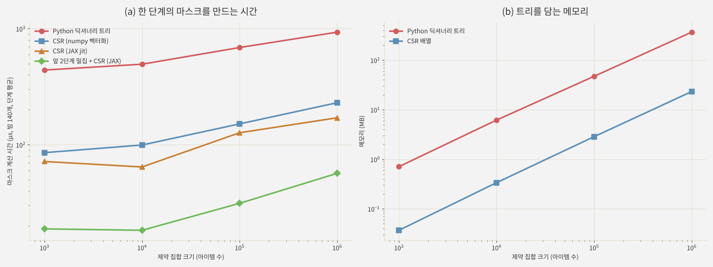

<br>{: .align-center}<br>

### _"생성 모델이 만든 ID가 카탈로그에 없다면?"_

[지난 글]()에서 생성형 추천의 설계 축을 정리하면서, 생성 출력을 쓰는 모든 모델에 붙어 다니는 장치 하나를 다음으로 미뤘습니다. **제약 디코딩(Constrained Decoding)**입니다.

생성형 추천 모델은 아이템 ID의 토큰을 하나씩 생성합니다. 모델은 "이 앞자리 다음에 어떤 토큰이 올 확률이 높은가"를 배울 뿐, 만들어진 조합이 실제 아이템인지는 알지 못합니다. [6편]()에서 접두사 트리로 이를 막는 기본 아이디어를, 예전에 쓴 [STATIC 리뷰]()에서 그것을 가속기에서 빠르게 돌리는 방법을 소개했습니다.

이번 글은 그 두 글을 한 걸음 더 밀고 나갑니다. 없는 ID가 실제로 언제 생기는지, 제약이 "없는 ID 막기"를 넘어 **새 아이템 노출이나 재고 같은 비즈니스 조건을 거는 도구**가 될 때 무엇이 달라지는지, 접두사 트리를 벡터 연산으로 바꾸면 얼마나 빨라지는지를 직접 실험으로 확인해 보겠습니다.

---

## 1. 없는 ID는 왜, 얼마나 생기나

### 1.1 조합 공간은 넓고 아이템은 드물다

TIGER의 Semantic ID는 256개 코드짜리 단계 세 개에 구분 토큰 하나입니다. 앞의 세 단계만 따져도 가능한 조합은 $256^3 \approx 1{,}678$만 개인데, 논문의 Amazon 데이터셋은 아이템이 1~2만 개 수준입니다. 실제 아이템이 차지하는 조합은 전체의 0.1% 안팎입니다.

모델은 각 단계의 조건부 분포만 배우므로, 단계마다 그럴듯한 토큰을 고르더라도 그 조합이 비어 있는 칸일 수 있습니다. TIGER 논문은 상위 10개 중 0.1~1.6%, 상위 20개 중 0.3~6%가 존재하지 않는 ID였다고 보고했고, 빔을 넓힌 뒤 걸러내는 방식으로 대응했습니다. 생성 도중 접두사를 맞춰 보는 확장은 향후 과제로 남겨 두었습니다.

### 1.2 제약이 필요한 세 가지 상황

없는 ID를 막는 것은 제약 디코딩의 가장 단순한 용도일 뿐입니다. 실제로는 다음 세 상황이 모두 같은 장치로 풀립니다.

* **유효성:** 카탈로그에 있는 아이템만 생성합니다. 없는 ID가 상위 목록에 섞이면 목록이 비거나, 더 넓은 빔이 필요해집니다.
* **비즈니스 조건:** 판매 중, 특정 지역, 최근 7일 이내 업로드처럼 **허용 집합이 카탈로그의 일부**인 경우입니다. 허용 집합이 작을수록 생성 후에 걸러내는 방식은 낭비가 커집니다.
* **새 아이템 노출:** 새 아이템만 허용해서, 모델이 평소에는 거의 생성하지 않는 아이템 중 가장 그럴듯한 것을 고르게 합니다. STATIC 논문의 cold-start 실험이 이 경우입니다.

어느 경우든 허용할 ID 집합으로 접두사 트리를 만들고, 각 단계에서 트리에 없는 토큰의 점수를 $-\infty$로 바꾸면 됩니다. 이 방식은 엔티티 이름을 토큰 단위로 생성하던 GENRE가 쓰면서 생성형 검색에 널리 퍼졌습니다. 모델은 그대로 두고 **탐색 공간만 바꾸는** 방식이라, 같은 모델 하나로 여러 조건을 바꿔 가며 쓸 수 있습니다.



---

## 2. 접두사 트리를 벡터 연산으로

### 2.1 Python 트리의 문제

6편 부록의 구현은 "앞자리 → 다음에 올 수 있는 코드 집합"을 딕셔너리에 담고, 빔마다 집합을 꺼내 후보를 만들었습니다. 작은 실험에는 충분하지만 실서비스에서는 두 가지가 걸립니다.

* **빔마다 도는 반복문:** 허용 토큰을 빔 하나씩 꺼내 붙이므로, 빔 수와 허용 토큰 수에 비례해 호스트(CPU)에서 시간이 듭니다.
* **단계마다 생기는 동기화:** 모델은 가속기에서 돌고 트리는 호스트에 있으니, 단계마다 로그 확률을 호스트로 가져왔다가 마스크를 다시 보내야 합니다. 디코딩 전체를 하나의 컴파일된 그래프로 묶을 수 없습니다.

STATIC 논문은 CPU로 트리를 넘기는 방식이 예비 실험에서 추론 시간을 약 두 배로 늘렸다고 보고했습니다.

### 2.2 CSR로 펼치기

STATIC의 해법은 트리를 오프라인에서 **CSR(Compressed Sparse Row) 배열 세 개**로 펼치는 것입니다. 상태(접두사)마다 번호를 붙이고, 자식 간선을 부모 순서대로 나열합니다.

<br>{: .align-center}<br>

* `row_ptr[n]`부터 `row_ptr[n+1]` 직전까지가 상태 $n$의 자식 간선입니다.
* `col`은 각 간선의 토큰, `child`는 그 토큰을 골랐을 때 이동할 다음 상태입니다.

빔이 상태 $n$에 있으면 허용 토큰은 `col[row_ptr[n]:row_ptr[n+1]]`입니다. 자식 수가 상태마다 다르면 분기가 생기므로, STATIC은 단계별 최대 자식 수 $B_l$만큼 **항상 같은 길이로 잘라 오고** 넘치는 칸은 유효성 마스크로 버립니다. 이렇게 하면 모든 빔을 한 번의 gather와 scatter로 처리할 수 있고, 디코딩 전체가 분기 없는 정적 그래프가 됩니다.

자식이 많은 앞쪽 단계는 아예 밀집 표를 씁니다. 첫 단계는 길이 $V$짜리 불리언 벡터 하나, 둘째 단계는 첫 토큰으로 바로 찾는 $V \times V$ 표입니다. 깊은 단계로 갈수록 표가 $V^d$로 커지므로, 논문은 앞의 두 단계까지만 밀집 표를 쓰고 그 아래는 CSR로 처리했습니다.

### 2.3 STATIC이 보고한 결과

자세한 내용은 [리뷰 글]()에 정리했으니 핵심만 옮깁니다. 2,000만 개 제약 집합, 30억 파라미터 모델, TPU v6e, 빔 70 기준입니다.

| 방식 | 추가 지연 | 추론 시간 대비 |
|---|---|---|
| CPU 트리 | +31.3 ms | 239% |
| 이진 탐색 (PPV, 정확) | +34.1 ms | 260% |
| 해시 비트맵 (오탐 2.1%) | +12.3 ms | 94% |
| 이진 탐색 (PPV, 상위 50개만 확인) | +1.56 ms | 11.9% |
| **STATIC** | **+0.033 ms** | **0.25%** |

메모리는 아이템 100만 개당 약 90MB였고, YouTube 홈 피드에서 "최근 7일 이내" 제약을 건 후보 생성기를 더했을 때 7일 이내 영상 조회가 5.1% 늘었습니다. 리뷰에서는 다루지 않았지만, 논문은 Amazon 데이터에서 **새 아이템만 허용한** 실험도 했습니다. 제약 없이 생성하면 새 아이템의 Recall@1이 세 데이터셋 모두 0%였고, 새 아이템 집합으로 제약하자 1.2~4.4%(새 아이템 2% 설정)가 나왔습니다. 무작위로 고르거나 밀집 벡터 검색을 쓴 기준선보다 높았습니다.

---

## 3. 직접 실험

### 3.1 실험 설계

* **세계와 ID:** [7편]()부터 써 온 손글씨 숫자 세계입니다. 아이템 1,797개 중 10%(179개)는 학습에 나오지 않는 새 아이템입니다. ID는 픽셀에서 학습한 RQ-VAE 3단계 x 16개 코드에 구분 토큰을 붙인 TIGER식 4토큰입니다.
* **모델:** [14편]()의 작은 디코더 Transformer를 학습 세션 8,000개로 학습했습니다. 이전 두 아이템의 ID를 보고 다음 아이템의 ID를 생성합니다.
* **디코딩:** JAX로 빔 서치 하나를 jit 컴파일해 두고 **마스크만 바꿔 가며** 비교했습니다. "사후 필터"는 제약 없이 빔 $M$개를 생성한 뒤 없는 ID와 허용 안 된 아이템을 걸러낸 것이고, "트리 제약"은 위의 CSR 방식으로 허용 집합의 접두사 트리를 건 것입니다.
* **허용 집합:** 전체 아이템, 새 아이템 179개, 무작위로 고른 "판매 중" 30%의 세 가지입니다.
* **평가:** Recall@10, 시드 3개(그림의 막대는 최소~최대)입니다. 새 아이템은 새 아이템끼리의 순위로, 정답 아이템별 평균을 냈습니다(우연 수준 약 0.056).

<br>{: .align-center}<br>

### 3.2 없는 ID는 학습 초반에 몰려 있었다

그림 (a)는 학습 도중의 모델로 제약 없이 빔 20개를 생성했을 때, 상위 목록에 없는 ID가 섞인 비율입니다.

| 학습 스텝 | 상위 10개 중 없는 ID | 상위 20개 중 없는 ID | Recall@10 (없는 ID 포함) | Recall@10 (트리 제약) |
|---|---|---|---|---|
| 100 | 35.8% | 42.8% | 0.091 | 0.113 |
| 200 | 4.3% | 12.5% | 0.353 | 0.358 |
| 400 | 0.43% | 1.8% | 0.413 | 0.415 |
| 3,000 | 0.02% | 0.10% | 0.513 | 0.513 |

학습 초반에는 상위 10개 중 셋 이상이 없는 ID였고, 그만큼 Recall이 깎였습니다. 하지만 400스텝만 지나도 상위 10개 기준 비율이 1% 아래로 떨어졌고, 끝까지 학습한 모델에서는 0.02%로 6편의 미니 TIGER(0.007% 이하)와 비슷했습니다. 이때는 제약이 있든 없든 Recall이 같았고, 빔 20의 결과는 전체 아이템을 하나하나 점수 매긴 정확한 순위와도 같았습니다.

아이템이 1,797개뿐이고 단계당 코드가 16개인 작은 세계라, 잘 학습된 모델은 존재하는 조합을 거의 완벽하게 외웠습니다. TIGER(코드 256개, 실제 데이터)나 9편의 단순한 MLP 생성기(상위 20개 중 최대 31%)처럼 조합 공간이 넓거나 모델이 약하면 이 비율은 크게 올라갑니다. **유효성만 놓고 보면 제약 디코딩은 잘 학습된 모델에서는 보험에 가깝고, 학습이 덜 됐거나 조합 공간이 넓을 때 효과가 드러납니다.**

### 3.3 새 아이템만 허용하면

제약이 진짜 힘을 쓰는 곳은 그림 (b)입니다. 모델은 학습에서 새 아이템을 한 번도 정답으로 보지 못했으므로, 제약 없이 생성하면 새 아이템을 거의 내놓지 않습니다.

* **사후 필터:** 빔 20개에서 새 아이템은 목록당 평균 0.005개, 빔 320개로 16배 늘려도 2.4개였습니다. Recall@10은 0.058로 우연 수준이었습니다. STATIC 논문의 "제약 없으면 0%"와 같은 현상입니다.
* **트리 제약:** 새 아이템 179개로 트리를 만들자 빔 10개만으로 Recall@10이 **0.245**, 우연의 4배 이상이 나왔습니다. 모델이 새 아이템에 낮은 확률을 주더라도, 그 안에서의 상대적인 순서는 콘텐츠 ID 덕분에 의미가 있었기 때문입니다.

그런데 예상과 다른 점이 하나 있었습니다. **빔을 넓힐수록 Recall이 대체로 떨어졌습니다.** 빔 10에서 0.245였던 것이 빔 80에서 0.175, 빔 160에서는 새 아이템 전체를 정확히 점수 매긴 순위와 같은 0.172가 됐습니다. 빔 10은 세 시드 모두에서 가장 높았습니다. 빔 서치가 정확한 순위에 가까워질수록 오히려 나빠진 것입니다.

원인을 보려고, 정확한 순위를 매길 때 ID의 **앞 몇 토큰까지만** 점수에 넣어 봤습니다.

| 점수에 넣은 토큰 | 새 아이템 Recall@10 |
|---|---|
| 첫 토큰만 | **0.326** |
| 앞 두 토큰 | 0.249 |
| 앞 세 토큰 | 0.164 |
| 네 토큰 전부 (정확한 순위) | 0.172 |

첫 토큰만으로 순위를 매긴 것이 가장 좋았고, 뒤쪽 토큰을 더할수록 나빠졌습니다. 첫 토큰, 앞 두 토큰, 그 이상의 순서는 세 시드 모두 같았고, 세 토큰과 네 토큰 사이의 차이는 시드마다 엇갈렸습니다.

해석은 이렇습니다. 첫 토큰은 거친 군집(이 세계에서는 숫자 모양과 획 굵기)을 담고 있어 취향과 직결되지만, 뒤쪽 토큰은 군집 안의 미세한 차이와 구분 토큰입니다. 모델은 뒤쪽 토큰의 분포를 **이미 본 아이템의 개별 기록**에서 배웠습니다. 이미 본 아이템에게는 이것이 아이템을 정확히 짚는 기억이지만, 새 아이템에게는 "자기와 미세 코드가 비슷한 인기 아이템이 있는가"라는 우연에 가까운 신호가 됩니다. 빔이 작으면 앞쪽 토큰에서 먼저 후보를 좁히므로 이 잡음의 영향을 덜 받습니다.

실무로 옮기면, **새 아이템 노출처럼 모델이 학습에서 보지 못한 집합을 제약으로 꺼낼 때는 빔 크기와 뒤쪽 토큰의 점수를 따로 점검해야 한다**는 뜻입니다. 작은 빔이나 앞쪽 토큰에 가중치를 둔 점수가 정확한 순위보다 나을 수 있습니다. 다만 이는 콘텐츠가 취향을 잘 설명하는 이 합성 세계에서의 결과라, 실제 데이터에서는 따로 확인이 필요합니다.

### 3.4 판매 중인 30%만 허용하면

그림 (c)는 무작위로 고른 30%만 판매 중이라고 보고, 정답이 판매 중인 경우만 평가한 결과입니다.

* **사후 필터는 목록을 다 채우지 못했습니다.** 빔 20개를 생성하고 판매 중인 것만 남기면 평균 6.5개만 남았습니다. 허용 비율이 30%이니 20 x 0.3 = 6개 근처가 남는 것이 당연합니다. Recall@10은 0.625였습니다.
* **트리 제약은 같은 빔으로 목록을 채웠습니다.** 빔 20개로 10개를 모두 채우고 Recall@10이 0.661이었습니다. 사후 필터가 같은 수준(0.672)에 이르려면 빔을 80개, 네 배로 늘려야 했습니다.

허용 비율이 $r$이면 사후 필터는 대략 $1/r$배의 빔이 필요합니다. 30%면 3~4배지만, STATIC의 "최근 7일 이내 영상"처럼 전체의 극히 일부만 허용하는 제약에서는 사후 필터가 사실상 불가능해집니다.

### 3.5 속도: 같은 결과, 다른 비용

빔 20개, 프롬프트 200개로 디코딩 시간을 쟀습니다(CPU, 프롬프트당 평균).

| 방식 | 프롬프트당 시간 | 결과 |
|---|---|---|
| 제약 없음 (jit) | 2.94 ms | 기준 |
| CSR 트리 제약 (jit) | 2.95 ms | |
| Python 딕셔너리 트리 (단계마다 호스트에서 마스크) | 8.20 ms | CSR과 상위 10개 100% 일치 |

두 트리 방식은 상위 10개가 완전히 같았지만, Python 트리는 2.8배 느렸습니다. CSR 방식은 마스크 계산이 디코딩 그래프 안에 들어가 제약 없는 디코딩과 시간 차이가 거의 없었습니다.

카탈로그가 커지면 어떻게 될지 보려고, 무작위 Semantic ID(단계당 코드 256개, 4단계, STATIC의 Amazon 설정과 같음)로 제약 집합을 1,000개에서 100만 개까지 늘려 가며 **마스크 한 번을 만드는 시간**만 따로 쟀습니다. 빔은 140개(배치 2 x 빔 70)이고, 아래 표의 시간은 네 단계의 평균입니다.

<br>{: .align-center}<br>

| 제약 집합 크기 | Python 트리 | CSR (numpy) | CSR (JAX) | 앞 2단계 밀집 + CSR | 메모리 (Python / CSR) |
|---|---|---|---|---|---|
| 1,000 | 440 μs | 86 μs | 72 μs | 19 μs | 0.7 MB / 0.04 MB |
| 100,000 | 689 μs | 151 μs | 127 μs | 31 μs | 47 MB / 2.9 MB |
| 1,000,000 | 934 μs | 230 μs | 171 μs | 57 μs | 367 MB / 23 MB |

* **비용은 허용 토큰 수에서 나옵니다.** Python 트리는 첫 단계(빔마다 허용 토큰 약 240개)에서만 1.1ms 이상이 걸렸고, 100만 개에서는 둘째 단계도 허용 토큰이 많아져 2.2ms가 걸렸습니다.
* **밀집 표가 앞쪽 단계를 해결합니다.** 앞의 두 단계를 표 조회로 바꾸자 그 단계들이 6~9μs로 줄었고, 전체로는 Python 트리보다 16~23배 빨랐습니다.
* **메모리는 16배 차이였습니다.** 100만 개 기준 Python 딕셔너리는 367MB, CSR 배열은 23MB였고, 만드는 시간도 8.4초 대 0.3초였습니다.

깊은 단계의 CSR 시간은 카탈로그가 커질수록 30μs에서 105μs로 조금씩 늘었는데, 큰 배열의 흩어진 위치를 읽는 메모리 접근 비용으로 보입니다. 이 측정은 모두 CPU에서 한 것이라, 가속기 위에서의 절대 시간은 STATIC 논문의 숫자를 봐 주시면 좋겠습니다. 여기서 확인한 것은 **트리를 배열로 펼치면 반복문과 동기화가 사라지고, 결과는 그대로라는 점**입니다.

---

## 4. 실무에서 고려할 것

**제약 집합이 바뀌는 속도.** CSR 배열은 오프라인에서 만들고, 바뀌면 다시 만들어야 합니다. STATIC도 실시간 재고 변화는 향후 과제로 남겼습니다. 이번 실험 기준으로 100만 개를 다시 만드는 데 0.3초였으니 분 단위 갱신은 충분히 가능하지만, 초 단위로 바뀌는 재고라면 전체 카탈로그로 트리를 고정해 두고 판매 중 여부는 마지막 단계에서 아이템별 비트마스크로 거르는 식의 조합을 생각해 볼 수 있습니다.

**마스크를 거는 위치.** 이번 실험과 STATIC은 로그 소프트맥스를 계산한 **뒤에** 마스크를 걸었습니다. 이렇게 하면 모델의 원래 확률이 그대로 점수가 됩니다. 마스크를 소프트맥스 **앞에** 걸면 허용 토큰끼리 확률이 다시 정규화되는데, 허용 집합이 작을수록 이 둘의 순위가 달라질 수 있으니 한쪽으로 정해 두고 평가해야 합니다.

**빔 크기는 제약과 함께 다시 정합니다.** 3.3절에서 봤듯이 제약을 걸면 빔 크기의 효과가 달라집니다. 유효성 제약에서는 빔이 클수록 정확한 순위에 가까워지지만, 학습에서 보지 못한 집합을 꺼낼 때는 정확한 순위가 꼭 좋은 것은 아니었습니다.

**검색 출력이면 필요 없습니다.** [9편]()의 TokenRec처럼 선호 벡터로 최근접 아이템을 찾는 방식에서는 없는 아이템이 애초에 나오지 않고, 비즈니스 조건도 벡터 검색의 필터로 겁니다. 제약 디코딩은 생성 출력을 고른 대가입니다.

**평가에 없는 ID를 숨기지 않습니다.** 사후 필터로 목록을 채운 Recall만 보면 없는 ID 문제가 보이지 않습니다. 상위 목록 중 없는 ID의 비율과, 목록이 몇 개나 채워졌는지를 함께 기록해 두는 편이 좋습니다.

---

## 5. 부록: 벡터화된 제약 디코딩 핵심 코드

실험은 JAX로 했지만, 연재의 다른 부록과 맞춰 PyTorch로 옮깁니다. 6편 부록의 Python 트리 버전과 비교해 보시면 좋습니다.

### Point 1. Semantic ID 목록을 CSR 트리로

상태 번호를 단계 순서로 붙이고 간선을 (부모, 토큰) 순으로 정렬하면, 간선이 이미 부모별로 모여 있어 `row_ptr`는 개수의 누적합이면 됩니다.

```python
import numpy as np

def build_csr(codes, V):
    """codes: (N, L) 정수 배열, 허용할 Semantic ID 목록"""
    N, L = codes.shape
    state = np.zeros(N, np.int64)                 # 각 아이템의 현재 접두사 상태 (루트 = 0)
    parents, cols, children, max_branch = [], [], [], []
    next_id = 1
    for l in range(L):
        key = state * V + codes[:, l]             # (부모 상태, 토큰)을 하나의 정수로
        uniq, inv = np.unique(key, return_inverse=True)
        child = next_id + np.arange(len(uniq)); next_id += len(uniq)
        state = child[inv]
        parents.append(uniq // V); cols.append(uniq % V); children.append(child)
        max_branch.append(int(np.unique(uniq // V, return_counts=True)[1].max()))
    parent = np.concatenate(parents)
    row_ptr = np.zeros(next_id + 1, np.int64)
    np.add.at(row_ptr, parent + 1, 1)
    return np.cumsum(row_ptr), np.concatenate(cols), np.concatenate(children), max_branch
```

### Point 2. 모든 빔의 마스크를 한 번에

빔마다 자식 수가 달라도 단계별 최대 자식 수 `B`만큼 잘라 오고, 넘치는 칸은 `valid`로 버립니다. 반복문도 분기도 없습니다.

```python
import torch

def allowed_mask(row_ptr, col, node, B, V):
    """node: (빔 수,) 현재 상태 -> (빔 수, V) 허용 마스크, 다음 상태 계산용 슬라이스"""
    start = row_ptr[node]
    count = row_ptr[node + 1] - start
    off = torch.arange(B, device=node.device)
    idx = (start[:, None] + off).clamp(max=len(col) - 1)      # 고정 길이로 잘라 오기
    valid = off[None] < count[:, None]
    toks = torch.where(valid, col[idx], torch.full_like(idx, V))   # 버릴 칸은 여분 열 V로
    mask = torch.zeros(len(node), V + 1, dtype=torch.bool, device=node.device)
    mask.scatter_(1, toks, True)
    return mask[:, :V], idx, valid
```

### Point 3. 제약 빔 서치의 한 단계

마스크를 로그 확률에 걸고 상위 $M$개를 고른 뒤, 고른 토큰으로 다음 상태를 찾습니다. 다음 상태도 같은 슬라이스에서 토큰이 일치하는 칸을 찾아 `child`로 바꾸기만 하면 됩니다.

```python
def constrained_step(logp, score, node, row_ptr, col, child, B):
    """logp: (P, M, V) 로그 확률, score: (P, M), node: (P, M)"""
    P, M, V = logp.shape
    mask, idx, valid = allowed_mask(row_ptr, col, node.reshape(-1), B, V)
    logp = logp.masked_fill(~mask.view(P, M, V), float("-inf"))     # 소프트맥스 뒤에 마스크
    cand = (score[..., None] + logp).view(P, M * V)
    score, flat = cand.topk(M, dim=1)
    beam, tok = flat // V, flat % V
    idx = idx.view(P, M, B).gather(1, beam[..., None].expand(-1, -1, B))
    valid = valid.view(P, M, B).gather(1, beam[..., None].expand(-1, -1, B))
    hit = (col[idx] == tok[..., None]) & valid                      # 고른 토큰이 있는 칸
    node = child[idx.gather(2, hit.float().argmax(2, keepdim=True)).squeeze(2)]
    return score, beam, tok, node
```

허용 집합을 바꾸려면 `build_csr`에 넘기는 ID 목록만 바꾸면 됩니다. 새 아이템만, 판매 중인 아이템만 넘기면 같은 모델로 3.3절과 3.4절의 디코딩이 됩니다.

---

## 6. 결론 및 다음 글

정리하면 다음과 같습니다.

* 생성형 추천의 ID 조합 공간은 실제 아이템보다 훨씬 넓어서, 모델은 **존재하지 않는 ID**를 만들 수 있습니다. 접두사 트리로 허용된 토큰만 남기는 제약 디코딩이 이를 막고, 같은 장치로 **비즈니스 조건과 새 아이템 노출**까지 다룰 수 있습니다.
* 실험에서 없는 ID는 학습 초반에 몰려 있었습니다(100스텝에서 상위 10개 중 36%). 잘 학습된 모델에서는 0.02%까지 줄어, 작은 카탈로그의 유효성 제약은 보험에 가까웠습니다.
* 제약은 **허용 집합이 작을 때** 진짜 효과를 냈습니다. 새 아이템만 허용하자 사후 필터로는 우연 수준이던 Recall@10이 0.245로 올랐고, 판매 중인 30%만 허용할 때는 사후 필터가 같은 성능을 내려면 빔이 네 배 필요했습니다.
* 새 아이템을 꺼낼 때는 **빔이 작을수록, 앞쪽 토큰만 볼수록** 더 나았습니다. 뒤쪽 토큰의 확률은 이미 본 아이템의 기억이라 새 아이템에게는 잡음이 됐습니다.
* 접두사 트리를 **CSR 배열로 펼치면** 같은 결과를 내면서 Python 트리보다 마스크 계산이 16~23배 빨라졌고, 메모리는 16분의 1이었습니다. 디코딩 시간은 제약이 없을 때와 거의 같았습니다.

다음 글에서는 연재 초반부터 써 온 RQ-VAE로 돌아갑니다. 지금까지 실험에서는 잘 동작하는 토크나이저를 전제로 했지만, 직접 구현해 보면 몇몇 코드에만 아이템이 몰리고 나머지 코드는 쓰이지 않는 **코드북 붕괴**를 거의 반드시 만나게 됩니다. 그 원인과 해결 방법을 정리하겠습니다.

---

## 참고 문헌

* Su et al., *Vectorizing the Trie: Efficient Constrained Decoding for LLM-based Generative Retrieval on Accelerators* (STATIC), KDD 2026. [arXiv:2602.22647](https://arxiv.org/abs/2602.22647)
* Rajput et al., *Recommender Systems with Generative Retrieval* (TIGER), NeurIPS 2023. [arXiv:2305.05065](https://arxiv.org/abs/2305.05065)
* De Cao et al., *Autoregressive Entity Retrieval* (GENRE), ICLR 2021. [arXiv:2010.00904](https://arxiv.org/abs/2010.00904)
* Tay et al., *Transformer Memory as a Differentiable Search Index* (DSI), NeurIPS 2022. [arXiv:2202.06991](https://arxiv.org/abs/2202.06991)
* Qu et al., *TokenRec: Learning to Tokenize ID for LLM-based Generative Recommendations*, IEEE TKDE 2025. [arXiv:2406.10450](https://arxiv.org/abs/2406.10450)
