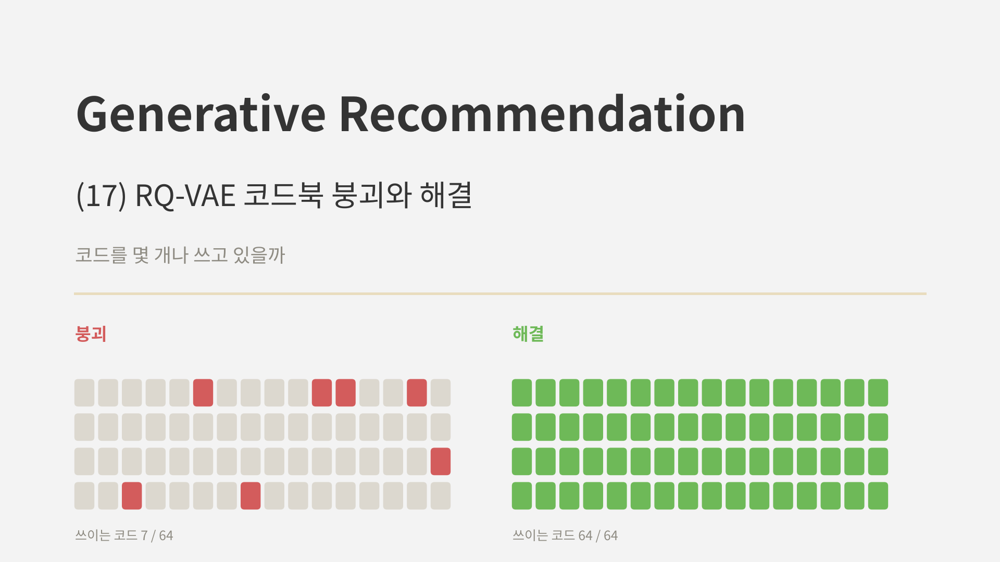
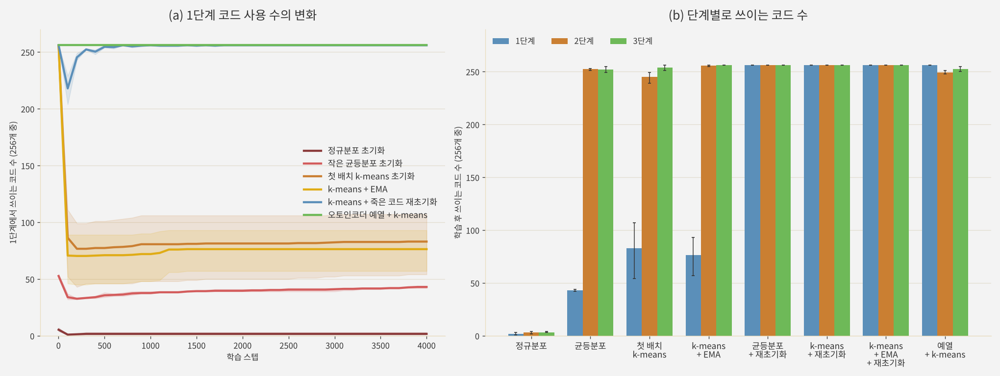
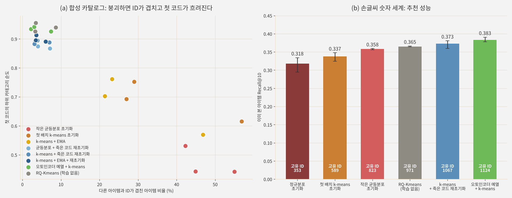
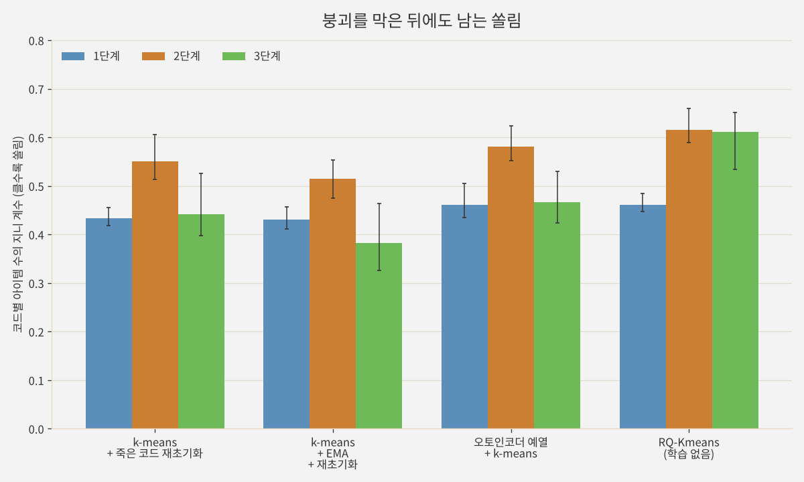

<br>{: .align-center}<br>

### _"코드 256개를 만들었는데, 실제로 쓰이는 건 몇 개일까?"_

[3편]()에서 VQ-VAE의 **코드북 붕괴**를 다뤘습니다. 일부 코드만 계속 선택되고 나머지는 한 번도 쓰이지 않는 현상이고, 원인과 퍼플렉시티로 확인하는 법, 죽은 코드를 재초기화하는 처방까지 봤습니다. 그때 RQ-VAE로 Semantic ID를 만들 때 겪는 붕괴는 따로 정리하겠다고 했는데, 이번 글이 그 약속입니다.

코드 하나짜리 VQ-VAE와 달리 RQ-VAE는 단계마다 코드북이 있고, 단계마다 들어오는 잔차의 크기가 다르며, 앞 단계가 무너지면 뒤 단계와 충돌 처리가 그 짐을 떠안습니다. 그래서 같은 붕괴라도 **어느 단계에서, 왜** 생겼는지를 나눠 봐야 고칠 수 있습니다.

실서비스 데이터는 공개할 수 없어서, 이번 실험은 실제 텍스트 임베딩의 성질을 흉내 낸 합성 카탈로그로 재현했습니다. TIGER와 같은 규모(3단계 x 코드 256개)에서 붕괴가 어떻게 생기고 무엇이 고치는지 확인하고, 연재에서 써 온 손글씨 숫자 세계에서 붕괴가 추천 성능에 남기는 흔적까지 보겠습니다.

---

## 1. RQ-VAE에서 붕괴가 더 까다로운 이유

3편에서 본 붕괴의 기본 구조는 같습니다. 코드는 선택될 때만 학습되므로, 처음에 밀려난 코드는 계속 밀려납니다. RQ-VAE에서는 여기에 세 가지가 더해집니다.

* **단계마다 입력의 크기가 다릅니다.** 1단계는 인코더 출력 전체를, 2단계부터는 앞 단계가 남긴 잔차를 양자화합니다. 이번 실험에서 잔차의 평균 크기는 단계별로 약 1.4, 0.25, 0.2로 줄었습니다. 코드북을 한 가지 분포로 초기화하면 어느 단계에서는 데이터와 맞지 않게 됩니다.
* **인코더가 함께 움직입니다.** 코드북을 아무리 잘 놓아도, 학습 초반 인코더 출력이 크게 이동하면 코드가 데이터가 없는 곳에 남겨집니다.
* **앞 단계가 무너지면 ID 전체가 흐려집니다.** 1단계 코드가 몇 개만 쓰이면 첫 코드가 담아야 할 큰 범주가 뭉개지고, 같은 ID에 몰리는 아이템이 늘어 [4편]()의 충돌 코드가 대부분의 구분을 떠맡게 됩니다.

TIGER 논문도 이 문제를 직접 언급했습니다. 코드북 붕괴를 막으려고 첫 학습 배치에 k-means를 돌려 코드북을 초기화했고, 코드북 사용률을 80% 이상으로 맞추려고 RQ-VAE를 2만 에폭 학습했다고 적었습니다. 공식 설정조차 사용률을 목표로 둘 만큼 흔한 문제라는 뜻입니다.

---

## 2. 실험 설계

**합성 카탈로그.** 문장 임베딩 모델이 만든 아이템 벡터의 대표적인 성질을 넣었습니다.

* 아이템 12,000개, 64차원, 길이 1로 정규화 (TIGER가 쓴 Amazon 데이터셋과 비슷한 규모)
* 모든 벡터가 공통 방향으로 치우친 **이방성** (무작위 두 아이템의 평균 코사인 유사도 약 0.29)
* 분산이 앞쪽 몇 개 차원에 몰린 **낮은 유효 차원**
* 카테고리 40개(크기가 Zipf 분포), 카테고리마다 하위 카테고리 3~10개, 잡음이 큰 이상치 2%

**RQ-VAE.** TIGER 설정을 따라 잠재 32차원, 3단계 x 코드 256개, 커밋먼트 가중치 $\beta = 0.25$로 두고, Adam(학습률 0.001), 배치 1,024로 4,000스텝 학습했습니다. 비교한 처방은 다음과 같습니다.

| 이름 | 코드북 초기화 | 추가 처방 |
|---|---|---|
| 정규분포 | $\mathcal{N}(0, 1)$ | |
| 균등분포 | $U(-1/K, 1/K)$ (공개 구현에서 흔한 방식) | |
| 첫 배치 k-means | 학습 전 인코더의 첫 배치에 잔차 k-means (TIGER) | |
| k-means + EMA | 첫 배치 k-means | 코드북을 EMA로 갱신 |
| 재초기화 | 균등분포 또는 첫 배치 k-means | 50스텝 동안 안 쓰인 코드를 그 단계의 잔차로 교체 |
| 예열 + k-means | 오토인코더를 1,000스텝 먼저 학습한 뒤, 전체 잠재 벡터에 잔차 k-means | |
| RQ-Kmeans | 학습 없이 임베딩에 바로 잔차 k-means (OneRec 방식) | |

**지표.** 단계별로 쓰인 코드 수와 퍼플렉시티, 다른 아이템과 ID가 겹친 아이템 비율, 첫 코드가 하위 카테고리를 얼마나 깔끔하게 나누는지 보는 순도, 복원 오차를 쟀습니다. 시드는 3개입니다.

---

## 3. 결과

### 3.1 세 가지 붕괴

<br>{: .align-center}<br>

왼쪽은 1단계에서 쓰이는 코드 수의 변화, 오른쪽은 학습이 끝난 뒤 단계별로 쓰이는 코드 수입니다. 처방 없이 시작한 세 가지가 모두 무너졌는데, 무너진 방식이 서로 달랐습니다.

**정규분포 초기화: 모든 단계가 무너졌습니다.** 단계별로 2개, 3개, 3개의 코드만 쓰였고, 아이템 12,000개가 **고유 ID 18개**에 몰렸습니다. 32차원 표준정규 벡터의 길이는 약 5.7로, 잔차(1.4, 0.25, 0.2)보다 훨씬 깁니다. 처음부터 모든 입력이 가장 가까운 한두 개 코드로 가고, 커밋먼트 항이 인코더 출력까지 그 코드 쪽으로 끌어당기면서 복원 오차도 정상의 10배 이상(0.354)이 됐습니다.

**작은 균등분포: 1단계만 무너졌습니다.** 1단계는 256개 중 43개만 쓰였지만, 2단계와 3단계는 거의 다 쓰였습니다. 코드가 원점 근처의 좁은 영역에서 시작하니, 데이터 전체를 덮어야 하는 1단계에서는 몇 개만 선택되고, 원점 근처에 모인 뒤쪽 잔차에서는 쉽게 선택됩니다. 4편에서 본 양상과 같지만, 코드가 16개에서 256개로 늘자 사용 비율은 56~69%에서 17%로 훨씬 나빠졌습니다.

**첫 배치 k-means: 시작은 완벽했지만 50스텝 만에 무너졌습니다.** k-means로 시작했으니 1단계 코드 256개가 모두 쓰였는데, 50스텝 뒤에는 66개로 떨어졌고 학습이 끝날 때도 83개(시드별 55~107개)였습니다. 원인은 인코더의 이동이었습니다. 학습 전 인코더로 k-means를 했는데 학습 초반 인코더가 크게 바뀌면서, 잠재 벡터가 처음 1,000스텝 동안 평균 0.97만큼 움직였습니다(시드 하나로 따로 측정). 잠재 벡터들이 중심에서 퍼진 평균 거리(0.68)보다 큰 이동입니다. 처음 k-means로 나눈 256칸 중 학습 후 잠재 벡터가 들어간 칸은 95개뿐이었습니다.

4편의 작은 실험(코드 16개)에서는 첫 배치 k-means로도 1단계 코드를 모두 썼습니다. 이번에는 코드북이 크고 복원 손실과 학습 설정이 달라 결과가 바뀌었는데, 이처럼 **같은 처방이 설정에 따라 통하기도 하고 안 통하기도 한다**는 것이 붕괴를 지표로 직접 확인해야 하는 이유입니다.

### 3.2 무엇이 고쳤나

| 처방 | 쓰인 코드 (1 / 2 / 3단계) | ID가 겹친 아이템 | 첫 코드 순도 | 복원 오차 |
|---|---|---|---|---|
| 정규분포 | 2 / 3 / 3 | 100% | 0.14 | 0.354 |
| 균등분포 | 43 / 252 / 252 | 47.4% | 0.47 | 0.036 |
| 첫 배치 k-means | 83 / 245 / 254 | 37.6% | 0.69 | 0.035 |
| k-means + EMA | 76 / 256 / 256 | 30.5% | 0.68 | 0.034 |
| 균등분포 + 재초기화 | 256 / 256 / 256 | 4.8% | 0.88 | 0.029 |
| k-means + 재초기화 | 256 / 256 / 256 | 4.7% | 0.89 | 0.030 |
| k-means + EMA + 재초기화 | 256 / 256 / 256 | 4.4% | 0.90 | 0.030 |
| 예열 + k-means | 256 / 249 / 253 | 4.2% | **0.93** | **0.026** |
| 예열 + k-means + 재초기화 | 256 / 256 / 256 | **3.7%** | **0.93** | **0.026** |
| RQ-Kmeans (학습 없음) | 256 / 256 / 256 | 5.2% | 0.94 | |

* **EMA만으로는 고쳐지지 않았습니다.** EMA는 선택된 코드를 배정된 벡터의 평균 쪽으로 옮길 뿐, 선택되지 않은 코드는 그대로 둡니다. 이미 죽은 코드를 살리지 못하니 1단계는 76개에 머물렀습니다.
* **죽은 코드 재초기화는 초기화와 상관없이 고쳤습니다.** 균등분포에서 시작해도, k-means에서 시작해도 모든 단계의 코드 256개를 다 썼고, 겹친 아이템은 5% 아래로 내려갔습니다. 왼쪽 그림의 파란 선처럼 학습 초반에 잠깐 떨어졌다가 곧 회복합니다.
* **예열 + k-means가 가장 좋은 ID를 만들었습니다.** 인코더가 먼저 자리를 잡은 뒤 k-means를 하니, 이후 1,000스텝 동안 잠재 벡터의 이동이 0.39로 퍼진 정도보다 작았고 처음 나눈 256칸이 거의 그대로 유지됐습니다. 복원 오차(0.026)와 첫 코드 순도(0.93)가 RQ-VAE 중 가장 좋았고, 재초기화를 더하면 2, 3단계의 남은 몇 개 코드까지 살아났습니다.
* **RQ-Kmeans는 여전히 강한 기준선이었습니다.** 학습 없이도 겹친 비율 5.2%, 첫 코드 순도 0.94로, 잘 고친 RQ-VAE와 비슷했습니다. 3편과 4편에서 강조했듯이, RQ-VAE를 쓴다면 이 기준선을 넘는지부터 확인해야 합니다.

눈여겨볼 점은 **복원 오차만 보면 붕괴가 잘 보이지 않는다**는 것입니다. 균등분포(0.036)와 재초기화(0.029)의 복원 오차 차이는 0.007이지만, ID가 겹친 아이템은 47%와 5%로 열 배 가까이 다릅니다. 디코더가 2, 3단계 코드로 1단계의 빈자리를 상당 부분 메워 주기 때문입니다. 복원 품질은 그럭저럭인데 Semantic ID로서는 망가져 있는 상태가 충분히 가능합니다.

### 3.3 붕괴가 ID와 추천에 남기는 것

<br>{: .align-center}<br>

왼쪽은 합성 카탈로그에서 시드별 결과를 찍은 것입니다. 붕괴한 설정(빨강, 주황, 노랑)은 오른쪽 아래에, 고친 설정(파랑, 초록, 회색)은 왼쪽 위에 모였습니다. 1단계가 무너지면 ID가 겹치는 아이템이 늘고, 동시에 첫 코드가 하위 카테고리를 나누는 능력도 떨어집니다. 생성 모델이 첫 토큰으로 "어떤 종류의 아이템인가"를 정하는 Semantic ID의 장점이 그만큼 약해집니다.

오른쪽은 [15편]()과 같은 손글씨 숫자 세계(아이템 1,797개, 3단계 x 코드 16개, 학습 세션 2,000개)에서 각 토크나이저로 ID를 만들고, 같은 개수 기반 추천 모델로 이미 본 아이템의 Recall@10을 잰 결과입니다.

* 붕괴 정도에 따라 성능이 순서대로 갈렸습니다. 정규분포 0.318, 첫 배치 k-means 0.337, 균등분포 0.358, RQ-Kmeans 0.365, k-means + 재초기화 0.373, 예열 + k-means 0.383입니다. 막대 안의 고유 ID 수(353개에서 1,124개)와 순서가 정확히 같습니다.
* 가장 나쁜 설정과 가장 좋은 설정의 차이는 0.065로, 15편에서 콘텐츠 ID와 협업 ID를 가른 차이와 비슷한 크기입니다. **토크나이저를 어떻게 학습했느냐만으로** ID 설계를 바꾼 만큼의 차이가 난 셈입니다.
* 새 아이템의 Recall@10은 0.18~0.22 사이에서 시드 편차 안에 엇갈려, 붕괴와 뚜렷한 관계가 보이지 않았습니다.

### 3.4 붕괴를 막은 뒤에도 남는 쏠림

모든 코드가 쓰인다고 코드가 **고르게** 쓰이는 것은 아닙니다. 코드별로 배정된 아이템 수가 얼마나 고르지 않은지를 지니 계수로 재 봤습니다(0이면 완전히 고르고, 1에 가까울수록 몇 개 코드에 몰림).

<br>{: .align-center}<br>

붕괴를 막은 RQ-VAE 세 가지 모두에서 **2단계가 가장 쏠려** 있었습니다(지니 계수 0.51~0.58, 1단계 0.43~0.46, 3단계 0.38~0.47). RQ-Kmeans는 2단계와 3단계가 모두 0.6 수준으로 쏠렸습니다.

이것은 JD.com 연구진이 보고한 **모래시계 현상(Hourglass Phenomenon)**의 약한 형태로 보입니다. 이들은 수억 개 상품의 RQ 기반 Semantic ID에서 중간 단계의 토큰이 소수에 몰리는 현상을 발견했습니다.

* **원인:** 1단계는 아이템을 비교적 고르게 나누지만, 2단계에 들어오는 잔차는 크기가 작은 다수와 큰 이상치 소수가 섞여 있습니다. 군집화가 이상치를 나누는 데 코드를 쓰는 사이, 작은 잔차들은 소수의 코드에 몰립니다.
* **영향:** 2단계 토큰이 흔한 아이템과 드문 아이템 사이에 생성 검색 성능 차이가 컸습니다(Recall@1 0.36 대 0.21).
* **처방:** 2단계에서 가장 흔한 토큰들을 지워 ID를 가변 길이로 만들자 Recall@10이 0.590에서 0.680으로 올랐습니다.

"쓰인 코드 수"만 보면 이런 쏠림은 보이지 않습니다. 붕괴를 막은 다음에는 퍼플렉시티나 지니 계수로 **단계별 분포**를 함께 봐야 합니다.

---

## 4. 실무 체크리스트

이번 실험과 3, 4편의 결과를 묶으면 다음과 같습니다.

1. **첫 스텝부터 단계별로 모니터링합니다.** 쓰인 코드 수, 퍼플렉시티, 지니 계수, ID가 겹친 비율, 한 ID에 몰린 최대 아이템 수를 함께 기록합니다. 복원 오차만으로는 늦게, 또는 전혀 알아채지 못합니다.
2. **인코더를 먼저 예열한 뒤 k-means로 초기화합니다.** 학습 전 인코더의 첫 배치로 k-means를 하면 인코더가 움직이면서 코드가 버려질 수 있습니다. 오토인코더를 먼저 학습하고, 전체 또는 충분히 큰 표본의 잠재 벡터로 단계별 잔차 k-means를 하는 편이 안전했습니다.
3. **죽은 코드 재초기화를 보험으로 둡니다.** 구현이 간단하고, 이번 실험에서는 어떤 초기화에서 시작해도 붕괴를 고쳤습니다. 잔차는 단계마다 크기가 다르므로, 교체할 값은 **그 단계의 잔차**에서 뽑아야 합니다.
4. **EMA는 붕괴 처방이 아닙니다.** 학습을 안정시키는 데는 도움이 되지만, 이미 죽은 코드를 살리지는 못합니다.
5. **RQ-Kmeans를 기준선으로 둡니다.** 학습 없이도 잘 고친 RQ-VAE와 비슷한 ID를 만들었습니다.
6. **붕괴를 막은 뒤에는 중간 단계의 쏠림을 봅니다.** 모래시계 현상은 데이터가 크고 분포가 롱테일일수록 심해진다고 보고됐습니다.

이번에 실험하지 않은 다른 접근도 있습니다. **SimVQ**는 코드북을 고정된 무작위 기저와 학습되는 선형 변환의 곱으로 바꿔, 선택되지 않은 코드도 선형 변환을 통해 함께 움직이게 만듭니다. **FSQ(Finite Scalar Quantization)**는 학습되는 코드북 자체를 없애고 각 차원을 정해진 몇 개 값으로 반올림하는 방식이라, 구조적으로 붕괴가 생기지 않습니다.

---

## 5. 부록: 붕괴를 막는 핵심 코드

실험은 JAX로 했지만 다른 편과 맞춰 PyTorch로 옮깁니다. 4편 부록의 `ResidualQuantizer`에 붙여 쓸 수 있는 형태입니다.

### Point 1. 단계별 모니터링

학습 중 일정 간격으로 전체(또는 큰 표본) 아이템의 코드를 뽑아 단계별 지표와 ID 충돌을 함께 기록합니다.

```python
import torch

@torch.no_grad()
def codebook_report(codes, K):
    """codes: (N, L) 정수 텐서, 아이템별 Semantic ID"""
    out = []
    for l in range(codes.size(1)):
        cnt = torch.bincount(codes[:, l], minlength=K).float()
        p = cnt[cnt > 0] / cnt.sum()
        srt = torch.sort(cnt).values
        idx = torch.arange(1, K + 1, dtype=torch.float, device=codes.device)
        gini = ((2 * idx - K - 1) * srt).sum() / (K * srt.sum())
        out.append(dict(level=l + 1, used=int((cnt > 0).sum()),
                        perplexity=float(torch.exp(-(p * p.log()).sum())), gini=float(gini)))
    _, inv, size = torch.unique(codes, dim=0, return_inverse=True, return_counts=True)
    collided = float((size[inv] > 1).float().mean())          # 다른 아이템과 ID가 겹친 비율
    return out, dict(unique=len(size), collided=collided, max_bucket=int(size.max()))
```

### Point 2. 예열 후 전체 잠재 벡터로 k-means 초기화

오토인코더만 먼저 학습한 뒤, 전체 잠재 벡터에 단계별 잔차 k-means를 돌려 코드북을 채웁니다. 4편의 첫 배치 초기화를 대신합니다.

```python
import torch.nn.functional as F
from sklearn.cluster import KMeans

def warmup_and_init(encoder, decoder, quantizer, X, steps=1000, bs=1024, lr=1e-3):
    opt = torch.optim.Adam([*encoder.parameters(), *decoder.parameters()], lr=lr)
    for _ in range(steps):                                     # 1) 양자화 없이 오토인코더만
        xb = X[torch.randint(len(X), (bs,))]
        loss = F.mse_loss(decoder(encoder(xb)), xb)
        opt.zero_grad(); loss.backward(); opt.step()
    with torch.no_grad():                                      # 2) 전체 잠재 벡터로 잔차 k-means
        r = encoder(X).cpu().numpy()
        for cb in quantizer.codebooks:
            km = KMeans(cb.size(0), n_init=1, random_state=0).fit(r)
            cb.data.copy_(torch.as_tensor(km.cluster_centers_, dtype=cb.dtype))
            r = r - km.cluster_centers_[km.labels_]
        quantizer.initialized.fill_(True)
```

### Point 3. 단계별 잔차로 죽은 코드 재초기화

일정 스텝 동안 선택되지 않은 코드를, **그 단계에 들어온 잔차** 중 무작위로 고른 값으로 바꿉니다. 1단계 잔차로 3단계 코드를 채우면 크기가 맞지 않아 다시 죽습니다.

```python
class DeadCodeReset:
    def __init__(self, num_levels, num_codes, every=50):
        self.used = torch.zeros(num_levels, num_codes, dtype=torch.bool)
        self.every, self.t = every, 0

    @torch.no_grad()
    def step(self, quantizer, codes, residuals):
        """codes: (B, L) 이번 배치의 코드, residuals: 단계별 입력 잔차 리스트 [(B, dim)] * L"""
        for l in range(codes.size(1)):
            self.used[l, codes[:, l].cpu()] = True
        self.t += 1
        if self.t % self.every:
            return
        for l, cb in enumerate(quantizer.codebooks):
            dead = (~self.used[l]).nonzero(as_tuple=True)[0]
            if len(dead):
                pick = torch.randint(len(residuals[l]), (len(dead),))
                cb.data[dead] = residuals[l][pick] + 1e-3 * torch.randn(len(dead), cb.size(1), device=cb.device)
        self.used.zero_()
```

4편 부록의 `forward`에서 단계별 입력 잔차 `r`을 리스트로 모아 함께 돌려주도록 고치면, 학습 루프에서 옵티마이저 스텝 뒤에 `reset.step(quantizer, codes, residuals)`를 부르면 됩니다.

---

## 6. 결론 및 다음 글

정리하면 다음과 같습니다.

* RQ-VAE의 코드북 붕괴는 **단계마다 다른 모습**으로 나타났습니다. 정규분포 초기화는 모든 단계를(고유 ID 18개), 작은 균등분포는 1단계만(256개 중 43개), 학습 전 인코더로 한 첫 배치 k-means는 인코더가 움직이면서 1단계를 무너뜨렸습니다(50스텝 만에 256개에서 66개).
* **죽은 코드 재초기화**는 초기화와 상관없이 붕괴를 고쳤고, **오토인코더 예열 후 k-means 초기화**는 가장 좋은 ID를 만들었습니다. EMA만으로는 고쳐지지 않았습니다.
* 붕괴는 **복원 오차에는 작게, ID에는 크게** 흔적을 남겼습니다. 복원 오차는 0.007 차이였지만 ID가 겹친 아이템은 47% 대 5%였고, 손글씨 숫자 세계에서는 이미 본 아이템 Recall@10이 붕괴 정도에 따라 0.318에서 0.383까지 갈렸습니다.
* 붕괴를 막은 뒤에도 **2단계에 쏠림**이 남았습니다. 대규모 데이터에서 보고된 모래시계 현상의 약한 형태로, 쓰인 코드 수가 아니라 단계별 분포로 확인해야 합니다.

다음 글은 연재의 마지막 편입니다. 지금까지는 합성 세계와 오프라인 지표로 모델을 비교했지만, 생성형 추천을 실제 서비스에 붙이면 오프라인 Recall이 말해 주지 않는 질문들이 생깁니다. 새 아이템이 들어올 때 ID를 어떻게 갱신하는지, 지연과 비용은 감당할 만한지, A/B 테스트에서 무엇을 봐야 하는지, **생성형 추천을 실서비스에서 검증한다는 것**이 무엇인지 정리하며 연재를 마무리하겠습니다.

---

## 참고 문헌

* Rajput et al., *Recommender Systems with Generative Retrieval* (TIGER), NeurIPS 2023. [arXiv:2305.05065](https://arxiv.org/abs/2305.05065)
* Kuai et al., *Breaking the Hourglass Phenomenon of Residual Quantization: Enhancing the Upper Bound of Generative Retrieval*, EMNLP 2024 Industry Track. [arXiv:2407.21488](https://arxiv.org/abs/2407.21488)
* Zhu et al., *Addressing Representation Collapse in Vector Quantized Models with One Linear Layer* (SimVQ), ICCV 2025. [arXiv:2411.02038](https://arxiv.org/abs/2411.02038)
* Mentzer et al., *Finite Scalar Quantization: VQ-VAE Made Simple*, ICLR 2024. [arXiv:2309.15505](https://arxiv.org/abs/2309.15505)
* Zeghidour et al., *SoundStream: An End-to-End Neural Audio Codec*, IEEE/ACM TASLP 2022. [arXiv:2107.03312](https://arxiv.org/abs/2107.03312)
* Lee et al., *Autoregressive Image Generation using Residual Quantization* (RQ-VAE), CVPR 2022. [arXiv:2203.01941](https://arxiv.org/abs/2203.01941)
* van den Oord et al., *Neural Discrete Representation Learning* (VQ-VAE), NeurIPS 2017. [arXiv:1711.00937](https://arxiv.org/abs/1711.00937)
