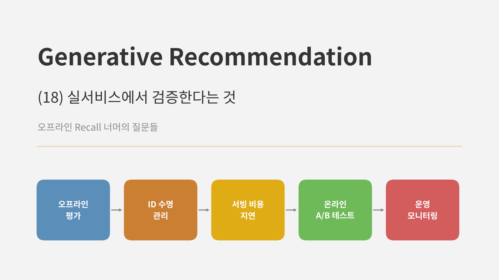
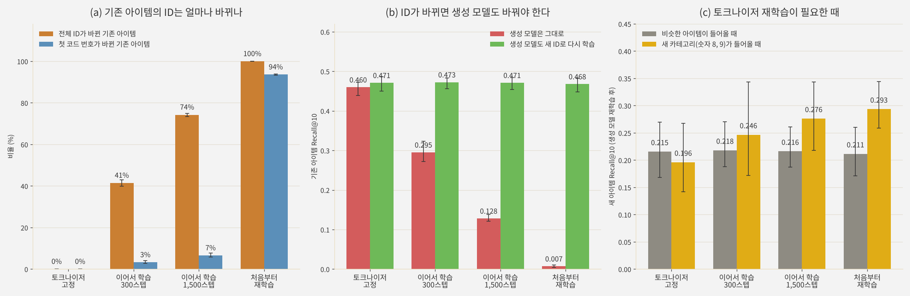

<br>{: .align-center}<br>

### _"오프라인에서 이긴 모델은 서비스에서도 이길까?"_

연재의 마지막 글입니다. 지난 17편 동안 Semantic ID를 만들고, 생성 모델을 붙이고, 여러 모델을 같은 합성 세계에서 비교했습니다. 하지만 지금까지의 실험은 모두 **고정된 카탈로그, 고정된 로그, 오프라인 Recall** 위에서 이뤄졌습니다.

실서비스는 그렇지 않습니다. 아이템은 매일 들어오고, 로그는 기존 추천이 보여 준 것만 담고 있으며, 디코딩 지연과 GPU 비용에는 예산이 있고, 최종 판단은 A/B 테스트가 내립니다. 이번 글에서는 공개된 산업 사례들이 생성형 추천을 어떻게 검증했는지 보고, 그중 이 연재의 주제와 가장 가까운 질문인 **"새 아이템이 들어올 때 Semantic ID를 어떻게 관리할까"**를 직접 실험합니다. 마지막으로 A/B 테스트와 운영에서 무엇을 봐야 하는지 정리하며 연재를 마무리하겠습니다.

---

## 1. 오프라인 지표가 말해 주지 않는 것

오프라인 Recall이 쓸모없다는 뜻은 아닙니다. 이 연재의 결론 대부분도 오프라인 비교에서 나왔습니다. 다만 실서비스로 가는 길에는 오프라인 지표가 보지 못하는 질문이 적어도 네 가지 있습니다.

* **로그는 기존 시스템이 보여 준 것만 담습니다.** 오프라인 평가의 정답은 과거에 노출되고 클릭된 아이템입니다. 기존 추천이 보여 주지 않은 아이템은 좋은 추천이어도 정답이 될 기회가 없습니다. 새 모델이 다른 아이템을 추천할수록 오프라인 점수는 불리해질 수 있습니다.
* **카탈로그는 계속 바뀝니다.** 새 아이템이 들어오면 ID를 붙여야 하고, 토크나이저를 다시 학습하면 기존 아이템의 ID까지 바뀔 수 있습니다. 고정된 데이터의 오프라인 실험에서는 드러나지 않는 문제입니다.
* **비용과 지연에는 예산이 있습니다.** 빔 서치 디코딩은 벡터 검색보다 비싸고, 생성 모델이 클수록 비용이 커집니다([9편](), [16편]()).
* **지표끼리 서로 밀고 당깁니다.** 클릭이 늘어도 새 아이템 노출이나 다양성이 줄 수 있고, 그 반대도 있습니다. 오프라인 Recall 하나로는 이 교환을 볼 수 없습니다.

---

## 2. 공개된 산업 사례는 어떻게 검증했나

생성형 추천을 실서비스에 붙인 결과를 공개한 사례를 모아 보면 다음과 같습니다.

| 사례 | 생성형 추천의 역할 | 공개된 결과 |
|---|---|---|
| YouTube 랭킹의 Semantic ID (Singh et al., RecSys 2024) | 랭킹 모델의 무작위 해시 영상 ID를 Semantic ID 기반 임베딩으로 교체 | 무작위 해시보다 성능이 좋았고, 새 영상에서도 일반화가 좋았음 |
| YouTube STATIC (Su et al., KDD 2026) | "최근 7일 이내" 제약을 건 생성형 후보 생성기를 **후보원 하나로 추가** | 7일 이내 영상 조회 +5.1%, 3일 이내 +2.9%, CTR +0.15% |
| Kuaishou OneRec (2025) | 후보 생성부터 랭킹까지의 다단계 파이프라인을 생성 모델 하나로 대체 | 전체 트래픽의 25%를 처리, 앱 체류 시간 +0.54%(Kuaishou), +1.24%(Kuaishou Lite) |
| Meta HSTU (Zhai et al., ICML 2024) | 사용자 행동 자체를 토큰으로 보는 생성형 추천 모델 (Semantic ID 방식은 아님) | 온라인 A/B 테스트에서 지표 12.4% 개선, 여러 서비스에 배포 |

이 사례들에서 반복되는 패턴이 세 가지 있습니다.

**한 번에 갈아엎지 않습니다.** STATIC은 기존 후보 생성기들 옆에 생성형 후보원 하나를 더했고, OneRec도 전체 트래픽의 25%를 맡는 형태로 배포됐습니다. 기존 시스템과 나란히 두고 비교할 수 있어야 문제가 생겼을 때 원인을 좁힐 수 있고, 되돌리기도 쉽습니다.

**비용을 성능과 함께 보고합니다.** OneRec은 학습과 추론의 하드웨어 사용 효율(MFU)이 각각 23.7%, 28.8%로 기존 랭킹 모델(4.6%, 11.2%)보다 높았고, 운영 비용이 기존 다단계 파이프라인의 10.6%였다고 보고했습니다. 생성형 추천의 실서비스 논리는 "더 정확하다"만이 아니라 "같은 비용으로 더 많이" 또는 "더 적은 비용으로 같게"인 경우가 많습니다.

**개선 폭은 작아 보이지만 규모가 큽니다.** CTR +0.15%, 체류 시간 +0.54%는 숫자만 보면 작습니다. 수억 명 규모에서는 큰 의미가 있고, 그 정도 트래픽이 있어야 통계적으로 확인할 수 있는 크기이기도 합니다. 이 점은 4절에서 다시 다룹니다.

YouTube의 Semantic ID 논문에는 이번 글의 실험과 직결되는 설계 결정도 하나 있습니다. 저자들은 RQ-VAE를 **한 번 학습한 뒤 고정**하고, 새로 올라오는 영상에는 고정된 인코더로 ID를 붙였습니다. 최신 데이터에 RQ-VAE의 학습 분포에 없던 영상이 섞일 수 있다는 위험을 인정하면서도, 6개월 간격의 데이터로 학습한 두 RQ-VAE가 다운스트림 성능에서 비슷했다는 실험을 근거로 Semantic ID 공간이 시간이 지나도 안정적이라고 결론 내렸습니다.

---

## 3. 직접 실험: 새 아이템이 들어올 때 ID를 어떻게 할까

### 3.1 실험 설계

새 아이템이 들어왔을 때 Semantic ID를 붙이는 방법은 크게 세 가지입니다.

* **토크나이저 고정:** 기존 RQ-VAE로 새 아이템을 인코딩합니다. 기존 아이템의 ID는 바뀌지 않고, 새 아이템은 같은 코드 버킷의 다음 빈 충돌 번호를 받습니다. YouTube의 방식입니다.
* **이어서 학습:** 기존 RQ-VAE를 새 아이템까지 포함한 데이터로 조금 더 학습합니다(300스텝, 1,500스텝).
* **처음부터 재학습:** 전체 아이템으로 RQ-VAE를 새로 학습합니다.

[17편]()의 손글씨 숫자 세계에서 시점을 둘로 나눴습니다.

* **0시점:** 카탈로그 A만 있습니다. A로 RQ-VAE(17편에서 가장 좋았던 예열 + k-means + 재초기화, 3단계 x 코드 16개)를 학습하고, A 안에서 일어난 세션 4,000개로 생성 모델을 학습합니다.
* **1시점:** 새 아이템 B가 들어오고, A와 B를 아우르는 새 세션 1,500개가 쌓입니다.

생성 모델은 연재에서 써 온 개수 기반 Semantic ID 모델이고, 이전 아이템의 ID로 다음 아이템의 ID를 생성합니다. 새 ID 체계를 적용한 뒤 생성 모델을 **그대로 둘 때**와 **새 ID로 다시 학습할 때**를 나눠 비교했습니다. 평가는 1시점의 테스트 세션에서 전체 아이템 중 Recall@10을, 정답이 기존 아이템(A)인 경우와 새 아이템(B)인 경우로 나눠 쟀습니다. 새 아이템의 종류는 두 경우로 나눴습니다.

* **비슷한 아이템이 들어올 때:** 전체의 30%를 무작위로 골라 B로 둡니다. 새 아이템이 기존 아이템과 같은 분포에서 옵니다.
* **새 카테고리가 들어올 때:** 숫자 8과 9를 B로 둡니다. 0시점의 토크나이저는 이런 모양을 한 번도 본 적이 없습니다.

### 3.2 결과

<br>{: .align-center}<br>

**토크나이저를 조금이라도 다시 학습하면 기존 ID가 크게 바뀝니다.** (a)는 비슷한 아이템이 들어오는 경우입니다. 처음부터 재학습하면 기존 아이템의 ID가 전부, 첫 코드 번호도 94%가 바뀌었습니다. 군집 자체가 비슷하더라도 코드 번호는 학습할 때마다 새로 붙기 때문입니다. 이어서 학습하는 경우는 첫 코드가 3~7%만 바뀌었지만, 뒤쪽 코드까지 포함한 전체 ID는 300스텝만에 41%, 1,500스텝에 74%가 바뀌었습니다.

**ID가 바뀌면 생성 모델도 함께 바꿔야 합니다.** (b)에서 생성 모델을 그대로 둔 채 새 ID를 적용하면, 기존 아이템 Recall@10이 이어서 학습 300스텝에서 0.295, 1,500스텝에서 0.128, 재학습에서는 0.007로 사실상 무너졌습니다. 생성 모델이 외운 것은 아이템이 아니라 **ID 토큰의 패턴**이기 때문입니다. 반대로 생성 모델을 새 ID로 다시 학습하면 네 방식 모두 0.47 수준으로 같았습니다.

**비슷한 아이템이 들어올 때는 토크나이저를 고정해도 충분했습니다.** (c)의 회색 막대처럼 새 아이템의 Recall@10은 고정 0.215, 재학습 0.211로 차이가 없었습니다. 고정은 기존 ID를 하나도 바꾸지 않으니, 이 경우에는 고정이 공짜로 같은 성능을 냅니다. YouTube의 결정과 같은 결론입니다.

**새 카테고리가 들어오면 재학습이 필요했습니다.** 노란 막대처럼 숫자 8과 9가 들어오자 고정 토크나이저의 새 아이템 Recall@10은 0.196이었고, 재학습은 0.293으로 약 1.5배였습니다. 이어서 학습도 1,500스텝이면 0.276까지 올라왔습니다. 세 시드 모두에서 재학습이 고정보다 높았지만, 한 시드에서는 차이가 작았습니다(0.278 대 0.268). 고정 토크나이저는 본 적 없는 모양을 기존 코드에 억지로 끼워 넣어서, 새 아이템 중 다른 아이템과 ID가 겹친 비율이 75%로 재학습(58%)보다 높았습니다.

참고로 생성 모델을 그대로 두면 토크나이저를 고정해도 새 아이템의 Recall은 0이었습니다. 이 실험의 개수 기반 모델은 학습 로그에서 본 적 없는 아이템을 정답 쪽으로 거의 올리지 못하기 때문입니다. 콘텐츠 ID를 쓰는 신경망 생성 모델은 [6편]()에서 봤듯이 어느 정도 일반화하지만, 새 로그를 반영해 생성 모델을 갱신해야 한다는 점은 같습니다.

### 3.3 실무로 옮기면

* **ID 체계와 생성 모델은 한 묶음으로 배포합니다.** 토크나이저를 바꾸면 ID 표, 생성 모델, 제약 디코딩의 접두사 트리를 같은 버전으로 함께 바꿔야 합니다. 하나만 바뀌면 (b)의 빨간 막대처럼 조용히 무너집니다.
* **기본은 고정, 재학습은 분포가 바뀔 때입니다.** 새 아이템이 기존과 비슷하면 토크나이저를 고정하고 새 아이템만 인코딩하는 편이 안전합니다. 새 카테고리가 생기거나 새 아이템의 충돌 비율이 오르기 시작하면, 토크나이저와 생성 모델을 함께 재학습할 시점입니다.
* **"이어서 학습"은 생각보다 안전하지 않습니다.** 첫 코드는 대부분 유지되지만 전체 ID는 절반 가까이 바뀝니다. 생성 모델을 함께 갱신하지 않을 거라면 이어서 학습도 하지 않는 편이 낫습니다.

---

## 4. A/B 테스트: 얼마나 큰 차이를 볼 수 있나

### 4.1 필요한 트래픽부터 계산합니다

온라인 실험을 설계할 때 가장 먼저 할 일은 **우리 트래픽으로 볼 수 있는 효과의 크기**를 계산하는 것입니다. 클릭률처럼 비율로 재는 지표를 양측 검정(유의수준 5%, 검정력 80%)으로 비교할 때, 그룹당 필요한 사용자 수는 다음과 같습니다.

| 기존 클릭률 | 상대 개선 0.5% | 1% | 2% | 5% |
|---|---|---|---|---|
| 2% | 3,084만 | 773만 | 194만 | 32만 |
| 5% | 1,196만 | 300만 | 75만 | 12만 |
| 10% | 566만 | 142만 | 36만 | 6만 |

클릭률이 5%인 서비스에서 1% 상대 개선을 확인하려면 그룹당 300만 명이 필요합니다. 2절의 CTR +0.15% 같은 결과는 그보다 훨씬 큰 트래픽에서만 확인할 수 있는 크기입니다. 트래픽이 크지 않은 서비스라면 몇 가지를 고려할 수 있습니다.

* **효과가 큰 지표를 주 지표로 고릅니다.** 생성형 추천이 실제로 바꾸는 것은 전체 클릭률보다 새 아이템 노출 비율이나 롱테일 커버리지인 경우가 많습니다. STATIC도 주 지표를 "최근 7일 이내 영상 조회"로 잡아 +5.1%를 확인했습니다.
* **실험 기간을 늘리거나, 인터리빙을 씁니다.** 두 모델의 추천을 한 목록에 섞어 보여 주고 어느 쪽 아이템이 선택되는지 보는 인터리빙은, 검색 분야에서 A/B 테스트보다 훨씬 적은 트래픽으로 두 랭킹의 우열을 가릴 수 있다고 보고됐습니다.
* **오프라인에서 확신이 큰 변경만 온라인에 올립니다.** 트래픽이 귀한 서비스일수록 오프라인 평가에서 새 아이템, 롱테일, 다양성까지 미리 걸러 두는 것이 중요합니다.

### 4.2 가드레일 지표를 함께 봅니다

주 지표가 좋아져도 다른 곳이 망가지면 배포할 수 없습니다. 생성형 추천에서 특히 함께 봐야 할 지표는 이 연재에서 다룬 실패 모드와 겹칩니다.

| 가드레일 | 왜 보나 | 관련 편 |
|---|---|---|
| 디코딩 지연 (p99) | 빔 서치는 벡터 검색보다 느리고, 제약이 붙으면 더 느려질 수 있음 | 9편, 16편 |
| 존재하지 않는 ID, 제약 위반 비율 | 생성 출력에만 있는 실패 모드 | 16편 |
| 새 아이템 노출 비율과 성능 | 협업 신호에 기운 ID는 새 아이템을 거의 추천하지 않음 | 5편, 14편, 15편 |
| 인기 쏠림과 다양성 | 생성 모델이 흔한 ID 패턴만 반복할 수 있음 | 9편, 17편 |
| 추천 목록 길이 | 사후 필터를 쓰면 목록이 비어 나올 수 있음 | 16편 |

새로운 추천은 처음 며칠 동안 신기해서 클릭이 늘었다가 줄어드는 경우도 있으니, 실험 기간은 이런 초반 효과가 가라앉을 만큼 길게 잡는 편이 좋습니다.

---

## 5. 운영에서 지켜볼 것

배포한 뒤에도 생성형 추천은 기존 추천과 다른 지점에서 조용히 나빠질 수 있습니다. 이 연재의 실험에서 나온 지표들을 운영 대시보드로 옮기면 다음과 같습니다.

* **ID 버전 일치:** 서빙 중인 ID 표, 생성 모델, 접두사 트리가 같은 버전인지 확인합니다. 3절의 실험처럼 하나만 어긋나도 성능이 무너집니다.
* **새 아이템의 충돌 비율:** 고정 토크나이저로 새 아이템을 인코딩하면서, 새 아이템 중 기존 ID와 겹치는 비율을 봅니다. 이 비율이 오르면 새 아이템이 기존 코드 공간에 잘 맞지 않는다는 신호이고, 재학습을 검토할 때입니다.
* **코드 사용 분포:** 단계별 쓰인 코드 수, 퍼플렉시티, 중간 단계의 쏠림을 재학습 때마다 기록합니다(17편).
* **생성 출력의 건강도:** 존재하지 않는 ID 비율, 제약 위반, 빔 안에서 같은 접두사로 몰리는 정도를 봅니다(16편).
* **새 아이템과 기존 아이템을 나눈 성능:** 전체 지표 하나로는 [15편]()의 그림에서 주황색(협업 ID)과 초록색(두 흐름)을 구분할 수 없습니다.

---

## 6. 연재를 마치며

18편 동안 다룬 내용을 한 표로 정리하면 다음과 같습니다.

| 편 | 주제 | 한 줄 요약 |
|---|---|---|
| 1~4 | 오토인코더, VQ-VAE, RQ-VAE | 아이템 표현을 압축하고, 이산 코드로 바꾸고, 여러 단계로 쌓아 Semantic ID를 만든다 |
| 5~6 | 좋은 Semantic ID, DSI와 TIGER | ID에 무엇을 담느냐가 새 아이템을 다룰 수 있는지를 정한다 |
| 7~14 | LETTER, TokenRec, LC-Rec, EAGER, EAGER-LLM | 콘텐츠와 협업 신호를 합치는 위치가 모델마다 다르다 |
| 15 | 세대별 모델 비교 | 두 신호를 각자의 ID로 두고 출력에서 합친 방식만 양쪽 장점을 얻었다 |
| 16 | 제약 디코딩 | 같은 장치로 유효성, 비즈니스 조건, 새 아이템 노출을 다룬다 |
| 17 | 코드북 붕괴 | 붕괴는 복원 오차에는 작게, ID와 추천에는 크게 흔적을 남긴다 |
| 18 | 실서비스 검증 | ID 체계와 생성 모델은 한 묶음이고, 검증은 트래픽 계산에서 시작한다 |

연재를 시작할 때의 질문은 "아이템을 토큰처럼 생성할 수 있다면 추천은 어떻게 달라질까"였습니다. 직접 실험해 보며 얻은 답을 세 가지로 줄이면 다음과 같습니다.

* **ID 설계가 생성 모델보다 먼저입니다.** 대부분의 개선과 실패가 ID에서 나왔습니다. 무엇을 양자화하고, 어떻게 양자화하고, 두 신호를 어디서 합치는지가 생성 모델의 크기보다 결과를 더 크게 갈랐습니다.
* **새 아이템은 따로 봐야 합니다.** 전체 지표에서 앞서는 설계가 새 아이템에서는 우연 수준인 경우가 반복해서 나왔습니다. 평가도, 디코딩도, ID 관리도 새 아이템을 별도의 축으로 다뤄야 합니다.
* **작은 실험은 방향을 알려 주지만, 결론은 서비스가 냅니다.** 이 연재의 실험은 일부러 작고 단순하게 만든 합성 세계였습니다. 그래서 현상의 원인을 하나씩 떼어 볼 수 있었지만, 실제 숫자는 각자의 데이터와 트래픽에서 다시 확인해야 합니다.

긴 연재를 끝까지 읽어 주셔서 감사합니다.

---

## 부록: 실서비스 검증 핵심 코드

### Point 1. 고정 토크나이저로 새 아이템에 ID 붙이기

기존 아이템의 ID는 그대로 두고, 새 아이템만 인코딩해 같은 버킷의 다음 빈 충돌 번호를 줍니다. 4편 부록의 `ResidualQuantizer`와 인코더를 그대로 씁니다.

```python
import torch
from collections import defaultdict

@torch.no_grad()
def assign_new_items(encoder, quantizer, x_new, id_table):
    """id_table: {item_id: (c1, c2, c3, suffix)} 기존 ID 표, x_new: {item_id: 특징 텐서}"""
    used = defaultdict(set)
    for code in id_table.values():
        used[code[:-1]].add(code[-1])
    new_ids = {}
    for item, x in x_new.items():
        _, codes, _ = quantizer(encoder(x[None]))
        prefix = tuple(codes[0].tolist())
        s = 0
        while s in used[prefix]:                    # 같은 버킷의 다음 빈 번호
            s += 1
        used[prefix].add(s)
        new_ids[item] = prefix + (s,)
    return {**id_table, **new_ids}
```

### Point 2. 토크나이저를 바꾸기 전에 ID 변화량 재기

새 토크나이저 후보가 기존 아이템의 ID를 얼마나 바꾸는지 먼저 잽니다. 전체 ID가 바뀐 비율이 0보다 크면, 생성 모델도 함께 재학습해야 합니다.

```python
from sklearn.metrics import adjusted_rand_score

def id_churn(old, new, items):
    """old, new: {item_id: ID 튜플}, items: 비교할 기존 아이템 목록"""
    full = sum(old[i] != new[i] for i in items) / len(items)
    first = sum(old[i][0] != new[i][0] for i in items) / len(items)
    ari = adjusted_rand_score([old[i][0] for i in items], [new[i][0] for i in items])
    return dict(full_changed=full, first_code_changed=first, first_level_ari=ari)
```

첫 코드 번호가 바뀐 비율과, 번호와 상관없이 군집이 얼마나 같은지 보는 조정 랜드 지수(ARI)를 함께 보면 "군집은 비슷한데 번호만 바뀐" 경우를 구분할 수 있습니다.

### Point 3. A/B 테스트에 필요한 사용자 수

4.1절의 표를 만든 계산입니다. 비율 지표를 양측 검정으로 비교할 때 그룹당 필요한 사용자 수입니다.

```python
from scipy.stats import norm

def users_per_arm(p, relative_lift, alpha=0.05, power=0.8):
    p2 = p * (1 + relative_lift)
    z = norm.ppf(1 - alpha / 2) + norm.ppf(power)
    return z ** 2 * (p * (1 - p) + p2 * (1 - p2)) / (p2 - p) ** 2

print(f"{users_per_arm(0.05, 0.01):,.0f}")          # 클릭률 5%, 상대 1% 개선 -> 약 300만 명
```

---

## 참고 문헌

* Singh et al., *Better Generalization with Semantic IDs: A Case Study in Ranking for Recommendations*, RecSys 2024. [arXiv:2306.08121](https://arxiv.org/abs/2306.08121)
* Su et al., *Vectorizing the Trie: Efficient Constrained Decoding for LLM-based Generative Retrieval on Accelerators* (STATIC), KDD 2026. [arXiv:2602.22647](https://arxiv.org/abs/2602.22647)
* Kuaishou OneRec Team, *OneRec Technical Report*, 2025. [arXiv:2506.13695](https://arxiv.org/abs/2506.13695)
* Zhai et al., *Actions Speak Louder than Words: Trillion-Parameter Sequential Transducers for Generative Recommendations* (HSTU), ICML 2024. [arXiv:2402.17152](https://arxiv.org/abs/2402.17152)
* Chapelle et al., *Large-Scale Validation and Analysis of Interleaved Search Evaluation*, ACM TOIS 2012.
* Rajput et al., *Recommender Systems with Generative Retrieval* (TIGER), NeurIPS 2023. [arXiv:2305.05065](https://arxiv.org/abs/2305.05065)
